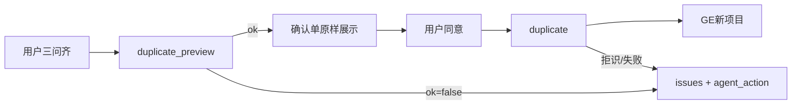

# Governance Assistant · project-duplicate（复制项目）

- **文档类型**：产品共识 + 体验规格 + **实现/测试规格**
- **版本**：**v0.1.9**（2026-08-01 · **已签收**：PD-M1～M4；层 C Mac + **生产 Chrome PASS**；PD-M4 `agent_action` 生产抽样通过）
- **里程碑**：**BO-M-PD**（Project Duplicate）
- **状态**：**已签收 · 生产可用**（BFF / OpenAPI **0.1.1** / Skill **0.1.1** / plugin **≥0.20.1** · [PD-PLAN-signoff](./hermes-profiles/governance-assistant/PD-PLAN-signoff.md)）
- **适用对象**：产品、GA / Hermes / skstudio 研发、QA

**上位 / 关联**

| 文档 | 关系 |
| ---- | ---- |
| [Governance-Assistant产品设计.md](./Governance-Assistant产品设计.md) | 管域 Copilot 总册 |
| [Governance-Assistant-project-create迭代.md](./Governance-Assistant-project-create迭代.md) | **对照能力**：全新建（create）；本能力不复用其共商长链；**fingerprint / commit / `next_action` 纪律对齐 PC** |
| [hermes-profiles/governance-assistant/SOUL.md](./hermes-profiles/governance-assistant/SOUL.md) | 瘦路由（含复制闭环 · 听 `agent_action`） |
| [hermes-profiles/governance-assistant/skills/governance/project-duplicate/SKILL.md](./hermes-profiles/governance-assistant/skills/governance/project-duplicate/SKILL.md) | **Agent 规程 · 0.1.1**（听 tool，不枚举失败剧本） |
| [openapi/ga-bo-m-pc-duplicate.openapi.yaml](./openapi/ga-bo-m-pc-duplicate.openapi.yaml) | preview + duplicate **0.1.1** |
| [hermes-profiles/governance-assistant/PD-PLAN-signoff.md](./hermes-profiles/governance-assistant/PD-PLAN-signoff.md) | 签收清单 |
| [hermes-profiles/governance-assistant/README.md](./hermes-profiles/governance-assistant/README.md) | profile 总览 |

## 0.1 DOC-SYNC（跨文档对齐表 · v0.1.9）

| 工件 | 版本 / 状态 | 与本迭代 |
| ---- | ----------- | -------- |
| 本迭代 | **v0.1.9** | 真源 · 已签收（含生产 Chrome） |
| Skill `project-duplicate` | **0.1.1** | ✅ 听顶层 `agent_action` |
| SOUL 路由 | 复制闭环 + agent_action | ✅ |
| OpenAPI pc-duplicate | **0.1.1** | ✅ |
| BFF | preview/duplicate + `agent_action`；业务拒 200 | ✅ |
| Plan store | 复用 `GaProjectCreatePlan`（duplicate_id=plan_id） | ✅ |
| plugin `skstudio-governance` | **≥0.20.1** | ✅ |
| AAP 入口 | 四键含「复制项目」 | ✅ |
| 签收 / 冒烟 | PD-ACT-* ✅；静态+Mac+**生产** Chrome PASS | [PD-PLAN-signoff](./hermes-profiles/governance-assistant/PD-PLAN-signoff.md) 已签 |

---

## 0. 共识冻结清单

| # | 共识 |
| - | ---- |
| D1 | 能力形态 = **Hermes skill**；名 **`project-duplicate`**；与 **`project-create` 分流**，不塞进 create，不复活 `enrich_shell` |
| D2 | 用户只共商 **三问**：源项目名、新项目名、新项目经理 |
| D3 | 源项目定位 **只用项目名**；禁止向用户索 uuid / 深链 |
| D4 | 父专项 **默认跟源**；确认单用 **专项名** 提一句「与源相同」（不展示 id）；不共商换专项 |
| D5 | 复制阶段 / 门控 / 任务等**结构**（含计划窗）；**不复制**运行态、签收历史、评论 |
| D6 | **不复制**源任务负责人；落库时 **全部任务**（含启动签收）owner = **新 PM**；后续由 PM 在执行力改派 |
| D7 | 双 tool 防飘：`governance_project_duplicate_preview` + `governance_project_duplicate`；落库 **仅** fingerprint + 同意 |
| D8 | 确认单由 **preview 服务端**生成（`confirmation_markdown`）；Agent **原样展示**，禁止重写结构表 |
| D9 | MVP **禁止**在 duplicate 流程内改结构；要改 → create 或 GE 执行力 |
| D10 | 完成须贴 **一行纯文本** `deep_link`（纪律对齐 create / C62） |
| D11 | **项目名全局唯一**：平台不支持同名项目；源解析与新名校验均按此假设（见 §3.5） |
| D12 | **克隆执行模型**：读源业务图 → 映射为与 create **同构内部 Plan** → **复用 create 边界/建图执行器**（系统起止、结项复盘等由执行器重建；非带运行态深拷贝） |
| D13 | **写权**：`preview` 与 `duplicate` **均要求**调用方对目标父专项具备建项写权（及可读源图）；无写权不得出可同意的确认单 |
| D14 | **fingerprint 纪律对齐 PC**：preview 固化意图并签发；duplicate 只验 fingerprint（+ id）；改三问须重新 preview（见 §4.3） |
| D15 | **MVP 不做 notify**（`notify.enabled=false` / 不跑欢迎通知步骤） |
| D16 | 确认单粒度：数量摘要 + **阶段名短列表**；不出全任务表 |
| D17 | 「同意」等价：`同意` / `确认` / `可以` / `没问题` / `OK`（及明显同义）；skill 承认后可调 duplicate |
| D18 | **duplicate 入参对齐 PC commit**：`duplicate_id` + `fingerprint` + `user_confirmed=true` **均必填**（不仅 fingerprint） |
| D19 | **名占用 / 源命中**：仅统计 **未软删** 项目（`deleted_at IS NULL`）；软删名可复用为新名 |
| D20 | **排期预检**：映射后的业务阶段窗 **同 create** 跑专项周期预检；不合格 → preview `ok=false` + issues，不落库、不自动平移日期 |
| D21 | **失败真源在 tool，不在 Skill**：preview/duplicate **自行判定**全部失败情形，并以结构化回执告诉 Agent **说什么 / 问什么 / 停或重试**；Skill **禁止**枚举失败剧本表。契约见 §2.3 / §4.4（对齐 create 的 `next_action` 思路，字段名用 PD 的 `agent_action`） |
| D22 | **开工前六条（2026-08-01 拍板）**：① 顶层必填 `agent_action`，多 issue 合成优先级 `stop`>`ask_user`>`retry_preview`>`show_only`，Agent **只听顶层**；② `retry_preview` **禁止自动连打**，展示后等用户确认/改三问再 preview；③ 排期类统一 `stop`（`show_only` 仅 `failed_partial`）；④ duplicate 业务拒识与 preview 同形 **200+`ok=false`+issues**（鉴权类仍 401/403）；⑤ 字段名坚持 `agent_action`（不引入 create 的 `owner`/`fix_schema`）；⑥ M4 同发 = BFF 填充 + OpenAPI **0.1.1** + Skill **0.1.1** + PD-ACT 单测，不扩产品语义 |

> **产品讨论状态（v0.1.9）**：D1–D22 已钉死并落地 **PD-M4**；**已签收**；**无待议产品题**。人话与处理要求由 tool `message` / 顶层 `agent_action` / `ask` / `hint` 下发。

---

## 1. 产品定位

| | project-create | project-duplicate |
| -- | -------------- | ----------------- |
| 意图 | **新建**执行图：从零共商结构 | **复制**已有项目：只换身份信息 |
| 结构从哪来 | 用户共商 + Agent 组 Plan | **服务端读源项目图** |
| Tool | `governance_project_plan_validate` + `_commit` | `governance_project_duplicate_preview` + `governance_project_duplicate` |
| 用户负担 | 阶段 / 门 / 任务 / 衔接 / 结项等 | **源项目名 + 新名 + 新 PM** |
| 改结构 | 本 skill 职责 | **禁止**（引导 create 或执行力） |

- SOUL 只做触发路由；Skill 只保留主路径红线；**确认单、失败引导、落库意图均以 BFF/tool 回执为真源**（D8 / D21）。
- 与已废弃的「补空壳 / enrich_shell」不同：duplicate 从**完整源项目**克隆结构，不是往系统空壳里填。

---

## 2. 用户体验过程

```text
用户开口「复制项目 / 按某某再做一个」
  → 齐三问：源项目名 · 新项目名 · 新 PM（「还是我」→ 当前发送者）
  → preview → 原样展示确认单
  → 用户「同意」（或 D17 等价词）
  → duplicate 落库
  → 简述成功 + 一行纯文本深链
  → （之后）PM 在执行力改派任务负责人
```

### 2.1 对话必齐 / 不问

| 必齐 | 不问（MVP） |
| ---- | ----------- |
| 源项目名 | 怎么改阶段 / 门 / 任务 |
| 新项目名 | 逐任务谁负责 |
| 新项目经理 | 专项挂哪（默默跟源） |
| | 项目 uuid、深链 |

### 2.2 确认单内容（服务端生成，须含 · D16）

- 源项目名、新项目名、新 PM
- 将复制：**N 阶段 / M 门控 / K 任务** + **阶段名短列表**（不出全任务表）
- 任务负责人：全部先设为新 PM，后续由 PM 在执行力改派
- **所属专项：与源项目相同**（展示专项名，不展示 id）
- 提示：回复「同意」后将调用 **duplicate** 执行复制
- MVP **不**承诺发送通知（D15）

### 2.3 失败与引导（normative · D21）

**原则**：失败情形由 **BFF/tool 穷尽处理**；LLM **不背失败表**。对用户可见文案以回执 `message`（及可选 `hint`）为准；Agent 只执行 `agent_action`。

#### 2.3.1 回执形状（preview `ok=false` 与 duplicate 拒识 / 硬失败）

```text
ok: false
agent_action: stop | ask_user | retry_preview | show_only   # 顶层必填；Agent 只听此字段（D22①）
guidance_message?: string                                   # 可选；合成/首条人话，便于直接贴
issues[]: {
  code,                 # 机读稳定码（日志/测；不对用户朗读码名）
  message,              # 情况解释（可直接展示或略润色，禁止改事实）
  agent_action,         # 单条建议（合成顶层时用）
  ask?,                 # 缺输入时：source_name | name | pm_username
  hint?,                # 一句处理要求（如「请换新项目名后再预览」）
  path?                 # 可选 JSON path
}
```

**多 issue 合成（D22①）**：顶层 `agent_action` = 各 issue 中优先级最高者：`stop` > `ask_user` > `retry_preview` > `show_only`。

| `agent_action` | Agent 必须 |
| -------------- | ---------- |
| **`show_only`** | 展示 `guidance_message` 或 issues 的 `message`（+`hint`）；**不**再调 preview/duplicate；可一句收尾。**仅**用于 `failed_partial` 等「已有结果须说明」 |
| **`ask_user`** | 展示 message；按 `ask` **只补问**对应字段；用户补齐前 **禁止**再 preview/duplicate |
| **`retry_preview`** | 展示 message + hint；**禁止自动连打 preview**（D22②）；等用户确认或改三问后再调；禁止拿旧 fingerprint 调 duplicate |
| **`stop`** | 展示 message；**停流程**；禁止降级 create / 索 uuid / 半套落库 |

成功路径：`ok=true` → 原样贴 `confirmation_markdown`（不变）。  
`failed_partial`：`ok` 语义随 create；须贴 `deep_link` + 说明；顶层 `agent_action=show_only`（D22③）。  
**HTTP（D22④）**：preview 与 duplicate **业务**失败 → **200** + 上形；仅鉴权/缺服务 token 等 → 401/403。

#### 2.3.2 失败目录（实现填充 `code`→人话/`agent_action`；**不下沉 Skill**）

| 阶段 | code（现网或对齐名） | 建议 `agent_action` | `ask` |
| ---- | -------------------- | ------------------- | ----- |
| 三问 | （未调 tool）Skill 红线：缺问则不问 tool | — | 缺哪问哪 |
| Preview | `source_not_found` | `ask_user` | `source_name` |
| Preview | `source_name_ambiguous` | `ask_user` | `source_name` |
| Preview | `new_name_same_as_source` / `project_name_taken` / `name_required` | `ask_user` | `name` |
| Preview | `username_unresolvable` | `ask_user` | `pm_username` |
| Preview | `project_forbidden` / `program_create_forbidden` / 写权类 | `stop` | — |
| Preview | `program_missing` / program_ref 失败 | `stop` | — |
| Preview | `unmappable_graph` / 映射 harness 失败 | `stop` | — |
| Preview | `phase_outside_program_period` / `schedule_precheck_failed` | **`stop`**（D22③；不自动改日期） | — |
| Duplicate | `need_user_confirm` / 缺 id·fp | `retry_preview` | — |
| Duplicate | `plan_fingerprint_mismatch` / `plan_not_found`（含 TTL） | `retry_preview` | — |
| Duplicate | `plan_forbidden` / 写权丢失 | `stop` | — |
| Duplicate | 执行器硬失败 | `stop` | — |
| Duplicate | `failed_partial` | **`show_only`**（必贴深链 · D22③） | — |

**不做**：向用户朗读内部码；索 uuid；Skill 内复制上表为长剧本。  
**注（D11）**：正常无「多名歧义」；若脏数据同名 → `source_name_ambiguous`，**不猜测**。

---

## 3. 复制语义（normative）

### 3.1 用户提供（不复制）

- 源项目：仅 `source_ref.name`（项目名）
- 新项目 `name`（须全局未被占用）
- `pm_username`（完整登录名；实现时可复用 create 的 C64 sender 短名别名）

### 3.2 从源复制

- 阶段、门控、任务（标题与图关系：产出 / 衔接 / 结项入口等）、计划窗等结构字段
- 父专项默认跟源（不共商更换）
- 新项目为干净执行图

### 3.3 不复制

- 完成态、签收历史、评论等运行态
- 源任务上的负责人（任何人）
- 源成员列表的「原班人马」（新图成员随新 PM / 任务 assignee 建立即可）
- 通知 / 欢迎类副作用（MVP · D15）

### 3.4 负责人（落库规则）

- 全部任务（含系统启动签收）的 owner / `assignee` = **新项目经理**
- 不追求空 assignee（GE 要求非空 `assignee_user_id`）
- **禁止**静默保留源项目他人 username

### 3.5 项目名全局唯一（D11）

- 平台约束：**不支持**全局同名项目。
- **源解析**：按精确项目名查找 → 0 或 1；多行同名视为数据错误，preview 失败。
- **新名**：preview 即检查未被占用；与源同名亦拒绝（必须新名字）。

### 3.6 克隆执行模型（D12）

```text
读源项目业务图（可读 + 目标专项可写）
  → 映射为内部 Plan（mode 可内部标记 duplicate；形状对齐 create）
  → 套 overrides：新 name、新 pm；全部任务 owner=新 PM；program=源专项；notify=false
  → 系统开始/结束/结项复盘等由 create 执行器按 boundary 重建
  → duplicate 落库时复用 create commit 建图步骤（或共享执行器）
```

**不是**：把源项目含运行态节点做字节级深拷贝。

---

## 4. 双 tool 契约（防飘）

确认单「不飘」靠契约，不靠模型自觉：

1. 内容由 **preview** 生成并返回 `confirmation_markdown`
2. **duplicate** 入参不再包含源名 / 新名 / PM，只能按 preview 固化的 fingerprint 落库

### 4.1 `governance_project_duplicate_preview`

| | |
| -- | -- |
| **入参** | `source_ref: { name }`、`name`（新项目名）、`pm_username` |
| **前置** | 调用方对父专项（跟源）**有建项写权**；源项目可读（D13） |
| **行为** | 按名解析源（D11）→ 校验写权 / 可读 / 新名未占用 / PM 可解析 → 映射 Plan 并固化 |
| **回执** | `ok` / `issues[]`（含 §2.3.1 字段）/ `confirmation_markdown` / `fingerprint` / `duplicate_id`；`ok=false` 时须带可执行的 `agent_action` |
| **副作用** | **永不落库** GE 项目 |

### 4.2 `governance_project_duplicate`

| | |
| -- | -- |
| **入参** | **`duplicate_id` + `fingerprint` + `user_confirmed=true` 均必填**（D18 · 对齐 PC commit） |
| **前置** | **再次校验写权**（D13）；fingerprint 匹配已固化预览 |
| **行为** | 按预览意图一次原子落库 → 返回 `deep_link` |
| **回执** | 成功：`ok` + `deep_link`；拒识/失败：与 §2.3.1 同形的 `issues[]`（或等价 detail→结构化）；`failed_partial` 仍带 `deep_link` |
| **禁止** | Schema 暴露源名 / 新名 / PM；无有效 id/fingerprint 时落库 |

### 4.3 fingerprint 纪律（对齐 PC · 解答「能参考 PC 吗」）

与 **project-create** 相同模式，只是名字不同：

| PC create | PD duplicate |
| --------- | ------------ |
| `validate` 审查 Plan，落库前签发 `plan_id` + `fingerprint` | `preview` 固化克隆意图，签发 id + `fingerprint` |
| 确认单来自 validate 回执 | 确认单来自 preview 回执 |
| `commit(plan_id, fingerprint, user_confirmed=true)` **不再传** Plan 正文 | `duplicate(duplicate_id, fingerprint, user_confirmed=true)` **不再传** 源名/新名/PM |
| 用户改字段 → **重新 validate** → 新 fingerprint | 用户改三问任一 → **重新 preview** → 新 fingerprint |
| 错 fingerprint → `plan_fingerprint_mismatch`（拒落库） | 同理拒落库（错误码名实现时对齐或新增等价码） |

TTL / 会话：实现上 **与 PC plan store 同策略**（同一套行存储或平行 store）；不另发明一套过期语义，除非 PC 后续变更再双端对齐。

### 4.4 Agent 对回执的纪律（D21 · 对齐 PC `next_action`）

与 create 的 `next_action` **同构不同名**（**D22⑤**：坚持 `agent_action`；**不**引入 create 的 `owner` / `fix_schema`——duplicate MVP 无 Agent 自修 Plan）：

| PD `agent_action` | 约等于 create | 差异 |
| ----------------- | ------------- | ---- |
| `ask_user` | `ask_user` | 只补三问字段，不共商结构 |
| `retry_preview` | （改字段后重 validate） | 只重 preview；**不自动连打**（D22②） |
| `show_only` / `stop` | 展示后停 | 无 `fix_schema`；排期用 `stop` |
| （成功贴单） | `show_sheet` | 确认单字段仍是 `confirmation_markdown` |

**Plugin/tool 文案**：schema description 写清「只听**顶层** `agent_action`；`retry_preview` 禁止自动连打；禁止索 uuid」。  
**M4 同发（D22⑥）**：BFF 填充 + OpenAPI **0.1.1** + Skill **0.1.1** + PD-ACT-*；不扩克隆语义。



---

## 5. Skill 红线（薄规程 · D21）

Skill **只**保留主路径 + 下列红线；**禁止**把 §2.3.2 失败目录抄进 SKILL.md。

0. 三问未齐 → 禁止 preview；`ok≠true` / 用户未同意 → 禁止 duplicate。  
1. 确认单 **原样贴** `confirmation_markdown`；禁止重写结构表。  
2. **`ok=false` / 拒识：只听顶层 `agent_action`**（及 `ask`/`hint`/`guidance_message`）；不背码表、不自造补救；`retry_preview` **禁止自动连打**。  
3. 禁止用 create 的 validate/commit 或 `goal_mutate` 冒充复制。  
4. 用户要改结构 → 一句引导 create 或「我 › 执行力」。  
5. 成功或 `failed_partial`：贴 tool 给出的纯文本 `deep_link`。  
6. 禁止向用户索源项目 uuid / 深链。  
7. 用户改三问 → 重新 preview；禁止旧 fingerprint。  
8. 「同意」及 D17 等价词 → 才调 duplicate。

---

## 6. 明确不做（MVP）

- 单 tool 双模式且落库仍接收全量字段（源名 / 新名 / PM）
- Agent 手填 phases JSON；用 create 长链冒充复制
- 复制运行态与历史；共商改结构或逐任务指派
- 向用户索 uuid；确认单展示专项 / 项目 id
- 落库空 assignee；静默保留源他人为任务负责人
- 共商更换父专项
- **notify / 成员欢迎通知**（D15 · 暂时不做）
- 依赖「全局同名多选」的澄清 UX（平台不允许同名）

---

## 7. 确认单样例（非规范死字，示意）

```markdown
## 复制确认单

- 源项目：测试项目123456
- 新项目：测试项目123456-副本
- 项目经理：wecom:example
- 所属专项：与源相同（公改项目）
- 将复制：3 个阶段、3 个门控、3 个任务
- 阶段：设计 · 实现 · 测试
- 任务负责人：全部先设为新项目经理（可之后在执行力改派）

回复「同意」后我将调用 governance_project_duplicate 执行复制。
```

---

## 8. 工程默认（对齐 create · 产品已收口）

| 项 | 默认 |
| -- | ---- |
| 计划窗 / 门控 due | 原样复制源；再跑 **D20** 排期预检 |
| 名唯一落地（D11） | 现网 GE **无** DB UNIQUE；MVP 在 BFF preview/duplicate **软查重**（精确名、未软删 · D19）。GE 硬约束另里程碑，不挡 PD |
| failed_partial | 对齐 create：贴深链 + 失败步；续跑策略随 create 执行器 |
| 成员 | 随新 PM 与任务 assignee 建立，不抄源成员花名册 |
| Plan store | 复用或平行 `ga_project_create_plan_store`（`PLAN_TTL_DAYS=7`、sender 隔离） |
| 内部 Plan | 映射为 `ProjectCreatePlan` 形状；`notify.enabled=false`；执行器走 create 建图；可附元数据 `source_project_id` |
| 源可读 / 专项可写 | 复用 create 鉴权路径（见 §10）；源必须是真实项目 id（不能依赖 create 的 `__pending__` 捷径） |
| PM 别名 | 复用 C64 `alias_username_to_sender_if_self` |
| 深链 | 与 create 相同 `resolve_entity_deep_link` / 定义页 path |
| OpenAPI | `ga-bo-m-pc-duplicate.openapi.yaml` |
| Plugin 落点 | `hermes-agent/plugins/skstudio-governance/`（与 PC validate/commit 同插件，**非** `hermes-skstudio-plugin`） |
| HTTP | `/internal/ga/project-duplicate/preview` · `/internal/ga/project-duplicate/duplicate`（路径实现时可微调，DOC-SYNC 回写） |

---

## 9. 里程碑切片（实现顺序）

| 切片 | 范围 | 出口 DoD | 状态 |
| ---- | ---- | -------- | ---- |
| **PD-M1** | 源解析 + 名占用 + 写权；图→Plan；`preview` BFF + store + 确认单；单测 | preview `ok` + md + id/fp；永不落库 | ✅ |
| **PD-M2** | `duplicate` 复用 `commit_project_plan`；notify=false；OpenAPI；FP/OWN/EXEC/HTTP/PART | 竖切深链；错 fp/无写权拒 | ✅ |
| **PD-M3** | plugin 两 tool；skill + SOUL + install；PLUG/ESC；静态+Chrome；AAP「复制项目」键 | Agent 面齐；Mac 竖切 PASS | ✅ |
| **PD-M4** | **D21+D22**：顶层 `agent_action` 合成；issues 填 `ask`/`hint`；duplicate 业务拒 → 200+ok=false；OpenAPI **0.1.1**；Skill **0.1.1**；PD-ACT-* | 失败路径不靠 Skill 剧本；Agent 只听顶层 | ✅ |

**同发纪律**：生产安装 Skill/SOUL 须与 BFF+plugin **同切片**；禁止只装 skill。

**实现路径（代码）**

| 模块 | 路径 |
| ---- | ---- |
| map / resolve / preview / commit | `skstudio/backend/app/services/ga_project_duplicate_*.py` |
| API schemas | `skstudio/backend/app/schemas/ga_project_duplicate_api.py` |
| routes | `POST .../project-duplicate/preview` · `.../duplicate` |
| tests | `skstudio/backend/tests/test_ga_project_duplicate.py` |
| plugin | `hermes-agent/plugins/skstudio-governance/` ≥0.20.1 |
| skill | `platform-docs/.../project-duplicate/SKILL.md` |

---

## 10. 应复用的 create 符号（实现索引）

| 符号 | 路径 |
| ---- | ---- |
| `ProjectCreatePlan` / `fingerprint` / `ensure_start_sign_task` / `collect_project_create_plan_issues` | `skstudio/.../ga_project_create_plan.py` |
| `alias_username_to_sender_if_self` / `_username_resolvable` | `ga_project_create_plan_validate.py` |
| `resolve_program_ref` / `ensure_program_ref_resolved`（`check_create_writable=True`） | `ga_project_create_plan_program_ref.py` |
| `get_plan_row` / `save_plan_row` / `load_plan` / `PLAN_TTL_DAYS` | `ga_project_create_plan_store.py` |
| `commit_project_plan` / `_compile_steps` | `ga_project_create_plan_commit.py` |
| `_assert_project_auth` / `_try_project_writable` / `_attach_schedule_precheck` | `ga_project_mutate.py` |
| `precheck_business_phase_schedules` | `ga_project_create_plan_schedule.py` |
| `get_ge_project_graph_with_user_jwt` / `list_ge_projects_with_user_jwt` | `goal_execution_client.py` |
| PC plugin handlers / `GovernanceHttpClient.project_plan_*`（仿写 duplicate） | `hermes-agent/plugins/skstudio-governance/` |

**须新建**：源名解析、新名软查重、graph→Plan 映射、`render_duplicate_confirmation_markdown`、duplicate 两 HTTP path、plugin 两 tool、skill/SOUL。

---

## 11. 测试矩阵（PD-xx）

| ID | 覆盖 |
| -- | ---- |
| **PD-SRC-01** | 源名 0 命中 → 「没有找到项目：{名}」 |
| **PD-SRC-02** | 源名多命中（脏数据）→ preview 失败、不猜 |
| **PD-SRC-03** | 新名与源同名 → 拒 |
| **PD-NAME-01** | 新名已被未软删项目占用 → 拒 |
| **PD-NAME-02** | 软删项目同名 → 允许作为新名（D19） |
| **PD-PERM-01** | 无写权 → preview 拒 |
| **PD-PERM-02** | 无写权 → duplicate 拒 |
| **PD-MAP-01** | 图→Plan：阶段/门/任务/衔接/窗；系统起止不进业务 phases |
| **PD-MAP-02** | 源他人 owner → 映射后全 = 新 PM（含 start_sign） |
| **PD-MAP-03** | 不可映射 / 缺 produce → preview 失败、零落库 |
| **PD-SCHED-01** | 克隆窗出专项周期 → preview issues（D20） |
| **PD-ALIAS-01** | 短名 / 「还是我」→ C64 归一 sender |
| **PD-CONF-01** | `confirmation_markdown` 含阶段名短列表 + tool 名；无全任务表 |
| **PD-FP-01** | 错 fingerprint → 拒 |
| **PD-FP-02** | 改三问后旧 fp → 拒 |
| **PD-TTL-01** | store 过期后旧 fp → 拒 |
| **PD-OWN-01** | 落库后全任务 assignee = 新 PM |
| **PD-EXEC-01** | preview→duplicate 竖切成功 + 纯文本深链 |
| **PD-PART-01** | `failed_partial` 仍带 `deep_link` |
| **PD-HTTP-01** | HTTP 链捕获 id+fp 再 duplicate（仿 PC validate→commit） |
| **PD-PLUG-01** | plugin 注册两 tool + client path |
| **PD-ESC-01** | 禁止用 validate/commit / `goal_mutate` 冒充复制（静态/skill 面） |
| **PD-PW-01** | Chrome 短冒烟：三问→同意→深链；Mac + **生产** PASS（2026-08-01） |
| **PD-ACT-01** | preview `source_not_found` → `agent_action=ask_user` + `ask=source_name` + 人话 message（M4） |
| **PD-ACT-02** | preview 写权拒 → `agent_action=stop`（M4） |
| **PD-ACT-03** | duplicate 错 fp → `agent_action=retry_preview`（M4） |
| **PD-ACT-04** | Skill **无**失败目录长表；仅「听 `agent_action`」（静态 · M4） |

层 A（CI）优先表内单测；层 C Chrome 为体验出口。M4 不挡已交付主路径使用。

---

## 12. 实现落点总表

| 层 | 工作 |
| -- | ---- |
| BFF | preview / duplicate；软查重；双侧写权；图→Plan；store；确认单渲染；**M4：issues 结构化引导** |
| OpenAPI | `ga-bo-m-pc-duplicate.openapi.yaml`（**0.1.1** · M4） |
| 执行器 | 复用 `commit_project_plan`；跳过 notify |
| Plugin | `skstudio-governance` 两 tool（schema 随 D21） |
| Profile | skill（**0.1.1** 薄）+ SOUL + install；AAP 四键 |
| 测 | §11 矩阵含 PD-ACT-*；[PD-PLAN-signoff](./hermes-profiles/governance-assistant/PD-PLAN-signoff.md) |

---

## 修订记录

| 版本 | 日期 | 说明 |
| ---- | ---- | ---- |
| **v0.1.9** | 2026-08-01 | **签收**：生产同发后 Chrome 竖切 PASS（`PD-PW-202608012201`）；`ask_user` 生产抽样；PD-PLAN-signoff 层 C 全勾 |
| **v0.1.8** | 2026-08-01 | **PD-M4 现网代码**：`ga_project_duplicate_action` · preview/commit 结构化 · OpenAPI/Skill **0.1.1** · plugin **0.20.1** · PD-ACT-01～04 |
| **v0.1.7** | 2026-08-01 | **D22**：开工前六条拍板（顶层合成优先级、retry 不连打、排期 stop、duplicate 200 同形、坚持 agent_action、M4 同发范围） |
| **v0.1.6** | 2026-08-01 | **D21**：失败真源在 tool（`code`/`message`/`agent_action`/`ask`/`hint`）；§2.3/§4.4/§5 改写；PD-M4 + PD-ACT-*；Skill 不下沉失败剧本 |
| **v0.1.5** | 2026-08-01 | **PD-M3**：plugin 0.20.0、skill 0.1.0、SOUL、install、toolsets、PD-PLAN-signoff、静态 PD-PW-01 |
| **v0.1.4** | 2026-08-01 | **PD-M2**：duplicate 落库复用 create commit；OpenAPI 0.1.0；FP/OWN/EXEC/HTTP/PART 测 |
| **v0.1.3** | 2026-08-01 | **PD-M1**：map/resolve/preview BFF；store=GaProjectCreatePlan；SRC/NAME/PERM/MAP/CONF/SCHED 测 |
| **v0.1.2** | 2026-08-01 | **可开工**：产品讨论收口；D18–D20；§8–§11 |
| **v0.1.1** | 2026-08-01 | 实现前置收口 D11–D17 |
| **v0.1.0** | 2026-08-01 | 全面共识冻结 |
