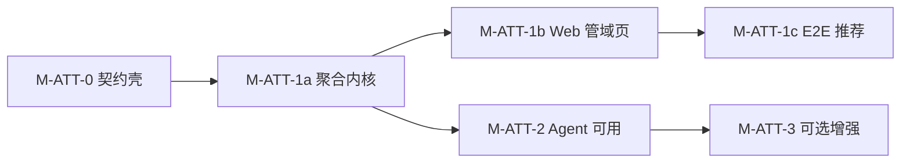

# Governance Assistant 产品设计

- **文档类型**：产品共识 + **BO-M1 架构、实现与验收真源**
- **版本**：**v0.8.111**
- **状态**：**三件套现网** — **管理范围** · **拆解** · **全新建**（`governance_scope` · `governance_goal_dq` · `governance_goal_mutate` · `governance_project_plan_validate`/`_commit` · PC **仅** `mode=create`）· **已废止**：PQ / `project_mutate` / `org_mutate` / enrich_shell / `execution_footprint` / `open_org_embed` · Internal Bearer **`SKSTUDIO_INTERNAL_SERVICE_TOKEN`**（无 `GOAL_EXECUTION_SERVICE_TOKEN` alias）· TN-2 旧别名已卸 · DQ「评价 xxx」+ DQ-WR · BO-M-PC create-only · **无** 组织评价 · **无** `focus_ref` · **BO-M3a / Accept 已废止** · **lifecycle 迁移属 GE（D11）** · 历史 PQ/ORG/M-STRUCT 长文见各节脚注（**勿当现网入口**）· [SHIP-三件套](./hermes-profiles/governance-assistant/SHIP-三件套.md)
- **产品定位**：**管域 Copilot** — 对 **`governance_active`** 用户幂等提供管域私聊，由全局一条独立的 `governance-assistant` Gateway 承载；表述 **管理范围（`org_scope` ∪ `goal_scope`）**，承载拆解评价与全新建项目
- **前置**：[business-os共识.md](./business-os共识.md) §3–§4、§11 · [hermes与skstudio集成(七期)](./hermes与skstudio集成(七期).md)（WSS / `gateway_register`）· [Personal-Assistant产品设计.md](./Personal-Assistant产品设计.md)（共享 Gateway + per-user thread 先例）

**关联文档**

| 文档 | 用途 |
| ---- | ---- |
| [business-os共识.md](./business-os共识.md) | Business OS 上位 · **治理域定义** · BO-M1 边界 |
| [Hermes与组织及目标执行的集成.md](./Hermes与组织及目标执行的集成.md) | **§13** `governance` toolset · `/internal/ga/scope` · I12/I13（PA `org`/`goal` 见 §12） |
| [Personal-Assistant产品设计.md](./Personal-Assistant产品设计.md) | **`gateway_role` + `thread_kind` + singleton GW** 参照实现 |
| [hermes-profiles/governance-assistant/](./hermes-profiles/governance-assistant/) | Profile 真源（SOUL · overlay · **已建**） |
| [Governance-Assistant-project-create迭代.md](./Governance-Assistant-project-create迭代.md) | **BO-M-PC** 共商建项 · **C62 现网**（**v0.1.45** · Skill **0.5.6** · 纯文本深链 · wecom 样例 · Chrome 硬+软） |
| [Governance-Assistant-project-duplicate迭代.md](./Governance-Assistant-project-duplicate迭代.md) | **BO-M-PD** 复制项目 · **v0.1.8**（M1～M4 · preview/duplicate + `agent_action`） |
| [openapi/ga-bo-m1.openapi.yaml](./openapi/ga-bo-m1.openapi.yaml) | **OpenAPI 3.0** M1 scope |
| ~~openapi/ga-bo-m2a / m2b / m2c / m2d / m-attention~~ | **已删除（MS-11）** · 四诊断+cross HTTP 废止；形分规则仍由库内 `build_ga_structure` 供 DQ |
| ~~openapi/ga-bo-m3a-work-items~~ | **已删除（MS-8）** · 历史见 [business-os §11.10](./business-os共识.md#1110-bo-m3a-工作列表共识normative) |
| [openapi/ga-bo-m-dq.openapi.yaml](./openapi/ga-bo-m-dq.openapi.yaml) | **OpenAPI 3.0** BO-M-DQ（§21 · **0.1.9** · `thread_id` / 工作根 · **无** `focus_ref`） |
| [openapi/ga-bo-m-pq.openapi.yaml](./openapi/ga-bo-m-pq.openapi.yaml) | **OpenAPI 3.0** BO-M-PQ（§22 · **0.1.10** · **已废止** · 考古契约） |
| [openapi/ga-bo-m-pc-plan.openapi.yaml](./openapi/ga-bo-m-pc-plan.openapi.yaml) | **OpenAPI 3.0** BO-M-PC M7（**0.2.0** · validate + commit-once） |
| [openapi/ga-bo-m-structure-mutate.openapi.yaml](./openapi/ga-bo-m-structure-mutate.openapi.yaml) | **OpenAPI 3.0** 目标链 mutate（§6.8.10.0 · **0.1.4 现网** · D8/D9/D10 · `owner_username`） |
| [openapi/ga-bo-m-org-mutate.openapi.yaml](./openapi/ga-bo-m-org-mutate.openapi.yaml) | **OpenAPI 3.0** 组织 mutate（§4.2g · §6.8.11 · **0.1.3 · 已废止** · 考古契约） |
| [本体领域模型.md](./本体领域模型.md) | WorkItem / Decision / Hint · **§1.6** · **§1.7 BO-M-DQ（半契约）** |
| [business-os共识.md §11.10.13](./business-os共识.md#111013-ga-跟进看板落地共识normative--2026-07-14) | **已废止** · 历史跟进看板冻结（勿再当产品真源） |
| [business-os共识.md §9](./business-os共识.md#9-演进与缺口) | **BO-M-DQ** / **BO-M-PQ** 演进入口（链本 §21 · §22） |
| [运维-Hermes-skstudio-集成.md](./运维-Hermes-skstudio-集成.md) | Gateway systemd、WSS token、publish 白名单 |

---

## 文档地图

| 章 | 内容 | 读谁 |
| --- | --- | --- |
| §0–§3 | 范围 · 目标 · 架构 · 对比 | 全员 |
| **§4** | Hermes Profile · **现网五 tool（三件套）** · **§4.0.1 命名共识** · ORG-R1 `manager_*` | 运维、研发 |
| **§5** | API · **现网：scope / DQ / structure-mutate / project-create-plan / thread**（PQ/ORG HTTP **已废止**） | 研发、前端 |
| **§6** | UX · 管域中心三键；M-STRUCT/M-ORG 长文多为历史 | 产品、前端、QA |
| §7–§13 | 部署 · 勾选 · 验收 · 实现设计 · 横切 | 研发、QA |
| **§21** | **BO-M-DQ** · §21.14 degraded 运维 | 产品、研发、运维 |
| **§22** | **BO-M-PQ**（**已废止 · 历史**） | 考古 |
| **BO-M-PC** | [project-create 迭代](./Governance-Assistant-project-create迭代.md)（**create-only**） | 产品、研发、QA |
| **BO-M-PD** | [project-duplicate 迭代](./Governance-Assistant-project-duplicate迭代.md)（**v0.1.8**） | 产品、研发、QA |
| **附录 A** | **废止与历史**（四诊断 HTTP · M-HT · WI · §18–§20 考古） | 考古时 |
| §14 | 修订记录 | 全员 |

> **现网（三件套）**：`governance_scope` · `governance_goal_dq` · `governance_goal_mutate` · `governance_project_plan_validate`/`_commit`（仅 create）。**已废止**：PQ / org_mutate / project_mutate / enrich / footprint。§4.2b–e / §15–§20 / §22 等长文为历史（锚点可仍写旧名）；入口见 [附录 A](#附录-a--废止与历史ms-91112) · [SHIP-三件套](./hermes-profiles/governance-assistant/SHIP-三件套.md)。

### 阅读路径

| 角色 | 建议章节 |
| ---- | -------- |
| 产品 / QA | §0–§1、**§4.0.1**、**§6.8.10.0**、**§6.8.11**、§9、§12 C8a、**§21**、**§22**、[MS-T06](./hermes-profiles/governance-assistant/MS-T06-signoff.md) / [ORG-T06](./hermes-profiles/governance-assistant/ORG-T06-signoff.md) |
| skstudio 后端 / 前端 | **§5.0 现网路由**、§8、§11、**§21**、**§22**；废止 API → 附录 A |
| Hermes / profile | §4.0–4.2g / **§4.0.1** · SOUL · [Hermes 集成 §13](./Hermes与组织及目标执行的集成.md) |
| 前端 | §5.4、§6、**M-STRUCT** / **M-ORG** · **勿**再跟 work-list / chip / 分布 Tab |

---

## 0. 范围

### 0.1 一句话

**为每位 `governance_active` 用户 lazy 幂等创建「管理助手」私聊群，由全局一条独立的 `governance-assistant` Gateway 承载；BO-M1 仅配置 `governance` toolset（`governance_scope`），使 Agent 能正确表述该用户的治理域（组织管辖 + 目标主责），与 Personal Assistant（个人 OS）和执行 OS（Master）三轨并列。**

### 0.2 BO-M1「可工作」定义（closure 口径）

同时满足：

| 类 | 含义 | 验收 |
| --- | --- | --- |
| **平台** | `governance-assistant` profile + 一条 WSS；register 为 **`gateway_role=governance`**（非 master / personal / agent_lab） | GA-01、GA-02 |
| **API** | `GET /internal/ga/scope` 聚合 `org_scope` + `goal_scope` | GA-03 |
| **身份** | `governance_active` 用户各有且仅有一个管域 thread；**首次进入管域入口**（BFF · D-GA-12）或 **首次上行** 时 lazy 创建 | GA-04 |
| **能力** | **仅** `governance_scope` tool；**不** 默认挂 `org_*` / `goal_*` / `inform` | GA-05 |
| **隔离** | 上行 **不** 注入 Kanban / workflow；**不** 读写 production `kanban.db` | GA-06 |
| **路由** | `thread_kind=governance` 上行经 **`gateway_role=governance`** | GA-01、GA-06 |
| **叙事** | GA **讲清** 治理域边界；**不** 冒充 PA 报个人队列为主答案 | GA-05、§9 四人表 |

**BO-M1 明确不做**：`governance_process` / `governance_achievement` · Finding · WorkIntent · Handoff · OrgCompany · kbase CRIT · GA 代发 inform。（**I13**：评审员 goal 读/写 ≡ Web；**不** 扩 `org_scope`。）

### 0.3 非 BO-M1 · BO-M2 分期（normative）

| 里程碑 | 核心问题 | 状态 |
| --- | --- | --- |
| **BO-M2a-goal** | 治理 **目标子树** 结构是否成立、是否卫生 | **已落地 §15** |
| **BO-M2a-org** | 治理 **组织子树** 结构是否成立、是否卫生 | **M2a-org 全三期 ✅**（§16.8）· **GA-08 ✅** |
| **BO-M2b** | **组织/人 ↔ 目标/项目** 跨域分布是否健康 | **M2b-1/2/3 ✅**（§17.9）· **M-HT UI 已废止** · **GA-09 ✅** |
| **BO-M2c** | 治理子树 **过程运行**（目标/项目轴 + 组织轴） | **已落地 §18** · **M-PR ✅** · **GA-11 ✅** |
| **BO-M2d** | 治理子树 **目标达成**（目标/项目轴 + 组织轴） | **已落地 §19** · **M-PR ✅** · **GA-12 ✅** |
| **BO-M-ATT** | 管域 **L2 attention**（steward-only digest） | **全闭环 §20** · M-ATT-0～2 |
| **BO-M3a** | ~~工作列表 draft→formal · 双 Tab · Accept 会话板~~ | **已废止（v0.8.55）** · 主闭环 = **M-STRUCT** |
| **BO-M-DQ** | **目标拆解质量评价**（形 + **拆解逻辑**） | **现网**（§21）· **「评价 xxx」** · **DQ-WR 现网（§21.3.3）** · WR-3 半自动签收待勾 |
| **BO-M-PQ** | **进展评价**（项目是否在轨） | **已废止**（历史 §22；Web「我 › 执行力」） |
| **M-ORG** | **组织 mutate**（部门/组 · 无组织评价） | **已废止**（历史 §6.8.11；Web「组织」模块（`/org/*`）） |
| **BO-M3b** | ~~人 Web 完成回写~~ | **已废止**（随 M3a 看板路径） |
| **BO-M3c** | ~~formal → Master / PA 移交~~ | **已废止**（随 M3a 看板路径） |
| 后置其它 | Finding 规则引擎 · M-PR-2b / kbase 印证 · 拆解逻辑本体化 | **显式后置** |

| 项 | 说明 |
| --- | --- |
| 目标链 **结构检查** | **BO-M2a-goal**（`GET /internal/ga/structure` · §15） |
| 组织子树 **结构检查** | **BO-M2a-org**（同端点扩展 · §16） |
| **跨域分布**（组织/人 ↔ 目标/项目） | **BO-M2b**（§17 · **GA-09 ✅**）· 对话解读 · **M-HT Web UI 已废止** |
| **过程运行**（推进 · 门控 · 偏差） | **BO-M2c** · `GET /internal/ga/process` · §18 · **GA-11 ✅** |
| **目标达成**（考核 · lifecycle · rollup） | **BO-M2d** · `GET /internal/ga/achievement` · §19 · **GA-12 ✅** |
| **管域 attention**（先看什么 · steward-only） | **BO-M-ATT** · `GET /internal/ga/attention` · §20 |
| ~~工作列表 / Accept / 会话板~~ | **已废止** · 勿再当「该跟进什么」主答案 |
| ~~Master / PA 移交（WI handoff）~~ | **已废止** |
| 每人一条 Gateway 进程 | BO-M1 采用 **共享 Gateway**（同 PA） |
| 替代 PA / 数坤坤 | 个人 OS **仍** 走 `personal-assistant` |
| 外部 IM 专用通道 | P0 仅 skstudio Web UI |
| `org_*` / `goal_*` 直接暴露给 GA | M1 **禁止**（单入口 `governance_scope`） |

### 0.4 速查（目标态）

| 步骤 | 动作 |
| ---- | ---- |
| 1 | 安装 `profiles/governance-assistant/`（§4） |
| 2 | `hermes -p governance-assistant gateway start`（§7） |
| 3 | 用户首次打开管域入口 → skstudio 调 `ga/scope` → 若 `governance_active` 则幂等 seed thread（§5.2） |
| 4 | 侧栏进入管理助手群，对话问「我的治理域是什么？」 |
| 5 | Agent 调用 `governance_scope` 并分 **组织** / **目标** 两段解释 |

---

## 1. 产品目标

### 1.1 要解决的问题

| 痛点 | Governance Assistant 怎么解（M1） |
| ---- | -------------------------------- |
| 管理者不知「组织管哪、目标主责哪」分散在两套 API / Tab | **一条 `governance_scope`** 双域画像 |
| 用数坤坤（PA）问管域，易混个人队列与 steward 范围 | **独立 GA** + 独立 thread / SOUL |
| Agent 自行拼 `org_*` + `goal_*`，易漏 org-only 管辖（如部门负责人无项目） | 服务端聚合 + **M1 单 tool** |
| 评审员 / super-steward 与 PA 读集混淆 | Goal 读集与 Web 同谓词（I13）；话术须区分 **steward 主责** vs **`reviewer_mode` 全库**；`org_scope` 不因评审员扩 |

### 1.2 产品原则（BO-M1）

1. **管域专属载体**：自有 profile / SOUL；**不是** PA 的 lens 开关。
2. **scope 先行**：M1 只答「管哪」；「怎么办」属 BO-M2+（[business-os §4.2](./business-os共识.md#42-边界口诀)）。
3. **双域并列**：`org_scope` 与 `goal_scope` **分栏叙述**；`execution_footprint` 仅作对照脚注。
4. **隔离**：与 master / PA / Lab **零 Kanban 耦合**。
5. **lazy 准入**：无管辖用户 **无** GA thread，避免全员空群。

### 1.3 非目标

- 不替代 Master 编排、不替代 PA 个人待办
- 不提供 inform 写、GE 结构写
- 不做全公司组织 browse（继承 org scope 纪律）
- 不在 M1 返回 steward 项目全量列表（仅 count，见 [business-os §11.4.1](./business-os共识.md#1141-scope-响应形状normative-摘要)）

---

## 2. 架构决策（BO-M1 冻结）

| ID | 决策 | 理由 |
| --- | --- | --- |
| **D-GA-1** | Profile 名 **`governance-assistant`**；**不** 复用 `personal-assistant` 或 `default` | 与 PA 工具白名单、SOUL、WSS 路由分离（[business-os A6](./business-os共识.md#82-反模式禁止)） |
| **D-GA-2** | WSS 注册：**`gateway_role=governance`**，`agent_slug=governance-assistant` | 与 master / personal / agent_lab **四分注册** |
| **D-GA-2b** | skstudio 新增 **`thread_kind=governance`**（协议 + DB + bridge） | 与 `production` / `agent_lab` / `personal` 并列 |
| **D-GA-3** | **全局一条** Gateway 进程，服务所有管域 thread | 同 D-PA-3 / agent-builder 共享 GW |
| **D-GA-4** | 每 **`governance_active`** 用户 **至多一个** 管域 thread | 路由键 = `thread_id`；registry **singleton governance Gateway** |
| **D-GA-5** | Thread **lazy 创建**：首次管域入口或 GA 首次上行前调 `GET /internal/ga/scope` | 避免全量预建；与 [business-os §11.3](./business-os共识.md#113-governance-assistant-载体m3) 一致 |
| **D-GA-6** | 上行 **跳过** Kanban / workflow 注入 | 同 `thread_kind=personal` 隔离原则 |
| **D-GA-7** | M1 toolset **仅** `governance`（`governance_scope`）；禁用 kanban / delegation / messaging / inform / org / goal 等 | 强制单入口聚合（[business-os §11.8](./business-os共识.md#118-明确不做bo-m1)） |
| **D-GA-8** | Internal API 前缀 **`/internal/ga/*`**，**非** `/internal/pa/*` | [business-os A7](./business-os共识.md#82-反模式禁止) |
| **D-GA-9** | Bot **显示名** · 群标题 · 侧栏入口 **统一为 `管理助手`**；侧栏 / IM **`testid`** 见 §6.3 | 与 PA **数坤坤** 区分；前端与 SOUL **统一** 用名，避免 @ 错 Bot |
| **D-GA-10** | **`governance_active`** 判定 **以 `ga/scope` 为准**（`org_scope.active ∨ goal_scope.active`） | 与 business-os §11.2 同源 |
| **D-GA-11** | 管域 thread 归属 **「我」Tab · 管域** 入口；**不** 放入 Agent Studio 分类 | 与 PA（Agent Studio / 数坤坤）入口分离；侧栏经 `nav-governance` 跳转 |
| **D-GA-12** | BO-M1 closure **推荐** 同步 `GET /api/v1/me/governance/scope`（管域入口触发 lazy seed） | 仅 internal + GA tool 可 API 演示，但 **不满足** §0.2 完整 UX closure |

---

## 3. 与 personal-assistant / master 对比

| 维度 | **master** | **personal-assistant** | **governance-assistant（M1）** |
| ---- | ---------- | ---------------------- | ------------------------------- |
| **OS** | 执行 OS | 个人 OS | **管域 OS（scope 子集）** |
| **Gateway** | `master` | `personal` | **`governance`** |
| **thread_kind** | `production` | `personal` | **`governance`** |
| **thread 粒度** | 多业务群 | 每用户 1 助手群 | **`governance_active` 用户各 1** |
| **M1 核心 tool** | kanban 等 | kbase · inform · org · goal | **`governance_scope` only** |
| **Internal 读** | BFF / 群上下文 | `/internal/pa/*` | **`/internal/ga/scope`** |
| **典型问法** | 派工、拆卡 | 我今天该做什么？ | **我的治理域是什么？** |
| **Kanban 注入** | 是 | 否 | 否 |

**结论**：Governance Assistant 是 **独立第四轨**（部署形态同 PA：共享 GW + per-user thread），职责上 **仅** 治理域认知，**不** 承担个人待办或 Master 编排。

---

## 4. Hermes Profile 规格

目录：`hermes-profiles/governance-assistant/`（**已建** · 安装到 `~/.hermes/profiles/governance-assistant/` · `install_governance_assistant_profile.py` **现网**）。

### 4.0 能力边界（BO-M1）

| 维度 | 说明 |
| --- | --- |
| **定位** | 管理者的 **管域 Copilot** — **管理范围** · **拆解评价（DQ）** · **全新建项目（PC create-only）** · **目标 mutate** |
| **独立** | 自有 overlay / SOUL / `.env`；**不从** PA 或 master sync |
| **Tool（现网 · 三件套）** | `governance_scope` · **`governance_goal_dq`** · **`governance_goal_mutate`** · **`governance_project_plan_validate`** · **`governance_project_plan_commit`** |
| **已废止（三件套后）** | ~~`governance_goal_pq`~~ · ~~`governance_goal_pq_rollup`~~ · ~~`governance_project_mutate`~~ · ~~`governance_org_mutate`~~ · enrich_shell · `execution_footprint` · `open_org_embed` |
| **已卸别名（TN-2）** | ~~`governance_decomposition_quality`~~ · ~~`governance_structure_mutate`~~（Hermes 未注册；HTTP `/decomposition-quality` · `/structure-mutate` 保留） |
| **命名演进（§4.0.1）** | 保留 `scope`；目标侧产品名已定（TN-2）；PQ/ORG mutate **已废止**（历史节可留旧名） |
| **已卸（MS-9 · Hermes）** | ~~`governance_structure`~~ · ~~`governance_process`~~ · ~~`governance_achievement`~~ · ~~`governance_attention`~~ — **禁止** 再注册进 GA profile；库内 `build_ga_structure` 仍供 DQ |
| **已卸（MS-6～8）** | ~~`governance_work_items`~~ — 路由 **404** · Hermes **未注册** · 服务层/表/OpenAPI **已删** |
| **禁止** | `inform` · PA `org_*`/`goal_*` · kanban · delegation · messaging · file · terminal · web；**目标 mutate 除外**（须用户同意）；**禁止** 进展评价/改组织/补空壳；**禁止** Accept/会话板/WI；**禁止** `focus_ref`；**禁止** 组织评分卡 |
| **鉴权** | Hermes → `/internal/ga/*`：**仅** `SKSTUDIO_INTERNAL_SERVICE_TOKEN`（与 skstudio backend 同值；**无** 旧名 alias） |

### 4.0.1 工具命名共识（normative · 2026-07-20）

> **一句话**：`scope` = **整域**快照；mutate/DQ 用 **`goal` / `org` 钉死域**；读负责人走 scope 树投影，**不**另开 tool、**不**把 scope 收成 org。

| 决策 | 约定 | 为什么 |
| ---- | ---- | ------ |
| **保留** `governance_scope` | 载荷 = `org_scope` ∪ `goal_scope`（+ steward 计数等） | 名须覆盖整域；**禁止** 改名为 `governance_org_scope`（名窄于实 → 幻觉缺 goal / 再造第二 scope） |
| **不拆** 读 tool | 禁止 `org_scope` + `goal_scope` 两个 Hermes tool | M1 已否决：易漏一侧、加重选型 |
| **ORG-R1** | `managed_org_trees[]` 投影 `manager_user_id` / `manager_username` / `manager_display_name`；全 null = 未设负责人 | GE 已有 manager；读写对称；问「谁负责」禁止甩 PA |
| **目标侧改名（TN-2 已完成）** | ~~`governance_decomposition_quality`~~ → **`governance_goal_dq`**；~~`governance_structure_mutate`~~ → **`governance_goal_mutate`** | 消除 `structure` 与组织混淆；缩短 DQ 名；旧名 Hermes 已卸 |
| **进展侧（BO-M-PQ）** | ~~`governance_goal_pq` / `goal_pq_rollup` / `project_mutate`~~ | **已废止**（历史见 §22；勿再注册） |
| **组织侧** | ~~`governance_org_mutate`~~ | **已废止**（历史见 §6.8.11；Web「组织」模块（`/org/*`）仍可用） |
| **动词集（现网）** | 固定 **`scope` · `dq` · `mutate` · `plan_validate`/`plan_commit`** | 模型选型稳定 |
| **迁移纪律** | 先能力（ORG-R1）后改名；改名须 **旧名别名 ≥1 个发版** 再弃用（**TN-1→TN-2 已履约**） | 避免现网会话/SOUL/EVAL 一夜全红 |
| **不做** | 为「查负责人」新开 tool；为 rename 改 HTTP 路径（BFF 可仍叫 structure-mutate） | tool 名面向模型；HTTP 稳定即可 |

**现网 Hermes 产品面（三件套）**：

```text
governance_scope
governance_goal_dq                 ← 曾用名 decomposition_quality（TN-2 已卸）
governance_goal_mutate             ← 曾用名 structure_mutate（TN-2 已卸）
governance_project_plan_validate   ← PC · 仅 mode=create
governance_project_plan_commit
```

> **脚注**：PQ / org_mutate / project_mutate / enrich **已废止**；历史章节 / 签收原文若仍写旧名，视为考古记录，**勿**再注册。

### 4.1 SOUL（M1 · 摘要）

- 身份：**管理助手**（Bot 显示名 · 群标题 · D-GA-9），运行在 `管理助手` 群。
- 职责：用户问管理范围、管辖、组织与目标各管什么 → **必须** 调用 `governance_scope`；用 **两段** 回答：**组织**（`org_scope`）与 **目标**（`goal_scope`）。
- **禁止**：用个人待办队列 Narrative 代替管理范围；把 PM/participant 项目数说成「战略管辖」。评审员全量须标明 **`reviewer_mode`**（破窗只读/写），**勿** 冒充「本人 steward 主责」。
- **禁止** 编造已废止的 `execution_footprint`；scope 只含 org/goal。
- 首条回复自报：管理助手身份 + 能回答「管理范围边界」；**不** 自称数坤坤。

### 4.2 Tool：`governance_scope`

| 项 | 约定 |
| --- | --- |
| **Handler** | `GET /internal/ga/scope` |
| **参数** | 无（sender 由 `X-Sender-User-Id` 解析） |
| **插件** | `plugins/skstudio-governance` |
| **响应** | [§5.6](./Governance-Assistant产品设计.md#56-响应类型-gascoperesponsenormative) · OpenAPI `GaScopeResponse`（M1 **0.3.2**） |
| **组织树** | `org_scope.managed_org_trees` = 层级真源（`path` / `children` / 可 `truncated`） |
| **负责人（ORG-R1）** | 树节点投影 `manager_user_id` / `manager_username` / `manager_display_name`；**全 null = 未设负责人**；问「谁负责」须据此回答；**禁止** 声称 scope 无人事、**禁止** 甩 PA（[§4.0.1](#401-工具命名共识normative--2026-07-20)） |
| **命名** | **保留** 本名（= 整域）；**禁止** 改名为 `governance_org_scope` |

### 4.2b Tool：`governance_structure`（BO-M2a · **Hermes 已废止 · MS-9**）

> **非现网** · 见 [附录 A](#附录-a--废止与历史ms-91112)。Hermes **不注册**；形分由 DQ 服务端内调 `build_ga_structure`（**无** `/structure` HTTP · MS-11）。用户「结构怎样」→ 评价 / 共商 mutate。

<details>
<summary>历史契约（折叠 · 勿当 Agent 路由）</summary>

> **产品决策（v0.8.61 · MS-9）**：Hermes **不再注册** `governance_structure`。  
> **MS-11**：`GET /internal/ga/structure` **HTTP 已删**；库内 `build_ga_structure` 仍供 DQ。

**历史**：BO-M2a-org 曾扩展 **同一** `governance_structure` 的响应与模型路由。

| 项 | 约定 |
| --- | --- |
| **Handler** | `GET /internal/ga/structure` |
| **参数** | 无（sender 由 `X-Sender-User-Id` 解析） |
| **插件** | `plugins/skstudio-governance`（与 `governance_scope` 同 plugin · 同 toolset） |
| **响应** | [§5.11](./Governance-Assistant产品设计.md#511-get-internalgastructurebo-m2a) · `goal_findings` / `org_findings` / `goal_tree_metrics` / `org_tree_metrics` · 别名 `findings` ≡ `goal_findings` |

#### 调用路由表（normative · 给模型 + SOUL + `tools.py` schema **逐字对齐**）

| 用户问法（示例） | 先调 scope？ | 必须调 structure？ | 解读字段 |
| --- | --- | --- | --- |
| 治理域 / 管哪 / 组织与目标各管什么 | —（scope 为主） | 否 | `governance_scope` |
| 目标链结构 / 专项太粗太细 / 缺 owner·PM / 默认链 | 建议（边界不清时） | **是** | **`goal_findings`**（别名 `findings`） |
| 组织子树结构 / 缺负责人·空组 / 部门编制 | 建议 | **是** | **`org_findings`** |
| 结构有没有问题（未指明域） | **是** | **是** | 按 active 域 **分栏**；`cross_structure_active=true` 时 **三分栏** |
| 人/部门与战略挂靠 · 主责部门与 owner 对齐 | 建议 | **是** | **`cross_findings`** · `cross_map_metrics` |
| 子树成员 vs 平台未入树 | 建议 | **是** | **`cross_map_metrics`** + `org.membership.platform_unassigned` |
| 结构 / 分布问题 | 建议（边界不清时） | **是** | `governance_structure` → findings / metrics |
| **过程运行**（blocked · 偏差 · 推进） | 建议 | **否** | `governance_process`（§18 · 规划） |
| **目标达成**（考核 · lifecycle） | 建议 | **否** | `governance_achievement`（§19 · 规划） |
| 个人待办 / 我 PM 的项目队列 | — | **否** | 引导 **PA** |

#### governance_structure · Tool schema description（normative · 与 tools.py 逐字对齐）

```text
Run structure checks on the caller's governance domain (goal subtree and/or org subtree).
Returns goal_findings, org_findings, cross_findings, goal_tree_metrics, org_tree_metrics, cross_map_metrics (findings/tree_metrics are goal-side aliases).
Use for: objective/program tree well-formedness (goal_findings); managed org subtree issues like missing manager, empty teams (org_findings); cross-domain allocation when cross_structure_active (cross_findings, cross_map_metrics such as subtree_member_count vs platform_unassigned_count).
Use when user asks if their governed org or goal tree has structural problems, or how people and programs are distributed across org and goal.
Do NOT judge strategic correctness, report execution progress (process/achievement), or substitute org_* / goal_* tools.
```

#### Agent 纪律（structure tool）

- **先** 必要时 `governance_scope` 确认边界，**再** `governance_structure`
- **org-only**（张雯）：`goal_structure_active=false` 时 **仍须** 解读 `org_findings`，**勿** 称「无结构问题」
- **双域**：无 cross 时 goal 与 org **分两段**；`cross_structure_active=true` 时 **三分栏**（goal / org / cross），**禁止** 混叙
- **`cross_findings`**：`kind=allocation` · **不** 混入 `findings` / `goal_findings` 别名
- **`platform_unassigned`**：全平台未入树人数（info）· **非** 子树内概念
- **禁止**：评战略对错 · 过程运行/目标达成（M2c/M2d tool）· achievement rollup · 代写组织任命 · 调 `org_*` / `goal_*`

**M2a 仍禁止**：在 structure 调用中 **混入** process/achievement 结论 · `org_*` · `goal_*` · `inform_*` · `kbase_*`

</details>

### 4.2c Tool：`governance_process` / `governance_achievement`（BO-M2c/M2d · **Hermes 已废止 · MS-9**）

> **非现网** · 见 [附录 A](#附录-a--废止与历史ms-91112)。Hermes **不注册**；**HTTP 已删（MS-11）**。过程/达成 **不** 进主闭环。

<details>
<summary>历史契约（折叠）</summary>

> **产品决策（v0.8.61 · MS-9）**：Hermes **不再注册** 这两 tool。

**历史（2026-07-11 · M-PR-4）**：曾注册两 tool · SOUL 五段路由 · **GA-11/12**。

| 项 | `governance_process` | `governance_achievement` |
| --- | --- | --- |
| **Handler** | `GET /internal/ga/process` | `GET /internal/ga/achievement` |
| **参数** | 无 | 无 |
| **插件** | `plugins/skstudio-governance`（M-PR-4 增注册） | 同左 |
| **响应** | [§5.12.1](./Governance-Assistant产品设计.md#5121-get-internalgaprocess) · §18 | [§5.12.2](./Governance-Assistant产品设计.md#5122-get-internalgaachievement) · §19 |

#### 调用路由表（normative）

| 用户问法（示例） | Tool | 解读字段 |
| --- | --- | --- |
| 子树/部门 **过程** 怎样 · blocked · 偏差 · 门控 | `governance_process` | **`goal_process_findings`** / **`org_process_findings`** **分栏** |
| 考核待评定 · lifecycle · 过考核期仍 active | `governance_achievement` | **`goal_achievement_findings`** / **`org_achievement_findings`** **分栏** |
| 「整体怎么样」（未指明） | scope（可选）→ structure → **process** → **achievement** | **各调各 tool** · **禁止** 用 structure 代替 |
| 某部门背责项目 **全面** blocked（交叉过程） | `governance_process` | 先 **org** 栏 · 必要时对照 **goal** 栏 · P0 **无** cross_process |
| 我 PM 某项目待办/blocked | — | **一句** → **PA（数坤坤）** |
| graph 扫描被 cap 截断 | `governance_process` | 引用 `process_metrics.projects_graph_truncated` · 说明 **优先扫了含偏差/blocked 的项目**（§6.7） |

#### Tool schema 纪律

- **`GOVERNANCE_PROCESS_DESCRIPTION`** / **`GOVERNANCE_ACHIEVEMENT_DESCRIPTION`** 须与 §5.12 **逐字对齐**（同 §4.2b 纪律）
- **禁止** 在 description 中引导调 `org_*` / `goal_*` · **禁止** 声称可答 structure/allocation 问题

</details>

### 4.2d Tool：`governance_attention`（BO-M-ATT · **Hermes 已废止 · MS-9**）

> **非现网** · 见 [附录 A](#附录-a--废止与历史ms-91112)。「先看 / 该改」→ **DQ → mutate**。**HTTP 已删（MS-11）**。

<details>
<summary>历史契约（折叠）</summary>

> **产品决策（v0.8.61 · MS-9）**：Hermes **不再注册** `governance_attention`。

| 项 | 约定 |
| --- | ---- |
| **状态** | **Hermes tool 废止（MS-9）** · 历史曾 **M-ATT-2** |
| **HTTP** | `GET /internal/ga/attention` · §5.13 |
| **问什么** | 「管域上先看什么」「我管的域有什么要优先关注」 |
| **不答** | 个人待办 · PM 队列 · 「今天该干什么」→ **引导 PA** |
| **响应** | `items[]` + `attention_summary` · 追问时再调 `detail_tool` 对应端点 |

**路由（normative）**：

| 用户问 | 调 tool | 讲什么 |
| --- | --- | --- |
| 管域先看什么 / 优先关注 | `governance_attention` | top `act_now` + 简要 `review_this_week` |
| 展开某条 | 对应 `detail_tool` | `governance_process` / `governance_structure` / `governance_achievement` |
| 今天该干什么 / 待办 | — | **一句** → **数坤坤（PA）** |
| 模糊「整体排个优先级」 | `governance_attention` + 澄清 | 先讲 **管域** digest · 个人待办 **不** 并入 rank |

#### governance_attention · Tool schema description（normative · 与 tools.py 逐字对齐）

```text
Read the caller's governance domain priority digest (steward-only L2 attention). Returns items[] (cap 3), attention_summary, and sections tier counts flattened from structure, allocation, process, and achievement findings. Use when user asks what to prioritize in their governed domain, what needs attention first, or steward-level what should I focus on. Use top act_now items first, then brief review_this_week. For detail on a specific item, follow detail_tool to governance_structure, governance_process, or governance_achievement. If attention_summary.truncated is true, say only the top 3 ranked items are shown. Do NOT ingest personal queues, PM todos, or merge rank with PA personal attention. Do NOT substitute structure/process/achievement tools for a digest question.
```

</details>

<a id="42e-toolgovernance_work_itemsbo-m3a-board--normative"></a>

### 4.2e Tool：`governance_work_items`（**已废止 · 遗留**）

> **非现网** · 见 [附录 A](#附录-a--废止与历史ms-91112)。主闭环 = **DQ → mutate → open_ge_embed → 再评**。

| 项 | 约定（废止后） |
| --- | ---- |
| **名称** | `governance_work_items`（遗留） |
| **产品问法** | 「该跟进什么 / 该改什么」→ **DQ 评价** → 共商后 **`governance_structure_mutate`**；**禁止** list/regenerate · **禁止** 再调 attention/structure tool |
| **实现** | **无路由（404）** · Hermes **未注册** · 服务层/表 **已删** · OpenAPI **已删（MS-8）** |

<details>
<summary>历史契约摘要（废止前 · 勿当现网规范）</summary>

曾：`action=list|regenerate` · GET/POST `/internal/ga/work-items` · accept/complete/handoff 在 Web · 与 attention 分栏。详见 [business-os §11.10](./business-os共识.md#1110-bo-m3a-工作列表共识normative)（同标废止）。

</details>
<a id="42f-toolgovernance_decomposition_qualitybo-m-dq--规划"></a>

### 4.2f Tool：`governance_decomposition_quality`（BO-M-DQ · 现网）

> **真源**：**§21** · OpenAPI [`ga-bo-m-dq.openapi.yaml`](./openapi/ga-bo-m-dq.openapi.yaml) **0.1.9**。**状态**：形分/意涵 **现网**；锚点 **「评价 xxx」**（§21.3）· **工作根持久化 DQ-WR 现网（§21.3.3）**；**无** `focus_ref`。

| 项 | 约定 |
| -- | ---- |
| **名称** | **`governance_decomposition_quality`**（同 `governance` toolset） |
| **HTTP** | **`GET /internal/ga/decomposition-quality`**（Hermes）；BFF 可选同形 |
| **参数** | `root_kind` · `root_id` · **`thread_id`（工作根键 · §21.3.3）** · **`reset_working_root`（可选）** · `include_logic` · `include_role_fit` · **无** `focus_ref` |
| **何时用** | 「评价拆解」「这棵树拆得怎样」· 「某维丢了几分，为什么」（同根评分卡语境 · G27 只深聊该维） |
| **何时不用** | 「该改目标结构 / 提分」→ 共商后 **`governance_goal_mutate`**；「该改组织编制」→ **指路 Web「组织」模块（`/org/*`）**（`org_mutate` **已废止**）；「我管哪」→ `governance_scope`；**禁止** 引导已卸 tool / WI |
| **权限** | `root` ∈ 调用方 **`goal_scope`**；越权拒绝；org-only **无**本 tool |
| **与 structure** | **服务端** 内调 `build_ga_structure` 产形分证据；Hermes **不** 注册 `governance_structure` |

#### governance_decomposition_quality · Tool schema description（normative · 短契约 · 与 tools.py 对齐 · MS-12）

> 细则（维序 · program 薄评 · G22–G29 · degraded 话术）见 **SOUL** 与 **§21**；**禁止** 把长 SOUL 塞进 tool description。

```text
Evaluate goal-decomposition quality for a node in the caller's goal_scope. User intent formula: "评价 xxx 的目标拆解" (xxx = named root or omitted). Returns a 1-5 scorecard with root {kind,id,name}. Params: root_kind, root_id, include_logic (default true), include_role_fit (default true), reset_working_root (optional; clear working root / 回到管辖根). Resolve root: named xxx / explicit root_* → else thread working root → else maximal owned default (or need_clarify). Plugin injects thread_id from session chat_id — do not ask the user for numeric thread ids. Never default to a company strategic ancestor; never pass focus_ref. Always tell the user which root is being scored (from response.root). Full rules: profile SOUL + GA §21.
```

<a id="42g-toolgovernance_org_mutate-m-org--现网"></a>
<a id="42g-toolgovernance_org_mutate-m-org--共识待实现"></a>

### 4.2g Tool：`governance_org_mutate`（M-ORG · **已废止**）

> **产品决策（三件套后）**：Hermes / Internal **已卸** `governance_org_mutate` 与 `POST /internal/ga/org-mutate`。改组织编制 → **Web「组织」模块（`/org/*`）**。下文为废止前契约摘要（锚点保留）；细则考古见 **§6.8.11**。

| 项 | 约定 |
| -- | ---- |
| **名称** | ~~`governance_org_mutate`~~（**已废止** · 勿再注册） |
| **状态** | **已废止** · 对话步签收仅作历史：[ORG-T06](./hermes-profiles/governance-assistant/ORG-T06-signoff.md) |
| **HTTP** | ~~`POST /internal/ga/org-mutate`~~ → **404** |
| **OpenAPI** | [`ga-bo-m-org-mutate` 0.1.3](./openapi/ga-bo-m-org-mutate.openapi.yaml)（考古） |
| **门闩** | 同 G29：本轮明确同意 + **`user_confirmed: true`** · **一次一项** |
| **P0 entity_kind** | `department` · `team`（create / patch / archive） |
| **fields** | 见 **§6.8.11 O9**：`title`→`name`（create **必填**）；负责人 **`manager_username` 可选**（有则映射；department → `manager_user_id`；team → `lead_user_id`） |
| **结果面** | 成功回执 `interactions[]` · **`type=open_org_embed`** → Host **navigate** [`/org/structure/…`](./skstudio-壳层与导航UI迭代.md#45-组织--我)（对称 D9；**不** 用 `open_ge_embed`） |
| **鉴权（P0）** | **`org_scope.active` +（GE 评审员 全树 OR 部门子树管家）**（与现网 `/api/v1/org/*` 结构写一致 · **§6.8.11 O8**） |
| **非目标** | 组织评分卡 / 组织 overall / membership·任命批处理 / 复活 structure·allocation 诊断 Hermes tool；**不做** 组织版 DQ |
| **与目标 mutate** | 目标上的 `owner` / `primary_department_id` 仍走 **`governance_structure_mutate`**（事挂人）；本 tool 管 **编制本身** |

#### governance_org_mutate · Tool schema description（normative · 与 tools.py 逐字对齐）

```text
Create, patch, or archive one org-scope entity (department|team) after the user explicitly agrees this turn (SOUL G29). action=create|patch|archive; REQUIRED user_confirmed=true. title required on create. manager_username optional (maps to department.manager_user_id or team.lead_user_id when set). One entity per call. Caller must have org_scope.active and be GE reviewer (full tree) OR department subtree manager (parent/target inside managed department subtree; team leads cannot write; root department create is reviewer-only). On create/patch success the response includes interactions open_org_embed for Host navigate to 我›组织. Do NOT score org trees; do NOT mutate memberships; do NOT call abolished structure/allocation tools; do NOT use this for goal-chain entities (use governance_structure_mutate). Do NOT write lifecycle_status.
```

### 4.3 `.env` 最小集

| 键 | 值 |
| --- | --- |
| `HERMES_PROFILE` | `governance-assistant` |
| `SKSTUDIO_HERMES_WS_URL` | 与 skstudio backend WSS 一致 |
| `HERMES_ADAPTER_SERVICE_TOKEN` | 与 skstudio backend 相同 |
| `HERMES_SESSION_PLATFORM` | `skstudio` |
| `GATEWAY_ALLOW_ALL_USERS` | `true` |
| `SKSTUDIO_INTERNAL_URL` / `SKSTUDIO_INTERNAL_SERVICE_TOKEN` | 调 `/internal/ga/*`（**无** 旧名 `GOAL_EXECUTION_SERVICE_TOKEN` alias） |

**M1 不需要**：`KNOWLEDGE_BASE_*`（未启用 kbase）。

### 4.4 `gateway_register`（normative）

```json
{
  "type": "gateway_register",
  "gateway_role": "governance",
  "agent_slug": "governance-assistant"
}
```

**skstudio `apply_gateway_register`**：新增 `gateway_role == "governance"` 分支；全局 **至多一条** governance Gateway（后连踢先连，同 personal/master 惯例）。

**实现锚点**：`hermes-skstudio-plugin/gateway_register.py` · `backend/app/hermes/connection_registry.py` · `backend/app/hermes/ws_skstudio_hermes.py` · `backend/app/hermes/bridge.py`。

---

## 5. API 与 skstudio 集成（BO-M1 真源 · M2a §5.11）

**机器可读**：

| 里程碑 | OpenAPI |
| --- | --- |
| M1 scope | [`openapi/ga-bo-m1.openapi.yaml`](./openapi/ga-bo-m1.openapi.yaml) |
| ~~M2a/M2b/M2c/M2d/M-ATT OpenAPI~~ | **MS-11 已删** |
| ~~M3a work-items~~ | **已删除（MS-8）** · 见 [business-os §11.10](./business-os共识.md#1110-bo-m3a-工作列表共识normative) |
| **BO-M-DQ** 拆解质量 | [`openapi/ga-bo-m-dq.openapi.yaml`](./openapi/ga-bo-m-dq.openapi.yaml) |

**业务语义**：[business-os §11.2–§11.4](./business-os共识.md#112-治理域定义normative) · 结构 [§11.9](./business-os共识.md#119-bo-m2-演进结构先行)。

### 5.0 路由总览

#### 5.0.1 M1（现网）

| Surface | Method | 路径 | 调用方 | 鉴权 |
| ------- | ------ | ---- | ------ | ---- |
| **Internal** | GET | **`/internal/ga/scope`** | Hermes `governance_scope` | `Bearer` + `X-Sender-User-Id` |
| **BFF** | GET | **`/api/v1/me/governance/scope`** | Web「我 › 管域」入口 | JWT session |
| **BFF** | POST | **`/api/v1/me/governance/ensure-thread`** | Web lazy seed（**GA-04**） | JWT session |

#### 5.0.2 M2a（**HTTP 废止 · MS-11** · 库内 `build_ga_structure` 仍供 DQ）

| Surface | Method | 路径 | 调用方 | 状态 |
| ------- | ------ | ---- | ------ | ---- |
| ~~Internal~~ | ~~GET~~ | ~~`/internal/ga/structure`~~ | ~~Hermes `governance_structure`~~ | **MS-11 已删** |
| ~~BFF~~ | ~~GET~~ | ~~`/api/v1/me/governance/structure`~~ | ~~Web chip / M-HT~~ | **MS-11 已删** |

形分规则引擎：`app/services/ga_structure.py` → `build_ga_structure()`（**仅** DQ 内调）。

#### 5.0.4 BO-M2c / BO-M2d（**HTTP 废止 · MS-11**）

| Surface | Method | 路径 | Hermes tool | 状态 |
| ------- | ------ | ---- | ----------- | ---- |
| ~~Internal~~ | ~~GET~~ | ~~`/internal/ga/process`~~ | ~~`governance_process`~~ | **MS-11 已删** |
| ~~Internal~~ | ~~GET~~ | ~~`/internal/ga/achievement`~~ | ~~`governance_achievement`~~ | **MS-11 已删** |
| ~~BFF~~ | ~~GET~~ | ~~`/api/v1/me/governance/process`~~ | — | **MS-11 已删** |
| ~~BFF~~ | ~~GET~~ | ~~`/api/v1/me/governance/achievement`~~ | — | **MS-11 已删** |

~~OpenAPI m2c/m2d~~ **MS-11 已删**。

#### 5.0.5b BO-M-DQ · 目标拆解质量（现网 · M0+M1）

| Surface | Method | 路径 | Hermes tool | 状态 |
| ------- | ------ | ---- | ----------- | ---- |
| **Internal** | GET | **`/internal/ga/decomposition-quality`** | `governance_goal_dq`（~~decomposition_quality~~ TN-2 已卸） | **现网** |
| **BFF** | GET | **`/api/v1/me/governance/decomposition-quality`** | — | **现网** |

OpenAPI：[`ga-bo-m-dq.openapi.yaml`](./openapi/ga-bo-m-dq.openapi.yaml) · 叙述 **§4.2f** · **§21** · env **`GA_DQ_AUX_*`**

#### 5.0.5c BO-M-PQ · 项目进展质量（**已废止**）

| 层 | 方法 | 路径 | Hermes | 状态 |
| -- | ---- | ---- | ------ | ---- |
| ~~Internal~~ | ~~GET~~ | ~~`/internal/ga/progress-quality`~~ | ~~`governance_goal_pq`~~ | **已废止** |
| ~~Internal~~ | ~~GET~~ | ~~`/internal/ga/progress-quality-rollup`~~ | ~~`governance_goal_pq_rollup`~~ | **已废止** |
| ~~Internal~~ | ~~POST~~ | ~~`/internal/ga/project-mutate`~~ | ~~`governance_project_mutate`~~ | **已废止** |
| ~~BFF~~ | ~~GET/POST~~ | ~~`/api/v1/me/governance/progress-quality*`~~ · ~~`…/project-mutate`~~ | — | **已废止** |

历史 OpenAPI / §22 叙述保留考古；**勿**再当现网入口。

**纪律**：形分规则 + 意涵辅模型 · **保留** 库内 `build_ga_structure`（**无** HTTP）· **不** 默认 regenerate work_items。

#### 5.0.5 BO-M-ATT · L2 attention（**HTTP 废止 · MS-11**）

| Surface | Method | 路径 | Hermes tool | 状态 |
| ------- | ------ | ---- | ----------- | ---- |
| ~~Internal~~ | ~~GET~~ | ~~`/internal/ga/attention`~~ | ~~`governance_attention`~~ | **MS-11 已删** |
| ~~BFF~~ | ~~GET~~ | ~~`/api/v1/me/governance/attention`~~ · ~~`/overview*`~~ | — | **MS-11 已删** |

~~OpenAPI m-attention~~ **MS-11 已删**。历史叙述见 §5.13 / §20（勿再实现）。

**纪律（历史 · 勿再实现）**：

- digest **仅** steward 读集内 findings（structure · allocation · process · achievement）
- **禁止** ingest `GET /ge/me/queues` · **禁止** 与 PA personal attention **跨 OS 统一 rank**
- 壳层可与 personal queues **并排 compose** · **不** merge 为单一列表（§6.8 · [business-os §8.2 A8](./business-os共识.md#82-反模式禁止)）

#### 5.0.6 BO-M3a · 工作列表（**已废止 · MS-8 无路由**）

> **产品决策（v0.8.55+ / MS-6～8）**：工作列表 / accept / handoff / regenerate **不再是产品路径**。主写路径 = **`POST /internal/ga/structure-mutate`**。Hermes tool **已卸**；服务层/表 **已删**；**BFF/internal 路由已卸**（旧 URL → **404**）；OpenAPI 文件 **已删除**。

| 面 | 路径 | 状态 |
| -- | ---- | ---- |
| **BFF / Internal** | ~~`…/work-items*`~~ | **无路由 · 404** |

历史语义见 [business-os §11.10](./business-os共识.md#1110-bo-m3a-工作列表共识normative)（已废止）。

#### 5.0.7 目标 / 组织 mutate 写路径（M-STRUCT **现网** · M-ORG **已废止**）

| Surface | Method | 路径 | Hermes tool | 状态 |
| ------- | ------ | ---- | ----------- | ---- |
| **Internal** | POST | **`/internal/ga/structure-mutate`** | `governance_goal_mutate`（~~structure_mutate~~ TN-2 已卸） | **现网** · OpenAPI mutate **0.1.4** · §6.8.10.0 |
| **Internal** | POST | ~~`/internal/ga/org-mutate`~~ | ~~`governance_org_mutate`~~ | **已废止** · OpenAPI org-mutate **0.1.3**（考古）· §6.8.11 |

鉴权摘要：structure = `goal_scope` + GE 写权（评审员或目标子树管家）。org-mutate **已卸**；改编制走 Web「组织」模块（`/org/*`）。

#### 5.0.3 M-HT（热力图 UI · ✗ 已废止 · GA-10）

| Surface | Method | 路径 | 调用方 | 鉴权 |
| ------- | ------ | ---- | ------ | ---- |
| **BFF** | GET | **`/api/v1/me/governance/structure`** | GA 对话 · 管域 findings 摘要 | JWT session · effective user（Act-As） |

> **产品决策（2026-07-11 · Accepted）**：M-HT Web UI **废止** — 执行力/组织「分布」Tab · 管域缩略卡 **不恢复**；**GA-10 废止**。跨域分布 **仍** 经 GA `governance_structure` · `cross_findings` 三分栏解读。组件源码 **保留** 作 fixture · **不** 维护用户入口。

**纪律**：响应形状 = §17.4（P0 + §17.4.2 扩展）· **禁止** 前端自行 rollup 矩阵口径 · **禁止** SOUL 引导用户去「分布 Tab」。

**M1 明确无（历史 · 已过时）**：M1 **读** scope **无** query。**现网已有** `POST /internal/ga/structure-mutate`；~~`POST /internal/ga/org-mutate`~~ **已废止**（§5.0.7）。**禁止** `/internal/pa/*` 治理域代理。

**M2a 明确无**：`POST /internal/ga/structure` · 将 process/achievement **并入** structure 端点。

**M2c/M2d 明确无（P0）**：`cross_process_findings` · GE 结构写 · 评战略对错 · kbase 要数 rollup（→ M-PR-2b+）。

**实现挂载**（`main.py`）：

```python
app.include_router(ga_internal_router)           # 无 prefix · 路由内 /internal/ga
app.include_router(ga_bff_router, prefix="/api/v1")  # paths /me/governance/*
```

| 模块 | 文件 |
| ---- | ---- |
| 聚合服务 | `app/services/ga_scope.py` → `build_ga_scope()` |
| 结构检查（M2a） | `app/services/ga_structure.py` → `build_ga_structure()` · §11.12 |
| 过程运行（M2c） | `app/services/ga_process.py` → `build_ga_process()` · §5.12.1 · §18 |
| 目标达成（M2d） | `app/services/ga_achievement.py` → `build_ga_achievement()` · §5.12.2 · §19 |
| 管域 attention（M-ATT） | `app/services/ga_attention.py` → `build_ga_attention()` · §5.13 · §20 |
| Internal 路由 | `app/api/routes_ga_internal.py` |
| BFF 路由 | `app/api/routes_me_governance.py` |

### 5.1 鉴权（normative）

#### 5.1.1 Internal（对齐 `/internal/pa/*`）

| 头 | 必填 | 说明 |
| --- | --- | --- |
| `Authorization` | ✓ | `Bearer <SKSTUDIO_INTERNAL_SERVICE_TOKEN>` · `deps_ge_internal.verify_ge_service_token`（读该 env；**无** 旧名 alias） |
| `X-Sender-User-Id` | ✓ | 上行用户 **username**（如 `wecom:ZhengChao`）· 非 numeric id |

```python
# routes_ga_internal.py — 与 routes_pa_org.py 同族
def _sender_header(x_sender_user_id: Annotated[str | None, Header(alias="X-Sender-User-Id")] = None) -> str:
    if not x_sender_user_id or not x_sender_user_id.strip():
        raise HTTPException(status_code=403, detail="sender_forbidden")
    return x_sender_user_id.strip()
```

**sender 解析**：`resolve_skstudio_user(db, sender_username)`；不存在 / 非人类用户 → **403** `sender_forbidden`（与 PA inform 同纪律）。

#### 5.1.2 BFF（Web JWT）

| 依赖 | 说明 |
| ---- | ---- |
| `get_current_user` | 同 `routes_me.py` / `routes_ge_bff.py` |
| actor | `build_ga_scope(db, sender_username=user.username)` |

未登录 → **401** `unauthorized`。**不** 接受 service token 调 BFF。

### 5.2 `GET /internal/ga/scope`

| 项 | 约定 |
| --- | ---- |
| **OperationId** | `gaInternalGetScope` |
| **请求体** | 无 |
| **Query** | 无（M1） |
| **成功** | **200** · `GaScopeResponse`（§5.6） |
| **缓存** | `Cache-Control: no-store`（建议） |

**处理顺序**（normative）：

1. `verify_ge_service_token` → 失败 **401** `unauthorized`
2. `_sender_header` → 失败 **403** `sender_forbidden`
3. `build_ga_scope(db, sender_username)` → GE 失败 **502** `upstream_error`；其它 **500** `internal_error`
4. 结构化日志 `ga_scope_read`（§11.2.3）

**Hermes plugin 调用**：

```http
GET /internal/ga/scope HTTP/1.1
Host: skstudio-backend
Authorization: Bearer <GOAL_EXECUTION_SERVICE_TOKEN>
X-Sender-User-Id: wecom:ZhengChao
```

### 5.3 `GET /api/v1/me/governance/scope`

| 项 | 约定 |
| --- | ---- |
| **OperationId** | `gaBffGetMyScope` |
| **响应 body** | 与 §5.2 **字节级同 schema**（`GaScopeResponse`） |
| **`governance_active=false`** | 仍 **200**（供空态 UI · 非 403） |

**前端用法**：管域入口首屏拉取 scope → `governance_active` 决定空态 vs 引导 ensure-thread。

### 5.4 `POST /api/v1/me/governance/ensure-thread`

| 项 | 约定 |
| --- | ---- |
| **OperationId** | `gaBffEnsureThread` |
| **请求体** | 无（M1） |
| **逻辑** | `ensure_governance_assistant_for_user(db, user)`（§5.9） |

**200 响应**（`GaEnsureThreadResponse`）：

```json
{
  "governance_active": true,
  "thread_id": 42001,
  "created": true,
  "thread_kind": "governance",
  "title": "管理助手"
}
```

| 场景 | `governance_active` | `thread_id` | `created` |
| ---- | ------------------- | ----------- | --------- |
| 首次创建 | true | int | true |
| 已存在 | true | int | false |
| 无管域 | false | null | false |

**与 GET scope 关系**：ensure-thread **内部** 先调 `build_ga_scope(..., include_footprint=false)`；`false` 时 **不** 创建 thread、**不** 返回 403。**execution_footprint 不参与 seed 判定**（v25.14.7）。

### 5.4.1 `GET /api/v1/me/governance/thread`（只读 · v25.14.7）

| 项 | 约定 |
| --- | --- |
| **OperationId** | `gaBffGetGovernanceThread` |
| **逻辑** | `find_governance_assistant_for_user` · **纯 DB** |
| **禁止** | 调用 `build_ga_scope` / GE upstream |
| **有 thread** | `{ seeded: true, thread_id, conversation_id, governance_active: true }` |
| **无 thread** | `{ seeded: false, thread_id: null, conversation_id: null, governance_active: true }` |
| **inactive 判定** | **不在此端点**；仍由 `GET scope` / overview 负责 |

**前端用法（normative · v25.14.7 · v26.10.10–11）**：**AppShell**（登录/`me` 成功后）prefetch `GET .../governance/thread`（**不** 限 `/me` 页）；chip / 「管理助手」点击时若缓存或 sidebar 已有 ids → **立即 navigate 中心** + **同步选中 Rail 会话** + **立刻 prefetch messages** → 后台 `POST ensure-thread` 幂等同步。`setQueryData(governance-thread)` 后 **禁止** 立刻 `invalidate` 同一 key；`sidebar` invalidate **仅当** `created=true`。消息区 **禁止** 整屏挡在 `GET messages` 上（壳/header/composer 先画；列表行内 status 可有）。**不再** 用 `deferRailConversationSelect` 推迟会话选中。

### 5.5 错误码（统一 · FastAPI `detail`）

| HTTP | `detail` | Internal | BFF | 场景 |
| --- | --- | --- | --- | --- |
| 401 | `unauthorized` | ✓ | ✓ | 无 Bearer / token 错误 / 未登录 |
| 403 | `sender_forbidden` | ✓ | — | 无或非法 `X-Sender-User-Id`；sender 不可解析 |
| 500 | `internal_error` | ✓ | ✓ | 未预期异常 |
| 502 | `upstream_error` | ✓ | ✓ | GE HTTP/超时失败 |

**响应形状**（全路由统一）：

```json
{ "detail": "sender_forbidden" }
```

**不做**：`governance_inactive` 专用 403 — 用 **200** + `governance_active: false` 表达。

### 5.6 响应类型 `GaScopeResponse`（normative）

与 [business-os §11.4.1](./business-os共识.md#1141-scope-响应形状normative-摘要) 及 OpenAPI `GaScopeResponse` **一致**。字段约束摘要：

| 块 | 关键约束 |
| --- | -------- |
| `actor` | `username` · `display_name` · `is_reviewer`（`true` 时驱动 goal 全量与 `governance_active`） |
| `governance_active` | `org_scope.active ∨ goal_scope.active` |
| `org_scope` | **direct** `managed_departments` / `managed_teams`；**嵌套** `managed_org_trees`（maximal managed root 下全量子部门 · 含 `path` · **`manager_*` 负责人投影（ORG-R1）** · 可 `truncated`；组织层级叙述真源）；`rollup` **并集去重** |
| `goal_scope` | `steward_projects` **仅** `count` / `steward_only_count`；**无** 项目列表 |
| `execution_footprint` | 可选；**不参与** `goal_scope.active` |

**完整示例**（郑超 persona · 摘要）见 business-os §11.4.1 JSON。

**空侧约定**（normative）：

| 用户类型 | `goal_scope.stewardship` | `goal_scope.steward_projects.count` |
| -------- | ------------------------ | ----------------------------------- |
| org-only（张雯） | `{ "objectives": [], "programs": [] }` | `0` |
| footprint-only（芦海星） | 同上 | `0` · footprint 在可选块 |

### 5.7 Pydantic 模型建议（skstudio）

```text
app/schemas/ga_scope.py
  GovernanceActor
  OrgSubtreeStats · ManagedDepartment · ManagedTeam
  OrgScopeSelf · OrgScopeRollup · OrgScopeBlock
  StewardshipObjective · StewardshipProgram · StewardshipBlock
  StewardProjectsSummary · GoalScopeBlock
  ExecutionFootprint · QueueFootprint
  GaScopeResponse
  GaEnsureThreadResponse
```

实现 **应** 以 OpenAPI schema 为准代码生成或 hand-written 对齐；pytest **GA-S-01** assert 响应通过 schema 校验。

### 5.8 Thread seed（lazy · 幂等）

**触发**（任一）：

1. `POST /api/v1/me/governance/ensure-thread`（**推荐** · D-GA-12）
2. 用户向已存在 governance thread **上行**（bridge 兜底；少见）
3. **企微同步 reconcile**（2026-07-10）：评审员 `POST /api/v1/org/wecom/sync` 完成后，对活跃企微用户中 `governance_active=true` 者批量 `ensure_governance_assistant_for_user`（**仍非登录全员 seed**；见 [`skstudio-组织与企微同步.md`](./skstudio-组织与企微同步.md)）

**流程**：

```text
JWT user → build_ga_scope(username, include_footprint=false)
  → governance_active == false → 200 ensure-thread { thread_id: null }
  → governance_active == true → upsert governance thread（owner = user）

Web 乐观打开（v25.14.7 · 已有 thread · v26.10.10–11 消息区秒开）：
  AppShell prefetch GET /thread 或 sidebar 命中 → navigate 中心立即
  → 同步 setConvId / openConversation（不 defer）
  → prefetch GET /conversations/{id}/messages
  → 消息列表壳先画（禁止整屏「加载消息中…」门闩；行内 status 可有）
  → POST ensure-thread 后台（metadata 同步 · 不阻塞 UI · created 才刷 sidebar）
```

**Thread 字段**（normative）：

| 字段 | 值 |
| --- | --- |
| `thread_kind` | `governance`（Alembic 扩展 enum） |
| `agent_slug` | `governance-assistant` |
| 标题 | **`管理助手`** |
| Bot `display_name` | **`管理助手`** |
| 侧栏 | **我 › 管域**（D-GA-11 · **不** 进 Agent Studio） |

**不** 在 `POST /auth/login` 全员 seed。

### 5.9 Connection registry

- 新增 `_governance` singleton（类比 `_personal`）
- `governance_gateway_connected()` · `notify_governance_gateway_status`
- 详见 §11.4

### 5.10 Bridge 上行

- `thread_kind=governance` → **`gateway_role=governance`**
- **不** 注入 `[skstudio-kanban]` / workflow（GA-06）
- 详见 §11.5

### 5.11 `GET /internal/ga/structure`（BO-M2a · goal + org）

**契约真源**：~~ga-bo-m2a OpenAPI~~（**MS-11 已删**） · 目标链 **§15** · 组织子树 **§16** · 业务 [business-os §11.9](./business-os共识.md#119-bo-m2-演进结构先行)。

| 项 | 约定 |
| --- | --- |
| **Method / 路径** | `GET /internal/ga/structure` · BFF 可选 `GET /api/v1/me/governance/structure` |
| **鉴权** | 与 **§5.1** 完全相同（Bearer + `X-Sender-User-Id`） |
| **Query** | **无**（M2a 不引入 `?perspective=` 等过滤；全量 P0 checks） |
| **读集 · goal** | 复用 M1 **`build_governance_stewardship_tree`**（子树 owner · 默认链过滤）；**不** 扩大评审员读集 |
| **读集 · org** | 复用 M1 **`org_scope` 管辖 root** 及其子树（§11.2 · [business-os §11.9.3](./business-os共识.md#1193-组织子树结构检查bo-m2a-org--normative)） |
| **处理顺序** | ① 鉴权 → ② `build_ga_scope()` → ③ goal checks → ④ org checks → ⑤ **cross checks**（若双域 active）→ ⑥ `ga_structure_read` |

**响应类型 `GaStructureResponse`（normative 摘要 · M2a 双域 + M2b-1 cross 壳）**：

| 块 | 关键约束 |
| --- | -------- |
| `governance_active` | 同 M1 scope |
| `goal_structure_active` | 治理 goal 子树内存在可检节点 |
| `org_structure_active` | **`org_scope.active`** 且子树可读（**BO-M2a-org**） |
| `cross_structure_active` | **双域均 active**（§17.9）；M2b-2 跑 P0 checks · `cross_map_metrics` 填实 |
| `structure_summary` | 全量聚合 goal + org + cross · **P0 不拆** 子 summary |
| `goal_tree_metrics` | goal 子树规模 |
| `org_tree_metrics` | org 子树规模 |
| `cross_map_metrics` | 跨域对照基数（双域 active 时 **非 null** · 在职口径） |
| `goal_findings[]` | 目标链六视角（§15.2） |
| `org_findings[]` | 组织六视角（§16.2） |
| `cross_findings[]` | 跨域分布（§17.3 · M2b-2 全 7 条 P0 现网） |

**向后兼容（normative）**：

| 现网字段 | 映射 |
| --- | --- |
| `findings` | **`goal_findings` 别名**（BO-M2a-goal 已落地客户端可不改） |
| `tree_metrics` | **`goal_tree_metrics` 别名** |

BO-M2a-org 实现 **须** 同时返回显式 `goal_findings` / `org_findings`（及别名）；新客户端优先读显式字段。

**与 scope 关系**：

- structure **不** 重复返回完整 `org_scope` / `goal_scope`；可选 `scope_ref: "same_as_m1"` 或 embed 最小 `actor` 块
- org-only 用户（张雯）：`goal_structure_active=false` · **`org_structure_active=true`** · `org_findings` **非空**（当子树存在可检事实）
- 双域用户（Victor / 郑超）：`goal_findings` 与 `org_findings` **分栏叙述**，**禁止** 合并为单一列表

**错误码**：与 **§5.5** 同族（403 `sender_forbidden` · 502 `upstream_error` 等）。

**Pydantic 模型建议**：

```text
app/schemas/ga_structure.py
  StructureFinding · StructureNodeRef · StructureSummary · GoalTreeMetrics · OrgTreeMetrics
  GaStructureResponse（含 goal/org 双域块 + 别名）
app/services/ga_structure.py
  build_ga_structure() · run_goal_structure_checks() · run_org_structure_checks()
  GOAL_CHECK_REGISTRY · ORG_CHECK_REGISTRY
app/services/ga_structure_config.py   # §15.8 + §16.4 阈值
app/services/ga_org_structure.py      # 可选拆分 · org 读集与 BFS
```

**pytest 锚点**：**§12.2 C2** · **GA-ST-01～19** · **GA-07**（goal）· **GA-08**（org）· **GA-09**（cross）· T-GH-03～06。

### 5.12 `GET /internal/ga/process` · `GET /internal/ga/achievement`（BO-M2c/M2d · M-PR）

**契约真源**：~~ga-bo-m2c~~（**MS-11 已删**） · ~~ga-bo-m2d~~（**MS-11 已删**） · 叙述 **§18–§19** · 业务 [business-os §11.9.7](./business-os共识.md#1197-过程运行与目标达成bo-m2c--bo-m2d--normative)。

#### 5.12.0 共享 Finding 模型（normative）

process / achievement / structure **共用** 同一 Finding 形状（便于 SOUL、eval、Web 摘要复用）：

| 字段 | 类型 | 必填 | 说明 |
| ---- | ---- | ---- | ---- |
| `check_id` | string | ✓ | 稳定标识 · 如 `process.gate_blocked` · `achievement.lifecycle_pending_assessment` |
| `kind` | enum | ✓ | **`process`** · **`achievement`** · structure 侧为 `structure` / cross 为 `allocation` |
| `perspective` | enum | ✓ | **`goal`** · **`org`** |
| `severity` | enum | ✓ | `error` · `warning` · `info` |
| `message` | string | ✓ | L1 可核对事实 · 人话 |
| `evidence` | object | ✓ | **非空** · 可核对字段（project_id · gate_id · lifecycle_status · …） |
| `node` | object | — | 可选锚点（goal/org 节点 ref · 与 structure `node` 同族） |
| `suggested_action` | string | — | 深链或 Web 引导 · **非** Agent 代写 |
| `layer` | enum | — | structure **专用**（`hygiene` / `coherence`）· process/achievement **省略** |

**Pydantic 落点（normative）**：

```text
app/schemas/ga_finding.py          # GaGovernanceFinding · ProcessFinding · AchievementFinding（kind 约束子类或 validator）
app/schemas/ga_process.py          # GaProcessResponse · ProcessSummary · ProcessMetrics
app/schemas/ga_achievement.py      # GaAchievementResponse · AchievementSummary · AchievementMetrics
app/services/ga_process.py         # build_ga_process() · PROCESS_CHECK_REGISTRY · graph 编排
app/services/ga_achievement.py       # build_ga_achievement() · ACHIEVEMENT_CHECK_REGISTRY
app/services/ga_process_config.py  # max_graph_projects 等（§18.6）
```

**与 structure 重复观测**：`lifecycle.stale_active`（structure）与 `achievement.period_ended_still_active`（achievement）**可并存** — kind 不同 · SOUL **分栏** 叙述 · **不** 去重合并。

#### 5.12.1 `GET /internal/ga/process`

| 项 | 约定 |
| --- | --- |
| **Method / 路径** | `GET /internal/ga/process` · BFF `GET /api/v1/me/governance/process` |
| **鉴权** | 与 **§5.1** 相同 |
| **Query** | **无**（P0 全量 P0 checks · 无 `?perspective=`） |
| **读集 · goal** | M1 **`governed_program_ids`** 下 **`status != draft`** 项目 · **`GET …/projects/{id}/graph`** |
| **读集 · org** | `primary_department_id` ∈ **`org_scope` 子树 BFS 并集** · 聚合主责 portfolio |
| **处理顺序** | ① 鉴权 → ② `build_ga_scope()` → ③ goal graph checks（cap · 启发式优先级）→ ④ org portfolio 聚合 → ⑤ `org.process.sync_stale`（**M-PR-1**）→ ⑥ `ga_process_read` |

**响应 `GaProcessResponse`（摘要）**：`goal_process_active` · `org_process_active` · `goal_process_findings[]` · `org_process_findings[]` · `process_summary` · `process_metrics`（含 `projects_graph_truncated` · `dept_process_rows[]` · M-PR-3）。

**上游**：复用 `goal_execution_client.get_ge_project_graph` · `pa_goal_scope.count_open_deviations` 等（§18.6）；单 graph 失败 → partial success。

#### 5.12.2 `GET /internal/ga/achievement`

| 项 | 约定 |
| --- | --- |
| **Method / 路径** | `GET /internal/ga/achievement` · BFF `GET /api/v1/me/governance/achievement` |
| **鉴权** | 与 **§5.1** 相同 |
| **读集 · goal** | M1 治理子树 **objectives + programs**（同 structure 索引链）· **P0 不拉 graph** |
| **读集 · org** | `primary_department_id` ∈ org 子树 · 聚合主责节点 lifecycle |
| **处理顺序** | ① 鉴权 → ② `build_ga_scope()` → ③ goal lifecycle checks → ④ org portfolio 聚合 → ⑤ `ga_achievement_read` |

**响应 `GaAchievementResponse`（摘要）**：`goal_achievement_active` · `org_achievement_active` · `goal_achievement_findings[]` · `org_achievement_findings[]` · `achievement_summary` · `achievement_metrics`。

**pytest 锚点**：**§12.2 C3** · **GA-PR-01～22** · **GA-11** · T-GH-07；**§12.2 C4** · **GA-ACH-01～13** · **GA-12** · T-GH-08。

### 5.13 `GET /internal/ga/attention`（BO-M-ATT · L2 管域 attention · 共识）

**契约真源**：~~ga-bo-m-attention~~（**MS-11 已删**） · 叙述 **§20** · 业务 [business-os §2.3](./business-os共识.md#23-观测类型与-readiness-区分) · [§9.1](./business-os共识.md#91-建议下一迭代2026-07-11--非-normative)。

#### 5.13.0 定位（normative）

| 项 | 约定 |
| --- | ---- |
| **回答** | 在 steward 读集内，**管域上现在最该关注什么**（L2 attention · kind `attention`） |
| **不是** | 个人待办排序 · 跨 OS 总调度 · 工作意图 · 新 check 规则 |
| **输入** | **复用** `build_ga_structure()` · `build_ga_process()` · `build_ga_achievement()` 的 **已有 findings** — **不** 拉 `/ge/me/queues` |
| **输出** | 有序 `items[]`（cap **3**）+ `attention_summary` + `sections` 计数 |

**与 PA 分界（normative）**：

| OS | 真源 | 问什么 |
| --- | --- | --- |
| **个人 OS（PA）** | `GET /ge/me/queues` | 我今天要推进什么 |
| **管域 OS（GA）** | `GET /internal/ga/attention` | 我管的域现在最该关注什么 |

壳层 **可** 在同一页 **并排** 展示二者 · **禁止** 合并为单一 rank 列表（[business-os A8](./business-os共识.md#82-反模式禁止)）。

#### 5.13.1 端点

| 项 | 约定 |
| --- | ---- |
| **Method / 路径** | `GET /internal/ga/attention` · BFF `GET /api/v1/me/governance/attention` |
| **鉴权** | 与 **§5.1** 相同 |
| **Query** | **无**（P0 全量 digest） |
| **处理顺序** | ① 鉴权 → ② `build_ga_scope()` → ③ 若 `governance_active=false` 则空 digest → ④ 并行/顺序调用 structure · process · achievement **服务层**（**不** 重复 HTTP）→ ⑤ flatten findings → ⑥ tier + rank → ⑦ cap → ⑧ `ga_attention_read` |

#### 5.13.2 响应 `GaAttentionResponse`（摘要）

| 字段 | 说明 |
| ---- | ---- |
| `governance_active` | 同 scope |
| `generated_at` | ISO8601 · UTC |
| `attention_summary` | `total_items` · `error_count` · `warning_count` · `info_count` · `truncated?` |
| `items[]` | 见 **§5.13.3** · max **3** |
| `sections` | `act_now` · `review_this_week` · `monitor` 计数 |

`governance_active=false` → `items=[]` · summary 全 0。

#### 5.13.3 `AttentionItem`（normative）

| 字段 | 类型 | 说明 |
| ---- | ---- | ---- |
| `rank` | int | 1-based · **仅 steward findings 间**排序 |
| `tier` | enum | `act_now` · `review_this_week` · `monitor` |
| `source_kind` | enum | `structure` · `allocation` · `process` · `achievement` |
| `source_ref` | object | 稳定引用 · 如 `{check_id, project_id}` · `{check_id, node.id}` — **禁止** queue 字段 |
| `severity` | enum | 继承源 finding |
| `title` | string | 人话标题 · ≤ 80 字 |
| `why_now` | string | 一句可核对理由 |
| `deep_link` | string? | Web 深链 · `/execution/...` · `/org/...` |
| `detail_tool` | enum? | `governance_structure`（**structure 与 allocation 均**）· `governance_process` · `governance_achievement` |

#### 5.13.4 排序与 tier（P0 · normative）

**同 tier 内**：`severity`（error → warning → info）→ `source_kind` 优先级（process error > structure error > …）→ `check_id` 字典序（稳定 tie-break）。

| 源 finding | tier 默认 |
| --- | --- |
| `process.*` · severity=**error**（`gate_blocked` · `deviation_active` · `org_portfolio_blocked`） | **act_now** |
| `structure.*` / `allocation.*` · severity=**error** | **review_this_week** |
| `achievement.*` · severity=**warning**（`lifecycle_pending_assessment` 等） | **review_this_week** |
| `process.org.sync_stale` · severity=info/warning | **monitor** |
| `structure.*` / `allocation.*` · severity=**info** | **monitor** |

**cap**：超出 3 条 → `attention_summary.truncated=true` · GA 引导调对应 detail tool 看全量。

**去重（M-ATT-3 可选）**：同一 `project_id` 多条 process finding P0 **不** 合并 · M-ATT-3 可加折叠。

#### 5.13.5 示例（Victor · 摘要 JSON）

```json
{
  "governance_active": true,
  "generated_at": "2026-07-11T12:00:00Z",
  "attention_summary": { "total_items": 4, "error_count": 1, "warning_count": 2, "info_count": 1 },
  "sections": { "act_now": 1, "review_this_week": 2, "monitor": 1 },
  "items": [
    {
      "rank": 1,
      "tier": "act_now",
      "source_kind": "process",
      "source_ref": { "check_id": "process.gate_blocked", "project_id": "proj-2h-q3" },
      "severity": "error",
      "title": "2H 线 Q3 专项 · 门控阻塞",
      "why_now": "管辖内 steward 项目存在 blocked 门控，直接卡住推进",
      "deep_link": "/execution/projects/proj-2h-q3",
      "detail_tool": "governance_process"
    },
    {
      "rank": 2,
      "tier": "review_this_week",
      "source_kind": "structure",
      "source_ref": { "check_id": "org.leadership.vacant_manager", "node": { "id": "dept-board-3" } },
      "severity": "error",
      "title": "董事会子树 · 3 个部门缺 manager",
      "why_now": "组织结构 error · 影响责权闭合",
      "deep_link": "/org/structure?highlight=dept-board-3",
      "detail_tool": "governance_structure"
    }
  ]
}
```

**张雯（org-only）**：items **仅** 含 `perspective=org` 或 org 轴 source · **无** goal/cross 条目。

#### 5.13.6 Pydantic 落点（normative）

```text
app/schemas/ga_attention.py       # GaAttentionResponse · AttentionItem · AttentionSummary
app/services/ga_attention.py      # build_ga_attention() · flatten · rank · cap
app/api/routes_ga_internal.py     # GET /internal/ga/attention
app/api/routes_me_governance.py   # BFF
tests/test_ga_attention.py        # GA-ATT-01～20
```

**pytest 锚点**：**§12.2 C5** · **GA-ATT-01～18** · **GA-ATT-DRILL-01**（M-ATT-2 生产对话）。

#### 5.13.7 Flatten 与 rank 算法（normative · M-ATT-1）

**输入源（同请求 · 服务层调用 · 禁止 HTTP 自调用）**：

```text
build_ga_structure(db, sender)   → goal/org/cross findings
build_ga_process(db, sender)     → goal/org process findings
build_ga_achievement(db, sender) → goal/org achievement findings
```

**Flatten 规则**：

| 源数组 | `source_kind` |
| --- | --- |
| `goal_findings` · `org_findings` | `structure` |
| `cross_findings` | `allocation` |
| `goal_process_findings` · `org_process_findings` | `process` |
| `goal_achievement_findings` · `org_achievement_findings` | `achievement` |

**过滤**：`governance_active=false` → 空 digest；org-only 跳过 goal 轴数组（与各 builder `*_active` 一致）。

**`title` / `why_now` 生成（P0 · 服务端模板）**：

| 字段 | 规则 |
| --- | --- |
| `title` | 优先 `finding.message` 截断 80 字；可前缀节点名（`node.name` / `evidence.project_name`） |
| `why_now` | 按 `source_kind` + `severity` 模板一句 · **须** 可核对 · **不** 战略评判 |
| `deep_link` | 复用 structure/process 现有 `suggested_action` 解析器（M-ATT-1 抽 `ga_attention_links.py` 可选） |
| `detail_tool` | structure/allocation → `governance_structure` · process → `governance_process` · achievement → `governance_achievement` |

**Rank**：§5.13.4 tier 表 → 同 tier 内 severity → source_kind 优先级 `process > allocation > structure > achievement`（同 severity 下）→ `check_id` 字典序。

#### 5.13.8 性能与缓存（normative）

| 项 | 约定 |
| --- | ---- |
| **P0** | 单次 `build_ga_attention()` **顺序** 调三 builder · **不** 要求 cross-request 缓存 |
| **同请求** | 若 BFF 并行拉 `/attention` + `/structure` + `/process` + `/achievement`，**允许** 重复计算（P0 可接受） |
| **P1 可选** | request-scoped memo on `build_ga_scope()` · 四端点共享 scope |
| **禁止** | attention 路径单独拉 graph **第四次** — 必须走 `build_ga_process` 已有 graph 结果 |

#### 5.13.9 Web 数据契约扩展（OpenAPI · 可选字段）

`AttentionItem` 增 **只读展示** 字段（服务端生成 · 前端 **不得** 自行翻译 tier）：

| 字段 | 示例 |
| --- | --- |
| `tier_label` | `需立即关注` · `本周处理` · `持续观察` |
| `source_kind_label` | `结构` · `分布` · `过程` · `达成` |

见 ~~ga-bo-m-attention~~（**MS-11 已删**） v0.1.1。

#### 5.13.10 列表–chip 不变量（normative · M-ATT-1）

服务端 **须** 保证下列关系（**GA-ATT-19**）：

| # | 不变量 |
| --- | --- |
| I1 | `governance_active=true` 且 flatten 后存在 severity∈{error,warning} 的 finding → `items.length ≥ 1` |
| I2 | `attention_summary.error_count + warning_count` = items 中 severity∈{error,warning} 的条数（**cap 前** 全量计数写入 summary · cap 后 items ≤3） |
| I3 | `truncated=true` ⟺ cap 前 ranked 条数 **>** 3 |
| I4 | `items=[]` ⟺ cap 前 **无** error/warning finding（允许仅有 info → monitor tier 条目 **或** 全空） |
| I5 | **禁止** queue / personal 字段进入 `items` 或 `source_ref` |

**说明**：三 chip 各自需关注数 **之和** 可 **大于** 列表可见条数（跨类 rank · cap）· **不** 违反 I1–I5。

#### 5.13.11 BFF overview 聚合（M-ATT-3 · **已废止 · MS-11**）

> **MS-11**：`/me/governance/overview*` · chip FE · 四诊断 BFF/internal HTTP **已删除**。下列为历史叙述，**勿再实现**。

| 项 | 做法 |
| --- | --- |
| **BFF 聚合端点** | `GET /api/v1/me/governance/overview` 一次返回 attention + 三 summary + 三 **category top**（**v25.14.1+**） |
| **category top** | 每 chip 附带 `{ items: ≤3, total_count }` — **类内** severity/tier 排序 · 字段同 `AttentionItem` |
| **request-scoped memo** | 同请求内 `build_ga_scope()` + 三 builder **并行**（ThreadPoolExecutor · 独立 Session） |
| **deep_link 解析** | 抽 `ga_attention_links.py` 复用 structure/process `suggested_action` |
| **分阶段 overview（v25.14.6）** | `GET .../overview/fast`（structure+achievement）+ `GET .../overview/process`（过程补全） |
| **thread prefetch（v25.14.7 · v26.10.10–11）** | `GET .../governance/thread` · **AppShell** prefetch · 同步选中 Rail · prefetch messages · **无**整屏 messages 门闩 · ensure 后台 · created 才刷 sidebar |

**overview 响应扩展（normative · v25.14.2）**：

| 字段 | 类内 kinds | cap |
| --- | --- | --- |
| `structure_top` | `structure` · `allocation` | 3 |
| `process_top` | `process` | 3 |
| `achievement_top` | `achievement` | 3 |

`total_count > 3` 时 chip 列表底 **须** 显示 **还有 N 项…**（**不** 链 GA · 完整清单仍靠管域关注列表 + GA）。

---

## 6. 用户体验（M1）

### 6.1 入口

| 项 | BO-M1 建议 |
| --- | ---------- |
| **位置** | **我** Tab 下 **「管域」** 入口（与「组织」「执行力」并列）；**normative · D-GA-11** |
| **可见性** | 可先对全员展示入口；无 `governance_active` 时展示空态文案 |
| **空态** | 「你当前没有组织管辖或目标主责；管理助手面向部门负责人与战略线 owner。」 |
| **与 PA 关系** | 数坤坤（PA）**不** 增加 Steward 模式开关（M1） |

### 6.2 对话预期（M1）

用户：「我的治理域是什么？」

GA（调用 `governance_scope` 后）应包含：

1. **组织**：管辖哪些部门/组、子树规模（部门数、人数）
2. **目标**：主责哪些目标/专项、steward 项目 **数量**
3. 若仅一侧非空，**明确说明另一侧为空**（张雯 / 芦海星样例）

### 6.3 前端 testid（BO-M1 · normative）

实现 **应** 使用下列 `data-testid`，避免侧栏与空态文案漂移：

| 元素 | `data-testid` |
| --- | --- |
| **我** Tab 下管域入口 | `nav-governance` |
| 管域 scope 空态页 | `governance-scope-empty` |
| 管域 thread 列表项 | `thread-governance-{thread_id}` |
| GA Gateway 离线提示（可选） | `governance-gateway-offline` |

**文案**：侧栏 / Bot / 群标题统一 **「管理助手」**（与 D-GA-9 一致）。

### 6.4 对话预期（M2a · structure tool）

**载体**：管理助手 · tool **`governance_structure`**（[§4.2b](./Governance-Assistant产品设计.md#42b-toolgovernance_structurebo-m2a--goal--org--单-tool)）。

| Persona | 用户 prompt | 预期 Agent 行为 |
| --- | --- | --- |
| **张雯** · org-only | 「产品中心组织结构有没有问题？」 | 先 `governance_scope`（可选）→ **`governance_structure`** → 只讲 **`org_findings`**（如缺 manager）；**不** 说 goal 链 |
| **Victor** · 双域 | 「我管的目标链和组织树结构怎么样？」 | `governance_structure` → **分两段**：goal 六视角 + org 六视角；**不** 合并 |
| **郑超** · 双域 | 「2H 线专项是不是拆太细？」 | 只解读 **`goal_findings`**；org 侧 **不** 主动展开除非用户问 |
| **芦海星** · org-only | 「医学中心缺不缺负责人？」 | **`org_findings`**；**勿** 用 `execution_footprint` 冒充 org 结构结论 |
| **任意** | 「公司还有多少人在组织树外？」 | `org.membership.platform_unassigned` · **在职** · 与 **组织 › 结构** 侧边栏「未分配」一致 · **非** 子树内概念 |
| **任意** | 「最近 blocked 多吗？」 | **不** 调 structure；**M-PR-4 前** 说明过程运行 tool 未启用 → PA；**后** → `governance_process` |

**引导写操作**：finding 含 `suggested_action` 时，引导 **组织 › 结构** 或 **我 › 执行力** — Agent **不** 代写 GE。

### 6.5 对话预期（M2b · cross · GA-09）

**载体**：管理助手 · tool **`governance_structure`**（[§4.2b](./Governance-Assistant产品设计.md#42b-toolgovernance_structurebo-m2a--goal--org--单-tool) · [§17](./Governance-Assistant产品设计.md#17-bo-m2b--跨域分布双向对照共识)）。

| Persona | 用户 prompt | 预期 Agent 行为 |
| --- | --- | --- |
| **Victor** · 双域 | 「我管的人跟战略目标挂靠得合理吗？」 | `governance_structure` → **三段**：goal / org / cross；引用 `cross_map_metrics` |
| **Victor** | 「专项 owner 跟主责部门对得上吗？」 | 解读 `cross.allocation.owner_outside_primary_dept` 等 **`cross_findings`** |
| **张雯** · org-only | 同类 cross 问题 | `cross_structure_active=false` → **不** 硬凑 cross；只讲 **`org_findings`** |
| **任意** · 双域 | 「子树多少人 vs 平台未入树？」 | **`cross_map_metrics`** · **在职** · 与结构页「未分配」一致 |

**GA-09**：**生产对话验收通过**（2026-07-11 · §12.3 #10～12）。

### 6.7 对话预期（M2c/M2d · process / achievement · M-PR-4）

**载体**：管理助手 · **`governance_process`** · **`governance_achievement`**（[§4.2c](./Governance-Assistant产品设计.md#42c-toolgovernance_process--governance_achievementbo-m2cd--m-pr-4)）。

| Persona | 用户 prompt | 预期 Agent 行为 |
| --- | --- | --- |
| **Victor** | 「我管的子树最近 blocked、偏差多吗？」 | `governance_process` → **goal/org 分栏** · 引用 finding `message`+`evidence` |
| **Victor** | 「2H 线考核待评定有哪些？」 | `governance_achievement` → **`goal_achievement_findings`** |
| **张雯** · org-only | 「产品中心主责项目过程怎样？」 | `goal_process_active=false` · 只讲 **`org_process_findings`** |
| **张雯** | 「主责专项考核闭合了吗？」 | **`org_achievement_findings`** |
| **任意** | 「整体怎么样？」 | scope（可选）→ structure（含 cross）→ process → achievement · **禁止** 只调 structure |
| **任意** | 「某部门背责项目是不是都卡住了？」 | `governance_process` · **先 org 栏** · 必要时对照 goal 栏 · **不** 臆造 cross_process |
| **任意** · cap 截断 | 「是不是只看了部分项目？」 | 若 `projects_graph_truncated=true`：**明确说明** 治理子树项目数 > cap · **优先扫描** 含 open deviation / blocked 的项目 · **不** 声称全量 |

**GA-11/12**：上表行为 **现网适用** · **生产对话验收通过**（2026-07-11）。

**与 structure 去重叙述**：同一节点若同时有 `lifecycle.stale_active`（structure）与 `achievement.period_ended_still_active`（achievement），**分 kind 各讲一条** · **不** 合并为一句。

### 6.6 跨域分布热力图（M-HT · ✗ 已废止 · GA-10）

> **产品决策（2026-07-11 · Accepted）**：M-HT Web UI **废止**。M-HT-0～6 **代码已实现**（`ExecutionAllocationPanel` 等组件保留作 fixture），**用户可见入口永久移除** — 执行力/组织 **无**「分布」Tab · 我 › 管域 **无** 缩略卡 · 旧 URL `?tab=allocation` **回退 overview**。**GA-10 废止**。
>
> 跨域分布 **仍** 经 GA `governance_structure` · `cross_findings` 三分栏解读（**GA-09 ✅**）。**禁止** SOUL 引导用户去 Web「分布 Tab」。

**现网解读路径（normative）**：

| 用户意图 | 路径 |
| --- | --- |
| 挂靠 / 负载对照 | GA 对话 · `cross_findings` + `cross_map_metrics` 文字解读 |
| 看具体节点 | 深链 **执行力** / **组织** overview |
| 矩阵 / 热力图 | **无 Web 入口** · Agent **不** 手绘矩阵 |

本节以下 M-HT normative 规格 **保留** 作历史与 fixture 参考 · **非** 交付范围。

**定位**：BO-M2b **allocation** 观测的 **Web 只读可视化**（normative 规格保留供恢复）；数据仍 `GET …/governance/structure` · **不** 新开 tool · **不** 替代管理助手对话。

| 项 | 约定 |
| --- | --- |
| **主落点（normative · UI 暂隐藏）** | **执行力** · **公司年度根** / **sub 目标** 右详情 · Tab **「分布」** · **组织 › 结构** · **部门** 右详情 · Tab **「分布」**（**M-HT-6**） |
| **现网可见** | **无** 上述 Tab（v25.11.3）· **我 › 管域** 仅对话入口 + scope 薄页 |
| **管域入口** | **我 › 管域**（§6.1）· GA 解读 `cross_findings`；缩略卡（M-HT-4）**已撤** |
| **双朝向** | **分入口单视角**：执行力目标（company/sub）→ **目标 → 部门**（B）· 组织部门 → **部门 → 负载**（A）· **无** 同页 toggle |
| **可见性** | `governance_active=true` · 公司根 / sub / 部门（非 team）· 双域矩阵需 `cross_structure_active=true`（见下表） |
| **子树过滤（M-HT-6）** | 全量 API · 前端 `allocationScopeFilter` 按当前节点子树收窄矩阵与 findings · **无** 后端 `?scope=`（P1） |
| **保留** | 执行力 **「人员」**（M30）· 组织 **「目标与执行」**（M31）— **禁止** 用热图替换 |

**公司年度根判定（normative）**：与现网 `GoalObjectiveDetail` 一致 — `objective.level === "company"`（含 `planning_year` 的年度战略根）· **sub** 为 `level === "sub"`。

| 条件 | 「分布」Tab | 面板内容 |
| --- | --- | --- |
| `governance_active=false` | **隐藏** | — |
| `governance_active=true` · company / sub / 部门 | **展示**（部门需 `cross_structure_active`） | 见 scope 表 |
| `cross_structure_active=false`（如张雯 org-only） | Tab 可展示 · **空态**（`governance-allocation-cross-inactive`）· 引导 **我 › 管域** | 不渲染矩阵 |
| `cross_structure_active=true`（Victor 双域） | **展示** | 子树过滤后矩阵 + `cross_findings` |

| scope | 视角 A | 视角 B | findings |
| --- | --- | --- | --- |
| **company 根** | **不展示**（仅 B） | 全量目标行 | 全量 |
| **sub 目标** | **不展示**（仅 B） | 该 sub 行（及子树，现网 API 多为单行） | 关联 objective / program |
| **部门** | 部门 org 子树行（**仅 A**） | **不展示** | 与子树部门有交的 finding |

**色阶（P1 默认 · M-HT-1/2）**：复用 `ga_structure_config`（§17.4.2）· **M-HT-5** 可换 kbase playbook。

| 指标 | 阈值字段 | 单元格着色 |
| --- | --- | --- |
| 部门专项数 | `department_goal_overloaded_program_count`（默认 **4**） | ≥ 阈值 → **过载**（橙）· 0 → **空挂**（浅灰）· 其余 → **均衡**（蓝/黄） |
| 部门项目数 | `program_overloaded_active_projects`（默认 **6**） | 仅 **tooltip** · 默认色阶以 **专项数** 为主 |
| 目标×部门格 | 同上（格内专项数） | 与视角 A 同规则 |

**URL 状态（normative）**：`?tab=allocation` · 可选 `allocation_view=dept|goal`（sub 强制 `goal`）· `highlight={node_id}` · `highlight_dept={department_id}` — **同页 Tab 内聚焦**（非跨节点跳转 · **M-HT-6**）

**窄屏**：矩阵 **横向滚动** · 对照基数与 findings 列表 **纵向堆叠**（链 [壳层 §4.2.6](./skstudio-壳层与导航UI迭代.md#426-管域分布热力图执行力--normative--m-ht)）

**findings 联动（M-HT-3 · 现网）**：`cross_findings` 列表 ↔ 矩阵双向高亮 · 映射优先 `evidence.primary_department_id` · `node.id` / `evidence.program_id` · 行内「查看」深链执行力 / **组织 › 结构**

**矩阵布局与排序（normative）**：

| 轴 | 视角 A（部门→负载） | 视角 B（目标→部门） |
| --- | --- | --- |
| **行** | `dept_allocation_rows` · **组织树先序 DFS**（与 **组织 › 结构** 同序 · `org_scope` 管辖根起） | `goal_dept_program_counts` · **目标 stewardship 树先序**（company → sub → 可选 program） |
| **列** | 指标列：`member_count` · `program_count` · `project_count`（项目数仅 tooltip） | 部门列 = 视角 A 同行集 · **同序** |
| **禁止** | 按专项数/项目数 **重排行/列**（P1） | 前端自行 rollup 子目标格 |

**交互（M-HT-1～3 · normative）**：

| 动作 | 行为 | 导航 |
| --- | --- | --- |
| **悬停单元格/格** | tooltip：`program_count` · `project_count` · 色阶依据（专项数） | 无 |
| **点击矩阵格** | 高亮对应 **部门行/列** 或 **目标行**；下方 findings 列表 **滚动并高亮** 关联项 | **不** 离开分布 Tab |
| **点击 finding 行** | 矩阵反向高亮（§6.6 映射）；行本身 `data-selected` | 无 |
| **finding 行「查看」** | — | 深链：执行力 `objectives/{id}` / `programs/{id}` · 或部门结构 **overview**（**无** `?tab=allocation` · v25.11.3） |

**已撤入口（M-HT-6 supersede M-HT-4 导流）**：左树「治理分布」· 子目标 overview banner · 部门 overview 外链 — **已废止** · **不** 恢复。

**testid**：`execution-detail-tab-allocation` · … · `governance-allocation-thumbnail`（**未挂载** · fixture only）

实现子里程碑：[§17.10](./Governance-Assistant产品设计.md#1710-跨域分布热力图-milestones-m-ht--normative) · 壳层 [§4.2.6](./skstudio-壳层与导航UI迭代.md#426-管域分布热力图执行力--normative--m-ht) — **UI 规格废止 · 组件保留**

### 6.8 管域页信息架构（M-ATT · normative · BO-M3a 中心延伸）

**落点演进**：

| 表面 | 角色 | 状态 |
| --- | --- | --- |
| **AAP 中心 `/governance`** | **规范主表面**：**评价** + mutate 后 Host **`navigate` GE 深链**（结果面） | **§6.8.10.0** · 壳层 [§4.2.8](./skstudio-壳层与导航UI迭代.md#428-管域-aap-中心双-tabbo-m3a--normative) |
| **我 › 管域**（`MeGovernanceEntry`） | 薄入口 · 打开管理助手 | M-ATT 组件可留；**勿** 恢复双 Tab 工作列表 |

#### 6.8.0 区块顺序（normative · 2026-07-11 · 评估区）

四类评估（structure · allocation · process · achievement）在 Web 上 **两层呈现**（**评估 Tab / Me 评估区** 共用）：

| 层 | 区块 | 回答 | 数据 |
| --- | --- | --- | --- |
| **L2 优先级** | **管域关注** | 跨四类混排：**现在最该盯哪几条** | `GET /governance/attention` |
| **分类摘要** | **结构与分布** chip | 树与挂靠 **整体** 健不健康 + **类内 top 3** | `overview.structure_summary` · `structure_top` |
| **分类摘要** | **过程运行** chip | 推进/门控/偏差 + **类内 top 3** | `overview.process_summary` · `process_top` |
| **分类摘要** | **目标达成** chip | 考核/lifecycle + **类内 top 3** | `overview.achievement_summary` · `achievement_top` |

**纪律**：

- **结构与分布合并为一 chip** — allocation（跨域分布）在业务上从属于「定义与挂靠」，与 structure 同读 `governance_structure` · **不** 单独第四 chip。
- **管域关注列表行** 仍保留 `source_kind`（structure / allocation / process / achievement）供行内弱标签；chip 层为 **摘要 + 类内 top 3**（结构与分布 chip 行内仍显 `[结构]`/`[分布]`）。
- **personal 待办** **不在** 本页 · 见 §6.8.4 · [business-os A8](./business-os共识.md#82-反模式禁止)。

**线框（normative）**：

```text
┌─ 我 › 管域（MeGovernanceEntry）──────────────────┐
│  个人助理                                         │
│  [ 管理助手                                    → ] │
│                                                   │
│  管域关注                          ← L2 attention   │
│  ┌─────────────────────────────────────────────┐ │
│  │ 🔴 需立即关注                                │ │
│  │   ! 2H线 Q3 专项 · 门控阻塞        [过程] → │ │
│  │ 🟡 本周处理 (2)                              │ │
│  │   📄 董事会子树 · 缺负责人         [结构] → │ │
│  │   📄 产品中心 owner 挂靠异常       [分布] → │ │
│  │ 还有 1 项持续观察 · 在管域对话中查看          │ │
│  └─────────────────────────────────────────────┘ │
│                                                   │
│  结构与分布            检查 15 项 · 需关注 4          │  ← chip · 摘要+top3
│    📄 董事会子树 · 缺负责人              [结构] →   │
│    📄 产品中心 owner 挂靠异常            [分布] →   │
│    … 还有 1 项…                                     │
│    [ 在管域对话中解读结构 ]                         │
│  过程运行              检查 12 项 · 需关注 3          │
│    ! 2H线 Q3 专项 · 门控阻塞                        → │
│    …                                                │
│  目标达成              检查  8 项 · 需关注 2          │
│    …                                                │
└───────────────────────────────────────────────────┘
```

**空态（`governance_active=true` · attention `items=[]`）**：

```text
管域关注
  ✓ 管域状况良好，暂无优先关注项
    仍可打开管理助手做全面解读
```

三类 chip **仍展示**（可能为「需关注 0」）。

#### 6.8.1 管域关注列表（L2 attention）

| 项 | 约定 |
| --- | ---- |
| **组件** | `GovernanceAttentionList.tsx` |
| **BFF** | `GET /api/v1/me/governance/attention` · §5.13 |
| **tier 可见** | 分组标题：**需立即关注** · **本周处理** · **持续观察**（`act_now` / `review_this_week` / `monitor`） |
| **默认展开** | 按 tier 分组展示 cap 内全部条目（**无** tier 内二次截断） |
| **行内标签** | 可选弱标签 `[结构]` `[分布]` `[过程]` `[达成]` ← `source_kind` |
| **行点击** | `deep_link`（执行力 / 组织） |
| **「在管域对话中查看」** | **乐观打开** GA thread（v25.14.7）· 可带 `detail_tool` hint · loading 时 disabled |
| **失败** | BFF 5xx → 区块降级文案 · **不** 破坏 chip / 管理助手 |
| **testid** | `governance-attention-list` · `governance-attention-item` · `governance-attention-tier-{act_now\|review\|monitor}` |

#### 6.8.2 三类摘要 chip（摘要 + 类内 top 3）

与 M-PR-5 **过程/达成** chip **同模式** · **新增结构与分布**（M-ATT-1）· **v25.14.2** 起每 chip **须** 展示 **摘要行 + 最多 3 条 finding 行**（有 deep_link）。

| chip | 组件 | 数据 | 展示字段（normative） |
| --- | --- | --- | --- |
| **结构与分布** | `GovernanceStructureSummary.tsx` | `overview.structure_summary` · `structure_top` | 摘要：`checks_run` · `error_count + warning_count` 作 **需关注** · 列表：top 3（structure+allocation **类内** rank）· 行内 `[结构]`/`[分布]` |
| **过程运行** | `GovernanceProcessSummary.tsx` | `overview.process_summary` · `process_top` | 摘要同现网 · 列表：process 类内 top 3 |
| **目标达成** | `GovernanceAchievementSummary.tsx` | `overview.achievement_summary` · `achievement_top` | 摘要含待评定 metrics · 列表：achievement 类内 top 3 |

**结构与分布 chip 细则**：

| 项 | 约定 |
| --- | ---- |
| **标签文案** | **结构与分布**（对用户可见 · **不** 拆成两个 chip） |
| **计数口径** | `structure_summary` = **goal + org + cross** findings 聚合计数（现网 `build_ga_structure` · §11.12） |
| **top 3 口径** | 与 attention **同源 flatten** · **类内** tier/severity 排序 · **不** 与管域关注列表 rank 逐条对齐 |
| **org-only** | `goal_structure_active=false` 时仍显示 chip · 计数仅 org（+ 无 cross 时不计 cross） |
| **列表行** | 复用 `GovernanceAttentionRow` · 有 `deep_link` 可点 · **无** finding 时不渲染列表（摘要仍展示） |
| **点击 chip 摘要行** | P0 **无** 独立详情页 · P1 **在管域对话中解读结构** → GA · **先 navigate · 后台 ensure**（v25.14.7） |
| **chip→GA loading** | `disabled` + 文案「打开管域对话…」（仅首次 seed 阻塞路径） |
| **加载** | `GovernanceOverviewContext` · 分阶段 `GET /overview/fast` + `/overview/process`（**v25.14.6+**） |
| **testid** | `governance-structure-summary` · `governance-structure-top-list` |

**挂载顺序（`MeGovernanceEntry.tsx` · normative）**：

```tsx
<GovernanceAttentionList />      // M-ATT-1 · 置顶
<GovernanceStructureSummary />   // M-ATT-1 · 新增
<GovernanceProcessSummary />     // 现网
<GovernanceAchievementSummary /> // 现网
```

#### 6.8.3 列表 vs chip 分工（避免重复感）

| 用户意图 | 看哪里 |
| --- | --- |
| 「现在最先处理哪几条」 | **管域关注** 列表（跨类 rank · cap **3**） |
| 「结构/挂靠整体有多少问题」 | **结构与分布** chip **摘要行** |
| 「结构/过程/达成里具体是哪几条」 | 对应 chip **top 3 列表**（类内 rank） |
| 「过程/达成各类有多少问题」 | 对应 chip **摘要行** |
| 「某条 finding 细节」 | 列表行 / chip top 行 `deep_link` 或 GA `detail_tool` |

列表与 chip **引用同一 finding 源** · UI **不** 要求数字逐条一致（列表 cap **3** · chip 摘要为全量 summary · chip top 3 为类内子集）。

#### 6.8.3a 数字不一致 UX（normative · M-ATT-1）

| 场景 | UI 行为 | 文案（normative） |
| --- | --- | --- |
| `items=[]` · 三 chip 需关注 **均为 0** | 列表空态 | **管域状况良好，暂无优先关注项** · 副文案：仍可打开管理助手做全面解读 |
| `items.length>0` · chip 需关注 **>** 列表 error+warning 条数 | **正常** · **不** 显示告警 | chip 为 **分类全量** · 列表为 **跨类 rank 子集** |
| `attention_summary.truncated=true` | 列表底部 **须** 显示截断提示 | **已展示优先级最高的 3 项** · 链：**在管域对话中查看完整清单**（打开 GA thread） |
| `items=[]` · **任一** chip 需关注 **>** 0 | **禁止出现**（实现 bug） | 见 **§5.13.10** 不变量 · **GA-ATT-19** |
| 单块 BFF 5xx | 该块降级 · 其他块保留 | 列表：「暂时无法加载管域关注」· chip：「—」占位 |

**chip 需关注口径（与列表对齐）**：`error_count + warning_count`（**不含** info · 与 `structure_summary` / `process_summary` 等同族）。

#### 6.8.3b chip 次要行动（P1 · 可选 · 不阻塞 M-ATT-1）

| chip | 条件 | 行动 |
| --- | --- | --- |
| 结构与分布 | 需关注 **>** 0 | 可选链 **在管域对话中解读结构** → GA · hint `governance_structure` |
| 过程运行 | 需关注 **>** 0 | 同上 · hint `governance_process` |
| 目标达成 | 需关注 **>** 0 | 同上 · hint `governance_achievement` |

P0 chip **仍无** 独立详情页 · 次要行动 **仅** 打开 GA · **不** 路由到执行力/组织页。

#### 6.8.4 personal 边界

| 项 | 约定 |
| --- | --- |
| **本页** | **无** personal 区块 · **无** queues |
| **M-ATT-3 可选** | 壳层 **其他页**（如首页/执行力）personal 与管域 **并排** · **禁止** merge rank |

#### 6.8.5 对话预期（M-ATT-2）

| persona | 管域关注列表 | 结构与分布 chip |
| --- | --- | --- |
| Victor | process error 置顶 · 含 structure/cross 行 | `structure_summary` 需关注 ≥1 |
| 郑超 | 双域 · **无** PM/queue 行 | 双域计数 |
| 张雯 | org-only 行 · 无 goal 轴 | 仅 org 相关计数 |
| 芦海星 | 不受 footprint 影响 | 同 GA-ST-10 |

#### 6.8.6 前端实现要点（normative · M-ATT-1 · overview v25.14.x）

| 项 | 约定 |
| --- | --- |
| **数据** | `GovernanceOverviewProvider` · `GET /api/v1/me/governance/overview`（**单次** fetch） |
| **Query key** | `["governance-overview"]` |
| **invalidate** | Act-As 切换 · 与现有 `useActAs` governance 键同批 invalidate |
| **组件** | `GovernanceAttentionList` · `GovernanceStructureSummary` · `GovernanceProcessSummary` · `GovernanceAchievementSummary` · 共享 `GovernanceAttentionRow` · `GovernanceCategoryTopList` |
| **样式** | 复用 `me-org-section-label` · `governance-summary-metrics` · 列表用 `governance-attention-*` BEM |
| **加载** | overview **单请求** skeleton · 单块失败 **不** 隐藏其他块（overview 全失败则四块同降级） |
| **窄屏** | 列表与 chip **纵向堆叠** · tier 标题 **不** 折叠为 tabs |
| **截断** | 管域关注 `truncated` 时渲染 `governance-attention-truncated-hint`（§6.8.3a）· chip `total_count>3` 时 **还有 N 项…** |

#### 6.8.7 产品非目标（M-ATT · normative）

| 非目标 | 说明 |
| --- | --- |
| chip 摘要行点击进详情页 | P0 无 · 深链靠 attention / chip top 列表行 |
| 管域页展示 personal 队列 | [business-os A8](./business-os共识.md#82-反模式禁止) |
| 四 chip（结构/分布拆开） | allocation ⊂ 结构与分布 |
| chip 展示全量 finding 列表 | 每类 **cap 3** · 余下靠 GA / 管域关注 |
| 恢复 M-HT 矩阵 | GA-10 ✗ |
| ~~BO-M3a 工作列表~~ | **已废止（v0.8.55）** · 历史见 [business-os §11.10](./business-os共识.md#1110-bo-m3a-工作列表共识normative) |

#### 6.8.8 testid 增补（M-ATT · normative）

| 元素 | `data-testid` |
| --- | --- |
| 列表空态 | `governance-attention-empty` |
| 截断提示 | `governance-attention-truncated-hint` |
| chip top 列表 | `governance-structure-top-list` · `governance-process-top-list` · `governance-achievement-top-list` |
| chip top 行 | `{top-list-testid}-item` |
| chip 次要行动（P1） | `governance-structure-summary-ask-ga` 等 |

<a id="689-aap-中心双-tab评估--工作列表bo-m3a--normative"></a>

#### 6.8.9 AAP 中心壳与路由（**已废止：双 Tab / 会话板默认面** · 被 §6.8.10.0 取代）

> **产品决策（v0.8.55）**：废止「默认面 = 本轮共识待办 list / Accept 会话板 / 双 Tab 评估\|工作列表」。现网中心 = **唯一「评价」+ 用法说明**；结果面 = Host **`navigate(deep_link)`**（§6.8.10.3b）。壳层不变量仍见 [§4.2.8](./skstudio-壳层与导航UI迭代.md#428-管域-aap-中心双-tabbo-m3a--normative)。

| 项 | 现网约定 |
| --- | ---- |
| **壳** | 保持 `ThreadBoundAppShell` · **不** 新壳层 |
| **默认面** | **「评价」**（无待办 list · 无评估 Tab 主 CTA） |
| **结果面** | mutate → `open_ge_embed` → 执行力深链 |
| **Rail** | 诊断 / 共商 / **mutate** / 再评 · **禁止** Accept 进板冒充落库 |
| **Me** | 薄入口 · **禁止** 双真源重 UI |

**一并废止**：评估区 regenerate 工作列表；「再次评价」第二按钮；四列看板；Accept → 会话板 → 点行手改；整页跳执行力再靠 `returnTo` 缝合（结果面 navigate + 浏览器后退除外）。

**组件**：`GovernanceApp.tsx`（现网）；`GovernanceWorkList` / `GovernanceCenterTabs` / `GovernanceAssessPanel` / `GovernanceGeEmbed` / `GovernanceConsensusCommit` = **遗留未挂载 · 待删**。
<a id="6810-诊断行动提分闭环normative--2026-07-16"></a>

#### 6.8.10 诊断 → 结构变更 → 提分闭环（normative · 2026-07-16 · **主路径 v0.8.46**）

> **一句话（v0.8.46）**：中心是办事台。**评价**在 GA；**共商**用自然语言收成结构化意图；**落库**由 GA 在用户同意后调 **mutate tool**；**可视化**经 `open_ge_embed` 在应用区嵌 GE（结果面）；**提分**只来自同根再评价对照。

<a id="68100-主闭环m-structnormative--v0843"></a>
<a id="68100-主闭环m-structnormative--v0845"></a>
<a id="68100-主闭环m-structnormative--v0846"></a>

##### 6.8.10.0 主闭环 · M-STRUCT（normative · **现网** · v0.8.47）

```text
评价
  → 自然语言共商 → StructureIntent
  → 用户本轮明确同意
  → governance_structure_mutate（create|patch · 一次一项）
  → 回执 interactions[] · open_ge_embed → 应用区嵌 GE（结果面 · 不搅聊天）
  → 再评价（同锚点全卡 + 影响维对照）
```

| # | 题 | 缺省（v0.8.46） |
| - | -- | ---- |
| D0 | 主路径 | **上表**；**不是** Accept→会话板→人在嵌层手改 |
| D1 | 确认门闩 | **双重**：① 对话本轮明确同意（SOUL G29）；② mutate 请求 **必须** `user_confirmed: true`（缺省/false → **400** `need_user_confirm`）。服务端 **不** 解析聊天史；信任 tool 传入的布尔，靠 SOUL/EVAL 约束模型 |
| D2 | 意图形态 | **StructureIntent**（机器对象）；自然语言只服务共商 |
| D3 | 落库 | GA **mutate tool** → skstudio/GE；**禁止** 散文假装已改 |
| D4 | 应用区结果面 | **写成功后的结果投影**（§6.8.10.3b）；信号见 **D9**；失败不硬开；**不**改会话选中、**不**重拉 messages |
| D5 | 再评价 | 走 **§21.3 同一解析序**（「再评价一下」= 未点名 xxx → 工作根 → 缺省根）；**不得**在未清工作根时跳过工作根直接退回缺省；叙述主讲 `desired_outcome` / 预期拉动维 / 维分 delta；**须先报当前根名**（§21.6）；**停**；不自动全维深聊；**不**把新建叶子单独当根 |
| D6 | P0+MS-5 实体 | `sub_objective` · `program` · `project` · `strategic_objective` 的 **create + patch**；**archive**（GE delete） |
| D7 | 旧会话板 / WI / Accept | **已废止（v0.8.55）** · 见 §6.8.10.6（历史）；**禁止** 再标「过渡仍可用」 |
| D8 | GE 字段映射 | **下表**（BFF 翻译层）；OpenAPI `fields` 用人话键，BFF → GE 真名字段 |
| D9 | 结果面信号 | mutate **200** 回执附带 `interactions: [{ type: "open_ge_embed", … }]` → plugin 透传 → **AppShell Host navigate** `deep_link`；**禁止** 扫 assistant body / 另开平行通道 / 默认套壳嵌 |
| D10 | 错误码 | 见 **D10 表**；CI 负例对码 |
| D12 | 工作根 | **唯一约定**「评价 xxx 的目标拆解」（§21.3）：有 xxx 钉 xxx；无 xxx → thread 工作根 → 缺省根；可钉非直接 owned；写权另判；**≠** `focus_ref` |

**角色分工（主路径）**：

| 面 | 做什么 | 不做什么 |
| -- | ------ | -------- |
| **Chat Rail（GA）** | DQ → 按维共商 → 亮出 StructureIntent → 用户同意 → **mutate** → 再评对照 | 未同意就写；一次调用改多项；只靠散文当参数；**发起/执行 `lifecycle_status` 迁移**（含 assess） |
| **中心应用区** | 「评价」；mutate 成功后 Host **进 GE 深链**（结果面） | 勾选加分；Accept 进板；GA 套壳嵌层；为开结果面重挂聊天 |
| **GE** | mutate 的**结构**真源落库；**考核期 lifecycle**（读时刷新 · `POST …/assess` · 评定 UI） | — |

**D11 · lifecycle 边界（normative · v0.8.68 · 共识）**：

| 项 | 约定 |
| -- | ---- |
| **归属** | Objective/Program 的 **`lifecycle_status` 状态机**（`active` → `pending_assessment` → `met`/`partial_met`/`not_met`/`archived`）属 **GE（M29）**，**不是** GA / M-STRUCT 的一部分 |
| **GA 可做** | 读侧看见（DQ 形分 `lifecycle.stale_active` 等）→ 对话催促 / 说明机制下一跳 → **`open_ge_embed` 指路进 GE** 由人评定 |
| **GA 不做** | mutate / 新 tool / PATCH 写 `lifecycle_status`；调用 `POST …/assess`；把「评达标」塞进 StructureIntent |
| **语义分离** | mutate `action=archive` = GE **DELETE** 空节点（去树）· **≠** `lifecycle_status=archived`（考核终态） |
| **为何** | 主闭环管「结构怎么改才提分」；考核期进退出「考核收没收成」——写路径、评审员门闩、读时自动刷新均在 GE |

**StructureIntent（normative · 最小字段）**：

| 字段 | 要求 |
| ---- | ---- |
| `op` | `create_sub_objective` · `create_program` · `create_project` · `create_strategic_objective` · `patch_*` · `archive_*` |
| `parent` / `target` | create 用 parent（战略 year 无 parent）；patch/archive 用 target（`kind`+`id`+可选 `name`） |
| `fields` | 见 **D8**；共商预填，mutate 原样提交 |
| `desired_outcome` | 完成定义（再评对照）；**不**写入 GE 实体字段 |
| `expected_dim_lifts` | 可选；预期拉动维；**不**写入 GE |

**D8 · `fields` → GE 映射（normative · BFF · MS-5）**：

| `entity_kind` | create：parent → GE | create：必填 `fields` | patch：允许键 | 备注 |
| ------------- | ------------------- | --------------------- | ------------- | ---- |
| `strategic_objective` | （无 parent；year 根） | **`title`→`name` 必填（M38）** · `planning_year`（缺省 UTC 年）→ GE `POST /objectives/years` · 可选 `copy_from_objective_id` · **宜传 owner（M39 现网）；省略 → caller / GE actor fallback** | `title`→`name` · `owner_user_id` / `owner_username` · `primary_department_id` | 仅评审员可 create year；**废止** GE 自命名；同年可多顶层 · **不改** §21.3 · 见 [M38](./目标与执行-同年多顶层战略目标迭代.md) **v0.1.5** · [M39](./目标与执行-年组管理面与顶层owner迭代.md) **v0.1.3** |
| `sub_objective` | `parent.id` → `parent_id`（父须为 objective） | `title`→`name` · **`owner_username` 优先**（或 `owner_user_id`；缺省 caller） | `title`→`name` · owner · `primary_department_id` | `description` **忽略**；未知 username → `owner_not_found` |
| `program` | `parent.id` → `objective_id`（父须为 **sub**） | 同 sub · **`owner_username` 优先** | 同左 + `primary_department_id` | `steward_user_id` **≡** owner；禁双写冲突 |
| `project` | `parent.id` → `program_id` | `title`→`name` · `pm_user_id`（缺省可回落 owner / caller） | `title`→`name` · `pm_user_id` · `program_id`（迁专项另议） | owner 可用 `owner_username` |

**archive**：`action=archive` + `target` → GE `DELETE` objective/program/project；须 `user_confirmed=true`；成功回执 **可不** 含 `open_ge_embed`。**≠** M29 `lifecycle_status=archived`（见 **D11**）。

**D9 · 结果面信号（normative · v0.8.54）**：

```text
mutate 200
  → response.interactions[] 含 type=open_ge_embed
  → tool 透传 → plugin stash → agent_reply.interactions
  → 【壳层】订阅（与 Rail 同寿 · 非仅 GovernanceApp）：
       · 每条新信号 → invalidate 目标树/项目（必）
       · navigate(deep_link)；短窗多项 → 只跟最新一条（可 debounce）
       · 已在执行力模块内 → prefer replace
  → 不改会话选中 · 不 invalidate messages
```

| 项 | 约定 |
| -- | ---- |
| **载荷** | `{ type: "open_ge_embed", entity: {kind,id,name?}, deep_link, desired_outcome? }` |
| **触发** | 壳层收到**新**块 → 自动投影结果面（navigate + 树刷新）；chip **非**门闩 |
| **挂载** | **AAP 壳层**；**禁止** 仅挂 `GovernanceApp`（进执行力后卸载会导致多项漏刷新） |
| **失败** | `ok=false` / 无该块 → **不**投影；Agent 用人话说明 |
| **禁止** | 扫正文 UUID；Accept 进板冒充；为开结果面重挂聊天；平行 CustomEvent 协议（除非日后统一进 interactions 注册表） |

**D10 · 错误码（normative · HTTP / `error` 字段）**：

| 码 | HTTP | 何时 |
| -- | ---- | ---- |
| `need_user_confirm` | 400 | 缺 `user_confirmed` 或 ≠ true |
| `invalid_fields` | 400 | 缺 title/owner/pm；D8 映射失败；`steward`≠`owner` 双写冲突；`owner_username` 与 `owner_user_id` 解析冲突 |
| `owner_not_found` | 400 | `owner_username` 在 skstudio 无对应用户 |
| `parent_required` / `target_required` | 400 | create 无 parent / patch 无 target |
| `parent_kind_mismatch` | 400 | 如 program 父非 sub；project 父非 program |
| `one_entity_only` | 400 | 一次请求多项（实现上拒批） |
| `root_out_of_scope` / `forbidden` | 403 | goal_scope / GE 写权不足 |
| `not_found` | 404 | parent/target 不存在 |
| `not_implemented` | 501 | 保留；MS-5 后战略/归档已实现，一般不再返回 |

**`governance_structure_mutate`（现网 tool）**：单 tool · `action=create|patch|archive` · `entity_kind`（含 `strategic_objective`）· parent/target · `fields`（**优先 `owner_username`**；亦接受 `owner_user_id`）· **`user_confirmed: true`（必填）** · create/patch 回执含 `entity` + `deep_link` + **`interactions`（`open_ge_embed`）** + 原样 `desired_outcome`；archive 可无嵌层块。OpenAPI [`ga-bo-m-structure-mutate` 0.1.4](./openapi/ga-bo-m-structure-mutate.openapi.yaml)。鉴权：**≡ Web `can_govern_*`**（子树 steward **或** `is_reviewer` 全量）+ GE 写权限；project create-plan / project mutate 同谓词（I13）。

**Person 落库（M42 · normative）**：对话层可继续 `*_username`；BFF **必须**解析为 `ge_person_id` ≡ `str(users.id)` 再写 GE；非法 → **`invalid_person_user_id`**。真源 [Person 身份硬切迭代](./目标与执行-Person身份硬切迭代.md)。**禁止**把 `ge_user_id_for_skstudio_user`（username）写入 Person 列。

**再评价（normative）**：

1. 锚点 = **§21.3 同一解析序**（「再评价一下」= 未点名 xxx → 工作根 → 缺省根）  
2. 机器 = **完整评分卡**（可比；可看交叉效应）  
3. 叙述 = **先报当前根**（`root.name` + 类型）→ 对照完成定义与预期维 / **维分 delta** / overall；**禁止** 再评首轮自动深聊所有短板  
4. **禁止** 仅以新建叶子为根再评冒充闭环  
5. 切回缺省用「回到我的管辖根再评」等（§21.3.1）

**不变式（主路径）**：

1. **评价 ≡ 再评价**（同一按钮）  
2. **无用户本轮同意 → 禁止 mutate**  
3. **无成功回执 → 禁止声称已改 / 禁止空跑再评装过关**  
4. **无 GE 变更无提分**  
5. **结果面不搅聊天**（§6.8.10.3b · Host 可进执行力深链；Rail 保持管域会话；D9 订阅在壳层）  

> **已废止（v0.8.55）**：~~Accept → 会话板 → 点行嵌 GE 手改~~；~~工作列表 draft→formal~~；~~`governance_work_items` 当「该跟进」~~。历史见 §6.8.10.6。

<a id="6811-m-org组织mutatenormative--现网"></a>
<a id="6811-m-org组织mutatenormative--共识待实现"></a>

##### 6.8.11 M-ORG · 组织 mutate（normative · **已废止** · 历史 v0.8.72）

> **三件套后**：Hermes / Internal **已卸**；改编制 → **Web「组织」模块（`/org/*`）**。下文为废止前规格（锚点保留）。

```text
（可选）governance_scope 确认 org 边界
  → 自然语言共商 → OrgStructureIntent
  → 用户本轮明确同意
  → governance_org_mutate（create|patch|archive · 一次一项 · user_confirmed:true）
  → 回执 interactions[] · open_org_embed → Host navigate 组织模块
  → （可选）口头确认；**无** 组织评分卡 / 组织再评义务
```

| # | 题 | 缺省（v0.8.71） |
| - | -- | ---- |
| O0 | 主路径 | **上表**；对称 M-STRUCT，但 **无** 组织 DQ |
| O1 | 确认门闩 | 同 D1 / G29：对话同意 + `user_confirmed: true` |
| O2 | 意图形态 | **OrgStructureIntent**（下表） |
| O3 | 落库 | GA **`POST /internal/ga/org-mutate`**（§5.0.7）→ 复用现网 org BFF/charter 包装 → GE `/org/*` |
| O4 | 结果面 | **`open_org_embed`**（**O10**）→ `/org/structure/…`；**禁止** 扫正文 UUID |
| O5 | 与目标 DQ | 事–人契合继续靠目标 DQ（`role_fit` / `alignment`）+ 目标 mutate 的 owner/`primary_department_id` |
| O6 | P0 实体 | `department` · `team` |
| O7 | 非目标 | 组织评价 / overall / membership·任命 / 复活 allocation Hermes tool / 静默写 / 非评审员管家写编制 |
| O8 | 鉴权 | **下节 O8**（评审员 + org_scope · **不**校验 managed 子树） |
| O9 | 字段映射 | **下节 O9**（对称 D8 · 负责人**可选**） |
| O10 | 结果面信号 | **下节 O10**（对称 D9 · `open_org_embed`） |
| O11 | 错误码 | **下节 O11**（对称 D10） |

**角色分工**：

| 面 | 做什么 | 不做什么 |
| -- | ------ | -------- |
| **Chat Rail（GA）** | 共商 OrgStructureIntent → **org mutate** | 组织打分；未同意就写；一次多项；非评审员冒充写 |
| **壳层 Host** | 订阅 `open_org_embed` → navigate + invalidate 组织树 | 仅挂 `GovernanceApp`；扫正文 |
| **组织**模块 | 结果面真页面（§4.5） | GA 套壳嵌层 |
| **GE `/org/*`** | 组织真源落库 | — |

**与 D11**：组织 mutate **不** 写考核 `lifecycle_status`（仍属 GE assess 路径）。`action=archive` = GE **DELETE** 空部门/组 · **≠** lifecycle `archived`。

**OrgStructureIntent（normative · 最小字段）**：

| 字段 | 要求 |
| ---- | ---- |
| `op` | `create_department` · `create_team` · `patch_department` · `patch_team` · `archive_department` · `archive_team` |
| `parent` / `target` | create：team **必须** parent=`department`；department 根节点可无 parent，子部门 parent=`department`。patch/archive：`target`=`{kind,id,name?}` |
| `fields` | 见 **O9**；共商预填，mutate 原样提交 |
| `desired_outcome` | 人话完成定义；**不**写入 GE |

**O8 · 鉴权（normative · 现网 · 部门子树写权）**：

| 项 | 约定 |
| -- | ---- |
| **产品闸** | 调用方须 **`org_scope.active`**（`governance_active` 组织半边）；否则 **403** `root_out_of_scope` / `forbidden` |
| **写权闸** | `X-Sender-User-Id` 对应用户须通过 **`require_ge_reviewer_or_org_subtree_manager`**（与现网 `routes_org_bff` 结构写 **同一门闩**） |
| **评审员** | 全组织树（建顶级部门、任意迁挂） |
| **部门子树管家** | 节点 `manager_user_id` 祖先链匹配（`is_ancestor_manager`）；可改管辖子树内部门/组（建子节点、改名、改负责人、重排、子树内迁挂、删空节点、章程绑定）；**Web**「组织」模块另可 **挂人 / 移出 / 添加后选主**（不经本 tool） |
| **组 lead** | **不**放行编制写与 membership 写（仅读 / portfolio） |
| **禁止（管家 · 本 tool）** | 建顶级部门；迁出子树 / 升为根；**经本 tool 写 membership**（仍走 Web BFF）；企微同步 / 排除名单（仍仅评审员） |
| **失败码** | 非评审员且不在子树 → **403** `not_org_subtree_manager`；评审员名单未配置且走评审员短路时 → **503** `group_creation_reviewers_not_configured`（透传现网） |
| **与 goal_scope** | 无关；目标链写仍走 `governance_structure_mutate` / `governance_goal_mutate` |

**O9 · `fields` → GE 映射（normative · BFF · 对齐现网 `frontend/src/org/api.ts`）**：

| `entity_kind` | create：parent → GE | create：`fields` | patch：允许键 | GE 真名 |
| ------------- | ------------------- | ---------------- | ------------- | ------- |
| `department` | 可选 `parent.kind=department` → `parent_id`；**无 parent = 根部门** | **`title` 必填**→`name`；负责人 **可选**（`manager_username` 优先，或 `manager_user_id`） | `title`→`name` · `manager_*` · `parent_id`（迁挂） | `name` · `manager_user_id` · `parent_id` |
| `team` | **必须** `parent.kind=department` → `department_id` | **`title` 必填**→`name`；负责人 **可选**（`manager_username` 优先，或 `manager_user_id` / 别名 `lead_user_id`） | `title`→`name` · 负责人键同上 | `name` · **`lead_user_id`** · `department_id`（迁组另议；P0 patch **不**迁部门） |

| 人话键纪律 | 约定 |
| ---------- | ---- |
| **统一入口** | tool/OpenAPI **统一**用 `manager_username` / `manager_user_id`（对称目标 mutate 的 `owner_username`） |
| **负责人可选** | create/patch **可不**带负责人 → GE 对应字段为 null/省略（与 Web「组织」模块（`/org/*`）一致）；**禁止** 因缺负责人返回 `invalid_fields` |
| **team 真名** | BFF **必须** 映射到 GE **`lead_user_id`**；亦接受 fields 直传 `lead_user_id`（与 `manager_user_id` 双写冲突 → `invalid_fields`） |
| **解析** | 若提供 `manager_username` → skstudio 用户 id；未知 → **400** `manager_not_found`；与 id 双写冲突 → **400** `invalid_fields` |
| **忽略** | `description` / 章程正文 / membership 列表（P0 **不**经本 tool） |
| **落库包装** | patch/archive **优先复用** `ge_org_charter` 包装（与 BFF `patch_*_with_charter_acl` / `delete_*_with_charter` 同路径），避免绕过章程绑定副作用 |

**archive（O9 续）**：

| 项 | 约定 |
| -- | ---- |
| **语义** | `action=archive` + `target` → GE **DELETE** department/team（空节点）；须 `user_confirmed=true` |
| **成功回执** | **可不** 含 `open_org_embed`（与 D9 archive 对称） |
| **department 阻塞** | 有子部门 → **409** `department_has_children`；有 teams → **409** `department_has_teams`；有主责目标/专项 → **409** `department_has_primary_objectives` |
| **迁移（可选）** | archive department 时可带 `fields.migrate_to_department_id` → 复用 BFF `migrate_to_department_id`（仅主责迁移；**不能**用它消掉 `department_has_teams` / `children`） |
| **team** | DELETE 会清该组 memberships（GE 现网行为）；P0 **不**另开「只卸成员」动作 |
| **≠ lifecycle** | **不是** `lifecycle_status=archived`（D11） |

**深链（O9 产出）**：

| kind | `deep_link` |
| ---- | ----------- |
| `department` | `/org/structure/department/{id}` |
| `team` | `/org/structure/team/{id}` |

**O10 · 结果面信号 `open_org_embed`（normative · 对称 D9）**：

```text
org-mutate 200
  → response.interactions[] 含 type=open_org_embed
  → tool 透传 → plugin stash → agent_reply.interactions
  → 【壳层】订阅（与 Rail 同寿 · 非仅 GovernanceApp）：
       · 每条新信号 → invalidate 组织树（必：`ge-org-departments`；宜兼 `me-org-users`）
       · navigate(deep_link)；短窗多项 → 只跟最新一条（可 debounce）
       · 已在「组织」模块模块内 → prefer replace
  → 不改会话选中 · 不 invalidate messages
```

| 项 | 约定 |
| -- | ---- |
| **载荷** | `{ type: "open_org_embed", entity: {kind,id,name?}, deep_link, desired_outcome? }` |
| **注册表** | §6.8.10.9.2 增类型；`parseInteractions` / Host hook **平行**于 `open_ge_embed`（**禁止** 复用 `open_ge_embed` 开组织页） |
| **挂载** | **AAP 壳层**（与 `OpenGeEmbedHost` 同寿）；可同文件邻接实现，**逻辑分离** |
| **失败** | `ok=false` / 无该块 → **不**投影；Agent 用人话说明（含 O11 码） |
| **禁止** | 扫正文 UUID；为开结果面重挂聊天；把组织深链塞进 `open_ge_embed` |

**O11 · 错误码（normative · HTTP / `error` 或 FastAPI `detail`）**：

| 码 | HTTP | 何时 |
| -- | ---- | ---- |
| `need_user_confirm` | 400 | 缺 `user_confirmed` 或 ≠ true |
| `invalid_fields` | 400 | 缺 **title**（create）；O9 映射失败；manager/lead 双写冲突；未知键滥用；**不含**「缺负责人」 |
| `manager_not_found` | 400 | `manager_username` 在 skstudio 无对应用户 |
| `parent_required` / `target_required` | 400 | team create 无 parent；patch/archive 无 target |
| `parent_kind_mismatch` | 400 | team 父非 department；department 父非 department |
| `one_entity_only` | 400 | 一次请求多项 |
| `root_out_of_scope` / `forbidden` | 403 | `org_scope` 未激活 |
| `not_org_subtree_manager` | 403 | 非评审员且 parent/target 不在其部门管辖子树（或试图建顶级 / 迁出子树） |
| `reviewer_required` | 403 | 仅评审员端点（企微 / 排除名单 / 非 primary 的 profile 等）仍用此码 |
| `not_found` | 404 | parent/target 不存在 |
| `department_has_teams` | 409 | archive 部门仍有组 |
| `department_has_children` | 409 | archive 部门仍有子部门 |
| `department_has_primary_objectives` | 409 | archive 部门仍有主责目标/专项（可先 `migrate_to_department_id`） |
| `group_creation_reviewers_not_configured` | 503 | 评审员名单未配置 |
| `not_implemented` | 501 | 预留（membership 等后置能力） |

**实现锚点（ORG-1 建议落点 · 非规范强制文件名）**：

| 层 | 建议 |
| -- | ---- |
| schema/service | `ga_org_mutate`（照抄 `ga_structure_mutate` 形状） |
| HTTP | `POST /internal/ga/org-mutate` · Bearer + `X-Sender-User-Id` |
| GE | `create/patch/delete_org_department\|team` + charter 包装 |
| 测试 | `test_ga_org_mutate` · **ORG-T01/T02/T05** |
| Hermes | `governance_org_mutate` · description 与上文逐字对齐 · **ORG-T03** |
| 壳层 | `useOpenOrgEmbedFromMessages` + AppShell Host · **ORG-T04** |

###### 6.8.11.1 ORG-T\* 矩阵（M-ORG · 实现出门 · v0.8.70）

| ID | 层 | 方式 | 夹具/前置 | 断言 | 落点 |
| -- | -- | ---- | --------- | ---- | ---- |
| **ORG-T01** | CI | pytest | mock GE · reviewer sender | `user_confirmed` 缺/false → **400** `need_user_confirm`；true + 合法 create department → 200 + `entity.id` + **`open_org_embed`** + deep_link `/org/structure/department/…` | `test_ga_org_mutate` |
| **ORG-T02** | CI | pytest | 鉴权/字段 | 子树外/无 parent create → **403** `not_org_subtree_manager`；`org_scope` 未激活 → **403**；team 父非 dept → **400** `parent_kind_mismatch`；username/id 冲突 → **400** `invalid_fields`；未知 username → **400** `manager_not_found` | 同上 |
| **ORG-T03** | CI | 静态 | SOUL/tools | G29 + org_mutate description 含同意门闩 / 一次一项 / reviewer / `manager_username`→lead / 禁组织打分 | `eval_governance_assistant` |
| **ORG-T04** | CI | vitest | 消息含 `open_org_embed` | **壳层 Host** debounce **navigate** `deep_link`；invalidate **`ge-org-departments`**；**未** invalidate messages / 换会话；历史块不跳 | shell Host 测（对称 MS-T04） |
| **ORG-T05** | CI | pytest | mock GE 409 | archive 有 teams → **409** `department_has_teams`；有主责 → **409** `department_has_primary_objectives`；有子部门 → **409** `department_has_children` | `test_ga_org_mutate` |
| **ORG-T06** | 半自动 | E2E/手工 | Mac `victor`（须评审员） | 共商 → 同意 → org mutate → Host navigate「组织」→ 树见变更 | [签收清单](./hermes-profiles/governance-assistant/ORG-T06-signoff.md) · [runbook](#68111a-org-t06-竖切剧本runbook) |

**负例（须显式 FAIL）**：

| 负例 | 期望 |
| ---- | ---- |
| org-mutate 无 `user_confirmed:true` 仍 200 | FAIL |
| 非评审员 200 | FAIL（O8） |
| create 无 title 仍 200 | FAIL（O9） |
| create 无负责人却 **400** `invalid_fields` | FAIL（负责人可选） |
| 仅因 parent ∉ managed_org_trees 而 403 | FAIL（O8 全树） |
| create/patch 200 无 `open_org_embed` 却宣称结果面现网 | FAIL（O10） |
| 用 `open_ge_embed` 打开 `/org/…` | FAIL |
| 组织打分 / 组织 DQ tool | FAIL（产品非目标） |
| 经本 tool 写 membership / lifecycle | FAIL |
| 仅扫正文 UUID 开组织页 | FAIL |

**宣称 M-ORG 现网前闸**：ORG-T01～T05 绿 + ORG-T06 签收。

<a id="68111a-org-t06-竖切剧本runbook"></a>

###### 6.8.11.1a ORG-T06 竖切剧本（runbook · ORG-4）

> **性质**：半自动**验收**（非新产品能力）。照抄 MS-T06 形态；**无** 组织再评义务。  
> **可勾清单**：[ORG-T06-signoff.md](./hermes-profiles/governance-assistant/ORG-T06-signoff.md) — **ORG-T06 绿 = 清单步 1～5 全勾**（或 blocker 明示）。

**前置**：`governance_active` 且 **`org_scope.active`** · 账号为 **GE 评审员** · GA gateway active · 本机或生产 skstudio 健康 · **ORG-1～3 已绿**。  
**账号**：Mac 开发默认 **`victor` / `p`**（须在 `group_creation_reviewers`）；生产同名企微账号须同为评审员。

| 步 | 操作 | 期望 | 失败判据 |
| -- | ---- | ---- | -------- |
| 1 | 「我的治理域」 | `governance_scope`；能分 org / goal | 调已卸诊断 tool |
| 2 | 共商新建部门或组 → 本轮明确「同意」 | `governance_org_mutate`（`user_confirmed=true`）· 一次一项 | 未同意就 mutate；幻觉未上线 tool（实现前） |
| 3 | 看回执 / 浏览器 | `open_org_embed` → Host **navigate** `/org/structure/…`；树见变更 | 用 `open_ge_embed`；停在 GA 套壳 |
| 4 |（可选）再改负责人 / 归档空节点 | patch/archive 对码；409 有子则人话说明 | 把 archive 说成 lifecycle |
| 5 | 非评审员账号负例（若可） | **403** `reviewer_required` | 非评审员仍 200 |

**层 A（可选）**：实现后可加 `ga_org_slice.sh`（仿 `ga_mstruct_slice.sh`）；不替代步 1～5。

##### 6.8.10.1 角色分工

| 面 | 做什么 | 不做什么 |
| -- | ------ | -------- |
| **中心应用区** | 「评价」；`open_ge_embed` → Host 进执行力结果面 | 待办 list · Accept 进板 · 评估 Tab regenerate |
| **Chat Rail（GA）** | 共商 StructureIntent → **mutate** → 再评 | 【行动卡】/ Accept 冒充落库 · 引导 WI regenerate |
| **GE** | mutate **结构**落库真源；**考核 lifecycle**（assess / 读时刷新） | — |

##### 6.8.10.2 闭环时序

**主路径（normative · v0.8.46）**：

```text
[中心] 点「评价」→ Compact focus 消息层 → 灌评价 prompt
[Rail] DQ 评分卡 → 「为什么」/共商 → 结构化 StructureIntent（人话摘要 + 机器对象）
[人] 本轮明确同意（可改标题/父节点等后再同意）
[Rail] governance_structure_mutate（一次一项 · user_confirmed:true）→ 成功回执
[中心] 收 open_ge_embed → 嵌 GE：树刷新 + 打开该 entity 详情（结果面；不重拉聊天）
[中心/Rail] 再点「评价」或口头再评 → 同根全卡 DQ → 影响维对照 / desired_outcome；停
```

**废止时序（历史 · Accept 进板 · 勿再实现）**：

```text
…共商 → 【行动卡】/ accept_actions → Accept → 会话板 → 点行嵌 GE 手改 → 再评价…
```

##### 6.8.10.3 中心 UI（normative · **v0.8.55**：主面 = 评价；结果面 = GE 深链）

| 区 | 约定 |
| -- | ---- |
| **顶栏动作** | 单一主按钮 **「评价」** · `governance-evaluate` |
| **主内容** | 用法说明；无待办 list；无评估 Tab 主 CTA |
| **结果面** | mutate 成功 → Host **`navigate(deep_link)`**（§6.8.10.3b） |
| **待办 / Accept** | **已废止** · 不挂载 |
| **评估 Tab** | **已废止** 作为中心主面；诊断走 Rail + DQ |

##### 6.8.10.3a 拉动维推导（normative · 不加 schema 字段）

前端/BFF 投影由主 `source_refs[].check_id` 前缀映射（未知 → 不展示 pill）：

| `check_id` 前缀 / 值 | 拉动维文案 |
| -------------------- | ---------- |
| `owner.` · `lifecycle.stale_active` | 问责 |
| `granularity.` | 粒度 |
| `coverage.` | 覆盖 |
| `cross.allocation.` | 对齐 |
| （仅对话意涵、无形分 check） | 拆解逻辑 |

##### 6.8.10.3b 结果面 = GE 深链（normative · 2026-07-18 · **v0.8.54**）

> **产品决策（v0.8.54）**：mutate 成功后的结果投影 = Host **`navigate(deep_link)`** 进入执行力（与用户点深链相同）。**不**在 `/governance` 内再套一层 GE 嵌壳。回程靠 **浏览器后退**（**无** `returnTo`）。Chat Rail 保持管域会话。  
> **订阅挂载（normative）**：**不得** 仅挂在 `GovernanceApp`（Host 一进执行力即卸载，连续 mutate 会丢后续 `open_ge_embed`）。须挂在 **AAP 壳层**（`PlatformShell` / 与 Chat Rail 同寿），只要管域 thread 可订阅消息即生效。  
> **v0.8.46～0.8.51** 曾用 `GovernanceGeEmbed` in-flow / 抽屉；**v0.8.52** 改 navigate 深链但仍挂在 `GovernanceApp`（多项漏刷新）；**v0.8.54** 修挂载点 + 多项收敛。

| 项 | 约定 |
| -- | ---- |
| **订阅位置** | **壳层**（与 Rail 同寿）· 订阅管域 thread 消息的 `open_ge_embed`；**禁止** 仅依赖 `/governance` 挂载 |
| **每条新信号** | **必** `invalidate` `ge-objectives` / `ge-projects`（树温和刷新；避免整树卸成空态闪白） |
| **导航** | Host **`navigate(deep_link)`**；已在 `/execution/*`（或同模块内）时优先 **`replace: true`** |
| **多项收敛** | 短窗内多条 `open_ge_embed`（连续 mutate）：**只跟最新一条 navigate**（可 debounce ~200–400ms）；中间条 **只 invalidate、不连跳**，压闪烁 |
| **历史** | 首屏已有历史 `open_ge_embed` **不**自动跳 |
| **纪律** | **禁止** 改聊天会话选中、**禁止** invalidate messages；Chat Rail 保持管域会话；**禁止** backdrop / 盖 Rail 的 dialog |
| **历史遗留** | ~~点待办「办理」~~ — **已废止** |
| **办事面布局** | **执行力模块原生布局**（左树+右详情） |
| **testid** | 落地为执行力页 testid；**无**默认路径 `governance-ge-embed` / `governance-ge-embed-backdrop` |
| **非目标** | GA 内双层顶栏套壳 · 壳层「回管域」角标 · 三层回程协议 · 结果面默认弹窗 · 把订阅留在会随 Host 卸载的 `GovernanceApp` |

**验收（多项）**：同轮连续 create ≥2 实体 → 树可见全部新节点；应用区落到**最后一条** deep_link；无连跳闪成空白。

##### 6.8.10.4 `deep_link` 解析契约（normative · 与 OpenAPI 0.1.5 对齐）

对 `source_refs[0]`（或主 ref）的 `entity_kind` + `entity_id`：

| `entity_kind` | `deep_link` |
| ------------- | ----------- |
| `strategic_objective` / `sub_objective` | `/execution/objectives/{id}` |
| `program` | `/execution/programs/{id}` |
| `project` | `/execution/projects/{id}` |
| `department` / `team` | `/org/structure?highlight={id}` |

- BFF `GET/POST …/work-items`：**凡可导航实体，必须返回非 null `deep_link`**（`resolve_entity_deep_link` · regenerate merge 写入 · **list 对落库 null 按 source_refs 补算**；**禁止** 长期 `null` 却暴露 `web_follow`）。
- Attention / WI 共用解析；`sub_objective`/`strategic_objective` → `/execution/objectives/{id}`（废止映到 `/programs/`）。
- 验收：victor 影像子目标 `8539ab3a-…` 在 **执行力详情页** 内须可见「负责人」编辑面且可保存（`not_met` 等评定态 **不得**锁死负责人）· **LOOP-T03/T06**。
- `deep_link` 字符串是导航键；**默认呈现**是 Host 进入该深链（执行力/组织），不是 GA 内嵌套层。

##### 6.8.10.5 「评价」prompt 约定（前端 → GA · normative）

中心按钮 **不** 直接调 DQ API 当唯一路径（可预取 scorecard 作旁注，**真源叙述仍在 GA**）。按钮行为：

1. `ensure-thread`（若需要）  
2. 向管域 thread **发送用户可见消息**（下列模板 · `{…}` 替换）  
   **落点**：`GovernanceApp` → `useGovernanceEvaluate` → `GovernanceComposerBridgeContext` → `ChatApp` `composerBridge`（与 Builder bridge 同形）

**首次 / 再评**（normative · 短 prompt；意图公式对齐 §21.3「评价 xxx」；**禁止** 用会话板 accepted 计数驱动文案差异作为产品门闩）：

```text
【应用区·评价】请评价目标拆解质量。
```

（= **未点名 xxx** → 服务端：工作根 → 缺省根）

再评可用：

```text
【应用区·评价】请再次评价。
```

（同上解析序；**不是**强制退回缺省根）

口头点名子根时，用户/Agent 等价于：

```text
评价「{节点名}」的目标拆解。
```

> **前端只灌意图标记**；**禁止** 写入裸 `root_kind` / `root_id`。根解析 **一律** 走 §21.3（有名用名 / 无名用工作根 / 无工作根用缺省根）。**禁止** `focus_ref` / AAP 中心上下文旁路。评分卡后的「为什么」追问：**目标态** 由 **DQ API** 经通用 **`interactions[]`**（§6.8.10.9 · `composer_prompts` · **plugin turn-bind + 进程 stash** 透传）送达前端渲染；**禁止** 以扫评分卡正文 / 正则抽维分作为主路径。**禁止** 现状速览长 summary。

| 字段 | 要求 |
| ---- | ---- |
| 根节点 | **§21.3 唯一解析序**；**禁止** 默认公司战略祖先 |
| 告知根 | 每次评分卡叙述 **须先** 点明当前评价根（§21.6 · 以回执 `root` 为准） |
| GA 工具 | **须** `governance_decomposition_quality` / `governance_goal_dq`；**禁止** regenerate / work_items |
| 首评回合 | **当前根一句** + **评分卡**（`body` 人话）+ **`composer_prompts`（短板维）** + 一行优先级维名；**停**；深聊等用户点「为什么」 |
| 建议行动 | 用户同意后 → **StructureIntent** → **`governance_structure_mutate`**；**禁止** Accept / `【行动卡】` 冒充落库 |

<a id="681051-策略共商叙述g27-细化--normative--v0826"></a>
<a id="681051-策略共商叙述g27-细化--normative--v0830"></a>

##### 6.8.10.5.1 策略共商叙述（G27 细化 · normative · v0.8.30）

> **分数层**：启用维独立计分（§21.2；`role_fit` 见 §21.13）。本节只约束 **Rail 话术**，避免「覆盖 + 拆解逻辑」等同缺口说两遍。

| 步 | 约定 |
| -- | ---- |
| 0 | **锚点**：一律 §21.3「评价 xxx」解析序；**评分卡首句须报当前根名**；**禁止** 追问 id、**禁止** 默认公司战略祖先 |
| 1 | 评分卡（启用维 + overall）；**行序 = 维优先级**；**禁止** 形分习惯把覆盖顶栏 |
| 1b | **整体判断 1～2 句**（总态势 / overall 最短板）；**禁止** 在此展开多维策略 |
| 2 | **短排优先级**：同 §21.2 **拆解逻辑 → 职能匹配 → 覆盖 → 问责 → 对齐 → 粒度**；已 4–5 分维 **跳过**；非 #1 **只列维名** |
| 3 | **只开当前 #1**：现状 → **主建议恰好 1 条** → 请确认；附带 ≤2 句（标「附带」）；**禁止** ①②③ 同权并列 |
| 4 | 用户确认 → 该项出卡 **或** 「继续下一项策略」 **或** 「直接给行动」跳过 |
| **合并** | logic 的 gaps **就是**缺肢/版图不全 **且** coverage 报空肢/无 project → **一轮**；主建议钉「先补落地」；时间线/命名等仅附带 |
| **分拆** | logic 尚可、coverage 低 → 只谈 **执行空心**；coverage 尚可、logic 低 → 只谈 **意图错配** |
| **组织↔目标** | 聊相关性时成对讲：**职能匹配（意 · A∪B）** 与 **结构对齐（形）**；**禁止** 把职能语义塞进对齐形分叙述里糊成一维 |
| **独立** | **对齐**、**问责**、**职能匹配** 与上不同源时 **单独开轮**，不塞进覆盖/logic 段落重复 |

##### 6.8.10.6 共识进板（**已废止 · 历史** · Accept / 会话板 · 原 v0.8.20～0.8.54「过渡」）

> **产品决策（v0.8.55）**：**整节废止**。主路径 **仅** §6.8.10.0。下列步骤 **不得** 再当产品或 SOUL 规范；**MS-6～8 已清**（路由卸 · 负向测试可留）。

| 步 | 历史约定（废止） |
| -- | ---- |
| 出卡 | ~~`accept_actions` / `【行动卡】`~~ |
| 确认 UI | ~~`governance-action-accept`~~ |
| 写入 | ~~会话板 `GovernanceSessionBoard`~~ |
| 办事 | ~~list → 就地嵌 / 办理~~ |
| regenerate | ~~评估 Tab / work_items~~ |

<a id="68107-验收用例实现出门--normative--v0844-双矩阵"></a>
<a id="68107-验收用例实现出门--normative--v0846-双矩阵"></a>

##### 6.8.10.7 验收用例（实现出门 · normative · **v0.8.56 · MS-T 主闸 · LOOP 遗留**）

> **真源矩阵**：**§6.8.10.7.0 MS-T\***（M-STRUCT 主路径）+ **§12.2 C8a**。  
> **LOOP-T\*（Accept/会话板）**：**产品废止**；测试可暂留回归遗留组件，**不得** 宣称产品绿。  
> **宣称「M-STRUCT 现网」前**：MS-T 闸全绿。

**覆盖策略（normative）**：

| 原则 | 约定 |
| ---- | ---- |
| **主路径优先** | 评价 → 共商 StructureIntent → 同意 → mutate → **`open_ge_embed`** → 同根再评；**禁止** Accept / regenerate / WI formal 冒充主闭环 |
| **分层** | **MS-T** = 主路径出门；LOOP-T Accept 系 = **遗留测试** |
| **废止** | 会话板 Accept 路径绿 ≠ 产品绿 |
| **禁止假绿** | 仅断言 deep_link 字符串却整页 `navigate` 到 `/execution` → **FAIL** |

###### 6.8.10.7.0 MS-T\* 矩阵（M-STRUCT · 实现出门）

| ID | 层 | 方式 | 夹具/前置 | 断言 | 落点 |
| -- | -- | ---- | --------- | ---- | ---- |
| **MS-T01** | CI | pytest | mock GE | `user_confirmed` 缺省/false → **400** `need_user_confirm`；true + 合法 create → 200 + `entity.id` + **`open_ge_embed`** | `test_ga_structure_mutate` |
| **MS-T02** | CI | pytest | goal_scope | 越权 parent/target → **403**；一次请求多项 → **400** `one_entity_only`；D8 双写冲突 → **400** `invalid_fields` | 同上 |
| **MS-T03** | CI | 静态 | SOUL/tools | G29 + mutate description 含同意门闩 / 一次一项 / D8 键名 | `eval_governance_assistant` |
| **MS-T04** | CI | vitest | 消息含 `open_ge_embed` | **`OpenGeEmbedHost`（AppShell）** debounce **navigate** `deep_link`；同模块 `replace`；**未**为开结果面 invalidate messages / 换会话 | shell `OpenGeEmbedHost` 测 · E2E |
| **MS-T05** | CI | vitest/pytest | 同根前后 scorecard | 再评对照钩含维分 delta / desired_outcome | 单测或 EVAL 结构 |
| **MS-T06** | 半自动 | E2E/手工 | Mac `victor` | 评→共商→同意→mutate→Host navigate GE→同根再评 | [签收清单](./hermes-profiles/governance-assistant/MS-T06-signoff.md) · [runbook](#681070a-ms-t06-竖切剧本runbook--ms-10) |

<a id="681070a-ms-t06-竖切剧本runbook--ms-10"></a>

###### 6.8.10.7.0a MS-T06 竖切剧本（runbook · MS-10 / MS-12）

> **性质**：半自动**验收**（非新产品能力）。层 A = API 契约冒烟（可选脚本）；层 B/C = 管域对话 + Host 结果面。  
> **纪律**：**禁止** 为绿而注册已卸 tool；**禁止** Accept / WI 冒充闭环。  
> **可勾清单（MS-12）**：[MS-T06-signoff.md](./hermes-profiles/governance-assistant/MS-T06-signoff.md) — **MS-T06 绿 = 清单步 1～6 全勾**（或 blocker 明示）。

**前置**：`governance_active` · GA gateway active · DQ aux 已配（`GA_DQ_AUX_API_KEY` 或 `DEEPSEEK_API_KEY`）· 本机或生产 skstudio 健康。  
**账号（MS-12）**：Mac 开发默认 **`victor` / `p`**（生产同名）；一般不必 Act-As；默认不强制上生产。

| 步 | 操作 | 期望 | 失败判据 |
| -- | ---- | ---- | -------- |
| 1 | 「我的治理域」 | 仅 `governance_scope`；分 org / goal | 调 structure/attention/WI；报个人待办为主答 |
| 2 | 「评价」/【应用区·评价】 | `governance_decomposition_quality`；多根 → 用人话列**名称**澄清 | `focus_ref`、默认公司战略祖先、追问数字 id |
| 3 | 点某维「为什么」 | 同根深聊；**无** structure tool | 调已卸诊断 tool |
| 4 | 共商一项 StructureIntent → 本轮明确「同意」 | `governance_structure_mutate`（`user_confirmed=true`）· 一次一项 | 未同意就 mutate；一次多项 |
| 5 | 看回执 / 浏览器 | `open_ge_embed` → Host **navigate** GE 深链；树见变更 | 停在 GA 套壳；无深链 |
| 6 | 同根再评 | 再调 DQ；能一句对照刚改结构 | 完全无视变更 |

**层 A（可选脚本）**：`skstudio/backend/scripts/ga_mstruct_slice.sh` — 默认 `GET /internal/ga/scope` + `GET …/decomposition-quality`（需 `GOAL_EXECUTION_SERVICE_TOKEN` · `GA_SLICE_SENDER=victor`）。`GA_SLICE_MUTATE=1` + JSON body 才跑 mutate 并断言 `open_ge_embed`。`GA_SLICE_RE_DQ=1`（MS-12）可在 mutate 后再评同根 DQ。不替代步 1～6 对话签收。

**签收栏**（勾完即 MS-T06 绿 · 详见清单）：环境 ☑ Mac · ☑ **生产** · 日期 **2026-07-19** · 执行人 **agent** · 账号 Mac `victor` / 生产 `wecom:victor` · 层 A ☑ · 步 1～6 ☑（→ [清单](./hermes-profiles/governance-assistant/MS-T06-signoff.md)）

**DQ 可观测**：见 [§21.14](#2114-dq-degraded-可观测ms-10)（`ga_dq_result` · 运维脚本 `ga_dq_degraded_report.sh`）。

###### 6.8.10.7.1 LOOP-T\* 矩阵（**已废止 · 遗留测试** · 不得宣称产品绿）

> **产品（v0.8.58 · MS-6 已完成）**：Accept / 会话板 / GA 套壳嵌层 / 待办 list **已废止且已清场**。本表仅考古；**绿 ≠ 产品绿**。现网出门 = **MS-T / C8a**。

| ID | 自动化 | 层 | Fixture / 前置 | 断言（遗留） | 产品态 |
| -- | ------ | -- | -------------- | ------------ | ------ |
| **LOOP-T01** | CI | vitest + E2E | mock auth · `/governance` | 曾：默认待办面 · 空板 · 唯一评价 | **废止默认待办**；保留「唯一评价」语义 |
| **LOOP-T02** | CI | E2E | GA thread 已挂 | 点评价 → `【应用区·评价】` + `root_id`；**无** regenerate POST | **现网仍有效**（评价壳） |
| **LOOP-T02b** | CI | vitest | `【行动卡】` / session | Accept → 会话板项 | **产品废止** |
| **LOOP-T02c** | CI | vitest | session ≥1 | 再评模板靠会话板计数 | **废止门闩**；再评文案不得依赖板 |
| **LOOP-T03～T03d** | CI | vitest + E2E | session `deep_link` | 开 `governance-ge-embed` · URL 仍 `/governance` | **产品废止**（结果面 = Host navigate） |
| **LOOP-T04** | 半自动 | E2E | Act-As victor | 抽屉改 owner → 再评 | **废止抽屉路径**；改在 GE 真页完成 |
| **LOOP-T05** | CI | vitest + E2E | tab/advanced | 无主 regenerate CTA | **现网仍有效**（禁 regenerate） |
| **LOOP-T06** | CI | pytest | 无 DB | `resolve_entity_deep_link` 全 `entity_kind` | **现网仍有效**（深链） |
| **LOOP-T07** | CI | vitest | Accept remount | 会话板清空 · 不回落 WI | **产品废止** |
| **LOOP-T08** | CI | vitest/E2E | 办事面 | 无 `returnTo` · 无回程 chip | 部分仍有效；**禁**「必须留在 `/governance`」假绿 |
| **WI-T34** | CI | vitest | session seed | 工作列表抽屉元数据 | **产品废止** |
| **EVAL-LOOP-01～04** | CI | 静态 | SOUL / 模板 | 曾：行动卡 / G25–G27 旧句 | **改断言**：**禁** WI「该跟进」· **禁** `【行动卡】`/Accept · **须** G29 mutate |
| **EVAL-DQ-01** | 既有 | drill | DQ-FIX-VICTOR | 对话评价走 DQ tool | **现网仍有效** |

###### 6.8.10.7.2 CI 门禁（normative · v0.8.56）

| 闸 | 必须绿 | 可后置 / 废止 |
| -- | ------ | ------------- |
| **M-STRUCT 宣称现网前** | MS-T01～T05（+ MS-T06 半自动签收） | — |
| **评价壳 / 深链（仍维护）** | LOOP-T02 · T05 · T06（及等价） | — |
| **Accept / 套壳嵌 / WI（遗留）** | — | LOOP-T01 待办面 · T02b · T02c · T03 族 · T04 · T07 · WI-T34 · **不得** 作产品出门 |
| **回归脚本** | mutate pytest + MS-T04 Host navigate + deep_link | Act-As 全链路；遗留 LOOP 至 MS-6 删除 |

###### 6.8.10.7.3 负例（须显式 FAIL）

| 负例 | 期望 |
| ---- | ---- |
| mutate 无 `user_confirmed:true` 仍 200 | FAIL |
| 未对话同意却声称已 mutate / 无回执装过关 | FAIL（SOUL/EVAL） |
| 开结果面导致 messages 重拉或换会话 | FAIL（MS-T04） |
| mutate 200 无 `open_ge_embed` 却宣称结果面现网 | FAIL（D9） |
| 仅扫正文 UUID 开结果面 | FAIL（D9） |
| Accept / 会话板点行冒充 mutate 结果面 | FAIL（产品废止） |
| 结果面仍宣称默认 `governance-ge-embed` 套壳 | FAIL（v0.8.52+ Host navigate） |
| escape / 深链带 `?returnTo=/governance` 冒充壳层缝合 | FAIL |
| 评价后出现「再次评价」第二按钮 | FAIL |
| 评价路径触发 `work_items` regenerate | FAIL |
| SOUL/Agent 引导 `governance_work_items` / Accept 当「该跟进」 | FAIL（EVAL） |

##### 6.8.10.8 文档自评（本闭环 · **v0.8.46**）

| 视角 | 评级 | 说明 |
| ---- | ---- | ---- |
| 产品闭环 | **A** | M-STRUCT 主路径钉死；Accept/会话板/**WI 已废止** |
| 确认门闩 | **A** | 对话同意 + API `user_confirmed` 双闸 |
| 结果嵌信号 | **A** | D9 = `open_ge_embed` 走 interactions 通用通道 |
| 字段/错误码 | **A** | D8 + D10 |
| 测试矩阵 | **A** | **MS-T / C8a** 出门；LOOP-T Accept 系 = 遗留；宣称现网前 MS-T 闸 |
| 三文档对齐 | **A** | GA · BO · 壳层 · Hermes · OpenAPI mutate · SOUL G29 |
| 风险（文档已闭合） | — | 见下「实现残留」 |

**实现残留（非文档缺口 · 出门见 TODO MS-\*）**：

| ID | 残留 | 出门 |
| -- | ---- | ---- |
| R1 | skstudio mutate 代理 + GE 调用（D8/D10） | MS-1 · MS-T01/T02 |
| R2 | Hermes tool + EVAL `user_confirmed` | MS-2 · MS-T03 |
| R3 | BFF 产出 `open_ge_embed` + 壳层 Host **navigate** | MS-3b · MS-T04 |
| R4 | 竖切 + 再评对照 | MS-4 · MS-T05/T06 |
| R5 | 战略 create / 删档 / 项目真嵌 | **MS-5 ☑** |

##### 6.8.10.9 Chat Rail · message `interactions[]`（通用机制 · normative · 2026-07-17 · **现网 · API 产出 · plugin turn-bind 透传**）

<a id="68109-message-interactions"></a>

> **产品决策**：人话与可点 UI **分通道**。**禁止** 为评分卡 / 「为什么」/ Accept **单独** 开协议字段或靠扫正文正则当主路径。任何 Copilot（GA / PA / 其它）共用同一套块类型注册表。

###### 6.8.10.9.1 消息形态

```text
agent_reply / Message
  body:            给人读的 markdown（排版自由；不承担 UI 协议）
  interactions[]:  给前端渲染的结构化块（可选；可空）
```

| 项 | 约定 |
| -- | ---- |
| **持久化** | `interactions` 写入消息侧车（`messages.extra_json.interactions`）· REST / WS 下行对前端 **显式展开** 字段 `interactions`（与 `knowledge_refs` 同级可读） |
| **流式 upsert** | 同 `client_msg_id` 的 streaming → final：**merge** `extra_json`（非空 `interactions` / `knowledge_refs` 覆盖对应键；**空 list / 缺键不抹掉**已写入的 `interactions`）· skstudio **v26.10.14+** |
| **未知 type** | 前端 **忽略**（不炸）；可打 debug 日志 |
| **与正文关系** | `body` **不得** 被要求含固定表格才能出「为什么」；**已删**扫正文维分。**禁止** 再靠 `【行动卡】` 驱动 Accept |

###### 6.8.10.9.2 块类型（首批 · 可扩展）

| `type` | 用途 | 载荷（最小） | 前端行为 | 首批消费方 |
| ------ | ---- | ------------ | -------- | ---------- |
| **`composer_prompts`** | 一点即灌输入框 | `items[]`: `{ id?, label, prompt }` | 渲染按钮/chip；点击 → composer bridge 注入 `prompt` 并聚焦 | DQ「为什么」· 其它追问 |
| **`accept_actions`** | ~~进应用区待办~~ | — | **已废止（v0.8.55）** · 勿再产出 | ~~Accept / 会话板~~ |
| **`open_ge_embed`** | 目标 mutate 成功后投影结果面 | `{ entity: {kind,id,name?}, deep_link, desired_outcome? }` | 壳层订阅 → `navigate(deep_link)` + invalidate **目标**树（D9 · §6.8.10.3b） | M-STRUCT 主路径 |
| ~~`open_org_embed`~~ | ~~组织 mutate 成功后投影结果面~~ | — | **已废止**（随 org_mutate；前端解析已删） | **已废止** |

**扩展纪律**：新能力 = **新 `type` + 注册渲染器**；**禁止** 再发明 `ga_scorecard` / `dq_*` 专用顶层字段；**禁止** 用 `open_ge_embed` 冒充组织结果面。

###### 6.8.10.9.3 生产路径（通用 · 仿 knowledge_refs）

```text
业务 API（或 tool）JSON 可选字段 interactions[]
  → Hermes tool 透传（不改 hermes-agent 亦可）
  → plugin：pre_gateway_dispatch 绑定本回合 skstudio thread（turn-bind）
             + post_tool_call 抽取 interactions / data.interactions → 进程内按 thread_id stash
  → adapter.send 读 stash → agent_reply.interactions[]
  → skstudio 落库（merge extra_json）+ 广播
  → Rail 按 type 注册表渲染
```

| 角色 | 做什么 | 不做什么 |
| ---- | ------ | -------- |
| **业务 API** | 需要可点 UI 时在 JSON 附带 `interactions`（例：DQ 据 `dimensions` 生成短板维 `composer_prompts`） | 指望 plugin / 适配器懂评分卡 |
| **Tool** | 透传 API JSON（可含 `interactions`） | 为 UI 改 prose 当唯一真源；plugin 为某 tool 硬编码 |
| **Agent（模型）** | 写给人看的评分卡 / 策略叙述 | **禁止** 依赖排版（`**2/5**` / emoji 前缀）驱动按钮 |
| **Gateway / 适配器（plugin）** | **turn-bind** + 通用抽取 + 进程 stash → `agent_reply`（**与业务无关的透传**） | 解析评分卡正文；`if tool_name == …`；把 payload 只放 ContextVar（跨 tool worker 会丢） |
| **前端** | `interactions` → type 注册表渲染 | 扫正文维分；为单一场景 hard-code 传输协议 |

###### 6.8.10.9.3a Plugin stash 纪律（normative · **v26.10.07 / v26.10.14**）

> **故障史**：初版用 ContextVar 存 `interactions` payload → tool 常在 `ThreadPoolExecutor` 跑，worker 写入对 `adapter.send`（asyncio）不可见 → 生产消息 `interactions: null`、评分卡下无「为什么」。

| 层 | 约定 | 落点（hermes-skstudio-plugin） |
| -- | ---- | ------------------------------ |
| **Payload** | **进程内 map**，键 = skstudio `thread_id`（=`chat_id`） | `interactions_stash._by_thread` |
| **Key 解析** | 显式 `thread_id` → `event.source.chat_id` → **turn-bound ContextVar** → `HERMES_SESSION_CHAT_ID`/`THREAD_ID` → `session_id`/`session_key` 绑定表 | `resolve_thread_key` |
| **Turn-bind** | `pre_gateway_dispatch`：**clear** 本 thread stash，并 `bind_turn_thread(chat_id)`（ContextVar + session map）；再经 gateway `copy_context` 进 agent / tool worker | `interactions_hook.on_pre_gateway_dispatch_clear_interactions` · **v26.10.14** |
| **抽取** | `post_tool_call`：任意 tool result 的顶层 / `data.interactions`；**禁止** tool 名特判 | `extract_interactions_from_tool_result` |
| **发送** | `adapter.send`：`get_interactions(thread_id=tid)` 写入帧 | `adapter.py` |
| **发版** | 改 stash / hook **须** 发 **hermes-skstudio-plugin** 并重启 **GA Gateway**；仅发 skstudio **不够** | `up-prod.sh hermes` |

###### 6.8.10.9.4 DQ / 结果面映射（本闭环 · 非专用协议）

| 场景 | 目标态（现网） | 废止 |
| ---- | -------------- | ---- |
| 首评「为什么」 | **DQ API** 产出 `composer_prompts`（仅短板维）· tool/plugin **turn-bind 透传** | ~~扫正文维分~~ |
| mutate 结果面 | **mutate API** 产出 `open_ge_embed`（D9）· Host **navigate** | ~~Accept 进板再点行~~ · ~~GA 套壳 `governance-ge-embed`~~ |
| ~~出卡 Accept~~ | — | ~~`accept_actions` / `【行动卡】`~~ **已废止（v0.8.55）** |

###### 6.8.10.9.5 验收（实现出门 · 摘要）

| ID | 断言 | 状态 |
| -- | ---- | ---- |
| **IX-T01** | `agent_reply` 含 `interactions` → REST/`message_to_dict` 可见同构数组 | ✅ |
| **IX-T02** | DQ API 短板维 → 消息下出现 `composer_prompts` 按钮；**不**依赖正文是否含 `**N/M**` / emoji | ✅ |
| **IX-T03** | 点击「为什么」→ composer 注入约定 prompt | ✅ |
| **IX-T04** | ~~`accept_actions` Accept → 会话板~~ | **已废止** · 勿再宣称绿 |
| **IX-T05** | 未知 `type` 被忽略；仅 `body` 的消息行为不变 | ✅ |
| **IX-T06** | tool worker（`copy_context`）stash 对 `adapter.send` 可见；无 thread key **不**静默丢块（有 warning） | ✅ v26.10.07/14 |
| **IX-T07** | 同 `client_msg_id`：先有 `interactions`、后帧缺键/空 list → **保留**已有 `interactions` | ✅ v26.10.14 |
| **IX-T08** | mutate 200 → 消息含 `open_ge_embed` → **AppShell Host navigate** `deep_link`（与 MS-T04 对齐） | ✅ |

---

## 7. 部署与运维

### 7.1 Profile 安装

```bash
cd skstudio/backend && python scripts/install_governance_assistant_profile.py
```

细则见 [hermes-profiles/governance-assistant/README.md](./hermes-profiles/governance-assistant/README.md)。生产由 `hermes-deploy` / post-deploy verify 调用同脚本（对标 `install_personal_assistant_profile.py`）。

### 7.2 Gateway 启停

```bash
hermes -p governance-assistant gateway install   # 首次
hermes -p governance-assistant gateway start
```

systemd 单元：`hermes-gateway-governance-assistant.service`（与 `hermes-gateway-personal-assistant` 并列）。改 **hermes-skstudio-plugin** stash / turn-bind 后 **须** 重启该 Gateway（§6.8.10.9.3a）。

### 7.3 Publish 白名单

`HERMES_PUBLISH_GATEWAY_PROFILES` / `p1-standard.yaml` **须追加** `governance-assistant`（与 master、personal-assistant 并列）—— **BO-M1 部署项**；具体 bundle 变更在实现 PR 中回写 [运维文档](./运维-Hermes-skstudio-集成.md)。

### 7.4 环境变量

skstudio `.env` 须配置 **`SKSTUDIO_INTERNAL_SERVICE_TOKEN`**（Hermes → `/internal/ga/*`）；`GOAL_EXECUTION_SERVICE_TOKEN` 仅用于 skstudio→GE outbound，**不**作 internal Bearer alias。

---

## 8. BO-M1 实现勾选（总览）

与 **§11 实现设计**、**§12 测试矩阵** 对照勾选；细项以 §11 文件树为准。

| # | 项 | 所有者 | §11 锚点 | 状态 |
| --- | --- | --- | --- | --- |
| 1 | `ga_scope.py` + internal/BFF 三路由 | skstudio backend | **§5**、§11.2–§11.3 | ☑ |
| 2 | `plugins/skstudio-governance` + `governance_scope` | hermes-agent | §11.7 | ☑ |
| 3 | `hermes-profiles/governance-assistant/` | platform-docs | §4、§11.8 | ☑ |
| 4 | `gateway_role=governance` register + registry + bridge | skstudio + plugin | §11.4–§11.5 | ☑ |
| 5 | `thread_kind=governance` + lazy seed | skstudio | §11.6 | ☑ |
| 6 | GA SOUL + disabled_toolsets | profile | §4、§11.8 | ☑ |
| 7 | 前端管域入口 + BFF | skstudio frontend + BFF | **§5.3–§5.4**、§6 | ☑ |
| 8 | pytest + eval（GA-01～06） | skstudio + hermes | **§12** | ☑ |
| 9 | M1.1 子树 owner stewardship 树 + 默认链过滤 | skstudio backend | §11.1 · `ga_goal_stewardship.py` | ☑ |
| 10 | BO-M2a-goal structure API + goal checks | skstudio backend | **§15** · §11.12 · GA-ST-01～07 · GA-ST-13 | ☑ |
| 11 | BO-M2a-org `ORG_CHECK_REGISTRY` + 双域响应 | skstudio backend | **§16** · §11.12.2 · GA-ST-08～13 · GA-ST-10b | ☑ |
| 12 | `governance_structure` tool + Hermes pytest | hermes-agent | §4.2b · T-GH-03～05b | ☑ |
| 13 | **GA-08** 生产结构对话验收 | QA · 管理助手 | §6.4 · §12.3 #7～9 | ☑ |
| 14 | **BO-M2b-1** cross 契约壳 + 三域编排 | skstudio backend | **§17.9** · GA-ST-14/15 | ☑ |
| 15 | **BO-M2b-2** `CROSS_CHECK_REGISTRY` P0 | skstudio backend | §17.3 · GA-ST-14 触发 | ☑ |
| 16 | **BO-M2b-3** SOUL 三分栏 + GA-09 | hermes + profile | §17.9 · EVAL-10+ | ☑ |
| 17 | **M-HT-0** 热力 metrics 契约扩展 | skstudio backend | §17.4.2 · GA-ST-18/19 | ☑ |
| 18 | **M-HT-1～4** 分布 Tab / 缩略卡 | skstudio frontend | §6.6 | ☑ 实现 · **✗ UI 废止** |
| 19 | **M-HT-5/6** playbook 色阶 / 上下文 Tab | — | §17.10 | ☑ 实现 · **✗ UI 废止** · GA-10 **✗** |
| 22 | **M-PR-0** process/achievement 双端点壳 + schema | skstudio backend | **§5.12** · **GA-PR-01～03** | ☑ |
| 23 | **M-PR-1** `ga_process.py` · graph P0 · sync_stale | skstudio backend | §18.5 · **GA-PR-10～16** | ☑ |
| 24 | **M-PR-2** `ga_achievement.py` · lifecycle P0 | skstudio backend | §19.5 · **GA-ACH-10～13** | ☑ |
| 25 | **M-PR-3** org 轴 · `dept_*_rows` | skstudio backend | **GA-PR-20～22** | ☑ |
| 26 | **M-PR-4** `governance_process` / `governance_achievement` + SOUL | hermes + profile | §4.2c · **GA-11/12** · T-GH-07/08 | ☑ |
| 27 | **M-PR-5** Web 薄摘要 chip（可选） | skstudio frontend | T-GF-30+ | ☑ |
| 28 | **M-ATT-0** attention 契约壳 + schema | skstudio backend | **§5.13** · **GA-ATT-01～03** | ☑ |
| 29 | **M-ATT-1a** 聚合内核（flatten/rank/cap） | skstudio backend | §11.13 · **GA-ATT-10～20** | ☑ |
| 30 | **M-ATT-1b** Web 管域页（列表 + 三 chip） | skstudio frontend | §6.8 · **T-GF-32～34** | ☑ |
| 31 | ~~M-ATT-2 `governance_attention`~~ | hermes + profile | **MS-9 Hermes 已卸** · EVAL-ATT **反向** | ☑ 历史 · 勿再当门闩 |
| 32 | **M-ATT-1c** Playwright E2E（推荐） | skstudio frontend | **T-GE-ATT-01～03** | ☑ |
| 33 | **M-ATT-3** 可选增强 | skstudio + shell | §20.9 · §5.13.11 · §6.8.3b | ☑ 部分（chip→GA · overview） |

---

## 9. 验收（GA-01–GA-12）

**代码状态**：BO-M1 现网 · **BO-M2a～M2d 已落地** · **GA-07/08/09/11/12 生产对话验收通过**（2026-07-11）· **M-HT/GA-10 废止** · **M-ATT 共识（§20）**。

| ID | 场景 | 通过标准 | 自动化 / 手工 |
| --- | --- | --- | --- |
| **GA-01** | governance GW register | WSS 帧 `gateway_role=governance`；registry singleton | T-GR-01 · T-GU-01 · T-GW-01～03 · T-GP-01 |
| **GA-02** | 双 GW 在线 | personal + governance 可同时 connected，互不抢路由 | T-GR-02 · T-GR-05 |
| **GA-03** | `GET /internal/ga/scope` | 200；含 `org_scope` / `goal_scope` / `governance_active`；四人 drill 数值一致（见下表） | GA-S-01～10 · T-GH-01 · drill 四人核对 |
| **GA-04** | lazy seed | `governance_active=true` 首次入口创建 thread；`false` 不创建 | T-GS-01～06 · GA-S-09～10 |
| **GA-05** | E2E 对话 | GA 对「我的治理域」调用 `governance_scope`；分 org/goal 叙述；芦海星不误称 steward | T-GP-03～04 · §12.3 eval · 四人对话抽检 |
| **GA-06** | 隔离 | governance 上行无 kanban 块；不写 kanban.db | T-GB-01 · T-GP-02 · T-GR-04 |
| **GA-07**（M2a-goal） | 目标链 structure | `governance_structure` · **`goal_findings`**；Victor 无默认链；2H overload · **或** [Act-As Victor](./skstudio-评审员Act-As.md) | GA-ST-01～07 · T-GH-03 · **生产对话验收通过** |
| **GA-08**（M2a-org） | 组织子树 structure | `governance_structure` · **`org_findings`** 非空（张雯）；双域 **分栏**（Victor）；`platform_unassigned` 为 **在职** 平台 count · **§12.3 #7～9** | GA-ST-08～13 · T-GH-05 · **生产对话验收通过** |
| **GA-09**（M2b） | 跨域 distribution | `governance_structure` · **三分栏** goal/org/cross · `cross_map_metrics` · **§12.3 #10～12** | GA-ST-14～17 · T-GH-06 · **生产对话验收通过** |
| **GA-10**（M-HT） | 执行力分布热力图 UI | **✗ 废止**（2026-07-11）· 跨域改验 **GA-09** | T-GF-10～23 · 组件 fixture only |
| **GA-11**（M2c） | 过程运行 | `governance_process` · goal/org 分栏 · cap 截断话术 · **§12.3 #15～16** | **GA-PR-10～22** · T-GH-07 · **生产对话验收通过** |
| **GA-12**（M2d） | 目标达成 | `governance_achievement` · lifecycle · org-only 张雯 · **§12.3 #17～18** | **GA-ACH-10～13** · T-GH-08 · **生产对话验收通过** |
| **GA-ATT**（M-ATT） | L2 管域 attention | steward-only digest · Web 三 chip · **§12.3 #19～22** | **GA-ATT-01～20** · **T-GF-32～34** · T-GE-ATT-* · **GA-ATT-DRILL-01** · M-ATT-2 后 |

### 9.1 生产 personas 基线（GA-03 / GA-05 / GA-11 / GA-12）

与 [business-os §11.6](./business-os共识.md#116-验收生产-personas--read-only-drill-基线) 相同：

| 用户 | `governance_active` | 要点 |
| ---- | ------------------- | ---- |
| Victor | true | 董事会 29 部门 · **十倍成长** 子树 3 sub · **~33** steward 项目（子树 owner 计数）· 非评审员升权 |
| 郑超 | true | 4 root / 9 部门 · 25 steward 项目（fixture）· PM 在 footprint |
| 张雯 | true | 产品中心 · goal 空 · 仍有管域 · **GA-08**：`org_findings` 可述结构问题 |
| 芦海星 | true | 医学中心 · goal 空 · footprint 有 PM |

---

## 10. 已共识项（BO-M1）

| ID | 问题 | **决议** |
| --- | --- | --- |
| **Q1** | 管域 thread 放哪一类侧栏？ | **「我」Tab · 管域** 入口（**D-GA-11**）；**不** 进 Agent Studio · **不** 与数坤坤同分类 |
| **Q2** | 登录是否全员 seed？ | **否** · **lazy**（`governance_active` + 首次入口/上行/企微同步 reconcile）；对比 PA 登录 seed |
| **Q3** | Web BFF 是否 BO-M1 必需？ | **推荐同步**（**D-GA-12**）；`GET /api/v1/me/governance/scope` 驱动入口与 **GA-04** |
| **Q4** | Victor steward 项目叙事 | **`steward_projects.count`** = 治理子树内全部非 draft 项目（**子树 owner** · 非 PA `subtree_governor` 角色过滤）· 生产 drill **~33**（2026-07-09）· **非** `is_reviewer` 升权 |
| **Q5** | `p1-standard` 是否装 governance GW？ | **是**（§11.11）；与 master · personal-assistant 并列 |
| **Q6** | Bot / 群标题 | **统一为「管理助手」**（**D-GA-9**） |
| **Q7** | M1 是否暴露 `org_*` / `goal_*`？ | **否** · 仅 `governance_scope`（**D-GA-7**） |
| **Q8** | OpenAPI 字段契约放哪？ | [`openapi/ga-bo-m1.openapi.yaml`](./openapi/ga-bo-m1.openapi.yaml) · 叙述 **§5** · 摘要 [business-os §11.4.1](./business-os共识.md#1141-scope-响应形状normative-摘要) |
| **Q9** | `thread_kind=governance` DB | **须** Alembic 扩展 enum/CHECK（§11.6）；与 PA `personal` 无迁移 **不同** |
| **Q10** | 回归脚本 | `scripts/run_governance_assistant_regression.sh`（§12.4）随 **包 C** PR 提交 |
| **Q11** | M2a OpenAPI | ~~ga-bo-m2a OpenAPI~~（**MS-11 已删**） · 叙述 **§15** · 阈值 **§15.8** |

---

## 11. 实现设计（BO-M1 真源）

### 11.1 模块与新建文件

```text
skstudio/backend/
  app/services/ga_scope.py                    # 治理域聚合
  app/services/ga_goal_stewardship.py         # M1.1 · 子树 owner 树 · 默认链过滤
  app/services/ga_structure.py                # BO-M2a · build_ga_structure · check registry
  app/services/ga_structure_config.py         # §15.8 阈值常量
  app/services/ge_goal_constants.py           # b1/b2/b3 · is_default_*
  app/schemas/ga_scope.py                   # GaScopeResponse · stewardship 层级
  app/schemas/ga_structure.py               # GaStructureResponse · StructureFinding
  app/schemas/ga_finding.py                 # GaGovernanceFinding 基类（M-PR-0）
  app/schemas/ga_process.py                 # GaProcessResponse（M-PR-0）
  app/schemas/ga_achievement.py             # GaAchievementResponse（M-PR-0）
  app/services/ga_process.py                # M-PR-1+
  app/services/ga_achievement.py            # M-PR-2+
  app/services/ga_process_config.py         # cap 等（§18.6）
  app/api/routes_ga_internal.py             # GET /internal/ga/scope · /structure · /process · /achievement
  app/api/routes_me_governance.py           # GET/POST /me/governance/*
  app/services/governance_assistant/
    __init__.py
    constants.py                            # THREAD_KIND_GOVERNANCE · GOVERNANCE_ASSISTANT_* 
    service.py                              # ensure_governance_assistant_for_user · lazy seed
  app/services/group_service.py
    create_governance_assistant_group(...)  # 仿 create_personal_assistant_group
  alembic/versions/0xx_add_thread_kind_governance.py
  scripts/install_governance_assistant_profile.py
  tests/test_ga_scope.py                    # scope 聚合 · persona · rollup
  tests/test_ga_goal_stewardship.py         # 子树 owner · 2H 线 · 默认链过滤
  tests/test_ga_structure.py                # BO-M2a · GA-ST-01～19
  tests/test_ga_process.py                  # BO-M2c · GA-PR-*（M-PR-0+）
  tests/test_ga_achievement.py              # BO-M2d · GA-ACH-*（M-PR-0+）
  tests/test_ga_internal.py                 # HTTP · 鉴权 · GA-S-*
  tests/test_governance_assistant_registry.py
  tests/test_governance_assistant_bridge.py
  tests/test_governance_assistant_seed.py
  tests/test_governance_assistant_sidebar.py
  tests/test_governance_assistant_profile.py
  tests/test_governance_assistant_deploy_contract.py

hermes-agent/
  plugins/skstudio-governance/
    __init__.py                             # governance_scope + governance_structure（M2a）· + process/achievement（M-PR-4）
  tests/plugins/test_skstudio_governance_plugin.py

hermes-skstudio-plugin/
  src/.../gateway_register.py               # governance 分支
  src/.../message_normalize.py              # skip kanban for governance
  tests/test_gateway_register.py            # + governance 用例

hermes-profiles/governance-assistant/       # platform-docs 真源 ☑
  SOUL.md · config.overlay.md · README.md
  env/governance-assistant.env.example

platform-docs/
  openapi/ga-bo-m1.openapi.yaml
  ~~openapi/ga-bo-m2a.openapi.yaml~~           # **MS-11 已删** · 形分仅库内
  hermes-profiles/tool-wiring.yaml          # governance 条目 ☑（status: planned）
  platform-tool-catalog.yaml                # governance 条目 ☑

frontend/src/
  pages/.../GovernanceScopePage.tsx         # 薄入口（可选）
  chat/threadSummaryCopy.ts · hermesUi.ts   # governance_gateway_connected
```

**main.py 挂载**：`from app.api.routes_ga_internal import router as ga_internal_router` → `app.include_router(ga_internal_router)`（与 `pa_org_router` 并列）。

### 11.2 `ga_scope.py`（聚合逻辑）

**职责**：对 sender 组装 [business-os §11.4.1](./business-os共识.md#1141-scope-响应形状normative-摘要) JSON；**不** 新增 GE 表；**不** 调用 PA HTTP（直接调 service 层）。

```python
def build_ga_scope(db: Session, *, sender_username: str) -> dict[str, Any]:
    actor = _resolve_actor(db, sender_username)  # display_name · is_reviewer（GE profile 或 skstudio user）
    org = _build_org_scope(db, sender_username)   # 见下
    goal = _build_goal_scope(db, sender_username) # 见下
    footprint = _build_execution_footprint(db, sender_username)  # 可选 · 不参与 active
    governance_active = org["active"] or goal["active"]
    return {
        "actor": actor,
        "governance_active": governance_active,
        "org_scope": org,
        "goal_scope": goal,
        "execution_footprint": footprint,
    }
```

#### 11.2.1 `org_scope` 构建

| 步骤 | 实现 |
| --- | ---- |
| managed departments | 复用 `org_scope.managed_departments_for_sender` + GE `get_org_departments`（同 `pa_org.org_managed_departments`） |
| managed teams | 复用 `org_scope.lead_teams_for_sender` |
| **`managed_org_trees`** | maximal managed roots（parent 不在本用户其它 managed 内）→ BFS 嵌套全量子部门 · 每节点 `path` · **`manager_user_id` / `manager_username` / `manager_display_name`（ORG-R1；空=未设）** · 全局节点预算（默认 80）超限标 `truncated` |
| 各 root 子树规模 | BFS 汇总 `department_count` / `team_count` / `member_count`（同 PA org 子树算法） |
| `self.org_path` | 优先 GE profile；**404 / 空** 时回退 `list_org_members` + `org_path_for`（生产 drill 必测） |
| `rollup` | 各 managed root 子树 id **并集去重** 后计数（[business-os rollup 注记](./business-os共识.md#1141-scope-响应形状normative-摘要)） |
| `active` | `len(managed_departments) > 0 or len(managed_teams) > 0` |

**纪律**：仅 **direct** manager / lead root；**不** 把祖先 read 权限部门并入 `managed_departments`。组织层级叙述真源 = **`managed_org_trees`**（对齐 goal 侧 stewardship 嵌套）；扁平列表不得单独充当「无树」。

#### 11.2.2 `goal_scope` 构建

| 步骤 | 实现 |
| --- | ---- |
| stewardship | GE JWT：`list_objectives` → **子树 owner ∪ effective PMBP** 逻辑构建 `strategic_objectives[]` 层级树（`strategic_objective` → `sub_objective` → `program`）；过滤 GE 默认链；`owned` = direct owner · `staffed` = effective PMBP（**M41** · [M41 迭代](./目标与执行-项目管理BP迭代.md)） |
| steward projects | 治理子树内全部非 draft 项目计数（按 `program_id` 归属 · **含** staffed 子树）；**仅** `count` + `steward_only_count` |
| `active` | `owned` 子树 **或** `staffed` 子树 **或** `steward_projects.count > 0` **或** `is_reviewer`（M41） |
| 评审员 | `is_reviewer` ⇒ `goal_scope.reviewer_mode` 全量 · `governance_active`；`org_scope` 不扩 |

**纪律**：PM / participant / `queues` **只** 进 `execution_footprint`；**禁止** 并入 `goal_scope.active`。

#### 11.2.3 结构化日志

```python
logger.info(
    "ga_scope_read",
    extra={
        "sender_username": sender_username,
        "governance_active": governance_active,
        "org_active": org["active"],
        "goal_active": goal["active"],
        "managed_root_count": org.get("rollup", {}).get("managed_root_count"),
        "steward_project_count": goal.get("steward_projects", {}).get("count"),
    },
)
```

### 11.3 HTTP 路由实现

**API 契约真源**：**§5** · [`openapi/ga-bo-m1.openapi.yaml`](./openapi/ga-bo-m1.openapi.yaml)。

```python
# routes_ga_internal.py
router = APIRouter(prefix="/internal/ga", tags=["ga-internal"])

@router.get("/scope", response_model=GaScopeResponse)
def ga_internal_scope(
    db: Annotated[Session, Depends(get_db)],
    _: Annotated[None, Depends(verify_ge_service_token)],
    sender: Annotated[str, Depends(_sender_header)],
) -> GaScopeResponse:
    return build_ga_scope(db, sender_username=sender)


@router.get("/structure", response_model=GaStructureResponse)  # BO-M2a
def ga_internal_structure(
    db: Annotated[Session, Depends(get_db)],
    _: Annotated[None, Depends(verify_ge_service_token)],
    sender: Annotated[str, Depends(_sender_header)],
) -> GaStructureResponse:
    return build_ga_structure(db, sender_username=sender)


# routes_me_governance.py — prefix 由 main 挂 /api/v1
@router.get("/me/governance/scope", response_model=GaScopeResponse)
def ga_bff_scope(user: Annotated[User, Depends(get_current_user)], db: Session = Depends(get_db)):
    return build_ga_scope(db, sender_username=user.username)

@router.get("/me/governance/structure", response_model=GaStructureResponse)  # BO-M2a · 可选
def ga_bff_structure(user: Annotated[User, Depends(get_current_user)], db: Session = Depends(get_db)):
    return build_ga_structure(db, sender_username=user.username)

@router.post("/me/governance/ensure-thread", response_model=GaEnsureThreadResponse)
def ga_bff_ensure_thread(user: Annotated[User, Depends(get_current_user)], db: Session = Depends(get_db)):
    thread, created = ensure_governance_assistant_for_user(db, user)
    scope = build_ga_scope(db, sender_username=user.username)
    return GaEnsureThreadResponse.from_scope_and_thread(scope, thread, created)
```

错误码与处理顺序见 **§5.5**；**不** 在本节重复 OpenAPI 字段表。

### 11.4 `connection_registry`（governance singleton）

```python
_governance: RegisteredConnection | None = None
GOVERNANCE_ASSISTANT_AGENT_SLUG = "governance-assistant"

def apply_gateway_register(ws, payload):
    role = payload.get("gateway_role")
    if role == "governance":
        slug = (payload.get("agent_slug") or "").strip()
        if slug != GOVERNANCE_ASSISTANT_AGENT_SLUG:
            logger.warning("governance gateway_register unexpected agent_slug=%s", slug)
        prev = _governance
        if prev and prev.ws is not ws:
            asyncio.create_task(prev.ws.close(code=4000, reason="superseded"))
        entry.gateway_role = "governance"
        entry.agent_slug = slug or GOVERNANCE_ASSISTANT_AGENT_SLUG
        _governance = entry
        return entry
    # … personal / master / agent_lab …

def resolve_uplink_entry(*, thread_kind, thread_id, agent_slug=None):
    if thread_kind == THREAD_KIND_GOVERNANCE:
        g = _governance
        return g if g and g.gateway_role == "governance" else None
    # …

def resolve_uplink_ws(...):
    if thread_kind == THREAD_KIND_GOVERNANCE:
        entry = resolve_uplink_entry(...)
        return entry.ws if entry else None
    # … **勿** 回落 master / personal
```

**不变式**：

- governance 连接 **不得** 写入 `_master` / `_personal` / `_by_lab_thread`。
- `resolve_uplink_entry` **与** `resolve_uplink_ws` **须同时** 识别 `thread_kind=governance`。
- production / personal 路由 **不受** governance 注册影响（GA-02）。

### 11.5 `bridge.emit_human_message`（governance 分支）

复制 `thread_kind=personal` 最小子集：

```python
if thread_kind == THREAD_KIND_GOVERNANCE:
    uplink = BotMentionPackageUplink(
        ...,
        thread_kind="governance",
        mentions_user_ids=effective_mentions,  # 直聊免 @（同 D-PA-13）
        # 无 kanban / workflow / builder_studio
    )
    target = conn_reg.resolve_uplink_entry(
        thread_kind=THREAD_KIND_GOVERNANCE,
        thread_id=message.thread_id,
        agent_slug=getattr(th, "agent_slug", None),
    )
    if not target:
        logger.warning("hermes uplink dropped: no governance gateway ...")
        return False
    return await _send_json_to_adapter(target.ws, uplink.model_dump_json())
```

下行：按 payload `thread_id` 落库；**不** 写 kanban outbox（GA-06）。

### 11.6 Thread seed（lazy · 幂等）

```python
def create_governance_assistant_group(db, *, owner_user_id, category_id, title, summary=None):
    # thread_kind=THREAD_KIND_GOVERNANCE
    # agent_slug=GOVERNANCE_ASSISTANT_AGENT_SLUG
    bot.display_name = GOVERNANCE_BOT_DISPLAY_NAME  # 「管理助手」

def ensure_governance_assistant_for_user(db, user) -> tuple[Thread | None, bool]:
    scope = build_ga_scope(db, sender_username=user.username)
    if not scope["governance_active"]:
        return None, False
    if existing := find_governance_assistant_for_user(db, user.id):
        return existing, False
    cat = ensure_governance_category(db)  # 「我 › 管域」· D-GA-11 · 非 Agent Studio
    _, tid = create_governance_assistant_group(...)
    return db.get(Thread, tid), True
```

**触发点**：

1. `GET /api/v1/me/governance/scope` 或管域入口 BFF（推荐）
2. 首次向 governance thread 上行前（bridge 侧兜底）

**与 PA 差异**：**不** 在 `POST /auth/login` 全员 seed；仅 `governance_active` 用户 lazy 创建（GA-04）。

**DB 迁移**：`threads.thread_kind` CHECK / enum 增 **`governance`**；常量 `THREAD_KIND_GOVERNANCE = "governance"` 放 `governance_assistant/constants.py`（或共享 `agent_lab/constants.py` 扩展）。

### 11.7 Hermes · `plugins/skstudio-governance`

```python
def governance_scope(task_id: str = None) -> str:
    resp = requests.get(
        f"{SKSTUDIO_INTERNAL_URL}/internal/ga/scope",
        headers={
            "Authorization": f"Bearer {GOAL_EXECUTION_SERVICE_TOKEN}",
            "X-Sender-User-Id": get_sender_username(),
        },
        timeout=30,
    )
    # 403/502 → JSON error 字符串；200 → resp.json() 序列化

registry.register(
    name="governance_scope",
    toolset="governance",
    schema={
        "name": "governance_scope",
        "description": "Read the caller's governance domain: org_scope (managed org subtree) "
                       "and goal_scope (stewardship / steward projects). "
                       "Use when user asks what they govern, jurisdiction, or org vs goal responsibility. "
                       "Do NOT substitute personal queues or PM projects for goal_scope.",
        "parameters": {"type": "object", "properties": {}, "required": []},
    },
    handler=lambda args, **kw: governance_scope(task_id=kw.get("task_id")),
)

def governance_structure(task_id: str = None) -> str:
    resp = requests.get(
        f"{SKSTUDIO_INTERNAL_URL}/internal/ga/structure",
        headers={
            "Authorization": f"Bearer {GOAL_EXECUTION_SERVICE_TOKEN}",
            "X-Sender-User-Id": get_sender_username(),
        },
        timeout=60,  # checks 可能略慢于 scope
    )
    # 403/502 → JSON error；200 → findings + tree_metrics

registry.register(
    name="governance_structure",
    toolset="governance",
    schema={
        "name": "governance_structure",
        "description": "Run structure checks on the caller's governance domain (goal subtree and/or org subtree). "
                       "Returns goal_findings, org_findings, goal_tree_metrics, org_tree_metrics "
                       "(findings/tree_metrics are goal-side aliases). "
                       "Use for: objective/program tree well-formedness (goal_findings); managed org subtree issues "
                       "like missing manager, empty teams (org_findings). "
                       "Use when user asks if their governed org or goal tree has structural problems. "
                       "Do NOT judge strategic correctness, report execution progress (process/achievement), "
                       "or substitute org_* / goal_* tools.",
        "parameters": {"type": "object", "properties": {}, "required": []},
    },
    handler=lambda args, **kw: governance_structure(task_id=kw.get("task_id")),
)
```

**M2a pytest**：`T-GH-03` mock 200 · `goal_findings` / 别名 `findings` · `T-GH-04` 403 · **`T-GH-05`** / **`T-GH-05b`** mock 双域 · schema 对齐 §4.2b（GA-08）。

**M2a-org schema**：`tools.py` 的 `GOVERNANCE_STRUCTURE_DESCRIPTION` 已与 **§4.2b normative 文案逐字一致**（M2a-org-3 · 2026-07-11）。

**`toolsets.py` / wiring**：`governance-assistant` profile **仅** enable `governance` toolset（两 tool 同 plugin）；`disabled_toolsets` 显式列 kanban · org · goal · inform · …

**Plugin `gateway_register`**：`HERMES_PROFILE=governance-assistant` → `role=governance`, `slug=governance-assistant`。

**`message_normalize`**：`_skip_kanban_context` 增 `thread_kind=governance` 与 profile 推断分支。

### 11.8 Profile 安装

**`install_governance_assistant_profile.py`**（对标 `install_personal_assistant_profile.py`）：

1. 复制 `hermes-profiles/governance-assistant/` → `~/.hermes/profiles/governance-assistant/`
2. merge `config.overlay.md`（**仅** `governance` toolset · `dispatch_in_gateway: false`）
3. 写入 `SKSTUDIO_INTERNAL_URL` + `GOAL_EXECUTION_SERVICE_TOKEN`（与 backend 对齐）
4. **不** 写入 `KNOWLEDGE_BASE_*`（M1 无 kbase）

**SOUL.md 必含**：管理助手 · `governance_scope` 强制路由 · **`governance_structure` 双域分栏**（§4.2b）· 禁止数坤坤自称 · org/goal 双段叙述 · footprint 脚注纪律。

### 11.9 侧栏 · WS 广播

| 组件 | 行为 |
| ---- | ---- |
| `sidebar_service` | `thread_kind=governance` → `governance_gateway_connected`（global singleton，仿 personal） |
| `gateway_ws_status` | `notify_governance_gateway_status(connected=…)` → `{"type":"governance_gateway_status"}` |
| `ws/router.py` · `auth_ok` | 增 **`governance_gateway_connected: bool`** |
| `hermesUi.ts` | 处理 `governance_gateway_status`；`resolveThreadBotGatewayConnected("governance", …)` |

### 11.10 前端（薄入口 · BO-M1 · M-HT 组件保留）

> **章节消歧**：本节 **GA §11.10** = 前端薄入口 / M-HT fixture。**工作列表（BO-M3a）** 历史真源为 **[business-os §11.10](./business-os共识.md#1110-bo-m3a-工作列表共识normative)** · 本文 **§5.0.6**（**MS-8 无路由**）。勿混用「§11.10」简称。

| 组件 | 行为 |
| ---- | ---- |
| 管域入口 | `data-testid="nav-governance"`（§6.3） |
| 空态 | `governance-scope-empty`；文案 §6.1 |
| 打开入口 | **AppShell** prefetch · 点击 → **乐观 navigate 中心** + **同步选中 Rail** + **prefetch messages** · **无**整屏 messages 门闩 · 后台 ensure（§5.4.1 · v26.10.11） |
| 侧栏分类 | governance thread **仅** 经「我 › 管域」暴露；**不** 出现在 Agent Studio 列表（D-GA-11） |
| `resolvePanelLane` | `thread_kind=governance` → lane **`governance_copilot`**（无 Builder/Lab 右栏） |
| Bot tooltip | **`governanceBuiltInBotTitle(connected)`** → `管理助手（Gateway …）` |
| **分布热力图（✗ 已废止 · GA-10）** | 组件 fixture：`ExecutionAllocationPanel` 等 · **无** Tab 挂载 · BFF structure 仍供 GA 对话 |
| **分布组件（代码保留 · M-HT-1/2/3/6）** | `GoalObjectiveDetail.tsx` · `executionDetailTabs.ts` · `ExecutionAllocationPanel.tsx` · `AllocationFindingsList` · `AllocationViewToggle` · `AllocationDeptView` / `AllocationGoalView` · `allocationFindingMap.ts` · `allocationFindingDeepLink.ts` · `MeOrgNodeDetail.tsx` · `GovernanceAllocationThumbnail.tsx`（**未引用**） |
| **管域缩略（M-HT-4 · 已撤）** | `GovernanceAllocationThumbnail` 保留源码 · **不** 挂载于 `MeGovernanceEntry` |

### 11.11 Deploy

| 项 | 变更 |
| --- | ---- |
| `p1-standard.yaml` | `profiles.gateway` 追加 **`governance-assistant`** |
| systemd | `hermes-gateway-governance-assistant.service` |
| `hermes-gateway-units.sh` | verify 检查 governance unit |
| `HERMES_PUBLISH_GATEWAY_PROFILES` | 含 `governance-assistant` |
| post-deploy verify | `install_governance_assistant_profile.py` + `gateway_register role=governance` smoke |

### 11.12 `ga_structure.py`（BO-M2a · 编排 + goal check registry）

**职责**：编排 **goal**（§15.4 P0）与 **org**（§16.3 P0 · `ga_org_structure.py`）双域检查；输出 **§15.3 / §16** Finding 形状 + 双域 metrics。**不** 写 GE · **不** 调用 PA HTTP。

**编排真源**（现网 · org-only **不** 因 goal 空而整包早退）见 **§11.12.2** `build_ga_structure()` 片段。

#### 11.12.0 Goal check 数据流（`CHECK_REGISTRY`）

```text
build_governance_stewardship_tree (M1.1)
        │
        ▼
StructureCheckContext ──► CHECK_REGISTRY[] (ordered · §15.4 P0)
        │                      │
        │                      ├─ chain.*      (perspective 1)
        │                      ├─ ownership.*
        │                      ├─ temporal.*
        │                      ├─ org.*        (goal 侧主责对照 · §15.4)
        │                      ├─ granularity.*
        │                      └─ hygiene.*
        ▼
goal_findings[] + goal_tree_metrics
```

| 组件 | 约定 |
| --- | --- |
| `CHECK_REGISTRY` | 可扩展 list；每项 `{ check_id, perspective, severity_default, applies(ctx), run(ctx) }` |
| `applies` | 例：`chain.incomplete` 仅在 tree 非空时；`org.primary_*` 需 program 带 `primary_department_id` 字段 |
| `run` | 返回 0..N findings；**每条** 含非空 `evidence` |
| 阈值 | **`ga_structure_config` 硬编码**（§15.8 · P0 冻结）；写入 finding `evidence.threshold` |
| GE 读 | 经现有 GE client（objectives/programs/projects）；**不** 新增表 |
| 日志 | `ga_structure_read` · sender · summary counts · goal/org finding counts |

**依赖纪律**（§15.2）：`chain.*` **error** 时仍输出后续 checks，但 SOUL/Agent **应** 提示「链未闭合时粒度/卫生结论可能不可靠」。

**实现顺序**（已完成）：骨架 → `program_overloaded`（2H）→ 其余 P0 → org 编排 → Hermes tool · regression。

（**v2.34**：`chain.default_chain_usage` · `hygiene.default_chain_project` · `tree_metrics.default_chain_project_count` **已删除**）

#### 11.12.1（废止 · 并入 §11.12.0）

旧版单域伪代码（goal 空则 early-return）**已废止** — 勿再引用。双域编排见 §11.12.2。

#### 11.12.2 Org 读集与模块落点（BO-M2a-org · 冻结）

**职责**：在 M1 **`org_scope` 管辖子树** 内运行 **§16.3 P0 checks**；输出 `org_findings` + `org_tree_metrics`。**不** 写 GE · **不** 暴露 `org_*` tool。

| 读集 / 函数 | 来源 | 用途 |
| --- | --- | --- |
| `managed_departments` / `managed_teams` | `build_ga_scope()` | 管辖 root（与 M1 同源） |
| `_collect_subtree_department_ids` | `ga_scope.py`（已有） | BFS 子树部门 id 集 |
| `get_org_departments` | GE client | 部门树 · teams · manager/lead |
| `list_org_members` / `members_for_*` | GE client（`ga_scope._rollup_org` 同链） | 子树 member 计数 |
| `org_users_service.list_org_users(status="unassigned")` | skstudio DB + GE profile | **`platform_unassigned` count**（全平台 · **在职** · 非子树 · 与结构页侧边栏「未分配」一致） |

**模块落点**（实现 PR 须对齐）：

```text
app/services/ga_structure.py          # build_ga_structure() 编排 goal + org
app/services/ga_org_structure.py      # 可选拆分 · ORG_CHECK_REGISTRY · _build_org_structure_context()
app/services/ga_structure_config.py   # goal + org 阈值（§15.8 · §16.4）
```

```python
def build_ga_structure(db: Session, *, sender_username: str) -> dict[str, Any]:
    scope = build_ga_scope(db, sender_username=sender_username)
    goal_findings, goal_metrics = _run_goal_structure_checks(db, scope, sender_username)
    org_findings, org_metrics = _run_org_structure_checks(db, scope, sender_username)
    all_findings = goal_findings + org_findings
    return {
        "governance_active": scope["governance_active"],
        "goal_structure_active": bool(goal_findings) or _goal_tree_active(scope),
        "org_structure_active": bool(scope.get("org_scope", {}).get("active")),
        "structure_summary": _summarize(all_findings),
        "goal_tree_metrics": goal_metrics,
        "org_tree_metrics": org_metrics,
        "goal_findings": goal_findings,
        "org_findings": org_findings,
        "findings": goal_findings,       # 向后兼容别名
        "tree_metrics": goal_metrics,    # 向后兼容别名
    }
```

`ORG_CHECK_REGISTRY`（**M2a-org-2 已落地** · `app/services/ga_org_structure.py`）：

| check_id | applies | run |
| --- | --- | --- |
| `org.hierarchy.parent_missing` | 子树可读 | `_check_hierarchy_parent_missing` |
| `org.hierarchy.orphan_department` | 子树可读 | `_check_hierarchy_orphan_department` |
| `org.leadership.manager_missing` | 子树可读 | `_check_leadership_manager_missing` |
| `org.leadership.team_lead_missing` | 子树可读 | `_check_leadership_team_lead_missing` |
| `org.leadership.appointee_disabled` | 子树可读 | `_check_leadership_appointee_disabled` |
| `org.membership.empty_team` | 子树可读 | `_check_membership_empty_team` |
| `org.membership.zero_member_department` | 子树可读 | `_check_membership_zero_member_department` |
| `org.membership.platform_unassigned` | 子树可读 | `_check_membership_platform_unassigned` |
| `org.span.department_understaffed` | 子树可读 | `_check_span_department_understaffed` |
| `org.span.department_overloaded` | 子树可读 | `_check_span_department_overloaded` |
| `org.hygiene.zombie_department` | 子树可读 | `_check_hygiene_zombie_department` |

P0 清单与 severity 真源仍 **§16.3（冻结）**。

### 11.13 `ga_attention.py`（BO-M-ATT · flatten + rank · M-ATT-0/1）

**职责**：在 **不新增 L1 check** 前提下，复用 `build_ga_structure` / `build_ga_process` / `build_ga_achievement` 的 findings，flatten → tier → rank → cap **3**，输出 steward-only digest。**禁止** 调用 `/ge/me/queues` · **禁止** 读 `execution_footprint` 队列字段。

**模块落点**：

```text
app/schemas/ga_attention.py       # GaAttentionResponse · AttentionItem · AttentionSummary
app/services/ga_attention.py      # build_ga_attention() · _flatten_findings · _rank_items · _cap_items
app/api/internal/ga_attention.py  # GET /internal/ga/attention（或并入 ga_internal router）
app/api/v1/me/governance.py      # BFF GET /api/v1/me/governance/attention
tests/test_ga_attention.py        # GA-ATT-01～18
```

**核心编排（normative）**：

```python
def build_ga_attention(db: Session, *, sender_username: str) -> dict[str, Any]:
    scope = build_ga_scope(db, sender_username=sender_username)
    if not scope.get("governance_active"):
        return _empty_attention_response(scope)

    structure = build_ga_structure(db, sender_username=sender_username)
    process = build_ga_process(db, sender_username=sender_username)
    achievement = build_ga_achievement(db, sender_username=sender_username)

    raw_items = _flatten_findings(structure, process, achievement, scope=scope)
    ranked = _rank_items(raw_items)          # §5.13.4 · §5.13.7
    items, truncated = _cap_items(ranked, max_items=3)

    return {
        "governance_active": True,
        "generated_at": _utc_now_iso(),
        "attention_summary": _summarize_attention(items, truncated=truncated),
        "sections": _tier_counts(items),
        "items": items,
    }
```

**Flatten 映射**：见 **§5.13.7** · `source_kind=allocation` 仅来自 `cross_findings`。

**Rank / tier**：见 **§5.13.4** · **§5.13.7** · 同 tier 内 `process > allocation > structure > achievement`。

**BFF 纪律**：JWT effective user = internal `X-Sender-User-Id` · Act-As 等价（**GA-ATT-03** · **GA-ATT-17**）。

**Hermes 侧（M-ATT-2 · 历史）**：曾注册 `governance_attention`。**MS-9**：Hermes **未注册**；EVAL-ATT **反向**（§12.2 C5b）。

**pytest 锚点**：BFF **GA-ATT-01～18** 可留；**GA-ATT-DRILL-01 / 正向 EVAL-ATT** **勿再当门闩**。

---

## 12. 测试要求（BO-M1 真源）

### 12.1 分层与通过门槛

| 层 | 范围 | 门槛 |
| --- | --- | --- |
| **单元** | `ga_scope` rollup / active 判定 · registry · plugin register | 新增函数 **有对应用例** |
| **集成** | `/internal/ga/scope` · WSS · bridge · lazy seed · sidebar | **§12.2 矩阵全绿** |
| **前端单元** | `nav-governance` · `governance_copilot` lane · hermesUi | Vitest 全绿（薄入口 PR） |
| **回归** | master + personal + agent_lab 现有用例 | **零失败** |
| **E2E / eval** | GA-01～GA-06 · 四人 persona 叙事 | 发版前 dev/staging 走一遍 |

CI 建议：

```bash
# skstudio
pytest tests/test_ga_scope.py tests/test_ga_goal_stewardship.py \
       tests/test_ga_structure.py tests/test_ga_internal.py \
       tests/test_governance_assistant_*.py

# hermes-agent
pytest tests/plugins/test_skstudio_governance_plugin.py

# plugin
pytest hermes-skstudio-plugin/tests/test_gateway_register.py \
       hermes-skstudio-plugin/tests/test_message_normalize.py
```

### 12.2 必选用例矩阵

#### A · `test_governance_assistant_registry.py`

| ID | 用例 | 断言 | 对应 GA |
| --- | --- | --- | --- |
| T-GR-01 | WSS `gateway_role=governance` + `agent_slug=governance-assistant` | `gateway_register_ok`；`is_governance_gateway_registered()` | GA-01 |
| T-GR-02 | personal + governance 同时在线 | `resolve_uplink_ws(personal)` ≠ `resolve_uplink_ws(governance)` | GA-02 |
| T-GR-03 | 第二条 governance 连接 | 先连 ws `code=4000 superseded` | — |
| T-GR-04 | 无 governance GW | `resolve_uplink_ws(governance)` → `None`（**勿**回落 master） | GA-06 |
| T-GR-05 | governance 与 master 同存 | production 仍走 master | GA-02 |

#### B · `test_governance_assistant_bridge.py`

| ID | 用例 | 断言 | 对应 GA |
| --- | --- | --- | --- |
| T-GB-01 | governance thread 直聊上行 | `thread_kind=governance`；无 `open_workflow_*` / kanban 块 | GA-06 |
| T-GB-02 | 无 governance GW 直聊 | `emit_human_message` → False；log `no governance gateway` | GA-01 |
| T-GB-03 | production 仍注入 kanban | governance 改动 **未** 影响 production | GA-02 |

#### C · `test_ga_scope.py` + `test_ga_internal.py`

| ID | 用例 | 断言 | 对应 GA |
| --- | --- | --- | --- |
| **GA-S-01** | `GET /internal/ga/scope` 合法 sender | 200 · `GaScopeResponse` schema 校验 | GA-03 |
| **GA-S-01b** | `GET /api/v1/me/governance/scope` JWT | 200 · 与 internal 同 schema | GA-03、GA-04 |
| **GA-S-02** | 无 `X-Sender-User-Id` | 403 · `sender_forbidden` | — |
| **GA-S-02b** | BFF 未登录 | 401 · `unauthorized` | — |
| **GA-S-03** | 郑超 fixture / mock GE | `rollup.managed_root_count=4`；`steward_projects.count=25`（治理子树 program 归属） | GA-03 |
| **GA-S-04** | 张雯 fixture | `goal_scope.active=false`；`governance_active=true` | GA-03 |
| **GA-S-05** | 芦海星 fixture | `goal_scope.active=false`；`execution_footprint.pm_project_count>=1` | GA-03、GA-05 |
| **GA-S-06** | 嵌套兼任 root rollup | `rollup` 并集 ≤ 简单相加 | GA-03 |
| **GA-S-07** | `org_me` 404 回退 | `org_scope.self.org_path` 非空 | drill 注记 |
| **GA-S-08** | `is_reviewer=true` | `governance_active=true` · `goal_scope` 覆盖全量（`reviewer_mode` 或等价计数）· **大于** 同用户去评审员后的 steward-only 集 | I13 |
| **GA-S-09** | `POST .../ensure-thread` · active | 200 · `thread_id` · `created` 布尔 | GA-04 |
| **GA-S-10** | `POST .../ensure-thread` · inactive | 200 · `thread_id=null` · `created=false` | GA-04 |
| **GA-S-11** | `GET .../governance/thread` · 未 seed | 200 · `seeded=false` · **无** scope 调用 | v25.14.7 |
| **GA-S-12** | `GET .../thread` · ensure 后 | 200 · `seeded=true` · id 与 ensure 一致 | v25.14.7 |

#### C2 · `test_ga_structure.py`（BO-M2a · 现网）

**覆盖策略（normative）**：以 **persona 集成锚点** 为主（GA-ST-03～05、08～09），**不** 要求每个 `check_id` 各有独立 pytest。新增 P0 check 时 **须** 至少一条锚点或专项用例触发；禁止仅登记注册表而无行为断言。

| ID | 用例 | 断言 |
| --- | --- | --- |
| **GA-ST-01** | `GET /internal/ga/structure` 合法 sender | 200 · `GaStructureResponse` schema |
| **GA-ST-01b** | `GET /api/v1/me/governance/structure` JWT | 200 · 与 internal 同 schema |
| **GA-ST-02** | 无 `X-Sender-User-Id` | 403 |
| **GA-ST-03** | Victor-like 子树 fixture | 200 · 含 3 sub 级 `tree_metrics` · **无** `default_chain_*` check（v2.34 已删） |
| **GA-ST-04** | 2H 单专项 8 项目 fixture | `granularity.program_overloaded` warning（阈值 §15.8） |
| **GA-ST-05** | goal 空 · org-only（张雯） | `goal_structure_active=false` · **`org_structure_active=true`** · **`org_findings` 非空**（有 fixture 时）· 别名 `findings` **空** |
| **GA-ST-06** | `is_reviewer=true` | structure/DQ 读集 **可** 覆盖管域外节点（≡ Web 全量） |
| **GA-ST-07** | 每条 finding | 含 `check_id` · `evidence` 非空 |
| **GA-ST-08** | 张雯 org-only fixture | `org_findings` 含 `org.leadership.manager_missing` 或等价 P0 check |
| **GA-ST-09** | Victor 双域 fixture | `goal_findings` 与 `org_findings` **均可** 非空 · 读集不扩大 |
| **GA-ST-10** | 芦海星 · org + 繁忙 footprint | `org_structure_active` **不** 依赖 `execution_footprint`（编号以 **§16.6** 为准） |
| **GA-ST-10b** | `platform_unassigned` 阈值 | count ≥ `platform_unassigned_info_count` → `org.membership.platform_unassigned` info · **在职**口径 |
| **GA-ST-11** | 嵌套 managed root | `org_tree_metrics` 子树 id **并集** 去重（同 M1 rollup） |
| **GA-ST-12** | Act-As 张雯 | effective user 下 `org_findings` 与本人一致 |
| **GA-ST-13** | 双域别名一致性 | `findings` ≡ `goal_findings` · `tree_metrics` ≡ `goal_tree_metrics`；**禁止** `org_findings` 混入别名 |
| **GA-ST-14** | cross 字段 schema + P0 触发 | `cross_structure_active` · `cross_findings` · `cross_map_metrics` · internal + BFF 200；双域 active · **M2b-2** 至少 1 条 P0 |
| **GA-ST-14b** | cross inactive org-only | 张雯 · `cross_structure_active=false` · `cross_map_metrics=null` |
| **GA-ST-15** | cross 别名纪律 | `cross_findings` **不** 混入 `findings` / `goal_findings` · `kind=allocation` 仅 cross |
| **GA-ST-16** | `cross_map_metrics` 填实 | 双域 active · `subtree_member_count` ≥ 1 · `platform_unassigned_count` 与 org 侧一致 |
| **GA-ST-17** | `primary_dept_zero_members` | 主责部门零成员 fixture · 触发 `cross.allocation.primary_dept_zero_members` |
| **GA-ST-18** | `dept_allocation_rows` schema | 行数 = 管域内部门数 · 各 `program_count`/`project_count` 与 P0 `primary_dept_project_counts` 一致 · `tests/test_ga_structure.py::test_ga_st_18_dept_allocation_rows` |
| **GA-ST-19** | `goal_dept_program_counts` rollup | 子目标行 `by_department` = 其子树专项按主责部门求和 · company 根行 = 全子树 rollup · `tests/test_ga_structure.py::test_ga_st_19_goal_dept_program_counts_rollup` |

#### C3 · `test_ga_process.py`（BO-M2c · M-PR）

**覆盖策略（normative）**：M-PR-0 **须** schema 绿；M-PR-1 **须** 至少一条 graph fixture 触发 P0 check；**不** 要求每个 `check_id` 独立 pytest（同 C2）。

| ID | 用例 | 断言 | 里程碑 |
| --- | --- | --- | --- |
| **GA-PR-01** | `GET /internal/ga/process` 合法 sender | 200 · `GaProcessResponse` schema · 空 findings 允许 | M-PR-0 |
| **GA-PR-02** | `GET /api/v1/me/governance/process` JWT | 200 · 与 internal 同 schema | M-PR-0 |
| **GA-PR-03** | 无 `X-Sender-User-Id` | 403 | M-PR-0 |
| **GA-PR-10** | Victor-like · graph 含 open deviation | `process.deviation_active` · `kind=process` · `perspective=goal` | M-PR-1 |
| **GA-PR-11** | graph · gate blocked fixture | `process.gate_blocked` · severity `error` | M-PR-1 |
| **GA-PR-12** | 项目数 > cap fixture | `process_metrics.projects_graph_truncated=true` · 仍 200 | M-PR-1 |
| **GA-PR-13** | 单 project graph 502 mock | 200 partial · `process.graph_fetch_failed` · **不** 整请求 502 | M-PR-1 |
| **GA-PR-14** | draft 项目 fixture | draft **不** 出现在 evidence project_id 集合 | M-PR-1 |
| **GA-PR-15** | `org.process.sync_stale` fixture | `last_synced_at` 超阈值 → info finding · **全平台** · `perspective=org` | M-PR-1 |
| **GA-PR-16** | 每条 process finding | 含 `check_id` · `evidence` 非空 · `kind=process` | M-PR-1 |
| **GA-PR-20** | 张雯 org-only · org portfolio | `goal_process_active=false` · **`org_process_findings` 可非空** | M-PR-3 |
| **GA-PR-21** | `dept_process_rows` schema | 行 id ⊆ org 子树 BFS · 与 `primary_department_id` 归因一致 | M-PR-3 |
| **GA-PR-22** | Act-As Victor | effective user 下 process 响应 ≡ 本人 | M-PR-3 |

#### C4 · `test_ga_achievement.py`（BO-M2d · M-PR）

| ID | 用例 | 断言 | 里程碑 |
| --- | --- | --- | --- |
| **GA-ACH-01** | `GET /internal/ga/achievement` 合法 sender | 200 · `GaAchievementResponse` schema | M-PR-0 |
| **GA-ACH-02** | BFF JWT | 200 · 同 schema | M-PR-0 |
| **GA-ACH-03** | 无 sender | 403 | M-PR-0 |
| **GA-ACH-10** | `pending_assessment` fixture | `achievement.lifecycle_pending_assessment` · `kind=achievement` | M-PR-2 |
| **GA-ACH-11** | 考核期已过仍 active | `achievement.period_ended_still_active` | M-PR-2 |
| **GA-ACH-12** | 张雯 org-only | `goal_achievement_active=false` · `org_achievement_findings` 可非空 | M-PR-3 |
| **GA-ACH-13** | 与 structure 并存 | 同节点可同时有 structure `lifecycle.stale_active` + achievement finding · **不** 断言互斥 | M-PR-2 |
| **GA-ACH-14** | P0 **不** 调 graph | mock 断言 achievement 路径 **无** `get_ge_project_graph` 调用 | M-PR-2 |

#### D · `test_governance_assistant_seed.py`

| ID | 用例 | 断言 | 对应 GA |
| --- | --- | --- | --- |
| T-GS-01 | `governance_active=true` 首次 ensure | `created=True`；`thread_kind=governance` | GA-04 |
| T-GS-02 | 第二次 ensure | `created=False`；id 不变 | GA-04 |
| T-GS-03 | `governance_active=false` | 不创建 thread | GA-04 |
| T-GS-04 | 用户 A/B 各 ensure | 两个 thread id 不同 | GA-04 |
| T-GS-05 | Bot `display_name` | **`管理助手`** | D-GA-9 |
| T-GS-06 | 登录 **不** 自动 seed governance | login 200；无 governance thread（除非 active + 入口触发） | GA-04 |

#### E · `test_governance_assistant_sidebar.py` + WS

| ID | 用例 | 断言 | 对应 GA |
| --- | --- | --- | --- |
| T-GU-01 | sidebar governance thread | 含 `governance_gateway_connected` | GA-01 |
| T-GW-01 | register 成功 | `governance_gateway_status connected=true` 广播 | GA-01 |
| T-GW-02 | disconnect | `connected=false` | GA-01 |
| T-GW-03 | `auth_ok` | 含 `governance_gateway_connected` | GA-01 |

#### F · plugin + Hermes

| ID | 用例 | 断言 | 对应 GA |
| --- | --- | --- | --- |
| T-GP-01 | `HERMES_PROFILE=governance-assistant` | frame `role=governance` | GA-01 |
| T-GP-02 | `thread_kind=governance` normalize | 无 `[skstudio-kanban]` | GA-06 |
| T-GH-01 | `governance_scope` mock skstudio | 200 JSON 透传 | GA-03 |
| T-GH-02 | skstudio 403 | plugin 返回结构化错误 | — |
| T-GH-03 | `governance_structure` mock skstudio | 200 · 含 `findings` / `goal_findings` · `tree_metrics` | GA-07 |
| T-GH-04 | structure 403 | 同 T-GH-02 错误形状 | — |
| T-GH-05 | structure mock **双域** body | 200 · 含 `org_findings` · `org_tree_metrics` | GA-08 |
| T-GH-06 | structure mock **三域** body | 200 · 含 `cross_findings` · `cross_map_metrics` · 别名纪律 | GA-09 |
| T-GH-06b | `GOVERNANCE_STRUCTURE_DESCRIPTION` | 与 §4.2b M2b 文案逐字一致 | GA-09 |
| T-GH-07 | `governance_process` mock skstudio | 200 · `goal_process_findings` / `org_process_findings` · schema §5.12 | GA-11 |
| T-GH-07b | `GOVERNANCE_PROCESS_DESCRIPTION` | 与 §4.2c / §5.12 逐字一致 | GA-11 |
| T-GH-08 | `governance_achievement` mock skstudio | 200 · achievement findings · schema §5.12 | GA-12 |
| T-GH-08b | `GOVERNANCE_ACHIEVEMENT_DESCRIPTION` | 与 §4.2c / §5.12 逐字一致 | GA-12 |
| T-GH-09 | ~~`governance_attention`~~ | **MS-9**：Hermes **未注册** = OK；BFF attention 可选保留 | 历史 M-ATT-2 |
| T-GH-09b | `GOVERNANCE_ATTENTION_DESCRIPTION` | 与 §4.2d 逐字一致 | GA-ATT · M-ATT-2 |
| T-GH-10 | ~~`governance_work_items` mock~~ | **已废止** · 勿再宣称绿 | — |
| T-GH-10b | ~~`GOVERNANCE_WORK_ITEMS_DESCRIPTION`~~ | **已废止**（§4.2e） | — |

#### C5 · `test_ga_attention.py`（BO-M-ATT · 现网）

| ID | 用例 | 断言 | 对应 |
| --- | --- | --- | --- |
| GA-ATT-01 | `governance_active=false` | `items=[]` | M-ATT-0 |
| GA-ATT-02 | schema 壳 | 必填字段 · max 3 items | M-ATT-0 |
| GA-ATT-03 | BFF 等价 | internal ≡ BFF shape | M-ATT-0 |
| GA-ATT-10 | Victor fixture | ≥1 act_now process · **无** queue source_ref | M-ATT-1a |
| GA-ATT-11 | 郑超 | 双域 · **items 无** personal_queue | M-ATT-1a |
| GA-ATT-12 | 张雯 org-only | 无 goal 轴条目 | M-ATT-1a |
| GA-ATT-13 | 芦海星 | digest **不** 依赖 footprint 繁忙 | M-ATT-1a |
| GA-ATT-14 | truncated cap | >3 findings → `truncated=true` | M-ATT-1a |
| GA-ATT-15 | tier 映射 | process error → act_now | M-ATT-1a |
| GA-ATT-16 | detail_tool | 每条非 null 时 ∈ 三 GA tool | M-ATT-1a |
| GA-ATT-17 | Act-As 等价 | effective user attention ≡ 本人 JWT | M-ATT-1a |
| GA-ATT-18 | tier_label / source_kind_label | 服务端中文字段 · 前端 **不** 硬编码 tier 文案 | M-ATT-1a |
| GA-ATT-19 | 列表–chip 不变量 | §5.13.10 I1–I5 · chip 需关注>0 时 items 非空 | M-ATT-1a |
| GA-ATT-20 | truncated 提示字段 | `truncated=true` 时 summary 含 `dropped_count`（cap 前总数−3） | M-ATT-1a |

#### G · `test_governance_assistant_profile.py`

| ID | 用例 | 断言 | 对应 GA |
| --- | --- | --- | --- |
| T-GP-03 | repo SOUL | 含 **管理助手** · 禁 personal 队列叙事 | GA-05 |
| T-GP-04 | overlay | 仅 `governance` enabled；无 org/goal/inform | GA-05 |
| T-GP-05 | install 幂等 | 第二遍 exit 0 | §11.8 |
| T-GP-06 | repo SOUL | 含 **org_findings** 分栏 · **platform_unassigned** 注记 | GA-08 |
| T-GP-07 | repo SOUL | 含 **cross_findings** · **三分栏** · `cross_structure_active` | GA-09 |
| T-GP-08 | repo SOUL | 含 **governance_process** / **governance_achievement** 路由 · cap 截断话术 · M-PR-4 前规划态 | GA-11/12 |
| T-GP-09 | repo SOUL | **MS-9**：三 tool 表 · **禁** attention 现网路由（分流纪律可留负向） | EVAL-ATT 反向 |

#### H · frontend Vitest（薄）

| ID | 用例 | 断言 |
| --- | --- | --- |
| T-GF-01 | `resolvePanelLane({ thread_kind: "governance" })` | `governance_copilot` |
| T-GF-02 | 空态组件 | `data-testid=governance-scope-empty` |
| T-GF-03 | `governanceBuiltInBotTitle` | 含 **管理助手** |

#### H2 · frontend Vitest（M-HT）

| ID | 用例 | 断言 | 对应 |
| --- | --- | --- | --- |
| T-GF-10 | company 根 + `governance_active` | **无** `execution-detail-tab-allocation` | **M-HT-1 · UI 暂隐藏** v25.11.3 |
| T-GF-11 | sub 目标 + `governance_active` | **无** `execution-detail-tab-allocation` | **M-HT-6 · UI 暂隐藏** v25.11.3 |
| T-GF-12 | `cross_structure_active=false` | `governance-allocation-cross-inactive` 或 Tab 隐藏 | **M-HT-1 ✅** |
| T-GF-13 | `allocation_view=goal` | 渲染 `allocation-view-goal` | **M-HT-2 ✅** |
| T-GF-14 | finding 点击 | 高亮对应部门列/目标行 | **M-HT-3 ✅** |
| T-GF-15 | 矩阵格点击 | `allocation-finding-row` 滚动高亮 · **不** 路由跳转 | **M-HT-3 ✅** |
| T-GF-16 | 视角 A 部门行序 | 与 mock `dept_allocation_rows` 数组序一致（组织树 DFS） | §6.6 排序 |
| T-GF-16b | 视角 B 目标行序 | 与 mock `goal_dept_program_counts` 数组序一致（stewardship DFS） | **M-HT-2 ✅** |
| T-GF-17 | `highlight` URL | 目标矩阵行 `allocation-goal-row--highlight`（同页 Tab） | **M-HT-6 ✅** |
| T-GF-18 | 左树无全局链 | **无** `execution-governance-allocation-link` | **M-HT-6 ✅** |
| T-GF-19 | 子目标无 banner | **无** `execution-allocation-view-in-distribution` | **M-HT-6 ✅** |
| T-GF-20 | 部门详情 | **无** `me-org-detail-tab-allocation` | **M-HT-6 · UI 暂隐藏** v25.11.3 |
| T-GF-21 | sub + legacy `?tab=allocation` URL | 回退 overview · **无** allocation Tab | **M-HT-6 · UI 暂隐藏** v25.11.3 |
| T-GF-22 | 部门详情 | **无** `me-org-detail-tab-allocation` | **M-HT-6 · UI 暂隐藏** v25.11.3 |
| T-GF-23 | `allocationScopeFilter` | full / objective / department 三 scope 不变量 | **M-HT-6 ✅** |
| T-GF-30 | 管域 overview process chip | `governance-process-summary` 只读 · 计数来自 BFF `/governance/process` | **M-PR-5 ☑** |
| T-GF-31 | 管域 overview achievement chip | `governance-achievement-summary` 只读 | **M-PR-5 ☑** |
| T-GF-32 | 管域 **结构与分布** chip | `governance-structure-summary` · `structure_summary` 需关注计数 | **M-ATT-1b** |
| T-GF-33 | 管域关注列表 | `governance-attention-list` · tier 分组 · 行标签 source_kind | **M-ATT-1b** |
| T-GF-34 | MeGovernanceEntry 区块顺序 | attention → structure → process → achievement | **M-ATT-1b** |

#### H3 · Playwright E2E（M-ATT · 推荐 · 不阻塞 M-ATT-1 合并）

规格：`frontend/e2e/me-governance-attention.spec.ts` · mock BFF（同 `mockFixture.ts` 模式）。

| ID | 用例 | 断言 | 对应 |
| --- | --- | --- | --- |
| T-GE-ATT-01 | Victor · 管域页 | 存在 `governance-attention-list` · ≥1 `governance-attention-item` · 三 chip 均渲染 | M-ATT-1c |
| T-GE-ATT-02 | truncated fixture | 存在 `governance-attention-truncated-hint` · 文案含「3 项」 | M-ATT-1c |
| T-GE-ATT-03 | 张雯 org-only | 列表行 **无** goal 轴标签 · `governance-structure-summary` 计数 ≥0 | M-ATT-1c |
| T-GE-ATT-04 | seeded thread · chip | 点击「在管域对话中解读结构」→ URL `/c/{conv}/t/{thread}` **立即** | v25.14.7 |
| T-GE-ATT-05 | unseeded · chip | `GET /thread` seeded=false → ensure → 仍跳转 | v25.14.7 |

**门槛**：M-ATT-1b **可** 仅 Vitest 合并 · E2E **建议** M-ATT-1b 后 48h 内补 PR · **不阻塞 M-ATT-2**。

#### C5b · `eval_governance_assistant.py` · EVAL-ATT（**已废止 · MS-9 须反向**）

> **产品决策（v0.8.61+ · MS-9）**：C5b **不再是** 出门闸。Hermes **禁止** 注册 `governance_attention`；「先看/该改」→ **DQ → 共商 mutate**。

| ID | 检查 | **现网目标断言（normative）** | 历史（废止） |
| --- | --- | --- | --- |
| **EVAL-ATT-01** | repo SOUL | **禁** 把「先看什么」路由到 `governance_attention`；须 DQ / mutate | ~~须含 attention 路由~~ |
| **EVAL-ATT-02** | tool description | description **缺席** = OK | ~~与 §4.2d 逐字~~ |
| **EVAL-ATT-03** | plugin tool 表 | **未注册** attention = OK | ~~须注册~~ |
| **EVAL-ATT-04** | SOUL | **不** 含 merge rank / queues ingest | 同左（仍有效） |
| **EVAL-ATT-05** | §12.3 #19～21 | 改为 DQ/mutate 可检索；**禁止** 要求 attention 现网 | ~~attention 路由可检索~~ |

**GA-ATT-DRILL-01** = **历史手工** · **禁止** 再当发版门闩。

#### C5c · EVAL-DIAG（MS-9 · structure/process/achievement Hermes 卸）

| ID | 检查 | **现网目标断言** |
| --- | --- | --- |
| **EVAL-DIAG-01** | plugin | **未注册** `governance_structure` / `process` / `achievement` |
| **EVAL-DIAG-02** | SOUL | 产品工具表 **仅** scope · DQ · mutate |
| **EVAL-DIAG-03** | DQ OpenAPI / schema | **无** `focus_ref` |

#### C6 · work-items board（M3a-board · **已废止 · EVAL 须反向**）

> **产品决策（v0.8.55+）**：C6 **不再是** 层 B 出门闸。  
> **MS-8（v0.8.60）**：`eval_governance_assistant.py` EVAL-WI **反向绿**；Hermes **未注册** WI；work-items **无路由（404）**；OpenAPI **已删**。

| ID | 检查 | **现网目标断言（normative）** | 历史（废止） |
| --- | --- | --- | --- |
| **EVAL-WI-01** | repo SOUL | **禁** 「该跟进」→ WI；须 **DQ → 共商 mutate** | ~~work_items / attention 跟进路由~~ |
| **EVAL-WI-02** | tool description | description **缺席** = OK（tool 已卸） | ~~与 §4.2e 逐字~~ |
| **EVAL-WI-03** | plugin 注册 | **未注册** = OK | ~~须注册 list\|regenerate~~ |
| **EVAL-WI-04** | overlay | 标废止 / 已卸；**禁止** 当产品门闩启用 | ~~须启用 tool~~ |

**主闭环出门**：§12.2 **C8a / MS-T\***。**禁止** 用旧 EVAL-WI 绿冒充 M-STRUCT。

#### C7 · `test_ga_decomposition_quality.py`（BO-M-DQ · M0/M1 · **DQ-WR**）

**覆盖策略**：形分 **无 LLM**；意涵测 **校验/degraded/skipped**，**不** 测 claim 全文。fixture **DQ-FIX-VICTOR**（§21.12）。**DQ-WR（T17～T22）**：真实写/读 `ga_dq_working_roots`（§21.3.3.6）；**禁止** 只 mock 解析函数冒充持久化绿。

| ID | 用例 | 断言 | 里程碑 |
| -- | ---- | ---- | ------ |
| **GA-DQ-T01** | DQ-FIX-VICTOR · 战略根 · `include_logic=false` | coverage=1 · granularity=2 · accountability=2 · alignment=2 · overall=1 | M0 |
| **GA-DQ-T02** | schema · internal GET | 200 · `GaDecompositionQualityResponse` required 字段 | M0 |
| **GA-DQ-T03** | 无 `X-Sender-User-Id` | 403 `sender_forbidden` | M0 |
| **GA-DQ-T04** | root 越权 | 403 `root_out_of_scope` | M0 |
| **GA-DQ-T05** | org-only / goal inactive | 403 `goal_scope_inactive` | M0 |
| **GA-DQ-T06** | program 根 | 仅三形式维；`logic_status=skipped`；无 decomposition_logic 主分 | M0 |
| **GA-DQ-T07** | `overall=geometric_mean` 合成 | 人造维分 [5,2,4] → overall **3.4** | M0 |
| **GA-DQ-T08** | 默认根 · 唯一直接 owned 战略 | 省略 root_* → 命中该战略（非祖先兜底） | M0 |
| **GA-DQ-T08b** | 默认根 · 唯一直接 owned 子目标 | 战略非 owned、子目标 owned → 默认该子目标 | M0 |
| **GA-DQ-T09** | 默认根 · 多 owned 无 focus | 400 `need_clarify`（须按名称澄清） | M0 |
| **GA-DQ-T10** | ~~`focus_ref`~~ | **废止（MS-9）** · 改测：多根澄清后 `root_kind`+`root_id` | — |
| **GA-DQ-T11** | 辅模型超时 mock | `logic_status=degraded` · formal 仍在 · decomposition_logic.score null | M1 |
| **GA-DQ-T12** | 辅模型返回管外 node id | 非法 node 被剥离或整段 degraded | M1 |
| **GA-DQ-T13** | schema · `role_fit` ok | 通过 `DqRoleFit`；`dimensions` 含 role_fit | **DQ-M2** |
| **GA-DQ-T14** | role_fit 辅模型超时 | `role_fit_status=degraded` · alignment 不变 | **DQ-M2** |
| **GA-DQ-T15** | `deferred_to_logic` | 同 theme 不双计压分 | **DQ-M2** |
| **GA-DQ-T16** | program 根 | `role_fit_status=skipped` | **DQ-M2** |
| **GA-DQ-T17** | 显式 root + `thread_id` | 200 · `root` 命中 · **upsert** `ga_dq_working_roots` | **DQ-WR** |
| **GA-DQ-T18** | 省略 root_* + 同 `thread_id` | 读出 T17 所写工作根 · `root.id` 相同 | **DQ-WR** |
| **GA-DQ-T19** | 省略 root_* · **无** `thread_id` | WR 现网后：**400** `thread_id_required`（或过渡 warning+owned，出门前禁） | **DQ-WR** |
| **GA-DQ-T20** | `reset_working_root=true` | 清表后命中 maximal owned（单根 fixture） | **DQ-WR** |
| **GA-DQ-T21** | 工作根节点已移出 scope | 当 stale 清除 · 回退 owned / need_clarify · **不** 403 装成功 | **DQ-WR** |
| **GA-DQ-T22** | 非本用户 governance `thread_id` | 400 `thread_not_governance` | **DQ-WR** |
| **EVAL-DQ-01** | drill / 静态 | 见 §21.8；logic ok ⇒ mismatches∪gaps 非空且 id∈子图 | M1 |
| **EVAL-DQ-02** | description / SOUL | 与 §4.2f **短契约**对齐 + 必备子串；细则在 SOUL | M1 |
| **EVAL-DQ-03** | 同 T06 | program 薄评 | M0/M1 |
| **EVAL-DQ-04** | 同 T04 | 越权 | M0 |
| **EVAL-DQ-05** | SOUL / §21.13 | 独立维 · 禁并入对齐 · A∪B | **DQ-M2** |
| **EVAL-DQ-06** | OpenAPI **0.1.9** | 含 `DqRoleFit` · `thread_id` · `reset_working_root` | **DQ-WR** |
| **EVAL-DQ-07** | 对话 / 静态 | 评分卡叙述含当前根名（对齐回执 `root.name`） | **DQ-WR** |
| **EVAL-DQ-08** | 半自动 / 测 | 钉子根后「再评价一下」仍同 `root.id`（须 `thread_id`） | **DQ-WR** |
| **EVAL-DQ-09** | pytest / drill | 管辖内非 owned 可钉；越权 403 | **DQ-WR** |
| **EVAL-DQ-10** | pytest / 半自动 | `reset_working_root` / 「回到管辖根」→ maximal owned | **DQ-WR** |

#### C9 · `test_ga_progress_quality*.py`（BO-M-PQ · **M0～M4 现网**）

**覆盖策略**：三维计分 **无 LLM**；固定 JSON graph fixture + 冻结 `as_of`；**禁止** 活库当日跑分当 CI。mutate 测（T20+）须真实调服务层或 GE mock，**禁止** 只 assert schema 冒充写绿。`action_items` 只断言枚举/维/target，**不**锁中文全文。fixture 见 §22.10.8。

| ID | 用例 | 断言 | 里程碑 |
| -- | ---- | ---- | ------ |
| **GA-PQ-T01** | 到期全验收 | `due_fulfillment=5` | M0 |
| **GA-PQ-T02** | 有到期全未验收 | `due_fulfillment=1`（非 0） | M0 |
| **GA-PQ-T03** | 预生成窗到期未验 | 计入到期完成（无特例） | M0 |
| **GA-PQ-T04** | 从未逾期 | `delayed_gate_handling=5` | M0 |
| **GA-PQ-T05** | 有逾期全开偏差 | `delayed_gate_handling=4`（封顶） | M0 |
| **GA-PQ-T06** | 已验收但仍有偏差任务 | 仍算曾逾期 → 延迟 ≤4 | M0 |
| **GA-PQ-T07** | 有逾期无一偏差任务 | `delayed_gate_handling=1` | M0 |
| **GA-PQ-T08** | 空项目 / 全预生成窗 | `execution_modeling=1` | M0 |
| **GA-PQ-T09** | 全硬断衔接 | `execution_modeling=1` | M0 |
| **GA-PQ-T10** | 仅未建模边（n_eval=0） | `execution_modeling=3` | M0 |
| **GA-PQ-T10b** | 局部未建模（规则 8） | `execution_modeling=4` | M0 |
| **GA-PQ-T11** | 系数互斥 | 周期过期 → `delay_factor=0.70` | M0 |
| **GA-PQ-T12** | overall 合成 | 人造维分 × factor → 一位小数 | M0 |
| **GA-PQ-T13** | schema · internal GET | 200 · `GaProgressQualityResponse` required | M1 |
| **GA-PQ-T14** | 无 `X-Sender-User-Id` | 403 `sender_forbidden` | M1 |
| **GA-PQ-T15** | 非 PM 非祖先 owner | 403 `project_forbidden` | M1 |
| **GA-PQ-T16** | 重名项目 | 400 `need_clarify` | M1 |
| **GA-PQ-T16b** | 后缀归一唯一 | `公立医院改革` → 命中 `公立医院改革项目` | M1+ |
| **GA-PQ-T16c** | 包含歧义 | `改革` 命中 ≥2 → `need_clarify` + candidates | M1+ |
| **GA-PQ-T16d** | 无命中 | `不存在的xyz` → 404 `project_not_found` | M1+ |
| **GA-PQ-T17** | 省略项目名且无 id | 400 `project_required` | M1 |
| **GA-PQ-T18** | 归档项目 | 200 可读评分卡 | M1 |
| **GA-PQ-T19** | 维分无 0 | 所有 score ∈ {1..5} 或 null | M0 |
| **GA-PQ-T20** | mutate 未 confirmed | 400 `need_user_confirm` | M3 |
| **GA-PQ-T21** | `open_deviation` 成功 | 200 · 有 remediation · `open_ge_embed` | M3 |
| **GA-PQ-T22** | 开偏差后复评 | 同项目延迟维升档或封顶 4 | M3 |
| **GA-PQ-T23** | action_items 枚举 | `suggested_action` ∈ §22.10.2.E；缺 activate 字段 → 400 | M0/M2 |
| **EVAL-PQ-01** | OpenAPI **0.1.3** + plugin | 含 progress-quality + project-mutate · Hermes 注册 | M4 |
| **EVAL-PQ-02** | SOUL / schema | 意图「评价 xxx 的进展」；禁 goal_mutate 改执行 | M4 |
| **EVAL-PQ-03** | 对话签收 | 报项目名 → 评分卡 → 主建议 → 确认 mutate · [EVAL-PQ-signoff](./hermes-profiles/governance-assistant/EVAL-PQ-signoff.md) | M4 |

#### C9b · `test_ga_progress_quality_rollup*.py`（BO-M-PQ · PQ-4 · **规划**）

**覆盖策略**：聚合 **无 LLM**；卡片 fixture + 冻结 `as_of`；API 测 mock GE graph；**禁止** 静默少算当绿。status 扩展测挂单卡纯函数。fixture 见 §22.11.9.8。

| ID | 用例 | 断言 | 里程碑 |
| -- | ---- | ---- | ------ |
| **GA-PQ-R01** | dimensions.status 赋值 | due 空→not_in_scope；S 空→vacuous_default；建模→earned | PQ-4b |
| **GA-PQ-R02** | worst 并列 | 多卡同 min overall → worst_projects 全列 | PQ-4b |
| **GA-PQ-R03** | label_summary=all_same | 全员同档 | PQ-4b |
| **GA-PQ-R04** | label_summary=single_drag | 仅 1 个 worst 且其余更好 | PQ-4b |
| **GA-PQ-R05** | label_summary=mixed | 多档 | PQ-4b |
| **GA-PQ-R06** | primary_drag | worst 上 earned 最低维；并列建模优先 | PQ-4b |
| **GA-PQ-R07** | road_to_green 去重 | 同 action+title 合并项目；≤8 | PQ-4b |
| **GA-PQ-R08** | 读集 draft+completed | 二者 eligible | PQ-4b |
| **GA-PQ-R09** | 排除 closed+archived | 不在 project_count | PQ-4b |
| **GA-PQ-R10** | 空节点 | 200 · empty · worst null | PQ-4b |
| **GA-PQ-R11** | root_out_of_scope | 403 | PQ-4b |
| **GA-PQ-R12** | need_clarify 节点重名 | 400 · candidates 含 kind | PQ-4b |
| **GA-PQ-R13** | graph 一失败 | 502 `rollup_upstream_error` · failed_projects 非空 | PQ-4b |
| **GA-PQ-R14** | schema rollup | 200 · 无默认 project_cards | PQ-4b |
| **GA-PQ-R15** | rtg_limit | 缺省 5 条；`rtg_limit=8` 顶满；>8 clamp | PQ-4b |
| **EVAL-PQ-R01** | OpenAPI **0.1.6** + plugin | 含 progress-quality-rollup · tool 注册 | PQ-4c |
| **EVAL-PQ-R02** | SOUL 路由 | 进展+树节点→rollup；裸评价→DQ；无「挂载前勿 call」 | PQ-4c |
| **EVAL-PQ-R03** | 对话签收 | worst → 分布状态构成 → Road-to-Green · 禁空集 5=处置好 | PQ-4c |

**两层验收（normative）**：

| 层 | §12.3 条目 | 执行方式 | 脚本 / 场景 |
| --- | --- | --- | --- |
| **A · 对话行为** | **#1～5**（M1 scope）· **#6～14** 结构/分布 · **#15～18** 过程/达成 · **#19～22** attention | **手工** 生产 drill · Act-As | **GA-05** · **GA-07～09** · **GA-11/12** · **GA-ATT-DRILL-01** |
| **B · 静态门禁** | **#6～9 SOUL/schema** · **#10～12** · **#15～18** · **#19～21** · tool description | **自动化** `eval_governance_assistant.py` | EVAL-06～13 · **EVAL-14+** · `EVAL-ATT-*` · `EVAL-LOOP-*` · TOOL-SCHEMA |

`eval_governance_assistant.py` **不** 替代层 A 对话抽检；CI 绿 **≠** GA-07/08/09 签字。**GA-07/08/09** 已于 **2026-07-11** 生产环境验收通过。

#### C8 · 遗留 LOOP-T / Accept（§6.8.10.7.1 · **产品废止 · 测试可暂留至 MS-6**）

**覆盖策略**：本表 **不是** 产品出门闸。评价壳 / 深链仍有效项见 **T02 · T05 · T06**；Accept / 套壳嵌 / 待办面 = **废止**。主闭环出门 = **C8a / MS-T\***。

| ID | 自动化 | 断言摘要 | 落点 | 产品 |
| -- | ------ | -------- | ---- | ---- |
| **LOOP-T01** | CI | 唯一评价 · ~~默认待办~~ | vitest + E2E | 待办面废止 |
| **LOOP-T02** | CI | 评价模板 · 无 regenerate | E2E + `useGovernanceEvaluate` | **现网有效** |
| **LOOP-T02b** | CI | Accept → 会话板 | `GovernanceMessageActions` | **废止** |
| **LOOP-T02c** | CI | 有板再评分支 | `useGovernanceEvaluate` | **废止门闩** |
| **LOOP-T03～T03d** | CI | `governance-ge-embed` · 留 `/governance` | Embed / WorkList | **废止** |
| **LOOP-T04** | 半自动 | 抽屉改 owner | TODO | **废止** |
| **LOOP-T05** | CI | 无主 regenerate | vitest + E2E | **现网有效** |
| **LOOP-T06** | CI | deep_link 纯函数 | `test_ga_deep_links.py` | **现网有效** |
| **LOOP-T07** | CI | remount 丢会话板 | SessionBoard | **废止** |
| **LOOP-T08** | CI | 无 returnTo | E2E | 部分有效 |
| **EVAL-LOOP-\*** | 静态 | **须**：禁 WI/Accept/`【行动卡】`；须 G29 mutate | `eval_governance_assistant.py`（**v0.8.58 反向绿**） | 跟 SOUL |

**出门**：宣称现网 **仅** C8a。细则见 **§6.8.10.7.1**。

#### C8a · M-STRUCT（§6.8.10.7.0 · 层 B · **宣称现网前必绿**）

**覆盖策略**：MS-T\* = 主闭环出门；细则与负例见 **§6.8.10.7.0 / §6.8.10.7.2**。MS-1～5 现网闸已绿（MS-T06 半自动签收）。

| ID | 自动化 | 断言摘要 | 落点 | 现网 |
| -- | ------ | -------- | ---- | ---- |
| **MS-T01** | CI | `user_confirmed` 缺/false → 400；true+合法 create → 200 | `test_ga_structure_mutate` | ☑ |
| **MS-T02** | CI | 越权 403 · 一次多项 400 | 同上 | ☑ |
| **MS-T03** | CI | SOUL G29 + tool description 门闩 | `eval_governance_assistant` | ☑ |
| **MS-T04** | CI | `open_ge_embed` → Host **navigate** · 不 invalidate messages | `OpenGeEmbedHost` / shell | ☑ |
| **MS-T05** | CI | 再评对照含 delta / desired_outcome | 单测或 EVAL | ☑ |
| **MS-T06** | 半自动 | 评→共商→mutate→GE 真页→再评竖切 | [签收清单](./hermes-profiles/governance-assistant/MS-T06-signoff.md) | ☑（2026-07-19 Mac + **生产** `wecom:victor`） |

| # | 用户 prompt | 预期 Agent 行为 | 层 |
| --- | --- | --- | --- |
| 1 | 「我的治理域是什么？」 | 调用 `governance_scope`；分 **组织** / **目标** 两段 | A · 手工 |
| 2 | 张雯 persona | 明确 goal 侧为空 · 仍有 org 管辖 | A · 手工 |
| 3 | 芦海星 persona | **不** 把 PM/队列说成 steward 管辖；可一句 footprint 对照 | A · 手工 |
| 4 | Victor persona | **不** 声称评审员全平台可见（除非 scope 内确有） | A · 手工 |
| 5 | 「我 steward 哪几个项目？」（M1） | 说明 M1 仅 count；引导 structure 或执行力 Tab | A · 手工 |
| 6 | 「十倍成长拆得有没有结构问题？」（M2a-goal） | 调用 `governance_structure`；解读 **`goal_findings`**；**不** 评战略对错 | A + B |
| 7 | 「产品中心组织有没有结构问题？」（M2a-org · 张雯） | 调用 `governance_structure`；只讲 **`org_findings`**；goal 侧为空 | A + B |
| 8 | 「我管的目标和组织结构分别怎么样？」（双域） | `governance_structure`；**分两段** goal / org；先 scope 可选 | A + B |
| 9 | 「公司还有多少人在组织树外？」（M2a-org） | 引用 `org.membership.platform_unassigned` · **在职** · **平台 count** · 与结构页「未分配」一致 · **不** 称子树内 unassigned | A + B |
| 10 | 「我管的人跟战略目标挂靠得合理吗？」（M2b · Victor） | `governance_structure` · **三段** goal / org / cross · `cross_map_metrics` | A · 手工 |
| 11 | 「专项 owner 跟主责部门对得上吗？」（M2b） | 解读 **`cross_findings`** · `cross.allocation.*` | A · 手工 |
| 12 | 张雯问 cross 类问题（org-only） | `cross_structure_active=false` · 只讲 org · **不** 硬凑 cross | A · 手工 |
| 13 | ~~**GA-10** · Victor 执行力「分布」Tab（M-HT）~~ | **✗ 废止**（2026-07-11）· 改验 **GA-09** | — |
| 14 | ~~**GA-10** · Act-As Victor~~ | **✗ 废止** — 同上 | — |
| 15 | 「我管的子树 blocked、偏差多吗？」（M2c · Victor） | `governance_process` · goal/org **分栏** · **不** 调 structure | A · **M-PR-4 后** |
| 16 | cap 截断时用户追问覆盖范围 | 引用 `projects_graph_truncated` · 说明优先扫描策略（§6.7） | A + B · **M-PR-4 后** |
| 17 | 「2H 线考核待评定有哪些？」（M2d） | `governance_achievement` · **`goal_achievement_findings`** | A · **M-PR-4 后** |
| 18 | 张雯问主责专项达成态（org-only） | **`org_achievement_findings`** · goal 侧 inactive | A · **M-PR-4 后** |
| 19 | 「我管的域现在最该关注什么？」（Victor） | **DQ 评价**（或 scope→DQ）· **禁止** `governance_attention` / WI | A · **MS-9** |
| 20 | 追问某条 attention 细节 | 按 `detail_tool` 展开 structure/process/achievement **之一** | A · **M-ATT-2 后** |
| 21 | 模糊「今天优先级怎么排？」 | **澄清主语** · 管域 → attention · 个人 → 引导 PA · **不** merge rank | A + B · **M-ATT-2 后** |
| 22 | 郑超 Act-As · attention | digest **无** personal_queue · 双域条目 | A · **M-ATT-2 后** |

脚本：`backend/scripts/eval_governance_assistant.py` — **层 B**（SOUL 短语 EVAL-06～13 · **EVAL-14+** process/achievement · `GOVERNANCE_*_DESCRIPTION` 与 §4.2b/c 逐字对齐）。

### 12.4 回归清单（PR 必跑）

**交付物**：`backend/scripts/run_governance_assistant_regression.sh`（**normative** · 随包 C 首 PR 提交 · §10 Q10）。

```bash
bash scripts/run_governance_assistant_regression.sh
```

等价分步：

```bash
pytest tests/test_hermes_gateway_register.py \
       tests/test_personal_assistant_registry.py \
       tests/test_governance_assistant_*.py \
       tests/test_ga_scope.py tests/test_ga_goal_stewardship.py \
       tests/test_ga_structure.py tests/test_ga_process.py tests/test_ga_achievement.py \
       tests/test_ga_attention.py \
       tests/test_ga_work_items.py \
       tests/test_ga_decomposition_quality.py \
       tests/test_ga_internal.py

pytest hermes-skstudio-plugin/tests/test_gateway_register.py \
       hermes-skstudio-plugin/tests/test_message_normalize.py

pytest tests/plugins/test_skstudio_governance_plugin.py  # hermes-agent

bash deploy/ubuntu/tests/p1-standard-bundle_test.sh    # 含 governance-assistant 后更新
```

**期望**：master / personal / Lab **行为不变**；governance 全绿。

### 12.5 验收映射（GA ↔ 测试）

| GA | 自动化 | 手工 / eval |
| --- | --- | --- |
| GA-01 | T-GR-01, T-GU-01, T-GW-01～03, T-GP-01 | — |
| GA-02 | T-GR-02, T-GR-05 | — |
| GA-03 | GA-S-01～10, T-GH-01 | drill 四人核对 |
| GA-04 | T-GS-01～06, **GA-S-09～10** | 入口首次打开 |
| GA-05 | T-GP-03～04, **§12.3 eval** | 四人对话抽检 |
| GA-06 | T-GB-01, T-GP-02, T-GR-04 | — |
| **GA-07**（M2a-goal） | **GA-ST-01～07** · **GA-ST-13** · T-GH-03 | Victor 2H drill · **手工签字** |
| **GA-08**（M2a-org） | **GA-ST-08～13** · **GA-ST-10b** · T-GH-05/05b · **§12.3 #7～9** | 张雯 org-only · 双域分栏 · **生产对话 ☑** |
| **GA-09**（M2b） | **GA-ST-14～17** · T-GH-06/06b · T-GP-07 · EVAL-10+ · **§12.3 #10～12** | Victor 三分栏 · **生产对话 ☑** |
| **GA-10**（M-HT） | **T-GF-10～23** | **✗ 废止**（2026-07-11） |
| **GA-11**（M2c） | **GA-PR-01～16** · **GA-PR-20～22** · T-GH-07/07b · T-GP-08 · **§12.3 #15～16** · EVAL-14+ | Victor/张雯 · **生产对话 ☑** |
| **GA-12**（M2d） | **GA-ACH-01～03** · **GA-ACH-10～14** · T-GH-08/08b · **§12.3 #17～18** | org-only · **生产对话 ☑** |
| **GA-ATT**（M-ATT） | **GA-ATT-01～20** · **T-GF-32～34** · T-GH-09 · **T-GE-ATT-*** · **§12.3 #19～22** · **EVAL-ATT-01～05** | **GA-ATT-DRILL-01** · Victor top 3 · **M-ATT-2 后** |

### 12.6 测试夹具约定

- 复用 `conftest.py` 的 `client`、`db`、GE mock fixtures（参考 `test_pa_org.py` / `test_pa_goal.py`）
- registry 测试 **`conn_reg.reset_registry()`** autouse
- persona fixtures：`wecom:ZhengChao` 等用 **mock GE 树** 固定关系，**不断言** 生产绝对字面（除 rollup 不变式）
- **process graph fixtures**：`tests/fixtures/ga_process/` — 最小 gate/deviation graph JSON（M-PR-1）
- **achievement lifecycle fixtures**：`tests/fixtures/ga_achievement/` — objective/program `lifecycle_status` 变体（M-PR-2）
- **attention fixtures**：`tests/fixtures/ga_attention/` — Victor truncated · 张雯 org-only · 全绿空态 JSON（M-ATT-1）
- **禁止** 依赖真实 Hermes 进程；WSS 用 `TestClient.websocket_connect`
- drill 脚本：`/tmp/bos_drill_governance_domain.py`（生产只读 · backend `.venv`）

---

## 13. 附录 · 横切改动清单（M1 ☑ · M2a 增项）

实现时 **`rg thread_kind`** / **`rg gateway_role`** / **`rg personal_gateway`** 并对下列路径勾选（漏改 = 联调必踩）。参照 [PA §13](./Personal-Assistant产品设计.md#13-附录-a--p0-横切改动清单i-pa-10)。

### M2a-org 增量（BO-M2a-org · 在 M2a 清单上追加）

| 路径 | 改动要点 |
| ---- | -------- |
| `app/services/ga_structure.py` | `build_ga_structure()` goal+org 编排 ☑ |
| `app/services/ga_org_structure.py` | `ORG_CHECK_REGISTRY` P0 · `_build_org_structure_context()` ☑ |
| `app/schemas/ga_structure.py` | `org_findings` · `org_tree_metrics` · `org_structure_active` ☑ |
| `tests/test_ga_structure.py` | **GA-ST-05 修订** · **GA-ST-08～13** · **GA-ST-10b** ☑ |
| `tests/test_act_as_equivalence.py` | **GA-ST-12**（AA-T14 张雯 structure）☑ |
| `plugins/skstudio-governance/tools.py` | **`GOVERNANCE_STRUCTURE_SCHEMA.description`** ↔ **§4.2b 逐字对齐** ☑ |
| `tests/plugins/test_skstudio_governance_plugin.py` | **T-GH-05** · **T-GH-05b** 双域透传 ☑ |
| `hermes-profiles/governance-assistant/SOUL.md` | §4.2b 路由表 · org-only / 双域分栏 ☑ |
| `backend/scripts/eval_governance_assistant.py` | §12.3 **#6～9** · TOOL-SCHEMA ☑ |
| `tests/test_governance_assistant_profile.py` | **T-GP-06** ☑ |
| [Hermes集成 §13.7](./Hermes与组织及目标执行的集成.md#137-m2a-org--governance_structure-双域扩展) | G9–G11 · tool 表修订 |

### M2b 增量（BO-M2b · 三期 · ✅ 已落地）

规格：[GA §17.9](./Governance-Assistant产品设计.md#179-bo-m2b-实现子里程碑normative--2026-07-11--已共识) · [business-os §11.9.6](./business-os共识.md#1196-跨域分布双向对照bo-m2b--normative)

#### M2b-1 · 契约与兼容壳（✅ 2026-07-11）

| 路径 | 改动要点 |
| ---- | -------- |
| `app/schemas/ga_structure.py` | `cross_structure_active` · `cross_findings` · `cross_map_metrics` ☑ |
| `app/services/ga_cross_structure.py` | `run_cross_structure_checks()` **空壳** · `cross_structure_active()` ☑ |
| `app/services/ga_structure.py` | `build_ga_structure()` 三域编排 · `structure_summary` 含 cross ☑ |
| ~~`openapi/ga-bo-m2b.openapi.yaml`~~ | **MS-11 已删** |
| `tests/test_ga_structure.py` | **GA-ST-14** · **GA-ST-14b** · **GA-ST-15** ☑ |

#### M2b-2 · Cross checks 内核（✅ 2026-07-11）

| 路径 | 改动要点 |
| ---- | -------- |
| `app/services/ga_cross_structure.py` | `CROSS_CHECK_REGISTRY` P0（§17.3）· `_build_cross_structure_context()` · `cross_map_metrics` ☑ |
| `app/services/ga_structure_config.py` | M2b 阈值扩展 ☑ |
| `tests/test_ga_structure.py` | **GA-ST-14** P0 触发 · **GA-ST-16** · **GA-ST-17** ☑ |
| `tests/helpers/ga_personas.py` | `patch_ge_for_cross_dual_domain` ☑ |

**M2b-2a（视角 B）**：`owner_outside_primary_dept` · `primary_dept_zero_members` · `owner_without_org_anchor`

**M2b-2b（视角 A）**：`department_zero_goal_load` · `department_goal_overloaded` · `sibling_department_goal_skew` · `person_steward_overloaded`

#### M2b-3 · GA 可用 tool + 对话（✅ 2026-07-11）

| 路径 | 改动要点 |
| ---- | -------- |
| `plugins/skstudio-governance/tools.py` | `GOVERNANCE_STRUCTURE_DESCRIPTION` 三分栏路由 ☑ |
| `hermes-profiles/governance-assistant/SOUL.md` | 三分栏 · G12–G14 ☑ |
| `backend/scripts/eval_governance_assistant.py` | EVAL-10+ ☑ |
| `tests/plugins/test_skstudio_governance_plugin.py` | **T-GH-06** · **T-GH-06b** ☑ |
| `tests/test_governance_assistant_profile.py` | **T-GP-07** ☑ |
| `scripts/run_governance_assistant_regression.sh` | 纳入 eval ☑ |
| [Hermes集成 §13.8](./Hermes与组织及目标执行的集成.md#138-m2b--governance_structure-跨域扩展) | **GA-09** ☑ |

**GA-07/08/09**：**生产对话验收通过**（2026-07-11 · §12.3 层 A）。

### M-PR 增量（BO-M2c/M2d · 规划）

规格：[GA §18.9](./Governance-Assistant产品设计.md#189-实现子里程碑m-pr--normative) · [business-os §11.9.7](./business-os共识.md#1197-过程运行与目标达成bo-m2c--bo-m2d--normative) · [TODO M-PR](./TODO.md#business-os--建议下一迭代bo-m2cd--m-pr)

#### M-PR-0 · 双端点契约壳

| 路径 | 改动要点 |
| ---- | -------- |
| `app/schemas/ga_finding.py` | `GaGovernanceFinding` 基类 · §5.12.0 |
| `app/schemas/ga_process.py` · `ga_achievement.py` | 响应壳 · OpenAPI 对齐 |
| `app/services/ga_process.py` · `ga_achievement.py` | `build_*()` 空 findings |
| `app/api/routes_ga_internal.py` | `GET /internal/ga/process` · `/achievement` |
| `app/api/routes_me_governance.py` | BFF 两路由 |
| `tests/test_ga_process.py` · `test_ga_achievement.py` | **GA-PR-01～03** · **GA-ACH-01～03** |

#### M-PR-1 · 目标·过程运行 P0

| 路径 | 改动要点 |
| ---- | -------- |
| `app/services/ga_process.py` | `PROCESS_CHECK_REGISTRY` · graph 编排 · cap · partial success |
| `app/services/ga_process_config.py` | `max_graph_projects` 默认 20 |
| `tests/fixtures/ga_process/` | gate · deviation · graph 失败 JSON |
| `tests/test_ga_process.py` | **GA-PR-10～16**（含 **sync_stale**） |

#### M-PR-2 · 目标·目标达成 P0

| 路径 | 改动要点 |
| ---- | -------- |
| `app/services/ga_achievement.py` | `ACHIEVEMENT_CHECK_REGISTRY` · **无 graph** |
| `tests/fixtures/ga_achievement/` | lifecycle 变体 |
| `tests/test_ga_achievement.py` | **GA-ACH-10～14** |

#### M-PR-3 · 组织轴切片

| 路径 | 改动要点 |
| ---- | -------- |
| `app/services/ga_process.py` · `ga_achievement.py` | `dept_*_rows` · org portfolio 聚合 |
| `tests/test_ga_process.py` · `test_ga_achievement.py` | **GA-PR-20～22** · **GA-ACH-12** |

#### M-PR-4 · Agent 可用

| 路径 | 改动要点 |
| ---- | -------- |
| `plugins/skstudio-governance/tools.py` | `governance_process` · `governance_achievement` · §4.2c description |
| `hermes-profiles/governance-assistant/SOUL.md` | §6.7 路由 · cap 话术 · 移除「未启用」规划态 |
| `backend/scripts/eval_governance_assistant.py` | **EVAL-14+** |
| `tests/plugins/test_skstudio_governance_plugin.py` | **T-GH-07/08** |
| `tests/test_governance_assistant_profile.py` | **T-GP-08** |

### M-ATT 增量（BO-M-ATT · 现网已交付 · 考古清单）

规格：[GA §20](./Governance-Assistant产品设计.md#20-bo-m-att--l2-管域-attention-共识) · [business-os §9.1](./business-os共识.md#91-建议下一迭代2026-07-11--非-normative) · [TODO M-ATT](./TODO.md#business-os--m-att-l2-attention)

#### M-ATT-0 · 契约壳

| 路径 | 改动要点 |
| ---- | -------- |
| `app/schemas/ga_attention.py` | `GaAttentionResponse` · §5.13 |
| `app/services/ga_attention.py` | `build_ga_attention()` 空 items |
| `app/api/routes_ga_internal.py` | `GET /internal/ga/attention` |
| `app/api/routes_me_governance.py` | BFF |
| `tests/test_ga_attention.py` | **GA-ATT-01～03** |

#### M-ATT-1a · 聚合内核（backend · 依赖 M-ATT-0）

| 路径 | 改动要点 |
| ---- | -------- |
| `app/services/ga_attention.py` | flatten structure/process/achievement · rank · cap · `dropped_count` · **禁止** queues |
| `tests/fixtures/ga_attention/` | Victor truncated · 张雯 org-only · 全绿空态 |
| `tests/test_ga_attention.py` | **GA-ATT-10～20** · 四 persona |

#### M-ATT-1b · Web 管域页（frontend · 依赖 M-ATT-1a）

| 路径 | 改动要点 |
| ---- | -------- |
| `frontend/src/me/GovernanceAttentionList.tsx` | §6.8.1 · `useGovernanceAttention()` |
| `frontend/src/me/GovernanceStructureSummary.tsx` | §6.8.2 · `useGovernanceStructure()` · **新增** |
| `frontend/src/me/MeGovernanceEntry.tsx` | §6.8.0 挂载顺序 |
| `frontend/src/me/GovernanceSummaries.test.tsx` | **T-GF-32～34** |

#### M-ATT-1c · Playwright E2E（推荐 · 依赖 M-ATT-1b · 不阻塞 M-ATT-2）

| 路径 | 改动要点 |
| ---- | -------- |
| `frontend/e2e/me-governance-attention.spec.ts` | **T-GE-ATT-01～03** |

#### M-ATT-2 · Agent 可用（依赖 M-ATT-1a API 稳定）

| 路径 | 改动要点 |
| ---- | -------- |
| `plugins/skstudio-governance/tools.py` | `governance_attention` · §4.2d |
| `hermes-profiles/governance-assistant/SOUL.md` | §4.2d 路由 · M-HT 废止话术 |
| `backend/scripts/eval_governance_assistant.py` | **EVAL-ATT-*** |
| `tests/plugins/test_skstudio_governance_plugin.py` | **T-GH-09** · **T-GH-09b** |

#### M-ATT-3 · 可选增强（依赖 M-ATT-2 · 不阻塞发版）

| 路径 | 改动要点 |
| ---- | -------- |
| `frontend/src/me/Governance*Summary.tsx` | §6.8.3b chip「在管域对话中解读」 |
| `app/api/routes_me_governance.py` | 可选 `GET .../overview` · §5.13.11 |
| shell 首页/执行力 | personal ∥ 管域并排 compose · **禁止** merge rank |

### M2a 增量（BO-M2a-goal · ☑）

| 路径 | 改动要点 |
| ---- | -------- |
| `app/services/ga_structure.py` | `build_ga_structure` · `CHECK_REGISTRY` · §11.12 |
| `app/services/ga_structure_config.py` | §15.8 阈值 |
| `app/schemas/ga_structure.py` | `GaStructureResponse` · `StructureFinding` |
| `app/api/routes_ga_internal.py` | `GET /internal/ga/structure` |
| `app/api/routes_me_governance.py` | 可选 `GET .../structure` |
| `tests/test_ga_structure.py` | GA-ST-01～13（goal + org 集成锚点） |
| `plugins/skstudio-governance/` | **`governance_structure`** 第二 tool |
| `tests/plugins/test_skstudio_governance_plugin.py` | T-GH-03～04 |
| `hermes-profiles/governance-assistant/SOUL.md` | M2a 六视角纪律（**现网** · `governance_structure` 已启用） |
| `scripts/run_governance_assistant_regression.sh` | 纳入 `test_ga_goal_stewardship` · `test_ga_structure` |

### Hermes · plugin

| 路径 | 改动要点 |
| ---- | -------- |
| `hermes-skstudio-plugin/.../gateway_register.py` | `governance-assistant` → `role=governance` |
| `hermes-skstudio-plugin/.../message_normalize.py` | `_skip_kanban_context` 含 `governance` |
| `hermes-skstudio-plugin/tests/test_gateway_register.py` | governance 注册帧 |

### skstudio · backend

| 路径 | 改动要点 |
| ---- | -------- |
| `app/hermes/connection_registry.py` | `_governance` · register/resolve/unregister |
| `app/hermes/bridge.py` | `THREAD_KIND_GOVERNANCE` 上行分支 |
| `app/hermes/ws_skstudio_hermes.py` | register_ok + `notify_governance_gateway_status` |
| `app/api/ws/router.py` | `auth_ok.governance_gateway_connected` |
| `app/services/sidebar_service.py` | governance thread 连通性字段 |
| `app/services/group_service.py` | `create_governance_assistant_group` |
| `app/services/governance_assistant/*` | lazy seed · constants |
| `app/services/ga_scope.py` | `build_ga_scope` 聚合 |
| `app/api/routes_ga_internal.py` | `GET /internal/ga/scope` |
| `app/api/routes_me_governance.py`（或 BFF 模块） | `GET /api/v1/me/governance/scope` · 可选 ensure-thread |
| `app/main.py` | 挂载 ga internal + me governance routers |
| `alembic/versions/*` | `thread_kind` 枚举增 `governance` |

### hermes-agent

| 路径 | 改动要点 |
| ---- | -------- |
| `plugins/skstudio-governance/` | `governance_scope` tool |
| `toolsets.py` | `governance` toolset 定义 |
| `tests/plugins/test_skstudio_governance_plugin.py` | HTTP mock · schema |

### platform-docs · deploy

| 路径 | 改动要点 |
| ---- | -------- |
| `hermes-profiles/governance-assistant/` | SOUL · overlay · env example |
| `hermes-profiles/tool-wiring.yaml` | governance 接线 |
| `platform-tool-catalog.yaml` | governance builtin |
| `deploy/.../p1-standard.yaml` | gateway profile 列表 |
| `backend/scripts/install_governance_assistant_profile.py` | 安装脚本 |

### frontend

| 路径 | 改动要点 |
| ---- | -------- |
| `hermesUi.ts` | `governance_gateway_status` · `auth_ok` |
| `resolvePanelLane.ts` | `governance_copilot` |
| 管域入口页 | §6.3 testid |

---

## 15. BO-M2 演进 · 目标链结构检查共识（BO-M2a-goal）

> **MS-9**：Hermes **`governance_structure` 已卸**。形分证据由 DQ 服务端内用 `build_ga_structure`；本章多为 **BFF/规则历史真源**，**禁止** 再要求 Agent 调 structure tool。

**里程碑定位**：BO-M1 回答 **「我管的边界在哪」**；BO-M2a-goal 回答 **「我管的目标链结构是否成立、是否卫生」** — **仍不** 评价战略对错、**不** 报 **过程运行**（BO-M2c）、**不** 报 **目标达成** rollup（BO-M2d · M-PR-2b+）。

**组织子树结构**（BO-M2a-org）见 **§16** — 与本章 **并列**，同端点扩展。

**真源链**：[business-os §11.9.1](./business-os共识.md#1191-目标链结构检查的六个视角bo-m2a-goal) · 待办 [TODO.md § Business OS](./TODO.md#business-os--governance-assistantbo-m2) · OpenAPI ~~ga-bo-m2a~~（**MS-11 已删**） · API **§5.11** · 实现 **§11.12**。

### 15.1 与 M1 / 后续里程碑的关系

```text
BO-M1  governance_scope        治理域边界（org ∪ goal 子树）
   ↓
BO-M2a-goal  governance_structure  目标链 checks → goal_findings（§15 · 已落地）
   ↓
BO-M2a-org   同上端点扩展          组织子树 checks → org_findings（§16 · 已落地）
   ↓
BO-M2b   同上端点扩展          跨域分布 → cross_findings（§17 · 已落地）
   ↓
BO-M2c governance_process     过程运行 — §18 · 独立端点 · 已落地
   ↓
BO-M2d governance_achievement 目标达成 — §19 · 独立端点 · 已落地
   ↓
BO-M-ATT governance_attention 先看什么 — §20 · 已落地
   ↓
BO-M3a 工作列表 draft→formal — **已废止（v0.8.55）** · 历史 business-os §11.10 · 主闭环 = M-STRUCT
   ↓
BO-M3b/c 人 Web 完成核对 · Master/PA 移交（后置）
```

**纪律**：

1. 所有 structure 检查 **仅在 M1 确定的治理子树内** 运行（复用 `build_governance_stewardship_tree` · 子树 owner 逻辑）。
2. Finding（`governance_structure` / process / achievement）**只陈述 L1 可核对事实** + `evidence`；**不** 用通用管理常识断言「战略上该不该这样拆」（[business-os A4](./business-os共识.md#82-反模式禁止)）。**例外**：**BO-M-DQ**（§21）允许在质量评分卡约束下评 **拆解逻辑**（相对陈述意图是否说得通）；**禁止**替老板定战略对错。
3. **org_scope 与 goal_scope 不互相推导**；组织主责检查为 **对照**（`primary_department_id` vs owner 组织归属），非合并 scope。
4. GA M2a **仍** 走聚合 internal API + 单 tool 扩展（`governance_structure` 或 scope 同族 endpoint）；**不** 默认暴露 `org_*` / `goal_*`。

### 15.2 结构检查的六个视角（normative）

均在治理 **goal 子树** 上运行；输出 **`goal_findings[]`** + **`goal_tree_metrics`**（响应别名 `findings` / `tree_metrics`）。

| # | 视角 | 回答什么 | 典型 check 主题 |
| --- | --- | --- | --- |
| **1** | **链与层级**（Chain） | 四层目标链是否合法 | 项目→专项→子目标→战略是否闭合；Program 是否挂在 `level=sub`；是否 orphan / 层级错位 |
| **2** | **负责人与责权**（Ownership） | 结构节点与执行是否有人负责 | 非默认 Objective/Program 的 `owner_user_id`；owner 有效；active 项目 `pm_user_id` |
| **3** | **时间与考核**（Temporal） | M29 窗口与 lifecycle 是否自洽 | `period_*` 是否在祖先年度内；过期仍 `active`；`pending_assessment` 超期 |
| **4** | **组织主责**（Org alignment） | 目标主责部门是否明确、可对照 | `primary_department_id` 缺失；`primary_department_needs_confirmation`；~~owner 不在主责部门子树~~ → **BO-M2b** `cross.allocation.owner_outside_primary_dept`（§17.3） |
| **5** | **粒度与分布**（Granularity） | 兄弟节点间负载是否极端 | 空专项/空子目标；单专项项目过多；sub 间项目占比倾斜 |
| **6** | **卫生**（Hygiene） | draft / archived 与 active 混挂 | draft 堆积；archived 下 active 项目 |

**依赖顺序**：**① 链与层级** 不通过时，⑤⑥ 结论不可靠；① 通过后 ②–⑥ 可并行。

**与 BO-M2d 边界**：⑥ 可 **计数** 项目下 metric/status 门控（ hygiene 级）；**不** 在此阶段做「子项是否支撑上级要数」或 rollup — 属 **目标达成**（BO-M2d · M-PR-2b+）。

### 15.3 Finding 形状（已落地 · normative）

```json
{
  "check_id": "granularity.program_overloaded",
  "kind": "structure",
  "perspective": "granularity",
  "layer": "coherence",
  "severity": "warning",
  "node": { "kind": "program", "id": "…", "name": "2H转型准备" },
  "message": "单个专项下 active 项目数超过阈值",
  "evidence": { "project_count_active": 8, "threshold": 6 },
  "suggested_action": "考虑拆分为多个专项或合并部分项目"
}
```

| 字段 | 说明 |
| --- | --- |
| `check_id` | 稳定标识 · 见 §15.4 注册表（实现时扩充） |
| `kind` | M2a 固定 `structure` |
| `perspective` | 六视角之一（§15.2 `#` 列英文名） |
| `severity` | `error` · `warning` · `info` |
| `node` | 关联 GE 节点（可选） |
| `evidence` | 机器可读事实 · **必填** |
| `suggested_action` | 人话建议 · 非 normative 执行令 |

响应聚合（goal 侧 · org 侧见 §16.5）：

```json
{
  "governance_active": true,
  "goal_structure_active": true,
  "org_structure_active": true,
  "structure_summary": { "checks_run": 24, "error_count": 0, "warning_count": 3, "info_count": 1 },
  "goal_tree_metrics": { "sub_objective_count": 3, "program_count": 12, "project_count_active": 33 },
  "org_tree_metrics": { "department_count": 9, "vacant_manager_count": 1 },
  "goal_findings": [ … ],
  "org_findings": [ … ]
}
```

### 15.4 Check 注册表（M2a P0 · 非 exhaustive）

实现 **须** 从 P0 子集起步；**禁止** 在 OpenAPI 中硬编码「仅允许 N 条 check」— 注册表可扩展。

| perspective | check_id（P0） | severity 默认 |
| --- | --- | --- |
| chain | `chain.incomplete` | error |
| ownership | `owner.missing` | error |
| ownership | `project.pm_missing` | warning |
| temporal | `period.out_of_parent_bounds` | error |
| temporal | `lifecycle.stale_active` | warning |
| org | `org.primary_department_missing` | warning |
| org | `org.primary_needs_confirmation` | info |

> **M2b 预留**：`owner ∉ 主责部门子树` **不在** M2a P0 — 见 §17.3 `cross.allocation.owner_outside_primary_dept`。

| granularity | `granularity.program_without_project` | warning |
| granularity | `granularity.program_overloaded` | warning |
| granularity | `granularity.sub_without_program` | info |
| granularity | `granularity.sub_load_skew` | info |
| hygiene | `hygiene.draft_heavy` | info |

阈值类（如 `program_overloaded` 的 `threshold`）写入 **`ga_structure_config` 硬编码**（§15.8）；pytest **断言行为**而非字面量。

### 15.5 API 与 Hermes（草案）

| Surface | Method | 路径 | 说明 |
| --- | --- | --- | --- |
| Internal | GET | **`/internal/ga/structure`** | 鉴权同 `/internal/ga/scope` |
| BFF | GET | **`/api/v1/me/governance/structure`** | 可选 · 管域入口展示 findings 摘要 |
| Tool | — | **`governance_structure`** | M2a 白名单扩展；**仍禁止** `org_*` / `goal_*` |

OpenAPI：~~ga-bo-m2a OpenAPI~~（**MS-11 已删**）（与 §15.3–§15.4 同步）。

**SOUL 纪律（M2a）**：用户问「我管的目标链结构有没有问题」「专项是不是拆太粗/太细」→ 调 `governance_structure`；**勿** 在此阶段回答「十倍成长该不该这样拆战略」（无 L0 / kbase 时不评）。

### 15.6 明确不做（BO-M2a）

| 不做 | 归属 |
| --- | --- |
| 各层 **数/态** rollup · kbase 印证 | **BO-M2d** · M-PR-2b+ |
| 偏差 · blocked · 过程推进 | **BO-M2c 过程运行** · §18 |
| 工作列表 · Master 移交 | **BO-M3a～c** · [business-os §11.10](./business-os共识.md#1110-bo-m3a-工作列表共识normative) |
| GE 结构写 · inform | **永远不做**（GA 红线） |

### 15.7 验收方向（待 GA-S 系列扩充）

| 场景 | 期望 |
| --- | --- |
| Victor · 十倍成长子树 | `goal_findings` 含子目标/专项枚举；**无** 默认链 |
| 张雯 · org-only | `goal_structure_active=false` · **`org_structure_active=true`** · `org_findings` 非空（§16.6） |
| 郑超 · 双域 | `goal_findings` + `org_findings` 分栏；**不** 合并叙述 |
| 评审员 | `is_reviewer` **不** 扩大 structure 读集（同 M1 I9/I10） |

### 15.8 阈值与配置（normative · M2a P0）

**P0 冻结**：阈值 **仅** 硬编码于 `app/services/ga_structure_config.py`（`StructureCheckConfig`）。`config.yaml` `governance.structure` 桥接 **属 P1**（实现前勿在文档中混称「二选一」）。

pytest **断言行为**（给定 fixture 触发/不触发），**不断言** 全局默认字面量变更。

| 键 | 默认 | 用于 check |
| --- | --- | --- |
| `program_overloaded_active_projects` | **6** | `granularity.program_overloaded` · active 项目数 **>** 此值 → warning |
| `draft_heavy_ratio` | **0.5** | `hygiene.draft_heavy` · draft/(active+draft) **>** 此值 → info |
| `sub_load_skew_ratio` | **0.9** | 单 sub 占全部项目比例 **>** 此值 → info（`granularity.sub_underloaded`） |

**纪律**：阈值变更 **不**  bump OpenAPI version；**须** 在 finding `evidence` 中回写实际 `threshold` 与观测值。

### 15.9 M2a / M2b / M2d / M2c 顺序注记（normative）

| 顺序 | 理由 |
| --- | --- |
| **M2a structure 先于 M2b allocation** | 先确认双域树合法，再评跨域分布 |
| **M2b allocation 先于 M2c 过程运行** | 先确认挂靠，再报推进/阻塞 |
| **M2c 过程运行 与 M2d 目标达成 可并行实现** | PR-1（graph）与 PR-2（lifecycle）无硬依赖 |
| **structure 不 deprecated** | 三域正交；同事实可不同 `kind`（如 stale_active vs achievement） |
| **M2d rollup / kbase 要数** | **M-PR-2b+** · 显式后置 |

---

## 16. BO-M2a-org · 组织子树结构检查共识

> **MS-9**：同 §15 — Hermes structure tool **已卸**；org findings 规则可留 BFF；Agent 不问 org 结构细查 tool。

**里程碑定位**：BO-M2a-org 回答 **「我管的组织子树结构是否成立、是否卫生」** — 补齐 **org-only 管理者** 的 GA structure 价值（[business-os §11.9.3](./business-os共识.md#1193-组织子树结构检查bo-m2a-org--normative)）。

**非本里程碑**：组织 **战略重组建议**（缺 L0 时不评）· 企微同步 **`org.process.sync_stale`**（M2c）· GE 组织 **结构写** · `org_*` tool 暴露。

### 16.1 动机与范围

| 痛点 | BO-M2a-org 怎么解 |
| ---- | ----------------- |
| org-only 负责人（张雯）有 GA scope 但 **无** goal structure | `org_structure_active=true` + `org_findings` |
| 组织健康度只在 Web 树里可见，GA 无法参谋式表述 | 六视角 findings + SOUL 分栏 |
| 双域用户只看目标链，忽略管辖组织树问题 | Victor / 郑超：**goal + org 分栏** |

**读集纪律**（与 M1 §11.2 同源）：

- 仅 **`managed_departments` / `managed_teams` direct 任命** 及其 **BFS 子树**
- 祖先 manager 对下级的 **读权限** **不** 扩入检查范围
- **不** 用组织职务推导 `goal_scope`；视角 5 仅 **对照** 已有 goal 事实

### 16.2 组织结构的六个视角（normative）

均在 **`org_scope` 管辖子树** 内运行；输出 **`org_findings[]`** + **`org_tree_metrics`**。

| # | 视角 | 回答什么 | 典型 check 主题 |
| --- | --- | --- | --- |
| **1** | **hierarchy** | 组织树是否合法 | orphan 部门 · parent 缺失 · 子树断链 |
| **2** | **leadership** | 责权任命是否齐全 | 部门缺 `manager` · 组缺 `lead` · 任命用户 disabled |
| **3** | **membership** | 编制与挂靠是否成立 | 空组 · 零成员部门 · **平台**未入树人数（`platform_unassigned`） |
| **4** | **span** | 兄弟节点负载是否极端 | 单部门人数过少/过多 · 嵌套 managed root 规模倾斜 |
| **5** | **goal_alignment**（对照） | 与 goal 主责部门是否可对照 | **输出在 `goal_findings`**（`org.primary_department_*`） |
| **6** | **hygiene** | 僵尸节点与无效任命 | 禁用用户仍挂岗 · 长期无成员部门 — **不含** 企微 sync（→ M2d） |

**依赖顺序**：**① hierarchy** 不通过时，④ 跨度结论不可靠；① 通过后 ②–⑥ 可并行。

**与 BO-M2c 边界**：编制变动率、离岗、**企微同步延迟**（`org.process.sync_stale` · `wecom_directory_sync.get_sync_status()`）**属过程运行（组织轴）**，不在 M2a-org。

### 16.3 Check 注册表（M2a-org P0 · 冻结）

| perspective | check_id（P0） | severity 默认 | 备注 |
| --- | --- | --- | --- |
| hierarchy | `org.hierarchy.orphan_department` | warning | 子树内 |
| hierarchy | `org.hierarchy.parent_missing` | error | 子树内 |
| leadership | `org.leadership.manager_missing` | error | 子树内 |
| leadership | `org.leadership.team_lead_missing` | warning | 子树内 |
| leadership | `org.leadership.appointee_disabled` | warning | skstudio `User.deleted_at` |
| membership | `org.membership.empty_team` | warning | 子树内 |
| membership | `org.membership.zero_member_department` | info | 子树内 |
| membership | `org.membership.platform_unassigned` | info | **全平台 · 在职** count · `org_users_service` |
| span | `org.span.department_understaffed` | info | 子树内 |
| span | `org.span.department_overloaded` | warning | 子树内 |
| hygiene | `org.hygiene.zombie_department` | info | 子树内 · 长期零成员 |

**明确不在 M2a-org P0**：

| check_id | 归属 | 理由 |
| --- | --- | --- |
| ~~`org.membership.unassigned_in_subtree`~~ | **废止** | 语义矛盾；改为 `platform_unassigned` |
| ~~`org.hygiene.sync_stale`~~ | **BO-M2c** `org.process.sync_stale` | 全平台运维态势 · 组织·过程运行 |

`node.kind` 扩展：`department` · `team` · `membership` · `user`（OpenAPI `OrgStructureNodeRef`）。

**goal_alignment 侧**（仍在 `GOAL_CHECK_REGISTRY` · `goal_findings`）：

| perspective | check_id | 说明 |
| --- | --- | --- |
| org | `org.primary_department_missing` | 现网已落地 |
| org | `org.primary_needs_confirmation` | 现网已落地 |

### 16.4 阈值与配置（normative · P0）

并入 `ga_structure_config.py`（与 §15.8 **同一模块** · **P0 硬编码**）：

| 键 | 默认 | 用于 check |
| --- | --- | --- |
| `department_overloaded_member_count` | **30** | `org.span.department_overloaded` |
| `department_understaffed_member_count` | **1** | `org.span.department_understaffed` |
| `platform_unassigned_info_count` | **1** | `org.membership.platform_unassigned` · count **≥** 此值 → info |

pytest **断言行为**，不断言字面量变更。

**L0 分层（normative）**：

| 层 | 内容 | 里程碑 |
| --- | --- | --- |
| **P0** | L1 事实 check + config 阈值 | M2a-org 首版 |
| **P1** | kbase playbook（合理编制 · 跨度原则）增强 `suggested_action` | 独立策展 · **不阻塞** M2a-org |

### 16.5 API 与响应形状

**不新增端点** — 扩展 **§5.11** `GaStructureResponse`：

```json
{
  "governance_active": true,
  "goal_structure_active": false,
  "org_structure_active": true,
  "structure_summary": { "checks_run": 8, "error_count": 1, "warning_count": 2, "info_count": 1 },
  "goal_tree_metrics": null,
  "org_tree_metrics": {
    "managed_root_count": 1,
    "department_count": 1,
    "team_count": 2,
    "member_count": 14,
    "vacant_manager_count": 1,
    "empty_team_count": 0,
    "platform_unassigned_count": 2
  },
  "goal_findings": [],
  "org_findings": [
    {
      "check_id": "org.leadership.manager_missing",
      "kind": "structure",
      "perspective": "leadership",
      "severity": "error",
      "node": { "kind": "department", "id": "…", "name": "产品中心" },
      "message": "部门缺少负责人任命",
      "evidence": { "department_id": "…", "manager_user_id": null },
      "suggested_action": "在 组织 › 结构 中指定部门负责人"
    }
  ],
  "findings": [],
  "tree_metrics": null
}
```

**别名纪律**：`findings` ≡ `goal_findings`；`tree_metrics` ≡ `goal_tree_metrics` — 仅当 goal 侧有数据时填充别名，**避免** 把 `org_findings` 混入别名。

**Hermes**：仍 **单 tool** `governance_structure`；SOUL 按用户问法分述：

- 「我管的组织有没有结构问题」→ 优先解读 `org_findings`
- 「目标链结构」→ `goal_findings`
- 双域默认 **先 scope 边界 → 再分 goal/org structure**

### 16.6 测试与验收

| ID | 场景 | 期望 |
| --- | --- | --- |
| **GA-ST-08** | 张雯 · org-only fixture | `org_structure_active=true` · `goal_structure_active=false` · `org_findings` 非空 |
| **GA-ST-09** | Victor · 双域 | `goal_findings` 与 `org_findings` 均可能非空 · 读集不扩大 |
| **GA-ST-10** | 芦海星 · org-only + 繁忙 footprint | `org_structure_active` **不** 依赖 `execution_footprint` |
| **GA-ST-10b** | `platform_unassigned` 阈值 | count ≥ `platform_unassigned_info_count` → `org.membership.platform_unassigned` info |
| **GA-ST-11** | 嵌套 managed root rollup | org metrics 子树 id **并集** 去重（同 M1 rollup） |
| **GA-ST-12** | 评审员 Act-As 张雯 | effective user 下 org findings 与本人一致（[Act-As](./skstudio-评审员Act-As.md)） |
| **GA-ST-13** | 双域别名一致性 | `findings` ≡ `goal_findings` · `tree_metrics` ≡ `goal_tree_metrics`；**禁止** `org_findings` 混入别名 |

完整矩阵见 **§12.2 C2**。

**明确不做（BO-M2a-org）**：

| 不做 | 归属 |
| --- | --- |
| 组织 CRUD / 代写任命 | **永远不做**（GA 红线） |
| 「该不该合并部门」战略评判 | 缺 L0 playbook 时不做（A4） |
| 全公司 org browse | 超出 `org_scope` |
| 独立 `governance_org_structure` tool | 违背单入口聚合；扩展同 tool |

### 16.7 已落地决策表（normative · 2026-07-11）

与 [business-os §11.9.5](./business-os共识.md#1195-bo-m2a-org-已落地决策表normative) 同源；**M2a-org 三子里程碑已交付**（§16.8），本表保留为 **不可漂移** 的架构决策记录：

| ID | 决策 |
| --- | ---- |
| **F1** | `org.hygiene.sync_stale` → **BO-M2c** `org.process.sync_stale`（`get_sync_status()` · 全平台 info） |
| **F2** | `unassigned_in_subtree` **废止** → `org.membership.platform_unassigned`（`org_users_service` · 全平台 **在职** count） |
| **F3** | P0 **不依赖** L0；阈值 `ga_structure_config` 硬编码；深度评价 P1 kbase 策展 |
| **F4** | `structure_summary` **仅聚合**；不拆 goal/org 子 summary |
| **F5** | 读集复用 **§11.12.2**；`ORG_CHECK_REGISTRY` 与 §16.3 对齐 |

**BO-M2c 预留（过程运行 · 组织轴 · §18）**：

| check_id（草案） | 数据源 |
| --- | --- |
| `org.process.sync_stale` | `wecom_directory_sync.get_sync_status().last_synced_at` |
| `org.process.departed_unresolved` | skstudio `User.deleted_at` + 组织挂靠对账 |

### 16.8 BO-M2a-org 实现子里程碑（normative · 2026-07-11）

将 §16 组织子树检查拆为 **三个可独立验收的子里程碑**；每步保持 `governance_structure` 单 tool、OpenAPI v0.2.1 双域响应形状不变。

| 子里程碑 | 交付 | 验收 |
| --- | --- | --- |
| **M2a-org-1** · 契约与兼容壳 | `GaStructureResponse` 双域字段 · `ga_org_structure.run_org_structure_checks()` shell · `build_ga_structure()` goal+org 编排 | **GA-ST-05 修订** · **GA-ST-13** · GA-ST-01 schema ☑ |
| **M2a-org-2** · Org checks 内核 | `ORG_CHECK_REGISTRY` P0（§16.3）· 读集 §11.12.2 | **GA-ST-08～13** · **GA-ST-10b** ☑ |
| **M2a-org-3** · GA 可用 tool | `GOVERNANCE_STRUCTURE_SCHEMA.description` ↔ §4.2b 逐字 · SOUL · eval #6～9 · **T-GH-05** · **T-GP-06** ☑ | **GA-08** ☑ |

**M2a-org-1 明确不做**：P0 check 实装 · `sync_stale`（→ M2c）· 第三 structure tool · 前端 · Hermes schema 文案（→ M2a-org-3）

**向后兼容**：`findings` ≡ `goal_findings` · `tree_metrics` ≡ `goal_tree_metrics`；**禁止**把 `org_findings` 混入 `findings` 别名。

---

## 17. BO-M2b · 跨域分布双向对照共识

> **MS-9**：cross 仍可由 BFF `/structure` 产出供 DQ 形分；Hermes **不** 再暴露 structure tool / 三分栏路由。

**里程碑定位**：BO-M2b 回答 **「组织/人 ↔ 目标/项目」双向分布是否健康** — 在 M2a 之后、**BO-M2c 过程运行** 之前（[business-os §11.9.6](./business-os共识.md#1196-跨域分布双向对照bo-m2b--normative)）。

**口诀**：**M2a 看树能不能站；M2b 看人和事在树上摊得匀不均、挂得对不对。**

### 17.1 动机与范围

| 痛点 | BO-M2b 怎么解 |
| ---- | ------------- |
| M2a 只评域内「胖瘦」，看不到跨域挂靠 | `cross_findings` 对照 org 编制与 goal 背责 |
| 「子树 N 人 vs 平台 M 人未入树」类事实无法表述 | 视角 A/B 双向镜像 check · `cross_map_metrics` **在职**口径 |
| GA 用错误分母算「覆盖率」 | 明确 metrics 口径（在职 · 子树 vs 平台分栏） |

| 项 | 约定 |
| --- | ---- |
| **读集** | **不扩大** M1 `org_scope` / `goal_scope`；在二者 **交集事实** 上对照 |
| **载体** | `GET /internal/ga/structure` · `governance_structure` · **不** 新开 tool |
| **输出** | `cross_findings[]` · 可选 `cross_map_metrics` |
| **叙述** | SOUL **三分栏** · `structure_summary` 仍仅聚合 |
| **人员口径** | **在职 only**（与 `platform_unassigned` · 结构页「未分配」一致） |

### 17.2 两个核心视角（normative）

| 视角 | 问什么 | 典型 check 主题 |
| --- | --- | --- |
| **A · org/人 → goal/项目** | 部门/人背了多少战略/专项/项目？ | 部门零战略挂靠 · 部门目标过载 · 兄弟部门目标倾斜 · 人兼管过载 · 负责人无组织锚点 |
| **B · goal/项目 → org/人** | 链/专项/项目人挂对、挂够了吗？ | 主责部门缺失 · owner ∉ 主责子树 · 主责部门零成员 · 与 `owner.missing` / `project.pm_missing` 衔接 |

**与 M2a 边界**：M2a **granularity** / **span** 评 **域内** 兄弟倾斜；M2b 评 **跨域** 对照。`org_scope` **不推导** `goal_scope`。

### 17.3 Check 注册表（M2b P0 · 冻结 · **现网**）

| perspective | check_id（P0） | severity 默认 | 状态 |
| --- | --- | --- | --- |
| org_to_goal | `cross.allocation.department_zero_goal_load` | info | ☑ |
| org_to_goal | `cross.allocation.department_goal_overloaded` | warning | ☑ |
| org_to_goal | `cross.allocation.sibling_department_goal_skew` | info | ☑ |
| org_to_goal | `cross.allocation.person_steward_overloaded` | warning | ☑ |
| goal_to_org | `cross.allocation.owner_without_org_anchor` | warning | ☑ |
| goal_to_org | `cross.allocation.owner_outside_primary_dept` | warning | ☑ |
| goal_to_org | `cross.allocation.primary_dept_zero_members` | warning | ☑ |

阈值写入 `ga_structure_config`（与 M2a 同模块扩展）；pytest **断言行为**。

### 17.4 响应形状（现网）

`cross_map_metrics` **P0 最小**（§17.4.1）；**P1 热力矩阵** 扩展见 §17.4.2 · 里程碑 **M-HT-0**（§17.10）。

> **注**：示例 `platform_unassigned_count` 为 **在职** 未入树人数；**不含** 离职（与 `org_users_service` · v25.8.1 一致）。

#### 17.4.1 P0 最小（现网）

```json
{
  "cross_findings": [ "…" ],
  "cross_map_metrics": {
    "subtree_member_count": 21,
    "platform_unassigned_count": 58,
    "primary_dept_project_counts": { "dept_rd": 28 }
  }
}
```

#### 17.4.2 P1 热力矩阵扩展（M-HT-0 · 现网 · normative）

在 P0 字段上 **追加**（`cross_structure_active=true` 时由后端一次算好 · **禁止** 前端自行 rollup 口径）：

| 字段 | 类型 | 视角 | 说明 |
| --- | --- | --- | --- |
| `dept_allocation_rows[]` | array | **A** | 部门 id/名 · `member_count` · `program_count` · `project_count` |
| `goal_dept_program_counts[]` | array | **B** | `node_kind` · `node_id` · `node_name` · `depth` · `by_department`（部门 id → 专项数） |

**聚合纪律**：

1. 原子粒度 = 治理子树内专项的 `primary_department_id`
2. 子目标 / 公司根行 = 子树内专项按部门 **求和 rollup**
3. 读集 **不扩大** M1 `org_scope` / `goal_scope`
4. 项目数可作 UI tooltip · 默认色阶以 **专项数** 为主 · 阈值见 §6.6（`ga_structure_config`）

**实现落点（M-HT-0 · normative）**：

| 模块 | 变更 |
| --- | --- |
| `backend/app/services/ga_cross_structure.py` | 扩展 `_build_cross_map_metrics()` · 复用 `CrossStructureCheckContext.programs_by_primary_dept`（`_build_programs_by_primary_dept`）与 `total_member_count_by_dept` |
| `backend/app/schemas/ga_structure.py` | `CrossMapMetrics` 增 Pydantic 字段 · BFF 透传 |
| `backend/tests/test_ga_structure.py` | **GA-ST-18/19**（Victor 双域 fixture · 与 `test_ga_st_16_cross_map_metrics` 同族） |

**禁止**：BFF / frontend 自行 rollup 矩阵口径（§5.0.3 纪律）。

**`goal_dept_program_counts` 行集（normative）**：

| `node_kind` | 何时输出一行 |
| --- | --- |
| `objective` · `level=company` | 公司年度根 · rollup 全治理子树 |
| `objective` · sub | 各子目标 · rollup 其子树专项 |
| `program` | 可选 P1 · 原子专项行（`by_department` 通常 1 格非零） |

示例（视角 B）：

```json
{
  "goal_dept_program_counts": [
    {
      "node_kind": "objective",
      "node_id": "obj_growth",
      "node_name": "十倍成长",
      "depth": 1,
      "by_department": { "dept_rd": 3, "dept_product": 1 }
    }
  ]
}
```

OpenAPI：~~ga-bo-m2b~~（**MS-11 已删**） **v0.2.2**（M-HT-0 已落地）

### 17.5 明确不做（BO-M2b · checks）

| 不做 | 归属 |
| --- | --- |
| 战略归口对错（「该不该归市场部」） | L0 playbook · A4 |
| 进展 / 偏差 / blocked | **BO-M2c 过程运行** · §18 |
| 数/态 rollup · kbase 印证 | **BO-M2d 目标达成** · M-PR-2b+ |
| GE 结构写 · 独立 tool | GA 红线 |

#### 17.5.1 明确不做（M-HT · 热力图 UI）

| 不做 | 归属 |
| --- | --- |
| **替换** 执行力「人员」或组织「目标与执行」 | 节点级 roster/portfolio · 与热图正交（§6.6） |
| 每个目标/专项/项目 Tab 均挂完整热力图 | 仅 **公司年度根**「分布」Tab（子目标 **行高亮** → M-HT-4） |
| 矩阵内编辑 GE / 评战略归口对错 | 只读可视化 · 写操作深链执行力 / **组织** |

### 17.6 验收方向（normative）

| 用户 | 期望 |
| ---- | ---- |
| Victor | `cross_findings` 陈述子树成员 vs 平台未入树等 **对照事实**；三分栏 · **GA-09 ✅** |
| 张雯 | org-only · cross 以部门↔目标挂靠为主 · **GA-09 #12 ✅** |
| Act-As Victor | effective user 下 scope/structure/cross 与 Victor 本人一致 |
| Act-As 张雯 | effective user 下 cross 与本人一致 |

### 17.7 OpenAPI（normative · 现网）

**不新开端点** — 在 ~~M2a OpenAPI~~（**MS-11 已删**） `GaStructureResponse` 上 **追加** 字段：

| 字段 | 类型 | 说明 |
| --- | --- | --- |
| `cross_structure_active` | boolean | `org_scope` 与 `goal_scope` 均 active 且读集可对齐时为 true |
| `cross_findings` | `CrossStructureFinding[]` | §17.3 P0 checks |
| `cross_map_metrics` | object | §17.4 最小对照基数（在职口径） |

契约：~~ga-bo-m2b OpenAPI~~（**MS-11 已删**）（**v0.2.2** 现网 · M-HT-0 热力矩阵字段）

### 17.8 测试与验收（现网）

| ID | 场景 | 锚点 | 子里程碑 |
| --- | --- | --- | --- |
| **GA-ST-14** | `cross_findings` schema + 至少一条 P0 触发 | pytest · OpenAPI | **M2b-1** schema · **M2b-2** 触发 ☑ |
| **GA-ST-15** | 别名纪律 | `cross_findings` **不** 混入 `findings` / `goal_findings` | **M2b-1** ☑ |
| **GA-ST-16** | `cross_map_metrics` 填实 | 双域 active · 在职口径 | **M2b-2** ☑ |
| **GA-ST-17** | `primary_dept_zero_members` | 主责部门零成员 fixture | **M2b-2** ☑ |
| **GA-09** | 生产对话 · Victor 三分栏 | §12.3 层 A 扩展 · eval 层 B `EVAL-10+` | **M2b-3** ☑ |
| **GA-ST-18** | `dept_allocation_rows` schema | `test_ga_structure.py::test_ga_st_18_dept_allocation_rows` | **M-HT-0** ☑ |
| **GA-ST-19** | `goal_dept_program_counts` rollup | `test_ga_structure.py::test_ga_st_19_goal_dept_program_counts_rollup` | **M-HT-0** ☑ |
| **GA-10** | 执行力分布 Tab 手工 | **✗ 废止**（2026-07-11 · M-HT UI 废止） | **GA-09** 对话 |

### 17.9 BO-M2b 实现子里程碑（normative · 2026-07-11 · 已共识）

将 §17 跨域分布检查拆为 **三个可独立验收的子里程碑**（同 M2a-org §16.8 模式）；每步保持 `governance_structure` **单 tool**、同端点 `GET /internal/ga/structure`、OpenAPI 在 M2a 上 **追加字段**（~~ga-bo-m2b~~（**MS-11 已删**））。

```text
M2b-1 契约壳 ──► M2b-2 checks 内核 ──► M2b-3 Agent 可用
                      │
              （可选拆 2 PR：2a 视角 B → 2b 视角 A）
GA-07/08/09（结构对话）──────────────► 生产验收通过（2026-07-11）
```

| 子里程碑 | 交付 | 验收 |
| --- | --- | --- |
| **M2b-1** · 契约与兼容壳 | `GaStructureResponse` 增 `cross_structure_active` · `cross_findings[]` · `cross_map_metrics`；`ga_cross_structure.run_cross_structure_checks()` **空壳**；`build_ga_structure()` goal+org+**cross** 编排；`structure_summary` 聚合计数 **含** cross | **GA-ST-14** schema · **GA-ST-15** 别名 ☑ |
| **M2b-2** · Cross checks 内核 | `CROSS_CHECK_REGISTRY` P0（§17.3 全 7 条）· `ga_structure_config` 阈值扩展 · `cross_map_metrics` 最小（子树成员 vs 平台未入树 · **在职**） | **GA-ST-14** 至少 1 条 P0 · **GA-ST-16/17** ☑ |
| **M2b-3** · GA 可用 tool | `GOVERNANCE_STRUCTURE_SCHEMA.description` / SOUL **三分栏** · eval **EVAL-10+** · **T-GH-06** | **GA-09** ☑ · 回归脚本纳入 ☑ |

**M2b-1 明确不做**：P0 check 实装 · SOUL 三分栏 · 第三 structure tool · 热力图 UI · Hermes description 大改（→ M2b-3）。

**M2b-2 内部拆分（可选 · 仍算一个子里程碑）**：

| 子 PR | check_id（§17.3） | 视角 |
| --- | --- | --- |
| **M2b-2a** | `owner_outside_primary_dept` · `primary_dept_zero_members` · `owner_without_org_anchor` | **B · goal→org** |
| **M2b-2b** | `department_zero_goal_load` · `department_goal_overloaded` · `sibling_department_goal_skew` · `person_steward_overloaded` | **A · org→goal** |

**`cross_structure_active` 纪律**：`goal_scope.active` **且** `org_scope.active` **且** 双域读集可对齐时为 `true`；org-only（张雯）或 goal-only 时为 `false` · `cross_findings` 为空 · **不** 扩大 scope 硬凑对照。

**向后兼容**：`findings` ≡ `goal_findings` · `tree_metrics` ≡ `goal_tree_metrics`；**禁止**把 `cross_findings` 混入 `findings` / `goal_findings` 别名（同 GA-ST-13 纪律）。

**读集纪律**：**不扩大** M1 `org_scope` / `goal_scope`；复用 M2a goal context + M2a-org org context（`CrossStructureCheckContext` 组合二者 · **不** 新造第三套 org 读链）。

### 17.10 跨域分布热力图 Milestones（M-HT · normative）

M2b P0（checks + 对话）已落地；**热力图 UI** 拆为 **5 个可独立验收里程碑**（仍单端点 `GET /internal/ga/structure`）：

```text
M-HT-0  metrics 契约扩展（后端）
   ↓
M-HT-1  执行力「分布」Tab · 视角 A（部门 → 负载）
   ↓
M-HT-2  视角 B（目标 → 部门）+ 双朝向切换
   ↓
M-HT-3  cross_findings 联动深链
   ↓
M-HT-4  管域缩略卡（全局入口保留）
   ↓
M-HT-6  上下文分布 Tab · 子树过滤（撤 M-HT-4 树头/banner/外链）
```

| ID | 交付 | 验收 |
| --- | --- | --- |
| **M-HT-0** | §17.4.2 字段 · `ga_cross_structure._build_cross_map_metrics` 扩展 · OpenAPI v0.2.2 · **GA-ST-18/19** | **✅ 2026-07-11** · `test_ga_structure.py` 绿 · BFF 200 |
| **M-HT-1** | 执行力公司年度根 Tab「分布」· 视角 A 矩阵 · 对照基数 · findings 列表（只读） | **✅ 实现 · ✗ UI 废止** |
| **M-HT-2** | 子切换 · 视角 B 矩阵 · 共用 legend | **✅ 实现 · ✗ UI 废止** |
| **M-HT-3** | finding ↔ 矩阵高亮 · 深链 overview（无 allocation Tab） | **✅ 实现 · ✗ UI 废止** |
| **M-HT-4** | 管域缩略卡 | **✅ 实现 · ✗ 废止** |
| **M-HT-6** | company/sub/部门就地「分布」Tab · `allocationScopeFilter` | **✅ 实现 · ✗ UI 废止** |

**后置（可 M-HT-5）**：kbase「合理编制」playbook 驱动色阶阈值（business-os §11.9.6 P1 playbook）

**M-HT 明确不做**：Hermes 新 tool · 执行力恢复组织左树 · Canvas 内热图 · Agent 代写 GE

---

## 18. BO-M2c · 过程运行共识（**Hermes tool 已废止 · MS-9**）

> **MS-9**：`governance_process` Hermes **已卸**。本章 = BFF/历史验收真源；Agent 主路径 **不** 调 process。

**里程碑定位**：BO-M2c 回答 **过程运行怎样** — 在 M2a/M2b 之后、与 **structure / allocation 正交**（**不** deprecated structure · **不** 并入 `GET /internal/ga/structure`）。

**产品语言（normative）**：对用户与 SOUL 统一称 **过程运行**；API / tool 英文 **`process`**。

### 18.1 2×2 与 M2a/M2b 对称

公司看事：**过程运行** + **目标达成**（见 §19）；各用 **目标/项目轴** 与 **组织轴** 两个读法：

| | **过程运行**（本章） | **目标达成**（§19） |
|---|---------------------|---------------------|
| **目标 / 项目视角** | 治理子树内专项/项目：阶段、门控、偏差、阻塞、逾期 | 目标/专项 lifecycle、考核评定、要数闭合 |
| **组织视角** | 部门/小组 **主责 portfolio** 的过程运行聚合 | 部门/小组 **主责 portfolio** 的目标达成聚合 |

```text
structure（M2a）   →  定义/树能不能站
allocation（M2b）  →  人和事挂得对不对
process（M2c）     →  过程运行怎样
achievement（M2d） →  目标达成怎样
```

### 18.2 API 与 Tool（normative）

| Surface | Method | 路径 | Hermes tool |
| ------- | ------ | ---- | ----------- |
| Internal | GET | **`/internal/ga/process`** | **`governance_process`** |
| BFF | GET | **`/api/v1/me/governance/process`** | — |

OpenAPI 草案：~~ga-bo-m2c OpenAPI~~（**MS-11 已删**）

**纪律**：

- **独立端点** · 按需调用（避免 structure 一次拉全量 project graph）
- **`kind=process`** · **`perspective=goal|org`**
- Finding **只陈述 L1 事实** + `evidence`；**不** 评战略对错（A4）

### 18.3 读集与归因（冻结 · P0）

| 项 | 约定 |
| --- | --- |
| **目标·过程运行** | M1 **`governed_program_ids`** 下 **`status != draft`** 项目 · 经 **`GET …/projects/{id}/graph`** |
| **draft** | **不** 进入过程运行 checks |
| **组织·过程运行** | 归因键 **`primary_department_id`** · 部门 id 须在 **`org_scope` 管辖子树 BFS 并集** 内（与 M2b rollup 同链） |
| **org-only** | `goal_scope.active=false` 时 **`goal_process_active=false`** · **`org_process_active=true`** 仍可有 `org_process_findings`（张雯） |
| **cross** | P0 **无** `cross_process_findings`；GA 叙述层可对照 goal/org 两栏 |

### 18.4 响应形状（摘要）

| 字段 | 说明 |
| ---- | ---- |
| `goal_process_active` | `goal_scope.active` 且治理子树存在可扫描 active 项目 |
| `org_process_active` | `org_scope.active` 且存在 org 子树内主责项目 |
| `goal_process_findings[]` | 目标/项目轴 |
| `org_process_findings[]` | 组织背责 portfolio 轴 |
| `process_summary` | 聚合计数（同 `structure_summary` 模式） |
| `process_metrics` | 含 `projects_graph_truncated` · `dept_process_rows[]`（M-PR-3） |

### 18.5 P0 check 注册表（冻结）

| check_id | 视角 | 数据源 | severity |
| -------- | ---- | ------ | -------- |
| `process.gate_blocked` | goal | graph · gate 应开未开 / prerequisite 未签 | error |
| `process.deviation_active` | goal | graph · open/active deviation | warning |
| `process.gate_item_overdue` | goal | graph · `is_overdue` 且未 signed | warning |
| `process.project_stalled` | goal | graph · 无 active phase（P1：N 天无 task 活动） | info |
| `process.graph_fetch_failed` | goal | 单 project graph 失败 · partial success | info |
| `process.org_portfolio_blocked` | org | 主责项目聚合 · 存在 gate_blocked / deviation | warning |
| `process.org.sync_stale` | org | `wecom_directory_sync.get_sync_status().last_synced_at` 超阈值 · **全平台** info | info |

**里程碑**：`org.process.sync_stale` 归属 **M-PR-1**（与 goal graph checks 同 PR 交付 · **GA-PR-15**）；**不** 回到 structure / M2a-org。

**与 structure 边界**：structure 的 `lifecycle.stale_active` 等 **保留** 在 structure（字段/窗口自洽）；过程运行 **不** 要求从 structure 迁移 checks。

### 18.6 性能（normative）

| 项 | 约定 |
| --- | --- |
| **cap** | `ga_process_config.max_graph_projects`（P0 默认 **20**）· `process_metrics.projects_graph_truncated=true` |
| **优先级** | 超 cap 时优先扫描含 open deviation / blocked 的项目（list 侧启发式） |
| **失败** | 单 graph 失败 **跳过** + `process.graph_fetch_failed` · **不** 整请求 502 |
| **GE batch** | `POST …/projects/graphs:batch` **可选** 中期项 · 不阻塞 M-PR-1 |

### 18.7 GA / PA 分工

| 问法 | GA | PA |
| ---- | -- | -- |
| 我管的子树/部门 **过程** 怎样 | `governance_process` · goal/org 分栏 | — |
| 我 PM 的项目 blocked/待办 | 一句指向数坤坤 | `goal_*` · queues |

### 18.8 与 structure 正交（normative）

| 观测 | 回答 | 端点 |
| ---- | ---- | ---- |
| structure | 定义成不成立 | `/internal/ga/structure` |
| allocation | 挂靠/负载分布 | 同上 `cross_findings` |
| **process** | **过程运行** | **`/internal/ga/process`** |

**禁止**：用 structure 回答过程运行；用 process 回答结构/分布问题。

### 18.9 实现子里程碑（M-PR · normative）

```text
M-PR-0  OpenAPI 壳 · 空 findings · pytest schema（GA-PR-01）
   ↓
M-PR-1  目标·过程运行 P0（graph · cap · sync_stale · GA-PR-10～16）
   ↓        ∥
M-PR-2  目标·目标达成 P0（lifecycle · 无 graph · §19）
   ↓
M-PR-3  组织·过程运行 + 组织·目标达成（dept 切片）
   ↓
M-PR-4  governance_process / governance_achievement · SOUL · GA-11/12
   ↓
M-PR-5  Web 薄摘要（可选 · 我 › 管域 / 执行力 overview）
```

| ID | 交付 | 验收 |
| --- | --- | --- |
| **M-PR-0** | 双端点壳 · `GaProcessResponse` / `GaAchievementResponse` schema | **GA-PR-01～03** · OpenAPI draft |
| **M-PR-1** | `ga_process.py` · P0 graph checks · cap · **`org.process.sync_stale`** | **GA-PR-10～16** |
| **M-PR-2** | `ga_achievement.py` · P0 lifecycle（§19.5） | **GA-ACH-10～13** |
| **M-PR-3** | org 切片 · `dept_*_rows` | **GA-PR-20～22** · 张雯 org-only |
| **M-PR-4** | Hermes tools · SOUL 五段路由 | **GA-11** · **GA-12** · eval EVAL-14+ |
| **M-PR-5** | BFF 摘要 chip | T-GF-30+（规划） |

---

## 19. BO-M2d · 目标达成共识（**Hermes tool 已废止 · MS-9**）

> **MS-9**：`governance_achievement` Hermes **已卸**。本章 = BFF/历史验收真源；Agent 主路径 **不** 调 achievement。

**里程碑定位**：BO-M2d 回答 **目标达成怎样** — 与 §18 **过程运行** 并列、与 structure **正交**。

**产品语言（normative）**：对用户与 SOUL 统一称 **目标达成**；API / tool 英文 **`achievement`**。

### 19.1 2×2（目标达成列）

| | **过程运行**（§18） | **目标达成**（本章） |
|---|---------------------|---------------------|
| **目标 / 项目视角** | 门控、偏差、推进 | lifecycle、pending_assessment、考核闭合 |
| **组织视角** | 主责 portfolio 推进 | 主责 portfolio 考核/达成态 |

### 19.2 API 与 Tool（normative）

| Surface | Method | 路径 | Hermes tool |
| ------- | ------ | ---- | ----------- |
| Internal | GET | **`/internal/ga/achievement`** | **`governance_achievement`** |
| BFF | GET | **`/api/v1/me/governance/achievement`** | — |

OpenAPI 草案：~~ga-bo-m2d OpenAPI~~（**MS-11 已删**）

### 19.3 读集（冻结 · P0）

| 项 | 约定 |
| --- | --- |
| **目标·目标达成** | M1 治理子树内 **objectives + programs**（同 structure 索引链）· **P0 不拉 graph** |
| **组织·目标达成** | `primary_department_id` ∈ org 子树 · 聚合主责节点 lifecycle |
| **org-only** | `goal_achievement_active=false` · `org_achievement_active=true` 可成立 |

### 19.4 响应形状（摘要）

| 字段 | 说明 |
| ---- | ---- |
| `goal_achievement_findings[]` | `kind=achievement` · `perspective=goal` |
| `org_achievement_findings[]` | `kind=achievement` · `perspective=org` |
| `achievement_metrics` | `pending_assessment_*_count` · `dept_achievement_rows[]` |

### 19.5 P0 check 注册表（冻结）

| check_id | 视角 | 说明 |
| -------- | ---- | ---- |
| `achievement.lifecycle_pending_assessment` | goal | objective/program `lifecycle_status=pending_assessment` |
| `achievement.period_ended_still_active` | goal | 考核期已过仍 `active`（与 structure `lifecycle.stale_active` **可并存** · kind 不同） |
| `achievement.org_portfolio_pending` | org | 主责专项/目标存在 pending_assessment |

**M-PR-2b（P1）**：项目 **metric/status 门控闭合** · 子项 **rollup 支撑上级要数** · kbase Note 印证 — **显式后置**。

### 19.6 与 structure / process 边界

| 问题 | 调谁 |
| ---- | ---- |
| 缺 PM、链未闭合 | `governance_structure` |
| 门控 blocked、偏差 active | `governance_process` |
| 考核待评定、要数未闭合 | `governance_achievement` |

### 19.7 GA 叙述顺序（normative · **MS-9 修订**）

用户问「整体怎么样 / 该关注什么 / 结构怎样」且未指明时：

```text
scope（可选）→ governance_decomposition_quality → 共商 →（同意后）governance_structure_mutate
```

**禁止** 串联已卸的 attention / structure / process / achievement Hermes tools。  
过程/达成细查：引导 **我 › 执行力** 深链，或承认当前 Agent **不** 再开独立 process/achievement tool（BFF 历史端点非产品路径）。

### 19.8 验收方向（normative）

| 用户 | 过程运行（GA-11） | 目标达成（GA-12） |
| ---- | ----------------- | ----------------- |
| Victor | 子树项目 deviation/blocked 摘要 · goal/org 分栏 | 2H 线 pending_assessment / 过考核期 active |
| 郑超 | 双域 portfolio | steward 子树评定态 |
| 张雯 | org-only · 产品中心主责项目过程 | org-only · 主责专项达成态 |
| Act-As | effective user ≡ 本人 | 同 Act-As 纪律 |

### 19.9 测试（§12 扩展 · 规划）

| 系列 | 范围 |
| ---- | ---- |
| **GA-PR-*** | process 端点 · graph fixture · cap · sync_stale · org 切片 |
| **GA-ACH-*** | achievement 端点 · lifecycle fixture · **无 graph** 断言（GA-ACH-14） |
| **GA-11 / GA-12** | 生产对话 · §12.3 扩展 #15～18 · **验收通过**（2026-07-11） |
| **EVAL-14+** | SOUL「过程运行/目标达成」短语 |

---

## 20. BO-M-ATT · L2 管域 attention 共识（**Hermes 产品路径已废止 · MS-9**）

> **产品决策（v0.8.61 · MS-9）**：Hermes **不再注册** `governance_attention`。管域「先看 / 该改」= **DQ → 共商 mutate**（§6.8.10.0）。  
> 本章保留为 **BFF `/internal/ga/attention` 历史/可选只读** 与 steward-only 纪律真源；**禁止** 再当 Agent 路由或 EVAL 正向门闩。

**里程碑定位（历史）**：曾补 L2 attention 回答「最该关注什么」。**不是** 工作列表 · **不是** PA 个人待办排序。

**产品决策沿革**：

| 决策 | 结论 |
| --- | ---- |
| M-HT Web UI | **废止** · GA-10 ✗ |
| BO-M3a 工作列表 | **已废止（v0.8.55）** · 主闭环 = M-STRUCT |
| L2 attention Hermes tool | **已废止（MS-9）** · HTTP 已废止（MS-11） |
| personal vs steward | **彻底分开** · **禁止** 跨 OS merge rank |

### 20.1 与 Business OS 分层

| 层 | 本里程碑 |
| --- | --- |
| L1 | **不** 新增事实 · 复用 structure/process/achievement findings |
| L2 | **`GET /internal/ga/attention`** · kind `attention` |
| L3 | ~~GA `governance_attention`~~（**MS-9 已卸**）· Web chip **历史** |
| L4 | 人拍板 · 现网 Agent 给 **DQ 评分卡 / StructureIntent** |

### 20.2 边界（normative）

**做**：

- 在 steward 读集内 flatten + tier + rank findings
- 提供 `why_now` · `deep_link` · `detail_tool`
- Web 管域区块只读展示

**不做**：

- ingest `GET /ge/me/queues` · `execution_footprint` 队列
- 与 PA personal attention **统一排序**
- 新 check 规则 · ~~工作列表 / Master 移交（→ BO-M3a～c）~~ **已废止** · 结构变更走 mutate |
- M-HT 矩阵 UI 恢复

**反模式**：[business-os A8](./business-os共识.md#82-反模式禁止) · [A9](./business-os共识.md#82-反模式禁止)

### 20.3 API 真源

叙述 **§5.13** · OpenAPI ~~ga-bo-m-attention~~（**MS-11 已删**）

### 20.4 排序摘要（P0）

见 **§5.13.4**。口诀：**过程 error 先 act_now · 结构/分布 error 本周 review · 卫生/同步 monitor**。

### 20.5 与 PA 对话分流

| 用户问 | 谁答 |
| --- | --- |
| 管域先看 / 该改什么 | **GA** · **DQ → 共商 mutate**（~~attention~~） |
| 今天该干什么 / 待办 | **PA** · queues |
| 模糊优先级 | GA **澄清主语** · **不** merge · **不** 调已卸 tool |

### 20.6 persona 示例（摘要）

**Victor**：rank1 = 2H 线 `process.gate_blocked`（act_now）· rank2 = 董事会 vacant manager（review_this_week）· **无** 个人签收条目。

**郑超**：双域 digest · footprint 仅 scope 脚注 · **无** PM 队列 in items。

**张雯**：org-only · items 无 goal/cross。

**芦海星**：org structure 为主 · footprint 繁忙 **不改变** digest 组成。

### 20.7 与 M-HT 关系

M-HT **废止** 后，跨域分布 **仅** 对话路径（GA-09）· attention digest **可** 引用 `allocation` severity=error 条目 · **不** 依赖矩阵 UI。

### 20.8 验收方向（normative）

| ID | 场景 |
| --- | --- |
| **GA-ATT-DRILL-01** | Victor 生产对话：能按 digest 讲 top 3 · 展开 process 细节 |
| **GA-ATT-01～03** | schema · `governance_active=false` · 空 digest |
| **GA-ATT-10～20** | 四 persona fixture · **断言无 queue 字段** · Act-As 等价 · **I1–I5** |

### 20.9 实现里程碑（normative · 2026-07-11）

**建议分期**：**5 个必达 + 1 可选** · 参照 M-PR（0→内核→Web→Agent）纪律 · **不把 backend 与 frontend 绑在同一 PR**。



| 期 | 名称 | 仓库 | 依赖 | 用户可见 | DoD / pytest |
| --- | --- | --- | --- | --- | --- |
| **M-ATT-0** | **契约壳** | skstudio | — | 无（API 200 空 digest） | **GA-ATT-01～03** · OpenAPI 对齐 |
| **M-ATT-1a** | **聚合内核** | skstudio | M-ATT-0 | 无（BFF 可 curl 验） | **GA-ATT-10～20** · §5.13.10 I1–I5 · fixtures |
| **M-ATT-1b** | **Web 管域页** | skstudio | M-ATT-1a | **是** · 1 列表 + 3 chip | **T-GF-32～34** · §6.8 挂载顺序 |
| **M-ATT-2** | **Agent 可用** | hermes + profile | M-ATT-1a API **稳定** | GA 对话「先看什么」 | **T-GH-09/09b** · **EVAL-ATT-01～05** · **GA-ATT-DRILL-01** |
| **M-ATT-1c** | **Playwright E2E** | skstudio | M-ATT-1b | — | **T-GE-ATT-01～03** · **不阻塞 M-ATT-2** |
| **M-ATT-3** | **可选增强** | skstudio + shell | M-ATT-2 | 部分 | 见下表 · **不阻塞发版** |

**并行策略**：

| 组合 | 说明 |
| --- | --- |
| M-ATT-1b ∥ M-ATT-2 准备 | M-ATT-1a 合并后 · frontend 与 hermes **可并行开分支** · M-ATT-2 **须** 等 1a API 稳定 |
| M-ATT-1c | M-ATT-1b 合并后 **48h 内** 建议补 · 可与 M-ATT-2 并行 |
| M-ATT-3 | M-ATT-2 + GA-ATT-DRILL-01 签字 **后** 按需排 |

#### M-ATT-0 · 契约壳（~1 PR · skstudio backend）

| 交付 | 路径 |
| --- | --- |
| Schema | `app/schemas/ga_attention.py` |
| 空壳 service | `app/services/ga_attention.py` → `items=[]` |
| 路由 | `GET /internal/ga/attention` · BFF `/api/v1/me/governance/attention` |
| 测试 | `tests/test_ga_attention.py` · **GA-ATT-01～03** |
| Hermes | **不改** plugin |

**合并门槛**：回归脚本纳入 `test_ga_attention.py`（空壳用例先绿）。

#### M-ATT-1a · 聚合内核（~1 PR · skstudio backend）

| 交付 | 路径 |
| --- | --- |
| 实装 | `build_ga_attention()` · flatten · tier · rank · cap · `dropped_count` |
| 链接 | 复用 structure/process `suggested_action` → `deep_link`（可选抽 `ga_attention_links.py`） |
| Fixtures | `tests/fixtures/ga_attention/` · Victor truncated · 张雯 org-only · 全绿空态 |
| 测试 | **GA-ATT-10～20** · 四 persona · **禁止** queue 字段 |

**合并门槛**：§5.13.10 不变量全绿 · BFF Act-As 等价（GA-ATT-17）。

#### M-ATT-1b · Web 管域页（~1 PR · skstudio frontend）

| 交付 | 路径 |
| --- | --- |
| 关注列表 | `GovernanceAttentionList.tsx` · `useGovernanceAttention()` |
| 结构与分布 chip | **`GovernanceStructureSummary.tsx`** · `useGovernanceStructure()` |
| 挂载 | `MeGovernanceEntry.tsx` · §6.8.0 顺序 |
| 空态/截断 | §6.8.3a · testid §6.8.8 |
| 测试 | `GovernanceSummaries.test.tsx` · **T-GF-32～34** |

**合并门槛**：process/achievement chip **行为不变** · 四 persona 手工 smoke（或等 M-ATT-1c）。

**不交付**：chip P1「在管域对话中解读」（→ M-ATT-3）· Playwright（→ M-ATT-1c）。

#### M-ATT-2 · Agent 可用（**历史 · MS-9 废止 Hermes 注册**）

| 交付（历史） | 现网（MS-9） |
| --- | --- |
| Client `fetch_ga_attention` / Tool `governance_attention` | **Hermes 未注册** · HTTP 已废止（MS-11） |
| SOUL G18–G21 attention 路由 | **改为** DQ → mutate；禁 attention |
| EVAL-ATT-01～05 **正向** | **C5b 反向**（缺席 / 禁路由） |
| GA-ATT-DRILL-01 | **勿再当门闩** |

#### M-ATT-1c · Playwright E2E（~1 PR · 推荐 · 可选）

| 交付 | 路径 |
| --- | --- |
| Spec | `frontend/e2e/me-governance-attention.spec.ts` |
| Mock | 复用 `mockFixture.ts` · truncated / org-only fixture |
| 测试 | **T-GE-ATT-01～03** |

**合并门槛**：**不阻塞 M-ATT-2** · M-ATT-1b 合并后 48h 内建议提交。

#### M-ATT-3 · 可选增强（按需 · 不阻塞 M-ATT-2 发版）

| 项 | 说明 |
| --- | --- |
| 同 project 多 finding 折叠 | 列表 UI 去重 |
| 壳层 personal ∥ 管域并排 compose | [business-os A9](./business-os共识.md#82-反模式禁止) · **禁止** merge rank |
| chip 次要行动 | §6.8.3b · `governance-*-summary-ask-ga` |
| BFF overview 聚合 | `GET /api/v1/me/governance/overview` · §5.13.11 · **v25.14.1 ☑** |
| chip 类内 top 3 | `structure_top` / `process_top` / `achievement_top` · §6.8.2 · **v25.14.2 ☑** |
| request-scoped memo | 同请求共享 `build_ga_scope()` + 三 builder |

#### 分期总览（决策用）

| 里程碑 | PR 量级 | 阻塞下一期 | 对外可演示 |
| --- | --- | --- | --- |
| M-ATT-0 | S | 是 | ✗ |
| M-ATT-1a | M | 是 | ✗（API only） |
| M-ATT-1b | M | 否（M-ATT-2 仅依赖 1a） | **✓ Web 管域页** |
| M-ATT-2 | S–M | 否 | **✓ GA 对话** |
| M-ATT-1c | S | 否 | — |
| M-ATT-3 | S 各 | 否 | 增量 UX |

**推荐排期（日历级 · 非承诺）**：

```text
Week 1   M-ATT-0  →  M-ATT-1a
Week 2   M-ATT-1b  ∥  M-ATT-2 开分支（2 在 1a 合并后）
Week 2–3 M-ATT-1c（可选）·  M-ATT-2 合并 + GA-ATT-DRILL-01
Backlog  M-ATT-3
```

待办：[TODO.md § M-ATT](./TODO.md#business-os--m-att-l2-attention) · 横切：[§13 M-ATT 增量](./Governance-Assistant产品设计.md#m-att-增量bo-m-att--规划)

### 20.10 Web 信息架构（normative · 2026-07-11）

**Accepted**：管域页 **1 列表 + 3 chip（摘要 + 类内 top 3）** — 结构与分布 **合并**（allocation ⊂ structure tool）。

| # | 区块 | 评估覆盖 |
| --- | --- | --- |
| 1 | 管域关注 | structure · allocation · process · achievement **混排优先级** |
| 2 | 结构与分布 chip | structure + allocation **摘要 + top 3** |
| 3 | 过程运行 chip | process **摘要 + top 3** |
| 4 | 目标达成 chip | achievement **摘要 + top 3** |

详见 **§6.8** · [壳层 §4.2.7](./skstudio-壳层与导航UI迭代.md#427-管域页-l2-attention--三-chip-m-att--normative)。

### 20.11 四拍 execution playbook（M-ATT · normative）

「四拍」是 **跨里程碑** 的逻辑顺序 · **不等于** 单个 PR：

| 拍 | 内容 | 里程碑 |
| --- | --- | --- |
| **1 · 契约** | OpenAPI + schema + 空壳路由 | **M-ATT-0** |
| **2 · 内核** | `build_ga_attention()` flatten/rank/cap · §5.13.10 | **M-ATT-1a** |
| **3 · Web** | 列表 + **`GovernanceStructureSummary`** + MeGovernanceEntry | **M-ATT-1b** |
| **4 · Agent** | Hermes tool + SOUL + eval + 生产 drill | **M-ATT-2** |

**PR 顺序（normative）**：**M-ATT-0 → M-ATT-1a → M-ATT-1b** · **M-ATT-2** 在 **1a** 合并后即可开（与 **1b** 可并行）· **M-ATT-1c** 在 **1b** 后 · **M-ATT-3**  backlog。

**回归**：`run_governance_assistant_regression.sh` **须** 含 `test_ga_attention.py`（自 M-ATT-0 起）。

**生产 drill 脚本（层 A · M-ATT-2 后）**：扩展 `backend/scripts/eval_governance_assistant.py --drill-attention` 或 `/tmp/bos_drill_governance_attention.py` — 打印 Victor digest top 3 **只读** · **不** 替代 GA-ATT-DRILL-01 人工签字。

### 20.12 文档自评（2026-07-11 · 三视角 · v0.7.3）

| 视角 | 评分 | 说明 |
| --- | --- | --- |
| **产品 / UI** | **A** | §6.8.3a 截断/空态/chip 不一致 **normative 文案** · §6.8.3b P1 chip→GA 出口 · **§5.13.10** 消除「chip>0 列表空」歧义 |
| **技术** | **A-** | §5.13.10 不变量可测 · §5.13.11 P1 memo/聚合端点路径清晰 · 仍接受 P0 四端点重复计算 |
| **测评** | **A-** | GA-ATT-19/20 · **T-GE-ATT** E2E 规格 · **EVAL-ATT-01～05** 层 B 定义 · drill 仍层 A 手工（与 GA-07～12 一致） |

**一致性检查**：business-os A8/A9 ↔ GA §6.8.4 ↔ Hermes §13.10 ↔ shell §4.2.7 **已对齐** · M-HT 废止 **无** 残留 normative 入口。

**剩余风险（可接受）**：M-ATT-1c E2E **推荐非阻塞** · GA-ATT-DRILL-01 人工签字待办 · M-ATT-3 余项（同 project 折叠 · 壳层 personal∥管域并排 compose）。

### 20.13 实施检查清单（M-ATT-0 开工前 · normative）

| # | 检查 |
| --- | --- |
| 1 | OpenAPI `ga-bo-m-attention` v0.1.1 与 §5.13 schema 一致 |
| 2 | `test_ga_attention.py` 骨架 + GA-ATT-01～03 红灯先行 |
| 3 | BFF 路由挂 `routes_me_governance` · Act-As effective user |
| 4 | 前端 **勿** 硬编码 tier/source 中文 · 用 `tier_label` / `source_kind_label` |
| 5 | 合并前跑 `run_governance_assistant_regression.sh` |

待办：[TODO.md § M-ATT](./TODO.md#business-os--m-att-l2-attention)

横切清单：[§13 M-ATT 增量](./Governance-Assistant产品设计.md#m-att-增量bo-m-att--规划)

---

<a id="21-bo-m-dq--目标拆解质量评价normative--共识--待实现"></a>

## 21. BO-M-DQ · 目标拆解质量评价（normative · 现网）

- **版本记入**：GA **v0.8.42** · OpenAPI **[`ga-bo-m-dq` 0.1.4](./openapi/ga-bo-m-dq.openapi.yaml)**（含 `DqRoleFit` · `interactions` · **默认根=直接 owned 子树根** · **DQ-M2 现网**）· 链 [business-os §9](./business-os共识.md#9-演进与缺口) · [本体 §1.7](./本体领域模型.md#17-bo-m-dq-目标拆解质量半契约v09)
- **状态**：**产品共识冻结** · **M0+M1+DQ-M2 现网**（§21.10–§21.13）
- **一句话**：管理助手能对 **goal_scope 内** 的战略/子目标（及专项薄评）给出 **1–5 质量评分卡**——**形式维**由 Finding 规则打分，**意涵维**（拆解逻辑 · **职能匹配**）由服务端辅模型在约束下评「相对意图是否说得通 / 组织职能面是否契合」；结构是质量的一部分，**不是**对立的另一套评价。

### 21.1 目的与边界

| 做 | 不做 |
| -- | ---- |
| 评价目标拆解 **质量**（形 + 意） | 替代 M2c/M2d「过程/达成已怎样」 |
| 用 scorecard 引导 **可深链共识行动**（§6.8.10） | 默认 `work_items` regenerate；自动改 L1 目标树；中心勾选加分 |
| 中心 **唯一「评价」** 灌 GA；办完后仍点同一按钮再评 | 「发起评价 / 再次评价」双按钮；评估 Tab 作 regenerate 主路径 |
| structure/cross **保留** 产证据 | 废弃 `governance_structure` |
| **组织↔目标**：结构对齐（形）+ 职能匹配（意 · §21.13） | 把职能语义揉进 `alignment` 形分 |

**与分层关系**：attention = 先看；**共识行动板** = 该办（深链）；**DQ = 拆得怎样 / 办完涨没涨**。三者 **禁止** 合成一个 rank。闭环 UI：**§6.8.10**。

### 21.2 维度（normative）

每维 **1–5**（1=不成立/须先重修 … 5=可作执行蓝图）。**未评**用 `null`，**不用 0**。展示可用 `×20` 百分制，**算法真源仍为 1–5**。

| 维 id | 中文 | 评什么 | 战略/子目标 | 专项 |
| ----- | ---- | ------ | ----------- | ---- |
| `decomposition_logic` | **拆解逻辑** | 子树相对锚点意图是否说得通、有无错配/缺块（**意**）；**≠** achievement | ✓ P0 现网 | **不做**（后置） |
| `role_fit` | **职能匹配** | 组织↔目标的职能契合（**意** · A∪B · **§21.13**）；**≠** `alignment` | ✓ **现网（DQ-M2）** | **暂不做** |
| `coverage` | **覆盖** | 意图是否落到可主责单元（形） | ✓ | **降维**=充实度（有无项目/空壳） |
| `granularity` | **粒度** | 粗细、空转、过载、命名壳（形） | ✓ | ✓ |
| `accountability` | **问责** | owner / 主责部门 / 周期可关账（形） | ✓ | ✓ |
| `alignment` | **对齐** | 编制与目标主责**挂靠/负载**是否同向（**形** · 有无正式挂上） | ✓ | **暂不做** |

**总分**：`overall = round(geometric_mean(启用且非 null 的维), 1)`（落在 **1.0～5.0**，一位小数）。同分短板优先（策略共商排序，非 overall 公式）：**拆解逻辑 → 职能匹配 → 覆盖 → 问责 → 对齐 → 粒度**。Rail 策略共商见 **§6.8.10.5.1**。

**档含义（各维共用叙述）**：

| 分 | 含义 |
| -- | ---- |
| 5 | 好，可作执行蓝图推进 |
| 4 | 基本好，局部可补 |
| 3 | 勉强可用，有明确短板 |
| 2 | 妨碍推进，须先改树再加活 |
| 1 | 质量不成立，优先补覆盖/问责/拆解逻辑/职能匹配 |

过程/达成 Finding **不计入**拆解质量分（可脚注「工况另见 process/achievement」）。

**组织↔目标两面（normative · 用户语言）**：

| 面 | 维 | 性质 |
| -- | -- | -- |
| **职能匹配** | `role_fit` | 意 · 该不该背 / 编制职能面撑不撑得住 |
| **结构对齐** | `alignment` | 形 · 有没有正式挂上、负载偏没偏 |

**禁止** 融合成单一「对齐」分。

### 21.3 锚点、缺省根与工作根（normative · v0.8.76）

| 锚点 `root_kind` | P0 | 说明 |
| ---------------- | -- | ---- |
| `strategic_objective` / `sub_objective` | ✓ | 完整启用维（含拆解逻辑） |
| `program` | ✓ 薄评 | **仅** 覆盖↓ · 粒度 · 问责 |
| `project` | ✗ | **不是** 质量评价锚点 |

#### 21.3.0 统一意图公式（normative · 各场景同一约定）

**用户意图公式**（口头 / 中心按钮 / 再评 / 换根 **同一套**）：

```text
评价 xxx 的目标拆解
```

| `xxx` | 含义 |
| ----- | ---- |
| **有值** | 缺省根名，或管辖内某子根（子目标/专项等）名 → **钉该节点** 为本次评价根，并 **写入/刷新** thread 工作根 |
| **省略** | 「请评价目标拆解质量」「再评价一下」、【应用区·评价/再评】等 → **不**另开规则，走下方解析序第 2～3 步 |

**唯一解析序**（首评 · 再评 · 换根 · 中心按钮 · tool 省略 `root_*` **全部适用**）：

```text
1. 点名了 xxx（或显式 root_kind+root_id）
      → 评 xxx（须 ∈ goal_scope 可锚节点；不要求 owned:true）
      → 成功后写入/刷新 thread 工作根
2. 未点名，但 thread 有工作根且仍 ∈ goal_scope
      → 评当前工作根
3. 未点名且无（有效）工作根
      → 缺省根 = maximal owned 子树根
         · 恰好 1 → 用之，并写入工作根（缺省即缺省工作根）
         · 0 或多个 → 400 need_clarify（人话列名称；禁止擅自挑公司战略祖先）
```

**禁止读成「默认公司战略根」**：缺省根 = 调用方 **直接 owned** 且无 owned 祖先的那一层（可为战略/子目标/专项），**不是** 读集里包着该分支的公司年度战略祖先。

#### 21.3.1 工作根（working root · normative）

| 项 | 约定 |
| -- | ---- |
| **是什么** | 管域 thread 上的**会话态**锚点 `{kind, id, name}`；「未点名 xxx」时的当前评价范围 |
| **不是什么** | **不是** 第二套 `ga/scope`；**不是** `focus_ref`（禁止从 AAP `center_app_context` 隐式投影） |
| **与缺省根** | 无工作根时用缺省根，且成功后工作根 = 该缺省根；之后简省再评跟工作根，**不会**无故跳回「另一个」缺省 |
| **可钉范围** | `goal_scope` 内 DQ 可锚节点（战略/子目标/专项） |
| **非直接 owned** | **允许**钉下行节点（可评）；mutate **写权另判**；能评不能改时须说明 |
| **切回缺省** | 用户明确要求回到管辖/缺省根（推荐话术下表）→ **清除或重置**工作根为 maximal owned，再 DQ |
| **真源** | 服务端 thread 工作根 + DQ 解析；**不得只靠**模型记上下文；前端人话名可选，不替代服务端 |

**切回缺省根 · 推荐用户话术**（SOUL 须识别）：

| 推荐（主） | 同义备选 |
| ---------- | -------- |
| **「回到我的管辖根再评」** | 「评回我直接负责的那棵」·「取消子根，按默认范围再评」 |

**不推荐**单独说「评整棵树」（易被听成公司战略）；若出现，须按 **「评我的整棵管辖树」** = 切回管辖/缺省根理解。

**多根澄清 ≠ 子根缩放**：澄清 = 多个 maximal owned 之间选（选出的名字即 xxx）；缩放 = 在一支下钉下行子节点。

**禁止**：`focus_ref` · AAP 中心隐式投影 · 前端写入裸 kind/id · 未点名时跳过工作根静默退回「另一个」缺省 · 默认公司战略祖先。

#### 21.3.2 与 tool 参数的对应

| 用户侧 | Agent / API |
| ------ | ----------- |
| 「评价『影像』的目标拆解」 | 解析名 → `root_kind`+`root_id` + **`thread_id`** |
| 「再评价一下」/【应用区·评价】 | 省略 `root_*` + **`thread_id`** → 服务端走工作根 → 缺省根 |
| 「回到我的管辖根再评」 | **`reset_working_root=true`**（或等价清表）+ `thread_id` → 再按缺省根解析并重写工作根 |

<a id="2133-dq-wr实现规格normative"></a>

#### 21.3.3 DQ-WR 实现规格（normative · v0.8.78 · **现网 · WR-1/WR-2**）

> **目的**：把 §21.3.0 解析序落到 **可测、可重启、可 Act-As** 的真源上。现网 `_resolve_root` **仅** 认显式 `root_*` / maximal owned，**尚无** thread 工作根；简省再评若省略 `root_*` 会丢子根——本小节补齐。

##### 21.3.3.1 存储真源（normative）

| 项 | 约定 |
| -- | ---- |
| **禁止** | 复用 plugin `interactions_stash`（**turn 清空** · 进程内存）· 纯前端 React Query · Hermes SessionDB 当唯一真源 · `threads.summary` / `knowledge_topic` 塞 JSON |
| **选定** | skstudio DB **user×thread** 状态表（对齐 `user_thread_inference_prefs` 模式） |
| **建议表名** | `ga_dq_working_roots`（实现可微调名，语义不变） |
| **主键** | `(user_id, thread_id)` — `user_id` = **effective** 用户（Act-As 后）；`thread_id` = 管域 `threads.id`（`thread_kind=governance`） |
| **列（最小）** | `root_kind` · `root_id` · `root_name` · `updated_at` |
| **生命周期** | 成功 DQ 解析后 **upsert**；`reset_working_root` 或节点已不在 `goal_scope` → **delete** 该行 |
| **为何不放 `threads` 单列** | 工作根属 **谁在评**（user）× **哪条管域会话**（thread）；Act-As 换人不得串读 |

落点提示（非强制文件名）：`app/models/orm.py` · alembic · `app/services/ga_dq_working_root.py`（get/upsert/clear）· 由 `build_ga_decomposition_quality` 调用。

##### 21.3.3.2 API 契约（normative · OpenAPI **0.1.9**）

在既有 `GET /internal/ga/decomposition-quality` 与 BFF `GET /api/v1/me/governance/decomposition-quality` 上增加：

| 参数 | 类型 | 必填 | 说明 |
| ---- | ---- | ---- | ---- |
| `thread_id` | int | **省略 root_\* 且要读/写工作根时必填** | skstudio 管域 thread id；与 `X-Sender-User-Id` 组成存储键 |
| `reset_working_root` | bool | 否 · 默认 false | true → 先清该键工作根，再按「无工作根」解析（切回管辖/缺省根） |

**解析算法（服务端 · 替换/扩展 `_resolve_root`）**：

```text
input: sender_username, thread_id?, root_kind?, root_id?, reset_working_root?

1. build goal_scope tree for sender
2. if reset_working_root and thread_id:
     clear ga_dq_working_roots(user, thread)
3. if root_kind and root_id:
     node = find_in_tree(...) or 403 root_out_of_scope
     upsert working root if thread_id present
     return node
4. if thread_id:
     wr = load working root(user, thread)
     if wr and find_in_tree(wr):
       return wr.node
     if wr: clear stale wr   # 已不在 scope
5. owned = maximal_owned_roots(tree)
   if len==1: upsert working root if thread_id; return
   if len!=1: 400 need_clarify
```

**响应**：仍返回 `root: {kind,id,name}`（成功路径 **必有**）。可选（实现宜加，便于测）：`working_root_persisted: bool`（是否本请求写库）——**不**替代 Agent 必报根名。

**错误**（增量）：

| detail | HTTP | 何时 |
| ------ | ---- | ---- |
| `thread_id_required` | 400 | 省略 `root_*` 且未传 `thread_id`，又要求工作根路径（实现：**WR 现网后** 简省再评必须带 thread；过渡期可降级为仅 owned 缺省并打 warning log，**出门前须去掉降级**） |
| `thread_not_governance` | 400 | thread 存在但非本用户 governance thread |
| 既有 | 403/400 | `root_out_of_scope` · `need_clarify` · `goal_scope_inactive` · `sender_forbidden` |

##### 21.3.3.3 Hermes / BFF 接线（normative）

| 层 | 必须 |
| -- | ---- |
| **Hermes tool** | `governance_goal_dq` / 别名：从 session 取 **`HERMES_SESSION_CHAT_ID`（= skstudio thread_id）** 作为 query `thread_id`；「回到管辖根」意图 → `reset_working_root=true` |
| **BFF 直调** | `me/governance/decomposition-quality`：用 `ensure-thread` / `me/governance/thread` 的 `thread_id` 传入 |
| **中心「评价」** | 仍只灌意图标记；**不**写 root_*；Agent 调 tool 时带 thread_id |
| **禁止** | tool 省略 `thread_id` 却声称「已钉工作根」 |

##### 21.3.3.4 实现分期（出门切片）

| 切片 | 交付 | 出门闸 |
| ---- | ---- | ------ |
| **WR-1** | 表 + alembic · `ga_dq_working_root` 服务 · `_resolve_root` 扩序 · internal+BFF 参数 · **GA-DQ-T17～T22** | pytest 绿 · regression 纳入 |
| **WR-2** | Hermes plugin 传 `thread_id` / `reset_working_root` · SOUL 已有话术 · EVAL-DQ-07～10 静态子串 | plugin 单测或 EVAL 绿 |
| **WR-3** | 半自动：钉子根 → 口头「再评价一下」→ 同 `root.id`；「回到管辖根」→ maximal owned | 签收勾选（可附 `ga_mstruct_slice` 扩展） |

**明确不做（本里程碑）**：中心选子根 UI · 工作根展示徽标（可选后置）· 跨 thread 共享工作根。

##### 21.3.3.5 代码落点清单（normative · 编码对照）

| 层 | 路径（建议） | 改动 |
| -- | ------------ | ---- |
| **ORM** | `skstudio/backend/app/models/orm.py` | `GaDqWorkingRoot`：`user_id`+`thread_id` PK · FK CASCADE · `root_kind`/`root_id`/`root_name`/`updated_at`（对齐 `UserThreadInferencePref`） |
| **迁移** | `alembic/versions/0xx_ga_dq_working_roots.py` | `create_table` + `_table_exists` 幂等（同 009） |
| **服务** | `app/services/ga_dq_working_root.py` | `get` / `upsert` / `clear`；`assert_governance_thread(db, user_id, thread_id)` |
| **DQ** | `app/services/ga_decomposition_quality.py` | `_resolve_root` 扩 §21.3.3.2 算法；成功路径设 `working_root_persisted` |
| **路由** | internal + `routes_me_governance` | query：`thread_id: int \| None` · `reset_working_root: bool = False` |
| **Schema** | `app/schemas/ga_decomposition_quality.py`（或等价） | 响应可选 `working_root_persisted`；Pydantic ↔ OpenAPI **0.1.9** |
| **Hermes plugin** | `hermes-agent/plugins/skstudio-governance/{client,tools}.py` | client 增参；handler：`thread_id=int(HERMES_SESSION_CHAT_ID)`（缺则不传并让服务端 400）；`reset_working_root` 进 schema（模型可设；切回话术） |
| **测** | `tests/test_ga_decomposition_quality.py` | **GA-DQ-T17～T22**；regression 脚本纳入 |

**`assert_governance_thread`（最小）**：

```text
th = db.get(Thread, thread_id)
if th is None or th.thread_kind != "governance": → 400 thread_not_governance
if effective_user 非该 thread 成员（含 Act-As 后 user）：→ 400 thread_not_governance
# 勿用 403，避免与 root_out_of_scope 混淆
```

**DDL 草图（与 009 同风格）**：

```sql
CREATE TABLE ga_dq_working_roots (
  user_id INTEGER NOT NULL REFERENCES users(id) ON DELETE CASCADE,
  thread_id INTEGER NOT NULL REFERENCES threads(id) ON DELETE CASCADE,
  root_kind VARCHAR(32) NOT NULL,
  root_id VARCHAR(64) NOT NULL,
  root_name VARCHAR(256) NOT NULL,
  updated_at TIMESTAMPTZ NOT NULL DEFAULT CURRENT_TIMESTAMP,
  PRIMARY KEY (user_id, thread_id)
);
```

##### 21.3.3.6 测试固件与步骤（normative · T17～T22 可抄）

**覆盖策略**：形分仍 mock GE / `include_logic=false`；**工作根断言落 DB**（读表或经第二次省略 `root_*` 的响应），**不** mock 掉 `ga_dq_working_root` 再自称绿。

| ID | Arrange | Act | Assert |
| -- | ------- | --- | ------ |
| **T17** | DQ-FIX-VICTOR · 用户 A · governance `thread_id=T` · 显式非缺省子节点 `root_*`（仍 ∈ scope） | GET + `thread_id=T` + `include_logic=false` | 200 · `root.id`=该子节点 · 表行 `(A,T)` upsert · 宜 `working_root_persisted=true` |
| **T18** | 接 T17 同 DB | GET **省略** `root_*` · 同 `thread_id=T` | 200 · `root.id` **同 T17**（**禁止** 退回另一 owned） |
| **T19** | 同树 | GET 省略 `root_*` · **无** `thread_id` | **400** `thread_id_required`（出门闸；过渡降级 **禁止** 合入主分支） |
| **T20** | T17 后表有子根行 · 树仅 **1** maximal owned | GET `reset_working_root=true` + `thread_id=T` · 省略 root_* | 表行已清或已改写为 owned · `root.id`=该 owned |
| **T21** | 表行指向节点 X；mock 树使 X **不在** scope | GET 省略 root_* + `thread_id` | 清 stale · 回退 owned 或 `need_clarify` · **非** 200 且 root=X |
| **T22** | 用户 A · `thread_id`=他人 / 非 governance / 不存在 | GET 任意 | **400** `thread_not_governance` |

**Hermes 层（WR-2 · 建议 ID）**：

| ID | 断言 |
| -- | ---- |
| **GA-DQ-P01** | handler 在 `HERMES_SESSION_CHAT_ID="42"` 时 HTTP query 含 `thread_id=42` |
| **GA-DQ-P02** | args `reset_working_root=true` → query 同名 true |
| **GA-DQ-P03** | CHAT_ID 空且省略 root_* → 透传后服务端 400（或 plugin 先拒 `thread_id_required`） |

**EVAL 静态子串（WR-2）**：SOUL / tool description 含「评价 xxx」·「管辖根」·「必报当前根」；**禁止** `focus_ref`；OpenAPI 文件含 `thread_id` / `reset_working_root`（**EVAL-DQ-06**）。

**半自动签收（WR-3）**：可复用 [MS-T06](./hermes-profiles/governance-assistant/MS-T06-signoff.md) 骨架加三步——钉名子根 →「再评价一下」同 `root.name` →「回到管辖根」回 maximal owned；生产 Act-As 一次即可。

### 21.4 权限（normative）

- 调用方须可建立管域上下文（`governance_active` 或等价有效用户）  
- `root` **必须** ∈ 该用户 **`goal_scope` 子树**；否则 **403** `root_out_of_scope`（**禁止** 静默空结果装「很好」）  
- **读/评** 不要求节点 `owned: true`；**写/mutate** 另走 GE 写权（能评 ≠ 能改）  
- `goal_scope.active=false` → **403** `goal_scope_inactive`  
- Act-As：按其扮演用户的 scope  
- 鉴权：internal = `Authorization: Bearer` GE service token + **`X-Sender-User-Id`**（username，同其它 ga 端点）

### 21.5 工具与合成架构（normative）

```text
governance_structure / cross     → 形式证据（保留）
        ↓ 规则纯函数（LLM 不改形分）
覆盖 / 粒度 / 问责 / 对齐
子图投影（含项目名等）+ 可选软提示
        ↓ 服务端辅模型（约束 JSON）
拆解逻辑 score + claim/supports/gaps/mismatches
        ↓
GET /internal/ga/decomposition-quality → GaDecompositionQualityResponse
Hermes tool governance_decomposition_quality 只叙述；不改形分、不重打意分
```

| 层 | 约定 |
| -- | ---- |
| **形分** | findings/metrics/子树统计 → **§21.10 阈值表** |
| **拆解逻辑** | **§21.11** 辅模型契约；半契约不本体化 |
| **职能匹配** | **§21.13** 辅模型契约（同族于拆解逻辑）；**独立维**，不并入 `alignment` |
| **失败** | 意涵失败 → 该意维 `null` + 对应 `*_status=degraded`；**禁止**默认填 3；**禁止** 用意失败抹掉形分 |
| **对 WI** | **禁止**默认 regenerate；共识进板须 **非 null `deep_link`**（§6.8.10.4）；`options[]` 可有 `web_follow` 镜像深链 |

**A4**：[business-os A4](./business-os共识.md#82-反模式禁止) 约束 Finding；DQ 允许相对陈述意图评拆解逻辑且须挂子图节点。

### 21.6 Agent 话术与输出（normative）

**告知当前根（硬规则）**：每次 DQ 成功叙述（首评 / 再评 / 换根）**必须先**用人话点明当前评价根——**名称 + 类型**（战略 / 子目标 / 专项），再出 overall / 各维。**真源** = 本次 tool 回执的 **`root: { kind, id, name }`**；**禁止** 凭记忆另说一个名、只报分不报根、把祖先战略名说成当前根。换根 / 切回管辖根须明示「已改钉到… / 已回到管辖根…」。

输出顺序：**当前根一句 → 拆解逻辑（若非 null）→ 形式短板 → ≤3 共识选项**。响应 schema 见 OpenAPI；字段摘要同 §21.5 合成结果。

`supports` / `mismatches[].node` **必须**出现在本次 `subtree_summary` 节点集合（服务端校验失败 → degraded）。

### 21.7 实现分期（normative）

| 期 | 交付 | 出门 |
| -- | ---- | ---- |
| **M0** | 投影 + §21.10 形分 + OpenAPI 实现 + tool 壳；`include_logic` 可先 skipped/degraded | **GA-DQ-\*** pytest 绿 |
| **M1** | §21.11 辅模型 + SOUL + EVAL-DQ | 对话含错配/缺块结构化字段 |
| **M2** | 可选路径软提示 | gaps 更稳 |
| **M-LOOP** | ~~评价 · 会话板 · Accept~~ | **已废止（v0.8.55）** · 主闭环见 **M-STRUCT / §6.8.10.0** |
| **DQ-M2 · role_fit** | §21.13 职能匹配意涵维 + OpenAPI + 辅模型 + SOUL/EVAL | **☑ 现网** · 对话能分「职能错配 / 编制能力缺口」与「未挂靠」 |
| **DQ-WR · 工作根** | §21.3.3：表 `ga_dq_working_roots` · `thread_id`/`reset_working_root` · Hermes 传 chat_id · **GA-DQ-T17～T22** · **GA-DQ-P01～P03** · WR-3 签收 | **☑ WR-1/WR-2 现网** · WR-3 待半自动 |
| **后置** | 中心选子根 UI · 评估 Tab 评分卡展览 · 专项对齐/意 · 本体化 · 自动改树 | 单独立项 |

### 21.8 验收（normative · 编码后升格）

见 **§12.2 C7** · **§21.12**。摘要：

| ID | 断言 |
| -- | ---- |
| **EVAL-DQ-01** | victor 公众公司树：维度字段齐；`overall=geometric_mean`；logic ok 时 mismatches∪gaps 非空且 node∈子图 |
| **EVAL-DQ-02** | SOUL/工具描述禁止「只用 structure 列表充当质量评价」 |
| **EVAL-DQ-03** | program 根：无 `decomposition_logic` 主分 / `logic_status=skipped` |
| **EVAL-DQ-04** | 越权 root → 403 |
| **EVAL-DQ-05** | §21.13：独立维 · 禁并入对齐 · A∪B（DQ-M2） |
| **EVAL-DQ-06** | OpenAPI **0.1.9** 含 `DqRoleFit` · `thread_id` · `reset_working_root` |
| **EVAL-DQ-07** | 评分卡叙述含当前根名（对齐回执 `root.name`） |
| **EVAL-DQ-08** | 「评价 xxx」钉子根后，「再评价一下」仍评工作根（须 `thread_id`） |
| **EVAL-DQ-09** | 管辖内非 owned 子节点可作 xxx；越权仍 403 |
| **EVAL-DQ-10** | `reset_working_root=true` / 「回到管辖根」→ maximal owned |
| **GA-DQ-T01～T16** | 形分 · role_fit（既有） |
| **GA-DQ-T17～T22** | 工作根持久化（§21.3.3 · **DQ-WR**） |

### 21.8.1 本节文档自评（v0.8.78）

| 面 | 等级 | 注 |
| -- | ---- | -- |
| 产品闭环 | **A** | 「评价 xxx」一条序 |
| 实现可执行性 | **A** | §21.3.3 WR-1/WR-2 已编码；pytest T17～T22 / P01～P03 绿 |
| 测试可扎实 | **A−** | 自动化绿；WR-3 半自动签收待跑 |
| 与废止 `focus_ref` 边界 | **A** | 显式 + DB；禁 turn-stash / 中心投影 |

### 21.9 显式后置

拆解逻辑一等本体化 · 专项对齐/意 · 评估 Tab **展览式评分卡** · 自动改树 · playbook 焊 Check registry · **中心选子根 UI**。  
（**不**后置：中心单一「评价」与深链闭环 —— 那是 **§6.8.10** 现共识；**不**后置：「评价 xxx」统一约定 —— **§21.3 已共识**。）

### 21.10 实现附录 · 形式维阈值（normative · draft 冻结供 M0）

> 相对 **锚点子树** 计算。`severity` 取自注入的 structure/cross findings（可对子树过滤）。实现模块建议：`ga_decomposition_quality.py` · `score_formal_dimensions(...)`。

#### 21.10.1 覆盖 `coverage`（战略/子目标）

定义「意图肢」= 锚点下一级 **sub_objective**（锚点为战略时）或下一级 **program**（锚点为子目标时）。  
「空肢」= 该肢子树 **无任何** program 且 **无任何** active project（子目标锚点时：program 下无 active project 也算空）。

| 条件 | 分 |
| ---- | -- |
| 无空肢，且 active 项目不全堆在单一意图肢（无 `granularity.sub_load_skew` info+） | **5** |
| 空肢占比 ≤25%，或仅有轻微 load_skew | **4** |
| 空肢占比 (25%, 50%] | **3** |
| 空肢占比 (50%, 75%] **或** 全部 active 项目在单一意图肢且另有 ≥1 空肢 | **2** |
| 空肢占比 >75% **或** 无任何 active project 承载 | **1** |

**专项充实度（coverage↓）**：active project 数 ≥1 → **≥4**；=0 → **1**；再按命名壳/过载与粒度联动（见实现：空壳且无项目封顶 1）。

#### 21.10.2 粒度 `granularity`

| 条件 | 分 |
| ---- | -- |
| 无 `granularity.*` warning/error；无明显测试壳名（`测试`/`test`/`demo` 前缀专项或子目标） | **5** |
| 仅 info 级 skew/空专项提示 ≤2 | **4** |
| 存在 `program_without_project` / `sub_without_program` warning **或** ≥1 测试壳名 | **3** |
| ≥2 空专项 **或** overload warning | **2** |
| 链未闭合导致子树不可信（上游 structure 明确 chain error 于该锚点）→ **强制 ≤2**；严重混挂测试壳+多空专项 | **1** |

#### 21.10.3 问责 `accountability`

| 条件 | 分 |
| ---- | -- |
| 子树内无 `owner.missing`；无 `lifecycle.stale_active` warning | **5** |
| 仅 stale_active warning，无 missing owner | **4** |
| `owner.missing` 恰好 1 | **3** |
| `owner.missing` ≥2 **或** 缺主责部门 error（若有） | **2** |
| 锚点自身缺 owner **或** missing≥半数意图肢 | **1** |

#### 21.10.4 对齐 `alignment`（仅战略/子目标）

> **边界**：本维 **仅** 结构挂靠/负载（形）。**职能是否对口 / 编制职能面是否撑得住目标意图** → **`role_fit`（§21.13）**，**禁止** 并入本阈值。

| 条件 | 分 |
| ---- | -- |
| 无 `cross.allocation.department_zero_goal_load`；无单部门扛全部主责专项的极端倾斜 | **5** |
| 仅 1 条 zero_goal_load info | **4** |
| ≥2 条 zero_goal_load **或** 单部门 program_count 占子树 ≥80% 且其它有成员部门为 0 | **2** |
| 双域 active 且大面积错挂（实现：zero_goal_load≥2 且 load_skew 同时成立） | **1** |
| 中间态 | **3** |

专项：**不输出** alignment 维（或 `score=null` + 不进 min）。

#### 21.10.5 `overall`

`overall.score = round( (∏ d.score)^{1/n} , 1)`，其中 `d` 为 `dimensions` 中 `score is not None` 的维，`n` 为个数；结果钳制在 **1.0～5.0**（**保留 1 位小数**，使小步改善可感）。若无任何非 null 维 → `overall.score=null`。  
`label` 形如 `2.3/5`；`display_percent = round(score * 20, 1)`（仅展示）。

> **产品意图（v0.8.34 / v26.10.08 · v0.8.49 一位小数）**：几何平均让各维同步改善时整体可感知抬升；**不再**用 `min` 木桶否决（最短板仍由评分卡行 + `priorities` / 「为什么」按钮表达）。整数四舍五入会抹平如 2.0→2.3 的改善，故 overall 展示到小数点后一位。

### 21.11 实现附录 · 拆解逻辑辅模型（normative）

| 项 | 约定 |
| -- | ---- |
| **执行位置** | skstudio **服务端**（`build_ga_decomposition_quality` 内）；**不是** Hermes 主模型重算 |
| **模型路由** | **DeepSeek Flash** · env：**`GA_DQ_AUX_BASE_URL=https://api.deepseek.com/v1`** · **`GA_DQ_AUX_MODEL=deepseek-v4-flash`** · 密钥 **`GA_DQ_AUX_API_KEY`** 或回退 **`DEEPSEEK_API_KEY`**（[推理模型配置共识 §3.3](./hermes-profiles/推理模型配置共识.md#33-bo-m-dq--skstudio-服务端辅模型ga_dq_aux_)）；未配置密钥 → `logic_status=degraded`；**禁止** Kimi |
| **超时** | 默认 **25s**（`GA_DQ_AUX_TIMEOUT_SEC`，上限 55）；超时 → degraded |
| **输入** | 锚点 `name`（+描述若有）· `subtree_summary`（子节点 kind/name/id、专项下项目名列表，cap 例如每专项 12）· 形式维分数与 top evidence_refs · 可选软提示字符串（M2） |
| **输出 JSON** | 与 OpenAPI `DqDecompositionLogic` 一致；`supports`/`mismatches.node` 的 id **必须 ⊆** 输入节点 id 集，否则服务端剥离非法项；若合法 mismatches∪gaps 皆空且 score≤2 → 仍允许但记 metrics |
| **校验失败** | 整段 logic degraded（score null，claim 可为空或固定句「意涵未通过校验」） |
| **专项** | 不调用辅模型；`logic_status=skipped` |
| **M0** | 允许恒 `logic_status=degraded` 或 `skipped`，不挡形分绿测 |

### 21.12 实现附录 · 测试矩阵挂钩（normative）

| 文件 / 钩子 | 内容 |
| ----------- | ---- |
| `tests/test_ga_decomposition_quality.py` | **GA-DQ-T01～T22**（§12.2 C7；T17～T22 = DQ-WR · §21.3.3.6） |
| `app/services/ga_dq_working_root.py`（建议） | get / upsert / clear / `assert_governance_thread` |
| `app/models/orm.py` · alembic | `GaDqWorkingRoot` · 表 `ga_dq_working_roots` |
| fixture | **DQ-FIX-VICTOR** + WR 用例同树；T20 用单 owned；T21 mock 移出 scope |
| `scripts/run_governance_assistant_regression.sh` | 纳入 T17～T22 |
| Hermes plugin | WR-2：**GA-DQ-P01～P03** · query `thread_id`=`HERMES_SESSION_CHAT_ID` |
| OpenAPI | [`ga-bo-m-dq` **0.1.9**](./openapi/ga-bo-m-dq.openapi.yaml) |

**黄金形分（DQ-FIX-VICTOR · 战略根 · 允许 ±0）**：覆盖 **1** · 粒度 **2** · 问责 **2** · 对齐 **2** · `overall` **2**（意涵 null；几何平均 \(\sqrt[4]{1\cdot2\cdot2\cdot2}=2\)）。若 fixture 微调导致分变，**先改 fixture 对齐本文，或改阈值并 bump 附录注记**。

<a id="2113-职能匹配-role_fitnormative--共识冻结--实现待-dq-m2"></a>

### 21.13 职能匹配 `role_fit`（normative · 共识冻结 · **现网 · DQ-M2**）

> **共识日期**：2026-07-16 · GA **v0.8.28**。与 [§6.8.10.5.1](#681051-策略共商叙述g27-细化--normative--v0830) · [本体 §1.7](./本体领域模型.md#17-bo-m-dq-目标拆解质量半契约v09) · OpenAPI **[`ga-bo-m-dq` 0.1.3](./openapi/ga-bo-m-dq.openapi.yaml)**（`DqRoleFit` 自 **0.1.1**）对齐。

#### 21.13.1 定义（A∪B）

在 **语义** 上评价组织↔目标的职能契合——**不是** 挂靠事实表，**不是** 拆解逻辑的别名。

| 向 | 问什么 | 例 |
| -- | ------ | -- |
| **A · 目标 → 组织** | 已拆出的肢，赋予某部门/小组在职能上是否说得通？ | 营收肢挂研发 → 错配 |
| **B · 组织 → 目标** | 现有部门/小组设置所形成的职能能力，是否足以覆盖锚点意图下的目标面？有无闲置/缺口？ | 有研发编制但树仅营收肢 → 能力闲置；目标要合规但编制无对口单元 → 能力缺口 |

#### 21.13.2 与邻近维边界

| 维 | 管什么 | 不管什么 |
| -- | ------ | -------- |
| `decomposition_logic` | 肢相对意图缺不缺、对不对 | 不评「谁来背 / 编制职能面」 |
| `coverage` | 肢有没有落到 program/project | 不评职能语义 |
| `alignment` | 挂没挂、负载偏没偏（形） | 不评该不该 / 能不能盖 |
| **`role_fit`** | **A+B** 职能语义契合 | 不替代挂靠 finding；**禁止** 并入 `alignment` |

**防双计**：缺对口肢时，缺口 **优先** 记在 `decomposition_logic.gaps`；`role_fit.capability_gaps[].deferred_to_logic=true` 标「已由 logic 覆盖」，本维 **不** 再为同一 theme 压低分。

#### 21.13.3 半契约字段表 `DqRoleFit`（normative · 对标 OpenAPI · `DqRoleFit` 自 0.1.1 · 现 **0.1.3**）

| 字段 | 必填 | 说明 |
| ---- | ---- | ---- |
| `status` | ✓ | `ok` \| `degraded`（块内；与顶栏 `role_fit_status` 一致） |
| `score` | | 1–5；degraded → `null` |
| `claim` | ✓ | 一两句总判断；无 `purpose` 时须说明证据弱 |
| `assignment_fits[]` | ✓ | **A**：`goal_node` · `org_unit?` · `verdict`=`fit`\|`misfit`\|`unknown` · `why?` |
| `capability_gaps[]` | ✓ | **B 缺口**：`theme` · `note?` · `deferred_to_logic?` |
| `capability_idle[]` | ✓ | **B 闲置**：`org_unit` · `note?` |

**顶栏（响应）**：

| 字段 | 必填 | 说明 |
| ---- | ---- | ---- |
| `role_fit` | | `DqRoleFit` \| null；**absent** = 未接线（≠ degraded） |
| `role_fit_status` | | `ok` \| `degraded` \| `skipped`；absent = 未接线 |
| `include_role_fit` | query | 默认 true；专项强制 skipped |
| `dimensions[].id=role_fit` | | 接线后进入 `overall=geometric_mean`；未接线则不出现 |
| `org_capability_summary` | | 可选：部门/小组摘要供辅模型 |

**校验**：`goal_node` / `org_unit` id 须 ∈ 输入摘要；非法项剥离；若剥离后 A/B 数组皆空且 score≤2 → 允许但记 metrics（同 logic 纪律）。

#### 21.13.4 算分与失败（实现纪律）

| 项 | 约定 |
| -- | ---- |
| **性质** | **意涵维** · 服务端辅模型（同族 `GA_DQ_AUX_*` / 可共用路由，**独立 JSON 契约**） |
| **独立** | **禁止** 改写 `alignment` 形分含义 |
| **失败** | `role_fit_status=degraded` → score `null`；**对齐形分仍照常** |
| **输入** | 锚点意图 · 子树肢 · org 摘要（+ purpose）· alignment 形分与 top findings ·（可选）logic gaps 摘要以免双计 |
| **专项根** | **skipped**（同 alignment） |
| **现网** | **DQ-M2**：返回 `role_fit` / `role_fit_status` / `org_capability_summary`；评分卡可报职能匹配分 |

#### 21.13.5 共商与修复路径

| 步 | 约定 |
| -- | ---- |
| 话术 | 成对讲：职能（意）→ 挂靠（形）；G27 按项 |
| 常见修复 | **补对口肢**（先 logic）→ **挂主责部门**（再 alignment） |
| SOUL | 评分卡**可报** `role_fit`；**禁止** 并入对齐；degraded 时说明职能未评分 |

#### 21.13.6 验收（DQ-M2 出门 · normative）

| ID | 断言 |
| -- | ---- |
| **GA-DQ-T13** | schema：响应含 `role_fit` / `role_fit_status=ok` 时通过 `DqRoleFit` 校验；`dimensions` 含 `role_fit` |
| **GA-DQ-T14** | 辅模型超时 → `role_fit_status=degraded` · alignment 形分不变 |
| **GA-DQ-T15** | `deferred_to_logic=true` 的 gap 不单独导致 role_fit 再降一档（防双计单测） |
| **GA-DQ-T16** | program 根 → `role_fit_status=skipped` · 无 role_fit 主分 |
| **EVAL-DQ-05** | SOUL/§21.13：独立维 · 禁止并入对齐 · A∪B 措辞 |
| **EVAL-DQ-06** | OpenAPI ≥0.1.1（现 **0.1.3**）含 `DqRoleFit`；description 与 §4.2f 一致 |

#### 21.13.7 文档自评（半契约补全 · v0.8.27）

| 视角 | 评级 | 说明 |
| ---- | ---- | ---- |
| 产品语义 | **A** | A∪B + 防双计字段清晰 |
| 机器契约 | **A** | OpenAPI **0.1.3**（`DqRoleFit` 自 0.1.1）+ 运行时接线 |
| 可实现性 | **A** | 输入/输出/失败路径已编码 |
| 可验收 | **A** | T13～T16 · EVAL-DQ-05/06 绿 |
| 风险 | — | 无 purpose 时 A 向 unknown 偏多；须 claim 明示 |

<a id="2114-dq-degraded-可观测ms-10"></a>

### 21.14 DQ degraded 可观测（MS-10 · 实现约定 · MS-12 运维脚本）

> **性质**：**运维可观测**，不是产品 tool、不是新评价维。响应字段已有 `logic_status` / `role_fit_status`（`ok` \| `degraded` \| `skipped`）。

| 约定 | 说明 |
| ---- | ---- |
| **日志** | 每次 DQ 完成打结构化 INFO（**现网键** `ga_dq_result`）：`logic_status` · `role_fit_status` · `root_kind`/`root_id` · `overall` · `duration_ms` · `aux_configured` · `logic_reason` / `role_fit_reason`（`no_key` \| `timeout` \| `parse` \| `validate` \| `ok` \| `skipped` \| `error`） |
| **告警直觉** | `aux_configured=false` 仍有流量 → 立即修密钥；`aux_configured=true` 且 logic degraded 持续偏高 → 查上游/超时；`skipped`（如 program 根）**不算**故障 |
| **运维脚本（MS-12）** | `skstudio/backend/scripts/ga_dq_degraded_report.sh`：扫含 `ga_dq_result` 的行，输出 status/reason/`aux_configured` 计数。生产：`journalctl -u skstudio --since … \| ./ga_dq_degraded_report.sh`；Mac：文件路径或 stdin。`aux_configured=false` 且样本>0 → 非零退出。**不上** Prometheus / 新产品 admin UI |
| **周报（MS-12+）** | 生产 systemd timer `skstudio-ga-dq-weekly.timer`（周一 01:00 UTC = 北京 09:00）：扫近 7 天 → **始终**向 `SKSTUDIO_GROUP_CREATION_REVIEWERS` 个人助理发简报（`POST /internal/ops/notify-reviewers`）。见 [运维 §9.5](./运维-Hermes-skstudio-集成.md) |
| **非目标** | 不为监控新开 Hermes tool |
| **实现落点** | `ga_decomposition_quality` 出口 + `ga_dq_aux` AuxOutcome（**MS-10-b ☑**）· 报告脚本 **MS-12-b** |

---

<a id="22-bo-m-pq--进展评价normative--共识--spike"></a>

## 22. BO-M-PQ · 进展评价（normative · 产品需求冻结）

- **版本记入**：GA **v0.8.87** · 链 [business-os §9](./business-os共识.md#9-演进与缺口) · [Hermes 集成 §13.14](./Hermes与组织及目标执行的集成.md#1314-bo-m-pq--进展评价规划) · [本体 §1.8](./本体领域模型.md#18-bo-m-pq进展评价半契约) · OpenAPI [`ga-bo-m-pq` 0.1.4](./openapi/ga-bo-m-pq.openapi.yaml)
- **状态**：**单项目现网** · **PQ-4 上卷现网（§22.11 · v0.8.91）** · 纯函数 + Internal 读/写 API + Hermes `governance_goal_pq` / `governance_goal_pq_rollup` / `governance_project_mutate`
- **一句话**：对用户有权管理的 **Project** 给出 **1–5 进展评分卡**；对治理子树内 **专项/子目标/战略** 给出 **worst-case + 分布 + Road-to-Green** 上卷；闭环仍经 **单项目 mutate**。
- **探索脚本**：`skstudio/backend/scripts/ga_progress_spike.py`（单项目）· `ga_pq_rollup_spike.py`（上卷探索）

### 22.1 目的与边界

| 做 | 不做 |
| -- | ---- |
| **单项目 Project** 评分卡（基石 · **现网**） | 主模型 / skill 另造综合分 |
| **PQ-4**：治理子树内 **专项 / 子目标 / 战略** 进展上卷（§22.11 · **需求冻结**） | 用 mean/geom 当主健康信号；静默 partial |
| 管域视角：约定结果是否在轨 | 个人 PM 待办（→ PA） |
| 建模是否建完、到期是否验收、逾期是否开偏差处置 | 目标 **拆得怎样**（→ **§21 DQ**） |
| 交/验、延期/偏差：**预生成窗与人工窗同一规则，无特例** | 因「系统预生成」而放宽到期完成或延迟处置 |
| 系统预生成窗 → **仅**进入 **执行建模** 评判 | 把阶段结束（系统判定）当成人动作 |
| 闭环用 **项目独有 mutate**（含偏差开立）；一次一项 | 复活 ~~process findings~~ Hermes tool；用目标链 `goal_mutate` 冒充项目执行写；rollup 批量 mutate |

**与分层**：

| 能力 | 问题 |
| ---- | ---- |
| **DQ** | 拆得怎样 |
| **PQ（单项目）** | 项目做得怎样 / 是否在轨 |
| **PQ-4（上卷）** | 树节点下项目进展综合（worst-case · 分布 · Road-to-Green） |
| **PA `goal_*_progress`** | 我名下批量进度（**无**主观健康度分） |

**禁止** PQ∪DQ 合成一张分；**禁止** PA 进展列表冒充管域评分卡；**禁止** 裸「评价 xxx」（树节点）走 PQ-4（仍走 DQ）。

### 22.2 意图、锚点与鉴权（normative）

**意图公式**（P0）：

```text
评价 xxx 的进展
```

| 项 | 约定 |
| -- | ---- |
| `xxx` | **项目名**：仅在调用方 **`goal_scope` 可见项目**中按名解析；唯一命中 → 评；重名 → `need_clarify`；不可见 / 无命中 → 拒绝或澄清 |
| **显式 id** | 对齐 DQ：API / tool 可传 **`project_id`**（对称 `root_kind`+`root_id`）；对话用名；plugin 注入 `thread_id` 规则对齐 DQ（P0 **不**做缺省项目 / 不做工作项目钉） |
| **锚点** | **仅** `project`；program / 子目标 / 战略 **后置** |
| **鉴权（C）** | 满足其一即可 **评**：**①** 该项目 **`pm_user_id` = 本人**；**②** 该项目所属目标子树上 **任一上级节点的 `owner`**。否则拒绝（无权限） |
| **归档** | **不论是否归档均可评**。归档后能否写 → **项目 mutate 自判**（业务写权）；**禁止**在本鉴权段重复写规则 |
| **省略 xxx** | P0 **不**做缺省项目；须点名、澄清或显式 `project_id` |
| **`as_of`** | 生产默认 = **用户时区下的此时此刻**；测试 / 回放可注入冻结 `as_of` |

### 22.3 维度与计分（normative · 1–5 · **不用 0**）

每维 **1–5** 整数。**未评**用 `null`（不进几何平均）。**禁止 0**（与 DQ 一致）。

| 维 id | 中文 | 评什么 |
| ----- | ---- | ------ |
| `execution_modeling` | **执行建模** | 过程是否建完：阶段/门控/任务、阶段间启动前提、是否仍靠系统预生成窗 |
| `due_fulfillment` | **到期完成** | 到 `as_of` 该验收的门控，验收了多少（**done = 已验收**） |
| `delayed_gate_handling` | **延迟处置** | 曾逾期门控是否已开偏差处置（**有对应偏差处理任务即算**） |

#### 22.3.1 术语

| 用语 | 含义 |
| ---- | ---- |
| **系统预生成窗** | 人未填 / 未改阶段 `planned_start/end` 时，GE 按专项周期补的有效窗（`planned_window_is_derived=true`） |
| **到期日** | 门控 `planned_due`（若有），否则阶段有效结束日（`planned_end` 或 `effective_planned_end`）——**不论是否预生成** |
| **逾期门控 / 曾逾期** | 相对 `as_of` 曾满足逾期谓词；**持久证据** = 该门控存在 **对应偏差处理任务**（即便后来已验收，任务仍在 → 仍算曾逾期）——**不论窗是否预生成** |
| **已处置** | **仅当**该逾期门控存在 **对应偏差处理任务**（任务**存在即可**，不必已做完）。**仅验收、口头跟进等都不算** |
| **人侧动作（义务面）** | **交**、**验**、**定义/修改到期日**；**不含** 阶段结束。主建议清单可列这三类 |
| **done（到期完成分子）** | **只有验收**算 done；已交未验 **≠** done（避免「球员兼裁判」） |
| **硬断** | 一阶段的门控项完成后，**不能**推动下一阶段启动：缺「上门控 → 下阶段任务（该任务产出下阶段门控）」的衔接；阶段间无内在联系 |
| **未建模边** | 缺门控或缺任务，暂不判硬断 |
| **空项目 / 全预生成** | 无业务阶段，**或** 所有阶段窗仍全是预生成（无人定义/修改）——**同一类**：「什么也没干」 |

#### 22.3.2 无特例原则（normative）

对 **到期完成** 与 **延迟处置**：

- **禁止**「预生成窗 → 不进本维 / 不下低分 / 并入建模了事」之类特例。
- 预生成与人工定义的窗，**同一套**验收与逾期处置规则。
- 预生成窗作为「过程未建实」的信号，**只**影响 **执行建模**。

#### 22.3.3 到期完成 · 分档

- **分母 `total`**：相对 `as_of` **到期日已过**、须验收的门控项数。
- **分子 `done`**：其中 **已验收** 的项数。
- 交、定义/修改到期日：可进叙述与主建议；**不**单独抬高 `done`（未验收仍未完成）。
- `total=0` → 本维 `null`。

完成率 \(r = done / total\)：

| 条件 | 分 |
| ---- | -- |
| \(r = 1\) | **5** |
| \(r \ge 0.8\) | **4** |
| \(r \ge 0.5\) | **3** |
| \(r \ge 0.2\) | **2** |
| \(0 < r < 0.2\) | **1** |
| \(r = 0\)（有到期项全未验收） | **1**（地板，不打 0） |

#### 22.3.4 延迟处置 · 分档

> 时间系数已反映「晚了」；本维看逾期后是否开了偏差应对。**只要存在过逾期证据（含偏差处理任务），本维封顶 4**（不给满分）。

| 情形 | 分 |
| ---- | -- |
| **从未**逾期（无逾期证据 / 无对应偏差处理任务） | **5** |
| 有过逾期，**全部已处置**（每项均有对应偏差处理任务） | **4**（封顶） |
| 有逾期，处置率 \(\ge 50\%\) | **3** |
| 有逾期，有处置但 \(\lt 50\%\) | **2** |
| 有逾期，**一个都未处置** | **1** |

#### 22.3.5 执行建模 · 分档

| 情形 | 分 |
| ---- | -- |
| 可评衔接均通行，且无人仅靠预生成窗 / 无空阶段类缺口 | **5** |
| 可评衔接大体通行，但有局部预生成窗或轻微空缺 | **4** |
| **仅有未建模**（不判硬断） | **3** |
| 预生成窗 + 空阶段（或未建模面较大），**但尚非「全未顾」** | **2** |
| **空项目**，或阶段窗 **全部仍为预生成**（无人定义/修改）；**或** 可评衔接全部硬断 / 硬断占主导 | **1**（地板） |

「可评」= 硬断/通行边；未建模边 **不** 单独打到地板，用上表中间档。硬断语义见 §22.3.1。

#### 22.3.6 综合与时间系数

```text
overall_raw = geometric_mean(非 null 维分)     # 一位小数；维分 ∈ [1,5]，无 0 传染
overall     = round(overall_raw × delay_factor, 1)
```

**`delay_factor`（只取最重一档）**：

| 条件 | 系数 |
| ---- | ---- |
| 专项周期已过且项目未收口 | **0.70** |
| 阶段有效窗已过且阶段未结束（**不论预生成或人工**） | **0.90** |
| 存在逾期门控（§22.3.1） | **0.95** |
| 以上皆无 | **1.0** |

叙述须写：**取值 + 原因**。

**综合标签**：≥4.5 按期推进 · ≥3.5 大体可控 · ≥2.5 有滞后 · ≥1.5 进展受阻 · <1.5 基本停滞（仅衰减后可能）。

**档含义（维）**：5 良好 · 4 基本正常 · 3 勉强过关 · 2 偏差较大 · 1 很差。

### 22.4 叙述序（normative · Rail）

1. **【整体评分】** 三维 + 综合 + 系数取值与原因 + 周期/当前阶段 + 一句判断
2. **【分维说明】** 每维：`看` → 事实要点 → `给分`（去重）
3. **【主建议】**
   - **要做的事**：≤4 条（可含：补建模 / 写窗与到期日 / 交·验 / **开偏差**）
   - **当前最优先**：第 N 项（短板优先：执行建模 → 延迟处置 → 到期完成）
   - 用户确认后 → **项目 mutate**（§22.5）

### 22.5 闭环与项目 mutate（normative · 规划名）

主闭环：

```text
评价（PQ）→ 共商 → 本轮明确同意 → 项目 mutate（user_confirmed=true）
  → open_ge_embed → 同项目再评
```

| 项 | 约定 |
| -- | ---- |
| **Tool** | **项目独有** mutate（候选名 `governance_project_mutate`；**≠** `governance_goal_mutate`） |
| **鉴权** | **严格同 §22.2 鉴权 C**（PM ∪ 祖先 owner） |
| **写权细化** | 归档等不可写状态由 **mutate / GE** 返回业务错误；**不**在 PQ 鉴权段重复 |
| **纪律** | `user_confirmed: true` 必填；一次一项；未同意禁写 |
| **P0 写能力（须含）** | 补阶段/门控/任务与阶段间前提；写阶段窗 / 门控到期日；**偏差开立**（→ 延迟维「已处置」） |
| **结果面** | `open_ge_embed` 深链该项目 |

字段映射 / 错误码 → **§22.10.4～22.10.5** · OpenAPI [`ga-bo-m-pq` 0.1.0](./openapi/ga-bo-m-pq.openapi.yaml)；本节钉 **产品能力边界**。

### 22.6 样例说明（须重跑）

旧样例（公立医院改革）在「预生成不进到期/延迟」口径下跑出：建模 2 · 到期 — · 延迟 5 · 综合 3.2。
**本版废止该口径**。按 §22.3：预生成窗已过的验收与逾期 **应进入**到期完成与延迟处置；全预生成 / 空项目 → 执行建模 **1**。
**验收**：以按本版规则重跑 spike / 未来 API 的输出为准，不锁旧数字。

### 22.7 实现分期

| 包 | 内容 | 状态 |
| -- | ---- | ---- |
| **PQ-0** | 本 §22 产品需求 + **实现前决议** | **☑ v0.8.81** |
| **PQ-0b** | **实现规格** §22.10 + OpenAPI | **☑ v0.8.82** |
| **PQ-0c** | 算法/mutate/契约加厚（action_items · 偏差两步 · OpenAPI **0.1.1**） | **☑ v0.8.83** |
| **M0** | 纯函数 `ga_progress_quality_score` + fixtures + spike 回正 | **☑ v0.8.84** |
| **PQ-1 / M1** | Internal 读 API + T13～T18 | **☑ v0.8.85** |
| **PQ-2 / M2** | 结构/窗/produce mutate + 写测 | **☑ v0.8.85** |
| **M3** | `open_deviation` 两步 + T20～T22 | **☑ v0.8.85** |
| **PQ-3 / M4** | Hermes PQ tool + SOUL + EVAL-PQ | **☑ v0.8.85** |
| **PQ-4** | 专项/子目标/战略进展上卷（§22.11）· `governance_goal_pq_rollup` · 中心入口后置 | **需求冻结 · v0.8.87** |

**文档范围（决议 B）**：扎实实现文档 **一次覆盖评 + 项目 mutate**；合入仍可按上表分期。

**非目标（P0）**：主观健康度黑箱；阶段结束当人动作；预生成特例放水到期/延迟；用目标 mutate 改执行明细；P0 缺省项目 / 工作项目钉。

### 22.8 文档自评（需求）

| 视角 | 评级 | 说明 |
| ---- | ---- | ---- |
| 产品语义 | **A** | 项目基石 · done=验收 · 已处置=偏差任务存在 · 空/全预生成=建模 1 |
| 机器契约 | **A** | OpenAPI **0.1.3**（candidates · 阶梯按名 · 现网路由） |
| 可实现性 | **A** | §22.10 可数算法 + action_items 规则 + 偏差两步编排 |
| 可验收 | **A** | §12 C9 · GA-PQ-T01～T23 · EVAL-PQ · 层 A 签收 |

### 22.9 实现前决议索引（v0.8.81）

| # | 决议 |
| - | ---- |
| 1 | 空项目 ≡ 全预生成窗 → 执行建模 **1**；硬断 = 阶段门控完成仍无法启动下一阶段（缺门控→下任务衔接） |
| 2 | 人侧义务含交/验/改到期日；**done 只认验收** |
| 3 | 曾逾期证据 = **偏差处理任务仍在**（验收后仍算曾逾期 → 延迟封顶 4） |
| 4 | **已处置** = 有对应偏差处理任务（存在即可，不必做完） |
| 5 | `as_of` = 用户时区此时此刻（测可冻） |
| 6 | 鉴权 C = PM ∪ 祖先 owner；归档可评；写权交给 mutate |
| 7 | 仅 `goal_scope` 可见项目按名解析；显式 id 对齐 DQ |
| 8 | 实现文档覆盖评+改（合入分期） |
| 9 | mutate 鉴权严格同 C |

### 22.10 实现规格（normative · v0.8.83 · 可编码可测）

> **真源层级**：产品语义 §22.1～22.9；**编码与 pytest 以本节 + OpenAPI 为准**。冲突时先改本节再改代码。

#### 22.10.1 输入、时间与可见性

| 项 | 约定 |
| -- | ---- |
| **主输入** | GE `GET /api/v1/ge/projects/{id}/graph`（service token + actor） |
| **补充** | 项目下 **全部** `GeDeviation`（含 `closed` / `open` / `active`；**排除** `cancelled`）——graph 若只带 open/active，评分服务须 **另查或扩展投影**，否则「曾逾期」漏判 |
| **业务阶段** | `is_system=false` 的 phase；系统起止阶段 **不** 参与空/全预生成地板与衔接边 |
| **系统门控/任务** | `is_system=true` 的 gate_item / task **不** 进到期完成分母、不进衔接边 |
| **`as_of`** | query 可选 ISO datetime；缺省 = 用户时区「此时此刻」。比较到期日时取 **`as_of` 的日历日**（与 GE `planned_due` date 对齐） |
| **用户时区** | 与 skstudio 用户档案时区一致；测 fixture 固定 `Asia/Shanghai` + 冻结 `as_of` |
| **可见项目集** | sender 的 `goal_scope` 投影中出现的 project id；按名匹配见 §22.10.3 阶梯（全等 → 后缀归一 → 唯一包含） |

#### 22.10.2 可数算法（normative）

##### A · 到期日与验收

```text
due(gi) =
  gi.planned_due                   if set
  else phase.planned_end           if set   # 人工窗优先
  else phase.effective_planned_end          # 含预生成
```

```text
accepted(gi) ⇔ status == "signed"
due_set = { non-system gi | due(gi) is not null ∧ due(gi) < as_of.date }
total = |due_set|
done  = |{ gi ∈ due_set | accepted(gi) }|
r = done/total → §22.3.3 分档；total=0 → null
```

**禁止**：把 `submit` / 改到期日算进 `done`；**禁止** 因 `planned_window_is_derived` 剔除 due_set。

##### B · 曾逾期集合与延迟处置

```text
S_dev = { gi | ∃ deviation(gi) ∧ remediation_task_id ≠ null ∧ status ≠ cancelled }
S_now = { non-system gi | ¬accepted(gi) ∧ (
            due(gi) < as_of.date
            ∨ is_overdue
            ∨ is_remediation_overdue
          ) }
S = S_dev ∪ S_now
```

```text
if S = ∅ → delayed = 5
else:
  handled = { gi ∈ S | ∃ remediation_task_id（任意非 cancelled 偏差） }
  ρ = |handled| / |S|
  ρ=1 → 4；ρ≥0.5 → 3；ρ>0 → 2；ρ=0 → 1
```

**纪律**：`S_dev` 非空 ⇒ 即使门控已 `signed`，维分 **≤4**。  
**注**：GE `open` 偏差在 activate 之前 **已有** `remediation_task_id` → 已计入 `handled`（与「任务存在即可」一致）。

##### C · 阶段衔接边与执行建模

对业务阶段按 `sequence` 排序，相邻对 `(A,B)` 一条边：

```text
ups   = non-system gate_items(A)
downs = non-system tasks(B) 且 produces ∩ gate_items(B) ≠ ∅
if ups=∅ ∨ downs=∅ → edge = unmodeled
else if ∃ gi∈ups, ∃ t∈downs: gi ∈ t.prerequisites → edge = pass
else → edge = hard_break
```

计数：

| 符号 | 含义 |
| ---- | ---- |
| `n_biz` | 业务阶段数 |
| `n_derived` | `planned_window_is_derived=true` 的业务阶段数 |
| `n_empty` | 无非系统门控 **且** 无非系统任务的业务阶段数 |
| `n_pass` / `n_hard` / `n_unmod` | 边分类计数 |
| `n_eval` | `n_pass + n_hard` |

**分档决策树（自上而下，命中即停）**：

1. `n_biz=0` **或** `n_derived=n_biz>0` → **1**（空 / 全预生成）
2. `n_eval>0` 且 (`n_hard=n_eval` 或 `n_hard/n_eval ≥ 0.5`) → **1**
3. `n_derived≥1` 且 `n_empty≥1` → **2**
4. `n_unmod≥1` 且 `n_eval=0`（仅有未建模、无硬断可评）→ **3**
5. `n_unmod/(n_unmod+n_eval) ≥ 0.5`（未建模面较大）且未命中 1 → **2**
6. `n_hard=0` 且 `n_derived≥1` → **4**
7. `n_hard=0` 且 `n_derived=0` 且 `n_empty=0` 且 `n_unmod=0` → **5**
8. 其余（轻微空缺 / **局部**未建模：`0 < n_unmod/(n_unmod+n_eval) < 0.5` 且 `n_hard=0`）→ **4**

##### D · 时间系数与 overall

与 §22.3.6 相同；实现时条件按优先级取 **最重一档**（0.70 > 0.90 > 0.95 > 1.0）。

```text
scores = [s for s in (modeling, due, delayed) if s is not null]
overall_raw = round( (∏ scores)^(1/|scores|) , 1)
overall = round(overall_raw × delay_factor, 1)
```

**禁止** 维分出现 0。

##### E · `action_items[]` 生成（normative · 可测结构，不锁全文）

短板维序（与 §22.4 一致）：`execution_modeling` → `delayed_gate_handling` → `due_fulfillment`。

对每个维，若 `score is null` 跳过；若 `score ≥ 4` 且该维无「必须动作」则跳过；否则按下列 **候选池** 取未解决事实，生成 ≤4 条（全局去重后截断）：

| 维 | 触发 | `suggested_action`（枚举） | `title` 模板（可本地化，测只断言 action+dimension+稳定 id） |
| -- | ---- | -------------------------- | --- |
| modeling | 全预生成 / 空 | `patch_phase_window` | 为人写阶段窗：{phase.name} |
| modeling | `n_empty>0` | `add_gate_item` 或 `add_task` | 补齐空阶段：{phase.name} |
| modeling | hard_break 边 | `add_prerequisite`（或缺 produce 时先 `link_produce`） | 衔接 {A.name}→{B.name} |
| modeling | unmodeled 边 | `add_gate_item` / `add_task` / `add_prerequisite` | 补建模：{A.name}→{B.name} |
| delayed | `gi ∈ S \ handled` | `open_deviation` | 开偏差：{phase}/{gi.name} |
| due | `gi ∈ due_set \ accepted` | （**非 mutate**）`prompt_accept` | 催验收：{phase}/{gi.name} |
| due | due 缺 `planned_due` 且仅靠窗 | `patch_gate_due` | 写门控到期日：{gi.name} |

**排序**：先按短板维序；同维内按 `as_of` 下逾期更久 / sequence 更前优先。  
**`priority_rank`**：`action_items[0].rank`（恒为 1，若列表非空）。  
**测**：断言 `suggested_action` ∈ 上表枚举 + `dimension` + 可选 `target_ref`；**禁止** 锁中文全文。

#### 22.10.3 解析序与鉴权真值表

**解析序**（对齐 DQ 显式优先，但 **无** 工作根 / 缺省项目）：

```text
1. project_id 显式 → 校验 ∈ goal_scope 可见集
2. 否则 project_name（xxx）→ 可见集阶梯匹配（仅 goal_scope）：
   a. 全等：trim + casefold
   b. 后缀归一：剥尾缀「项目」「工程」「计划」后再比；另试 query+「项目」全等
   c. 唯一包含：归一后 query 长度 ≥2，且 q∈name 或 name∈q（casefold）
   - 0 → 404 project_not_found
   - 1 → 命中（评分卡报正式全名）
   - ≥2 → 400 need_clarify；body/detail 含 candidates[{id,name}]
3. 否则 → 400 project_required
```

**Hermes 纪律**：`project_name` **原样**传用户 xxx；**禁止** 模型剥「项目」或改写后再搜。

**鉴权 C**（在解析成功后）：

| 条件 | 结果 |
| ---- | ---- |
| `pm_user_id == sender` | 允许 |
| 项目所属链上（program / 其祖先 objective…）任一节点 `owner_user_id == sender` | 允许 |
| 否则 | 403 `project_forbidden` |

归档项目：**允许** 读评分卡。mutate 再判写权（GE 业务错误透传）。

#### 22.10.4 HTTP · 响应形状 · 错误码

| 方法 | 路径 | 说明 |
| ---- | ---- | ---- |
| GET | `/internal/ga/progress-quality` | 评分卡 |
| POST | `/internal/ga/project-mutate` | 一次一项写 |

**Query（GET）**：`project_id?` · `project_name?` · `as_of?` · `thread_id?`（可选日志关联；P0 **不**持久化工作项目）

**`GaProgressQualityResponse`（required 摘要）**：

| 字段 | 说明 |
| ---- | ---- |
| `project` | `{id,name,pm_user_id,archived?}` |
| `as_of` | 实际使用的瞬间 |
| `dimensions[]` | `{id,label,score,band,facts[]}` ×3；score 1–5 或 null |
| `overall` · `overall_label` · `delay_factor` · `delay_factor_reason` | 见响应 schema |
| `action_items[]` | ≤4；见 §22.10.2.E |
| `priority_rank` | 列表非空则为 1 |
| `interactions[]` | 可选 `composer_prompts`（短板追问） |
| `metrics` | 可选：due total/done、\|S\|、边计数（测/排障） |

**错误码（PQ）**：

| HTTP | detail | 场景 |
| ---- | ------ | ---- |
| 400 | `project_required` | 无名无 id |
| 400 | `need_clarify` | 重名；须带 `candidates[]` |
| 400 | `need_user_confirm` | mutate 未确认 |
| 400 | `invalid_fields` / `one_entity_only` | mutate 字段 |
| 400 | `deviation_activate_incomplete` | `open_deviation` 缺 activate 必填 |
| 403 | `sender_forbidden` | 无 sender |
| 403 | `project_forbidden` | 非 PM 非祖先 owner |
| 403 | `goal_scope_inactive` | 调用方无可用 goal_scope（无可见项目集） |
| 404 | `project_not_found` | id/名不在可见集 |
| 409 | GE 透传（`deviation_already_open` · `deviation_open_requires_produce` · …） | mutate |
| 502 | `upstream_error` | GE 失败 |

#### 22.10.5 项目 mutate 字段表（normative · PQ-M）

对称 org/structure mutate：`user_confirmed: true` 必填；**一次一项**；鉴权 **同 C**。

| `action` | `target.kind` | `fields`（必填标 ✓） | GE 映射 |
| -------- | ------------- | -------------------- | ------- |
| `open_deviation` | `gate_item` | ✓ `reason` · ✓ `remediation_plan` · ✓ `remediation_due`；`kind?`（默认 overdue）；`assignee_user_id?` | **编排两步**（§22.10.5.1） |
| `patch_phase_window` | `phase` | `planned_start?` · `planned_end?`（至少一） | `PATCH /phases/{id}` |
| `patch_gate_due` | `gate_item` | ✓ `planned_due` | `PATCH /gate-items/{id}` |
| `add_phase` | `project`（或 body.project_id） | ✓ `name`；`sequence?`；窗可选 | `POST /projects/{id}/phases` |
| `add_gate_item` | `phase` | ✓ `name`；`form?`；`planned_due?` | `POST .../gate-items` |
| `add_task` | `phase` | ✓ `title`；`assignee_user_id?` | `POST .../tasks` |
| `add_prerequisite` | `task` | ✓ `gate_item_id` | `POST /tasks/{id}/prerequisites` |
| `link_produce` | `task` | ✓ `gate_item_id` | `POST /tasks/{id}/produces`（**P0 保留**：硬断修复与开偏差前置） |

**成功回执**：`entity` 摘要 + `interactions[]` 含 **`open_ge_embed`**（深链该项目）+ 可选 `desired_outcome` 回声。

**非目标（P0）**：交/验门控（属执行人；评分卡用 `prompt_accept` 只出建议不出 mutate）；改 PM；目标链节点；组织编制。

##### 22.10.5.1 `open_deviation` 两步编排（normative）

GE 真源：

1. `POST /gate-items/{id}/deviations/open` → 偏差 `status=open`，**已创建** `remediation_task`（此时评分即算已处置）
2. `PATCH /deviations/{id}` · `action=activate`，body 须含 `reason` · `remediation_plan` · `remediation_due` → `status=active`（可跟进）

**GA 纪律**：一次 `open_deviation` mutate **必须** 连续完成 1+2；缺 activate 三字段 → 400 `deviation_activate_incomplete`（**禁止** 只 open 半截当成功回执）。  
若步骤 1 返回 `deviation_open_requires_produce` → 透传 409，并建议先 `link_produce` / 补产出任务。  
若步骤 1 成功、步骤 2 失败 → **整笔失败**（504/502 或 409）；实现应尽量补偿或返回明确 `deviation_activate_failed`（OpenAPI 列此码）。

#### 22.10.6 代码落点清单（建议 · 非强制文件名）

| 层 | 落点 |
| -- | ---- |
| 纯函数 | `app/services/ga_progress_quality_score.py` — graph+deviations+as_of → dimensions/overall/action_items（**无 IO**） |
| 编排 | `app/services/ga_progress_quality.py` — 鉴权 · 拉 graph · 偏差补充 · 组响应 |
| mutate | `app/services/ga_project_mutate.py` — action 分发 → GE client（含偏差两步） |
| schema | `app/schemas/ga_progress_quality.py` · `ga_project_mutate.py` |
| 路由 | `app/api/routes_ga_internal.py` |
| 测 | `tests/test_ga_progress_quality.py` · `tests/test_ga_project_mutate.py` |
| fixture | `tests/fixtures/pq/*.json`（冻结 graph + deviations + as_of + expected） |
| spike | `scripts/ga_progress_spike.py` **调用同一纯函数**（禁止第二套口径） |
| Hermes | **现网**：`governance_goal_pq` · `governance_project_mutate`（plugin ≥0.13.0） |

#### 22.10.7 测试矩阵挂钩

见 **§12.2 C9**（**GA-PQ-T01～T23** · **EVAL-PQ-***）· **C9b**（**GA-PQ-R*** · PQ-4）。

**黄金不变量（CI）**：

- 任意绿测输出：维分 ∉ {0}；有 `S_dev` ⇒ delayed ≤ 4
- 预生成 due 项出现在 T03 fixture 的 `due_set`
- T08 / T09 → modeling=1；T10b → modeling=4（局部未建模）
- `action_items[].suggested_action` ∈ §22.10.2.E 枚举

#### 22.10.8 Fixture 约定（normative）

| ID | 用途 |
| -- | ---- |
| **PQ-FIX-EMPTY** | 无业务阶段 → modeling=1 |
| **PQ-FIX-ALL-DERIVED** | 业务阶段全 `planned_window_is_derived` → modeling=1 |
| **PQ-FIX-DUE-ALL** / **NONE** | 到期完成 5 / 1 |
| **PQ-FIX-DERIVED-DUE** | 仅派生窗到期未验 → 仍进 due |
| **PQ-FIX-DEV-HANDLED** | 偏差任务在、可已 signed → delayed=4 |
| **PQ-FIX-OVERDUE-OPEN** | 当前逾期无偏差 → delayed=1 |
| **PQ-FIX-HARD-BREAK** | 相邻阶段无可评衔接 → modeling=1 |
| **PQ-FIX-UNMODELED** | 仅缺门控/任务（`n_eval=0`）→ modeling=3 |
| **PQ-FIX-PARTIAL-UNMOD** | 局部未建模（规则 8）→ modeling=4 |
| **PQ-FIX-PERIOD** | 周期过期未收口 → factor 0.70 |
| **PQ-FIX-ACTIONS** | 已知短板 → `action_items` 含稳定 `suggested_action` 集合 |

每个 fixture 目录含：`graph.json` · `deviations.json`（可空）· `as_of` · `expected.json`。

#### 22.10.9 实现规格自评

| 视角 | 评级 | 说明 |
| ---- | ---- | ---- |
| 可编码 | **A** | 决策树 + action_items + 偏差两步可直接译 |
| 可测 | **A−** | C9 + fixture；expected 实体待 PQ-1 落地 |
| 契约 | **A−** | OpenAPI **0.1.1**；挂路由后升现网 |
| 残留 | — | activate 失败补偿策略实现自选；用户时区字段落点依赖档案 API |

---

### 22.11 PQ-4 · 进展上卷（normative · 产品需求冻结 · v0.8.87）

> **状态**：**现网（v0.8.91）** · Internal + Hermes `governance_goal_pq_rollup`。  
> **探索**：`skstudio/backend/scripts/ga_pq_rollup_spike.py`（调用 `rollup_aggregate` · 仍非契约）。

#### 22.11.1 目的与边界

| 做 | 不做 |
| -- | ---- |
| 对治理子树内 **专项 / 子目标 / 战略** 做进展上卷 | skill / prompt 另造综合分 |
| 复用单项目 `score_progress_quality` 真源 | mean / geom 作主健康点 |
| worst-case + **预聚合分布** + Road-to-Green | 默认摊开分项目三维表充当「分布」 |
| 下钻后 **单项目** mutate（一次一项） | rollup 批量写；用 `goal_mutate` 改执行 |
| | 静默 partial（截断后装作完整卡） |

与 **DQ**：裸「评价 xxx」（树节点）→ **DQ**；「评价 xxx **的进展**」且 xxx 为树节点 → **本上卷**。

#### 22.11.2 意图与路由（normative）

| 用户说法 | 路由 |
| -------- | ---- |
| 评价 **xxx 的进展** / 做得怎样 / 是否在轨 · xxx=**项目** | `governance_goal_pq` |
| 评价 **xxx 的进展** / 做得怎样 / 是否在轨 · xxx=**专项/子目标/战略** | **`governance_goal_pq_rollup`** |
| 评价 **xxx 的目标拆解** / 拆得怎样 | `governance_goal_dq` |
| 裸「评价 xxx」· xxx=树节点 | **`governance_goal_dq`**（现网习惯；**禁止**静默改 PQ-4） |
| 名既像项目又像树节点 / 多命中 | `need_clarify` + candidates（进展 vs 拆解；或节点列表） |

**省略节点名**：P0 **不**做缺省上卷根（与单项目 PQ 对称；**不**复用 DQ-WR 工作根，除非后续另决议）。

#### 22.11.3 锚点、鉴权与读集（normative）

| 项 | 约定 |
| -- | ---- |
| **锚点** | 用户点名的节点：`program` \| `sub_objective`（子目标）\| `strategic_objective`（战略）；显式 `root_kind`+`root_id` 或按名解析 |
| **鉴权** | 该节点必须属于调用方 **治理子树**（`goal_scope` / stewardship：用户直接治理的子树闭包内）。否则 403 |
| **上卷范围** | 该节点子树下的 **全部可评项目**（闭包） |
| **可评项目** | **含** `draft` 与 **`completed`/`complete`**；**排除** 归档与 **`closed`**（谓词见 §22.11.9.1） |
| **partial** | **禁止**。默认评完全部可评项目；若设运维上限且超限 → **硬失败**（明确错误码），不得截断成功 |
| **按名解析** | 在治理子树 **节点名** 上阶梯匹配（全等 → 后缀归一 → 唯一包含），对齐 §22.10.3；0→404；≥2→`need_clarify` |
| **空节点** | 0 可评项目 → 仍返回上卷形：健康点空/— · 分布全 0 · Road-to-Green 空 · 说明原因 |
| **单项目节点** | N=1 仍走 rollup（形状一致）；可一句说明「等同单卡」；改执行须下钻 mutate |

#### 22.11.4 上卷策略（normative）

三块，顺序固定：

##### A · worst-case 健康点

```text
worst_overall = min({ project.overall | 可评项目已评分 })
worst_label   = overall_label(worst_overall)   # 同 §22.3.6 档
worst_projects = 所有 overall == worst_overall 的项目（并列木桶全列）
```

- **主信号** = `worst_overall` + `worst_label`（**不用** mean / geom 作主健康点）。  
- 一期 **等权**；预算/任务加权后置。

##### B · 分项分布（预聚合统计 · **不是**明细表）

分布回答：「一个拖后腿，还是大家一样？」——**机器先算好**。

**B1 · 健康档构成（必出）**

- 各 `overall_label` 的 **个数 + 占比**  
- 一句解读枚举（normative 语义）：`全员同档` \| `单点拖累` \| `多数可控有少数滞后` 等（实现可表驱动）

**B2 · 维构成（必出 · 状态构成）**

三维分别统计，API **结构化**字段（禁止只报裸「5 分 ×N」）：

| 状态 | 含义 |
| ---- | ---- |
| **earned**（实得分） | 有样本、按单项目规则打出的 1–5 |
| **not_in_scope**（未进入考评） | 如到期维 `score=null`（无到期须验收门控） |
| **vacuous_default**（空集默认） | 如延迟维 `S=∅ → 5`；**叙述禁止**读成「处置良好」 |

须标明哪一维是 **主因拖累**（通常取对 worst 贡献最大的 earned 低分维）。

推荐叙述形：

```text
维构成：
- 建模：差（1 分）4/4 — 主因拖累
- 到期：未进入考评 4/4（无到期须验收门控）
- 延迟：无逾期样本 → 空集记 5  4/4（非「处置良好」）
```

**B3 · 分项目明细**

- **默认不展开**；按需下钻或 mutate 前再给单卡（可调 `governance_goal_pq`）。

##### C · Road-to-Green

| 项 | 约定 |
| -- | ---- |
| 来源 | **只**合并各项目已有 `action_items`；**禁止**新造动作 |
| 排序 | 项目 overall **升序**，再项内 `rank` |
| 去重键 | `suggested_action` + `title`；同键合并涉及项目 |
| 展示 | 涉及项目名；>3 个写「等 N 个」 |
| 条数 | 默认 **5** · 硬顶 **8** |
| mutate | 每条可邀「点名一项目再确认」；**禁止**一次批改多项目 |

#### 22.11.5 叙述序（Rail · normative）

1. 正在评价：**××**（专项/子目标/战略）· 下属 N 可评项目 · 路径  
2. 【整体健康 · worst-case】分数 + 标签 + 木桶项目  
3. 【分项分布】健康档构成 → 维构成（状态口径）→ 一句总解读  
4. 【Road-to-Green】→ 可邀下钻单项目 → 共商 → `governance_project_mutate`（一次一项）→ 复评（单项目或再上卷）

#### 22.11.6 API / Tool（契约摘要）

| 项 | 约定 |
| -- | ---- |
| **HTTP** | `GET /internal/ga/progress-quality-rollup`（BFF 对称可选） |
| **Hermes** | `governance_goal_pq_rollup` |
| **OpenAPI** | [`ga-bo-m-pq` 0.1.6](./openapi/ga-bo-m-pq.openapi.yaml) · schema `GaProgressQualityRollupResponse` · `rtg_limit` · `PqDimension.status` |
| **响应必含** | `root` · `worst` · `distribution`（档构成 + 维状态构成）· `road_to_green[]` · `project_count` · `scored_count`；明细项目列表 **可选/默认省略** |
| **评分** | 每项目调用与单项目 **同一** `score_progress_quality`；**禁止**第二套口径 |

#### 22.11.7 分期与验收（规划）

| 包 | 内容 | 状态 |
| -- | ---- | ---- |
| **PQ-4a** | 本 §22.11 需求 + OpenAPI 0.1.4 草案 | **☑ v0.8.87** |
| **PQ-4b** | §22.11.9 实现规格 + backend 编排 + 维 status + C9b | **☑ §22.11.7a 4b-0～2** |
| **PQ-4c** | Hermes tool + SOUL + EVAL-PQ-R* | **☑ 注册 · R03 签收待勾** |
| **PQ-4d** | 管域中心入口 | **后置** |

**非目标（本期）**：加权上卷；跨组织 portfolio；Web 热力/分布 Tab（已废止）。

##### 22.11.7a 实现子里程碑（normative · v0.8.90）

顺序硬依赖：`4b-0 → 4b-1 → 4b-2 → 4c`；上一闸未绿不启下一包。每里程碑固定 **实现 → 测试 → 文档**。

| 子里程碑 | 实现 | 测试闸 | 文档 | 状态 |
| -------- | ---- | ------ | ---- | ---- |
| **4b-0** 维 status | `score_progress_quality` + `PqDimension.status` | **GA-PQ-R01** + C9 回归 | 本节勾选 · 本体/BO 一行 | **☑** |
| **4b-1** 聚合纯函数 | `rollup_aggregate`（无 IO）· `is_rollup_eligible` | **R02～R07 · R15** + fixture | spike 回正调用聚合 | **☑** |
| **4b-2** 编排+HTTP | `build_ga_progress_quality_rollup` · `GET …/progress-quality-rollup` | **R08～R14 · R15 query** | HTTP 现网 | **☑** |
| **4c** Hermes | `governance_goal_pq_rollup` + SOUL | **EVAL-PQ-R01～R02** CI · **R03** 签收 | 上卷现网 · 签收清单 | **☑**（R03 层 A 待勾） |

**纪律（已兑现）**：4b-0～2 绿后挂 Hermes；SOUL 已去掉「挂载前勿 call」。层 A **EVAL-PQ-R03** 仍须对话签收勾选。

#### 22.11.8 决议索引（v0.8.87）

| # | 决议 |
| - | ---- |
| 1 | 上卷策略 = worst-case + 预聚合分布 + Road-to-Green |
| 2 | 分布 ≠ 明细表；维构成须区分 earned / not_in_scope / vacuous_default |
| 3 | 锚点 = 用户点名的专项/子目标/战略（∈ 治理子树） |
| 4 | 读集含 draft+completed；排除归档与 closed；禁止 silent partial；graph 失败整卡失败 |
| 5 | 裸「评价 xxx」树节点 → DQ；进展意图 → PQ / PQ-4 |
| 6 | mutate 仅单项目、一次一项 |
| 7 | Tool 名 `governance_goal_pq_rollup`；不引入 TQ |
| 8 | 中心入口后置 |
| 9 | `rtg_limit` 默认 5 / 硬顶 8；`PqDimension.status` required；stewardship 复用 `ga_goal_stewardship` |

#### 22.11.9 实现规格（normative · v0.8.89 · 可编码可测）

> **真源层级**：产品语义 §22.11.1～22.11.8；**编码与 pytest 以本节 + OpenAPI 0.1.6 为准**。冲突时先改本节再改代码。  
> **依赖**：单项目算法 **§22.10.2**（同一 `score_progress_quality`）；本节只规定 **维 status 扩展**、**读集过滤**、**上卷聚合**、**失败策略**、**落点与测**。

##### 22.11.9.1 可评项目谓词（normative）

对节点子树内每个 Project 候选：

```text
is_archived(p) ⇔
  p.archived == true
  ∨ p.deleted_at ≠ null
  ∨ lower(p.lifecycle_status) == "archived"
  ∨ lower(p.status) == "archived"

is_closed(p) ⇔ lower(p.status) == "closed"
  # 注意：complete / completed **不是** closed

is_rollup_eligible(p) ⇔ ¬is_archived(p) ∧ ¬is_closed(p)
  # 因此：draft / active / complete / completed 均可进入（其余非归档非 closed 态同理）
```

**纪律**：

- 单项目 `governance_goal_pq` **仍可**评归档（§22.2）；**上卷读集更严**，不矛盾。  
- `complete`/`completed` **必须进入**上卷（与「关闭不进」分立）。  
- 评分卡内时间系数对 completed 的既有处理（§22.10）不变；本节只管 **是否进入集合**。

##### 22.11.9.2 维 `status` 扩展（单卡纯函数 · 方案 A）

扩展 `score_progress_quality` 每个 `dimensions[]` 元素：

| 字段 | 类型 | 约定 |
| ---- | ---- | ---- |
| `status` | enum | `earned` \| `not_in_scope` \| `vacuous_default` |
| `score` | int\|null | 同 §22.10；`not_in_scope` ⇒ **必须** `null` |

赋值（normative）：

```text
due_fulfillment:
  due_set 空 → status=not_in_scope, score=null
  else → status=earned, score=按 §22.10.2.A

delayed_gate_handling:
  S 空 → status=vacuous_default, score=5
  else → status=earned, score=按 §22.10.2.B（封顶 4 等不变）

execution_modeling:
  恒 status=earned, score=按 §22.10.2.C
  # 建模维无「未进入」；空/全预生成仍是 earned=1
```

**纪律**：上卷 **禁止** 再推断 status；只消费纯函数输出。单卡 OpenAPI / 叙述亦可使用 status（推荐同步露出）。

##### 22.11.9.3 编排顺序（normative）

```text
1. 鉴权 sender + goal_scope.active（同 GA internal 惯例）
2. 解析 root（root_kind+root_id 或 root_name 阶梯；仅搜治理子树节点）
3. root ∉ stewardship 子树 → 403 root_out_of_scope
   （真源：`ga_goal_stewardship.build_governance_stewardship_tree`；
    节点归属判定对齐 DQ `_resolve_root` / `root_out_of_scope`；
    项目闭包经 `collect_governed_program_ids` 与 root 子树求交）
4. 收集 root 子树 Project 闭包 → filter is_rollup_eligible
5. project_count = |eligible|
6. 若 project_count=0 → 200 空上卷形（worst null · distribution 空 · road_to_green=[] · empty_reason）
7. 对每个 eligible：拉 graph + deviations → score_progress_quality
   - 任一拉取/评分 IO 失败 → **整次失败** 502 rollup_upstream_error
     detail.failed_projects[{id,name?,error}]；**禁止** 静默少算
8. 纯函数 rollup_aggregate(cards) → worst / distribution / road_to_green
9. 返回 GaProgressQualityRollupResponse（默认不含 project_cards）
```

**并发**：实现可有界并行拉 graph（建议并发 ≤8）；语义仍是全有或全无。  
**上限**：P0 **无**项目数硬上限；若后续加阈值，超限 → 400 `rollup_limit_exceeded`（非 partial）。

##### 22.11.9.4 聚合纯函数 `rollup_aggregate`（normative）

输入：`cards[]`（每张含 overall、overall_label、dimensions[].{id,score,status}、action_items、project）。  
输出：worst / distribution / road_to_green / primary_drag。

**A · worst**

```text
scored = { c | c.overall ≠ null }
worst_overall = min(overall)
worst_label   = overall_label(worst_overall)   # §22.3.6
worst_projects = { c ∈ scored | c.overall == worst_overall }  # 全列
```

**B1 · label_counts / shares / summary**

```text
label_counts[L] = |{ c | overall_label(c.overall)=L }|   # 含 overall null → 档「—」可选；P0 仅计 scored
label_shares[L] = label_counts[L] / scored_count

label_summary =
  empty          若 scored_count=0
  all_same       若恰好 1 个标签的 count == scored_count
  single_drag    若 |worst_projects|==1
                 ∧ 存在其它 scored 的 overall > worst_overall
  mixed          否则
```

**B2 · dimension_status 桶**

对每个维 id ∈ {execution_modeling, due_fulfillment, delayed_gate_handling}：

```text
按 cards 的 dimensions[id].status 分组：
  earned: 再按 score 分子桶 {score→count}
  not_in_scope: count
  vacuous_default: count（可附 note=「非处置良好」当维=delayed）
```

**B3 · primary_drag**

```text
候选维 = 在 worst_projects 的并集上出现的维，且 status==earned 且 score≠null
primary_drag = 其中 score 最低者
并列 → 优先级 execution_modeling > due_fulfillment > delayed_gate_handling
若无 earned 候选 → primary_drag=null
```

**C · road_to_green**

```text
pool = flatten (card.overall, rank, action_item, project) 按 overall↑, rank↑
去重键 = (suggested_action, title)
合并 project_ids/names；names 展示最多 3，其余进 truncated_project_count
条数：`rtg_limit` query **默认 5** · **硬顶 8**（越界 clamp；缺省=5）
禁止发明 card 中不存在的 suggested_action
```

##### 22.11.9.5 按名解析（rollup 入口）

```text
搜索域 = 调用方治理子树内节点名（strategic_objective / sub_objective / program）
阶梯 = §22.10.3（全等 → 后缀归一 → 唯一包含）
0 → 404 root_not_found（可 hint：若评项目请走 progress-quality）
1 → 命中
≥2 → 400 need_clarify + candidates[{kind,id,name}]
```

**禁止** 在 rollup 入口混搜项目名（减少同名撞车）；项目进展走 `progress-quality`。

##### 22.11.9.6 错误码（normative）

| HTTP | detail | 场景 |
| ---- | ------ | ---- |
| 400 | `root_required` | 无名无 id |
| 400 | `need_clarify` | 多命中；须 `candidates[]`（含 kind） |
| 400 | `rollup_limit_exceeded` | 可选上限触发（P0 可不实现） |
| 403 | `sender_forbidden` | 无 sender |
| 403 | `goal_scope_inactive` | 无目标治理域 |
| 403 | `root_out_of_scope` | 节点不在 stewardship 子树 |
| 404 | `root_not_found` | 名称/id 无命中 |
| 502 | `rollup_upstream_error` | 任一 eligible 项目 graph/偏差拉取失败；**须**带 `failed_projects[]` |

##### 22.11.9.7 代码落点（规划）

| 层 | 路径（预期） |
| -- | ------------ |
| 纯函数扩展 | `ga_progress_quality_score.py` — `dimensions[].status`（单卡 OpenAPI `PqDimension` 同步） |
| 上卷聚合 | `ga_progress_quality_rollup.py` — `rollup_aggregate`（无 IO） |
| 编排 | `build_ga_progress_quality_rollup` — 鉴权·`build_governance_stewardship_tree`·拉 graph·全有或全无 |
| Stewardship | `ga_goal_stewardship.py`（与 DQ/单项目 PQ 同树）；禁止第二套管辖算法 |
| Internal | `GET /internal/ga/progress-quality-rollup` |
| 测 | `test_ga_progress_quality_score.py`（status）· `test_ga_progress_quality_rollup.py`（聚合+API · C9b） |
| Hermes | plugin 注册 `governance_goal_pq_rollup`（PQ-4c） |
| 探索 | `scripts/ga_pq_rollup_spike.py` — **非契约**；PQ-4b 绿后须回正或标 deprecated |

##### 22.11.9.8 Fixture 约定（rollup）

| ID | 用途 |
| -- | ---- |
| **PQ-R-FIX-ALL-SAME** | 多项目同 overall → `label_summary=all_same` · worst 并列 |
| **PQ-R-FIX-SINGLE-DRAG** | 1 差 N-1 好 → `single_drag` |
| **PQ-R-FIX-MIXED** | 多档混合 → `mixed` |
| **PQ-R-FIX-EMPTY** | 节点下无 eligible → empty 上卷形 |
| **PQ-R-FIX-DRAFT** | draft 在集合内且出 overall |
| **PQ-R-FIX-COMPLETED** | completed 在集合内 |
| **PQ-R-FIX-EXCL-CLOSED** | closed 不在集合 |
| **PQ-R-FIX-EXCL-ARCHIVED** | archived 不在集合 |
| **PQ-R-FIX-VACUOUS** | 全员延迟 vacuous_default · 建模 earned 低 → primary_drag=建模 |
| **PQ-R-FIX-UPSTREAM** | mock 一项目 graph 失败 → 502 + failed_projects |

每个聚合 fixture：输入 `cards.json`（或 graph 集）+ `expected_rollup.json`。

##### 22.11.9.9 实现规格自评

| 视角 | 评级 | 说明 |
| ---- | ---- | ---- |
| 可编码 | **A** | 谓词 + status 赋值 + 聚合决策树可直接译 |
| 可测 | **A** | C9b GA-PQ-R* + fixture |
| 契约 | **A** | OpenAPI **0.1.6**（`PqDimension.status` required · rtg_limit · failed_projects · label_summary） |
| 残留 | GE `status` 枚举若有方言，以本节谓词 + 测锁；completed vs closed 分立 | |

<a id="附录-a--废止与历史ms-91112"></a>

## 附录 A · 废止与历史（MS-9 / 11 / 12）

> **现网**：scope · DQ · **PQ** · mutate · M-STRUCT · M-ORG。形分证据由库内 `build_ga_structure` 供 DQ（**无** structure HTTP）。**进展评价**见 **§22**（单项目现网 · **§22.11 PQ-4 规格冻结** · OpenAPI pq **0.1.6**）。

| 主题 | 正文锚点（折叠/考古） | 清场 |
| ---- | -------------------- | ---- |
| Hermes `governance_structure` | [§4.2b](#42b-toolgovernance_structurebo-m2a--hermes-已废止--ms-9) | MS-9 卸 tool · MS-11 删 HTTP |
| process / achievement | [§4.2c](#42c-toolgovernance_process--governance_achievementbo-m2cm2d--hermes-已废止--ms-9) · §5.12 · §18–§19 | 同上 |
| attention / overview chip | [§4.2d](#42d-toolgovernance_attentionbo-m-att--hermes-已废止--ms-9) · §5.13 · §20 | MS-9/11 |
| work_items / Accept / 会话板 | [§4.2e](#42e-toolgovernance_work_itemsbo-m3a-board--normative) · §6.8.9 | MS-6～8 |
| M-HT 分布 UI | §5.0.3 · §17 | GA-10 / MS-11 FE |
| 结构/跨域契约长文 | §5.11 · §15–§17 | 规则仍可服务 DQ；**HTTP 已删** |

**运维**：[§21.14](#2114-dq-degraded-可观测ms-10) · `ga_dq_degraded_report.sh`。  
**签收**：[MS-T06-signoff.md](./hermes-profiles/governance-assistant/MS-T06-signoff.md)。

---

## 14. 修订记录

| 版本 | 日期 | 摘要 |
| ---- | ---- | ---- |
| **v0.8.111** | 2026-08-21 | **M42 Person 落库注**：structure mutate 对话可用 username · BFF → `ge_person_id` · 链 [M42](./目标与执行-Person身份硬切迭代.md) **v0.3.0** |
| **v0.8.110** | 2026-08-18 | **M41 现网**：`staffed` 代码落地 · OpenAPI **0.3.3** · 链 [M41](./目标与执行-项目管理BP迭代.md) **v0.2.0** · **GA-S-PMBP-01** |
| **v0.8.109** | 2026-08-18 | **M41 PMBP**：§11.2.2 `goal_scope` 含 `staffed` · `active` 判定 · 链 [M41](./目标与执行-项目管理BP迭代.md) **v0.1.0** · **GA-S-PMBP-01** |
| **v0.8.108** | 2026-08-01 | **BO-M-PC C62 现网**：链迭代 **v0.1.45** · Hermes **§13.15 v1.9.71** · Skill **0.5.6** · PC-PW-C62 hard+soft · skstudio **v26.11.41** |
| **v0.8.107** | 2026-08-01 | **BO-M-PC C61 软效率现网**：链迭代 **v0.1.42** · Hermes **§13.15 v1.9.70** · PC-PW-C61 soft_ok |
| **v0.8.106** | 2026-08-01 | **BO-M-PC C60 现网**：链迭代 **v0.1.39** · Hermes **§13.15 v1.9.69** · PC-PW-C60 |
| **v0.8.105** | 2026-08-01 | **BO-M-PC C59 现网**：链迭代 **v0.1.35** · Hermes **§13.15 v1.9.68** |
| **v0.8.104** | 2026-08-01 | **BO-M-PC C59-M2**：链迭代 **v0.1.34** · Skill **0.5.3** · Hermes **§13.15 v1.9.67** |
| **v0.8.103** | 2026-08-01 | **BO-M-PC C59-M1**：链迭代 **v0.1.33** · Hermes **§13.15 v1.9.66** · OpenAPI pc-plan **0.2.3** |
| **v0.8.102** | 2026-08-01 | **BO-M-PC C58 现网**：链迭代 **v0.1.32** · Hermes **§13.15 v1.9.65** · PC-PART / Playwright ask-user |
| **v0.8.101** | 2026-08-01 | **BO-M-PC C58-M3**：链迭代 **v0.1.31** · Skill **0.5.2** · Hermes **§13.15 v1.9.64** |
| **v0.8.100** | 2026-08-01 | **BO-M-PC C58 指针**：链迭代 **v0.1.27** · C57 现网 · C58 规格冻结 · Hermes **§13.15 v1.9.61** |
| **v0.8.99** | 2026-07-29 | **BO-M-PC M7 现网**：链迭代 **v0.1.23** · SKILL **0.4.0** · OpenAPI **pc-plan 0.2.0** / pq **0.1.11** · Hermes **§13.15 v1.9.59** |
| **v0.8.98** | 2026-07-29 | **BO-M-PC M7 跨文档同步**：链迭代 **v0.1.20** · SKILL **0.4.0** · OpenAPI **pc-plan 0.2.0-draft** / pq **0.1.10** · Hermes **§13.15 v1.9.58**（实现待同发） |
| **v0.8.96** | 2026-07-26 | **M39 现网**：D8 owner 宜传/省略 fallback · `_create_strategic` 透传 · M39-GA-T01 · 链 [M39](./目标与执行-年组管理面与顶层owner迭代.md) **v0.1.3** |
| **v0.8.95** | 2026-07-26 | **M39 v0.1.1**：D8 owner **宜传**；省略 → caller（与 GE fallback）· 链 [M39](./目标与执行-年组管理面与顶层owner迭代.md) |
| **v0.8.94** | 2026-07-26 | **M39 规划**：D8 `strategic_objective` create **owner 必填**（废止 caller 静默）· 链 [M39](./目标与执行-年组管理面与顶层owner迭代.md) **v0.1.0** |
| **v0.8.93** | 2026-07-26 | **M38 现网**：D8 title 必填落地 · M38-GA-T01 · 链迭代 **v0.1.5** |
| **v0.8.92** | 2026-07-26 | **M38 规划（v0.1.1）**：D8 `strategic_objective` **`title`/`name` 必填** · owner=caller · `copy_from_objective_id` · **不改** §21.3 DQ 缺省根；链 [M38 迭代](./目标与执行-同年多顶层战略目标迭代.md) · 《需求》**v2.38.22** |
| **v0.8.91** | 2026-07-23 | **PQ-4 现网**：4b-0～2 + 4c（status · rollup_aggregate · Internal · Hermes tool）· C9b R01～R15 · EVAL-PQ-R* |
| **v0.8.90** | 2026-07-23 | **§22.11.7a 实现子里程碑**：4b-0/1/2 + 4c（实现/测试/文档）· 启动 4b-0 编码 |
| **v0.8.89** | 2026-07-23 | **§22.11.9 收口**：`PqDimension.status` required · `rtg_limit` 钉死 · stewardship 落点 · C9b R15 · OpenAPI **0.1.6** |
| **v0.8.88** | 2026-07-23 | **§22.11.9 PQ-4 实现规格 + C9b**：维 status · 读集 completed≠closed · graph 全有或全无 · label_summary/primary_drag 可数 · OpenAPI **0.1.5** |
| **v0.8.87** | 2026-07-23 | **§22.11 PQ-4 进展上卷需求冻结**：worst-case + 预聚合分布 + Road-to-Green；锚点=专项/子目标/战略；含 draft 排除归档；裸「评价 xxx」仍 DQ；OpenAPI **pq 0.1.4** 草案；tool `governance_goal_pq_rollup` |
| **v0.8.86** | 2026-07-22 | **PQ 项目名阶梯匹配**：全等 → 后缀归一 → 唯一包含；T16b～d；SOUL 原样传名；OpenAPI **pq 0.1.3** |
| **v0.8.85** | 2026-07-22 | **BO-M-PQ 现网（M1～M4）**：Internal 读/写 API · C9 T13～T22 · Hermes `goal_pq`/`project_mutate` · SOUL · EVAL-PQ · OpenAPI **pq 0.1.2** |
| **v0.8.84** | 2026-07-22 | **BO-M-PQ M0**：`ga_progress_quality_score` + pq fixtures + C9 T01～T12/T10b/T19/T23 绿 · spike 回正 |
| **v0.8.83** | 2026-07-22 | **§22.10 加厚**：action_items 可测规则 · 建模规则 8 钉死 · 偏差 open+activate 两步 · `link_produce` P0 · OpenAPI **pq 0.1.1** · C9 T10b/T23 |
| **v0.8.82** | 2026-07-22 | **§22.10 实现规格**：可数算法 · 鉴权真值表 · mutate 字段表 · §12 **C9**（GA-PQ-T01～T22）· OpenAPI **pq 0.1.0** 草案 |
| **v0.8.81** | 2026-07-22 | **§22 实现前决议**：done=验收 · 已处置=偏差任务存在 · 曾逾期=偏差任务证据 · 空/全预生成→建模1 · 鉴权=PM∪祖先owner · as_of=用户时区此刻 · 实现文档覆盖评+mutate |
| **v0.8.80** | 2026-07-22 | **§22 产品需求冻结**：P0 仅 Project · 1–5 不用 0 · 预生成无到期/延迟特例 · 延迟处置封顶 4 · 鉴权 PM∪steward · **项目独有 mutate（含偏差开立）** · spike 须回正 |
| **v0.8.79** | 2026-07-22 | **§22 BO-M-PQ 进展评价共识**：三维（执行建模 / 到期完成 / 延迟处置）+ 最重时间系数 · 系统预生成窗归建模 · 主建议=待办清单+最优先 · Mac spike `ga_progress_spike.py` · **未** 产品化 |
| **v0.8.78** | 2026-07-21 | **DQ-WR 现网**：WR-1（`ga_dq_working_roots` · T17～T22）· WR-2（Hermes `CHAT_ID`→`thread_id` · P01～P03 · plugin **0.12.1**）· WR-3 签收清单待勾 |
| **v0.8.77** | 2026-07-21 | **DQ-WR 实现规格**：§21.3.3 表/API/算法 · **§21.3.3.5 落点清单** · **§21.3.3.6 T17～T22 可抄步骤** · P01～P03 · OpenAPI **0.1.9** · 编码待办 |
| **v0.8.76** | 2026-07-21 | **「评价 xxx 的目标拆解」统一约定**：§21.3 一条解析序（有名→工作根→缺省根）· 缺省即缺省工作根 · 切回「管辖根」话术 · EVAL-DQ-10 · OpenAPI **0.1.8** · SOUL 对齐 · §21.8.1 文档自评 |
| **v0.8.75** | 2026-07-21 | **DQ 工作根共识**：§21.3 可钉管辖内子根（含非直接 owned；写权另判）· thread 工作根 + 省略 `root_*` 解析序 · 简省再评不丢锚 · **必报当前根**（§21.6）· D5/D12 · OpenAPI DQ **0.1.7** · SOUL 对齐 · 实现标 **DQ-WR** |
| **v0.8.74** | 2026-07-20 | **D-GA-9**：Bot / 群标题 / 侧栏统一 **管理助手**（废「管域参谋」「管域助手」用户可见名）· 链 SOUL / constants |
| **v0.8.73** | 2026-07-20 | **ORG-R1 现网** + **TN-1 别名窗口**：`manager_*` · `governance_goal_dq`/`goal_mutate` 优先注册 · 旧名别名仍在 · plugin **0.12.0** · TN-2 当时未卸（**后于 TN-2 已卸**） |
| **v0.8.72** | 2026-07-20 | **工具命名共识 §4.0.1** + **ORG-R1** + **现网状态扫尾**：M-ORG/文首/地图/§6.8.11 去「待实现」· scope=整域（禁改 org_scope）· 目标态 `goal_dq`/`goal_mutate` · 树节点 `manager_*` · OpenAPI M1 **0.3.2** · TODO TN-0～2 |
| **v0.8.71** | 2026-07-19 | **M-ORG 残留闭合**：O8 **全树写**（不校验 managed 子树）· O9 **负责人可选** · §5.0.7 路由表 · ORG-T06 runbook + 签收骨架 · OpenAPI **0.1.2**；链 BO **v1.3.72** · 本体 **v0.9.12** |
| **v0.8.70** | 2026-07-19 | **M-ORG 契约冻结**：§6.8.11 **O8 鉴权（评审员）** · **O9 字段表**（team→`lead_user_id`）· **O10 `open_org_embed`** · **O11 错误码** · **ORG-T01～T06**；OpenAPI org-mutate **0.1.1**；链 BO **v1.3.71** · 本体 **v0.9.11** |
| **v0.8.69** | 2026-07-19 | **M-ORG 共识**：新增 **`governance_org_mutate`**（§4.2g · §6.8.11）· OpenAPI **0.1.0 草案**；**不做** 组织评价/组织 DQ；链 BO **v1.3.70** · 本体 **v0.9.10** |
| **v0.8.68** | 2026-07-19 | **D11 lifecycle 边界**：`lifecycle_status` 迁移属 GE；GA 只读可催可指路；mutate `archive` ≠ lifecycle 归档；链 BO **v1.3.69** · 本体 **v0.9.9** |
| **v0.8.67** | 2026-07-19 | **MS-12**：DQ tool **短契约** · `ga_dq_degraded_report` · MS-T06 签收清单 + slice `RE_DQ` · 附录 A · 链 BO **v1.3.68** |
| **v0.8.66** | 2026-07-19 | **MS-11**：删 overview chip / M-HT FE / 四诊断+overview **HTTP** 与 process/achievement/attention 服务 · 删 m2a/m2b/m2c/m2d/attention OpenAPI · **保留** 库内 `build_ga_structure`（DQ）· 废止「BFF 可留」· 链 BO **v1.3.67** |
| **v0.8.65** | 2026-07-19 | **MS-10 现网**：`ga_dq_result` 日志 · `ga_mstruct_slice.sh` · Hermes toolsets 三 tool · 删 FE `resolveEvaluateRoot` · 层 A 签收 |
| **v0.8.64** | 2026-07-19 | **MS-10 文档**：主闭环加固范围（竖切 MS-T06 runbook · DQ degraded 可观测约定）· **不加** 新 tool |
| **v0.8.63** | 2026-07-19 | **MS-9b 现网**：Hermes 三 tool · DQ 去 `focus_ref` · EVAL 反向 · 本地 install + `up-prod.sh all` 生产生效（plugin **v0.10.0**） |
| **v0.8.62** | 2026-07-19 | **MS-9a 文档一致性**：EVAL-ATT/C5b **反向** · §20/§19.7/drill #19 标遗留 · 禁正向要求 attention/structure Hermes 注册 |
| **v0.8.61** | 2026-07-19 | **MS-9 文档共识**：Hermes 产品 tool **仅** scope · DQ · mutate；卸 structure/process/achievement/attention **Hermes 注册**；废止 DQ **`focus_ref`**（OpenAPI **0.1.6**）；BFF `build_ga_structure` 仍供 DQ 形分 |
| **v0.8.60** | 2026-07-19 | **MS-8**：卸 work-items 路由（404）· 删 OpenAPI 考古文件 · Mac/生产部署生效 |
| **v0.8.59** | 2026-07-19 | **MS-7 清库**：drop `ga_work_items` · 删服务层/schema/ORM · 删 `accept_actions` parser · HTTP 410 stub 保留 · TODO MS-7 ☑ |
| **v0.8.58** | 2026-07-19 | **MS-6 代码对齐**：卸 Accept/会话板/死组件 · Hermes 卸 `governance_work_items` · BFF/internal **410** `work_items_abolished` · EVAL-WI/LOOP 反向绿 · TODO MS-6 ☑ |
| **v0.8.57** | 2026-07-18 | **§11.10 子节/EVAL 反向**：D9=Host navigate；C6 EVAL-WI 目标断言反向并登记脚本漂移；T-GH-10 废止；链 BO **v1.3.58** |
| **v0.8.56** | 2026-07-18 | **验收矩阵对齐废止**：LOOP-T/C6/C8/IX 标遗留；MS-T04/`IX-T08` = Host navigate；EVAL-LOOP 改禁 WI/Accept；链 README · BO **v1.3.57** · 本体 **v0.9.7** |
| **v0.8.55** | 2026-07-18 | **废止 BO-M3a 看板路径**：工作列表 / Accept / 会话板 / WI handoff **不再是产品**；主闭环仅 M-STRUCT；§4.2e · §5.0.6 · §6.8.9/10.6 改废止；链 BO **v1.3.56** · SOUL |
| **v0.8.53** | 2026-07-18 | **mutate `owner_username`**：优先登录名 · `owner_not_found` · OpenAPI **0.1.4** · 禁向用户要数字 id · SOUL G29 |
| **v0.8.52** | 2026-07-18 | **结果面 = navigate GE 深链**：去掉 GA 套壳嵌层 · 浏览器后退 · 链壳层 **v2.12.25** · BO **v1.3.54** |
| **v0.8.51** | 2026-07-18 | **结果面 = App Host in-flow**：废止默认全屏抽屉/backdrop · `role=region` · 链壳层 **v2.12.24** · BO **v1.3.53** |
| **v0.8.50** | 2026-07-18 | **org 嵌套树**：`managed_org_trees` · role_fit 吃 `path` · OpenAPI M1 **0.3.1** · 禁谎称无层级 |
| **v0.8.49** | 2026-07-18 | **DQ overall 一位小数**：`round(geo, 1)` · OpenAPI DQ **0.1.5** · 小步改善可感 |
| **v0.8.48** | 2026-07-18 | **MS-5**：战略 year create · `action=archive` · 项目真嵌 `ProjectSettingsPanel` · OpenAPI mutate **0.1.3** · D6/D8 扩 · R5 ☑ |
| **v0.8.47** | 2026-07-18 | **M-STRUCT 现网（MS-1～4）**：BFF mutate · Hermes tool · `open_ge_embed` 开嵌 · 再评对照钩 · MS-T01～T05 ☑ · MS-T06 runbook |
| **v0.8.46** | 2026-07-18 | **残留风险三轮**：D9 `open_ge_embed` · D10 错误码 · OpenAPI mutate **0.1.2** · IX-T08 · 活引用对齐壳层/Hermes/TODO |
| **v0.8.45** | 2026-07-18 | **残留风险二轮**：D8 P0 GE 字段映射 · §12.2 **C8a MS-T** · C6 主路径改指 MS-T · 自评 R1～R5 · 链 BO **v1.3.50** |
| **v0.8.44** | 2026-07-18 | **残留风险闭合**：§6.8.10.3 主/过渡 UI 分列 · **MS-T\* + LOOP-T\*** 双矩阵 · D1 钉 `user_confirmed` 必填 · 壳层 §4.2.8 对齐 M-STRUCT · OpenAPI mutate **0.1.1** |
| **v0.8.43** | 2026-07-18 | **主闭环 M-STRUCT**：评价→共商 StructureIntent→同意→mutate→应用区嵌 GE（结果面）→同根全卡再评；会话板降级；OpenAPI **ga-bo-m-structure-mutate 0.1.0 草案**；链 BO / Hermes / SOUL **G29** |
| **v0.8.42** | 2026-07-17 | **废除「默认战略根」口径**：§21.3 / G27 / SOUL / OpenAPI **0.1.4** = **直接 owned 子树根**；唯一则评、多根 `need_clarify`；禁公司战略祖先；tool schema 同步 |
| **v0.8.41** | 2026-07-17 | **活标签清「待实现」**：§4.0 七 tool 现网 · §4.2f/§5.0.6/§21/§21.13 标题现网 · 活引用 OpenAPI **0.1.3** · 保留旧锚点兼容 |
| **v0.8.40** | 2026-07-17 | **文档残差闭合**：§6.8.10 导语 turn-bind · OpenAPI **ga-bo-m-dq 0.1.3** · overlay G27=maximal owned · §4/§7 install+gateway 启停对齐 README |
| **v0.8.39** | 2026-07-17 | **§6.8.10.9 正文对齐现网**：turn-bind / 进程 stash / 流式 merge / 发版须重启 GA Gateway · IX-T06/T07 · 链 plugin **v26.10.14** · skstudio **v26.10.14/15** |
| **v0.8.38** | 2026-07-17 | **§21.3 默认根=maximal owned** · changelog 点 turn-bind · skstudio **v26.10.15** |
| **v0.8.37** | 2026-07-17 | **§6.8.10.2 Compact「评价」≡ focus 消息层**：`chatRail.focus()` 后再 `GovernanceComposerBridge` · 壳层 **v2.12.20** · skstudio **v26.10.13** |
| **v0.8.36** | 2026-07-17 | **§5.4.1 消息区秒开对齐中心**：同步选中 Rail · 取消整屏 messages 门闩 · skstudio **v26.10.11** |
| **v0.8.35** | 2026-07-17 | **§5.4.1 消息区乐观打开恢复**：AppShell prefetch thread · 打开立刻 prefetch messages · ensure 后禁止自杀 invalidate · sidebar 仅 `created` · skstudio **v26.10.10** |
| **v0.8.34** | 2026-07-17 | **§21.10.5 `overall=geometric_mean`**：渐进可感；短板仍由维行/`priorities`/「为什么」表达（取代 min 木桶） |
| **v0.8.33** | 2026-07-17 | **§6.8.10.9 补丁**：plugin interactions **thread 级 stash**（修 tool 线程 ContextVar 丢失）· **删**扫正文维分「为什么」fallback（IX-5） |
| **v0.8.32** | 2026-07-17 | **§6.8.10.9 message `interactions[]` 现网**：人话/`body` 与可点 UI 分通道 · `composer_prompts` / `accept_actions` · **API 产出 · plugin 透传** · **禁止** 扫正文/专用 `ga_*` 字段 / plugin tool 名特判；链 SOUL / Hermes / TODO |
| **v0.8.30** | 2026-07-16 | **G27**：~~默认战略根~~（**v0.8.42 更正**→直接 owned 子树根）禁追问 root_id · 评分卡后整体判断 1～2 句 · 非 #1 只列维名 |
| **v0.8.29** | 2026-07-16 | **G27 收紧**：评分卡同序维优先级 · 主建议 1 条 + 附带 ≤2 · SOUL/prompt/EVAL-LOOP-04 |
| **v0.8.28** | 2026-07-16 | **DQ-M2 现网**：`role_fit` 辅模型 + schema/routes · GA-DQ-T13～16 · EVAL-DQ-05/06 · §4.2f 扩写 · SOUL/overlay · 链 BO / 本体 / TODO |
| **v0.8.27** | 2026-07-16 | **`role_fit` 半契约**：§21.13.3 字段表 · OpenAPI **ga-bo-m-dq 0.1.1** · GA-DQ-T13～16 / EVAL-DQ-05/06 · 链本体 / BO / TODO |
| **v0.8.26** | 2026-07-16 | **`role_fit` 职能匹配**：§21.2/§21.13 独立意涵维（A∪B）· 不并入对齐 · DQ-M2 后置 · G27 共商成对讲 · 链本体 / business-os / TODO |
| **v0.8.25** | 2026-07-16 | **G27 按项共商**：§6.8.10.5.1 维优先级+只深聊一项 · logic/coverage 同源合并 · **EVAL-LOOP-04** |
| **v0.8.24** | 2026-07-16 | **评价策略共商层**：§6.8.10.2/5/6 评分卡→按维策略→确认后再【行动卡】· SOUL **G27** · EVAL-LOOP-01～03 · 链 overlay / TODO |
| **v0.8.23** | 2026-07-16 | **嵌树办事面 + 树着色**：§6.8.10.3b 左迷你树+右详情 · LOOP-T03d · 左树状态靠标题色无括号后缀 · 链壳层 / business-os |
| **v0.8.22** | 2026-07-16 | **就地嵌 GE 现网**：`GovernanceGeEmbed` · obj/program `embedMode` · escape 新标签 · C8 测绿 · org/project 逃逸后置 |
| **v0.8.21** | 2026-07-16 | **§6.8.10.7 / §12.2 C8 测试加固**：LOOP-T01～T08 + 负例 + CI 闸 · EVAL-LOOP · 过渡 drawer≠T03；链 TODO / business-os |
| **v0.8.20** | 2026-07-16 | **就地嵌 GE 办事**：§6.8.10.3b · 会话板 D1 · 不变式「不换模块」· LOOP-T03/T03b 改写 · 废止整页跳+`returnTo`；链壳层 / business-os |
| **v0.8.19** | 2026-07-16 | **M-LOOP 包 A 现网**（M-L1～M-L6）：`governance-evaluate` · List–Detail 深链 CTA · filter=open/changed · composerBridge 灌模板 · consensus-commit accept · 再评分支 · LOOP-T01～T06（T04 手工）· 藏 regenerate |
| **v0.8.18** | 2026-07-16 | **M-L1 现网**：`resolve_entity_deep_link` · WI merge/list 补算 deep_link · sub_objective→objectives · LOOP-T03/T06 |
| **v0.8.17** | 2026-07-16 | **§6.8.10 缺省钉死**：Rail accept 进板 · check_id→维 · filter=accepted/done · 评价 prompt 模板 · LOOP-T02b · 链 business-os **M3a-2/3** 改写 · SOUL 评价禁 regenerate |
| **v0.8.16** | 2026-07-16 | **§6.8.10 诊断→行动→提分闭环**：唯一「评价」· 共识进板须 GE 深链 · List–Detail · LOOP-T01～06 · deep_link 解析表 · 降级 regenerate 主路径 · 链壳层 **§4.2.8** · OpenAPI work-items **0.1.5** · business-os **§11.10.10** |
| **v0.8.15** | 2026-07-15 | **BO-M-DQ M0+M1 现网**：`GET …/decomposition-quality` · Hermes tool · `GA_DQ_AUX_*` · GA-DQ-T01～T12 · EVAL-DQ · SOUL G22–G24 · 链 Hermes **v1.9.15** · business-os **v1.3.36** |
| **v0.8.14** | 2026-07-15 | **§21.10–12 实现附录**（形分阈值 · 辅模型 · 测试钩）· OpenAPI **ga-bo-m-dq 0.1.0** · **§4.2f** schema 文 · **§12.2 C7** · 链 business-os **v1.3.35** |
| **v0.8.13** | 2026-07-15 | **§21 BO-M-DQ** 目标拆解质量评价共识 · **§4.2f** tool 规划 · §15 A4 例外注记 · 链 business-os **v1.3.34** · 本体 **v0.9.0 §1.7** |
| **v0.8.12** | 2026-07-14 | **§4.2e/§12 C6** 可编码：OpenAPI **0.1.4** · internal POST · **T-GH-10** · **EVAL-WI** · 链 business-os **v1.3.33 §11.10.13.8** |
| **v0.8.11** | 2026-07-14 | **§4.2e `governance_work_items`** · 链 business-os **v1.3.32 / §11.10.13** · 本体 **v0.8.0** |
| **v0.8.10** | 2026-07-14 | 链 business-os **v1.3.31**（**§11.10.2a** 实现默认冻结）· OpenAPI **0.1.3** |
| **v0.8.9** | 2026-07-14 | 链 business-os **v1.3.30**（模板覆盖 · 完成算法/409 · **WI-T\***）· OpenAPI **0.1.2** |
| **v0.8.8** | 2026-07-14 | **BO-M3a 六段 Milestone** 链 [business-os §11.10.11](./business-os共识.md#111011-实现-milestone-表normative--2026-07-14) · §0.3 包 A/B/C · business-os **v1.3.29** |
| **v0.8.7** | 2026-07-14 | **§6.8.9 AAP 中心双 Tab** · 落点演进表 · 链 business-os **§11.10.10** · 壳层 **§4.2.8** · business-os **v1.3.28** |
| **v0.8.6** | 2026-07-14 | **BO-M3a 稳定 id** · §11.10 前端章消歧注记 · OpenAPI **0.1.1**（example · `outcome_satisfied`）· 链 business-os **v1.3.27** |
| **v0.8.5** | 2026-07-14 | **BO-M3a OpenAPI** · §5.0.6 work-items 路由 · 链 [`ga-bo-m3a-work-items`](./openapi/ga-bo-m3a-work-items.openapi.yaml) · business-os **v1.3.26**（模板 · 完成回写） |
| **v0.8.4** | 2026-07-14 | **BO-M3a 工作列表**：§0.3 里程碑拆 M3a/b/c · 链 [business-os §11.10](./business-os共识.md#1110-bo-m3a-工作列表共识normative) · business-os **v1.3.25** |
| **v0.8.3** | 2026-07-11 | **管域乐观打开**：§5.4.1 GET thread · ensure `include_footprint=false` · §5.8/§6.8/§11.10 · GA-S-11/12 · T-GE-ATT-04/05 · T-GS-07 · skstudio **v25.14.7** |
| **v0.8.2** | 2026-07-11 | **管域关注 cap 3**（与 chip top3 对齐）· OpenAPI · §5.13/§6.8/§12 · skstudio **v25.14.3** |
| **v0.8.1** | 2026-07-11 | **chip 摘要+top3**：§5.13.11 overview 现网 · §6.8.2/§6.8.3/§6.8.6/§20.10 同步 · skstudio **v25.14.2** |
| **v0.8.0** | 2026-07-11 | **M-ATT 全闭环**：§8 #28～33 ☑ · `build_ga_attention` · Web 1 列表 + 3 chip · `governance_attention` · EVAL-ATT · T-GE-ATT · overview/chip→GA（M-ATT-3 部分） |
| **v0.7.4** | 2026-07-11 | **§20.9 里程碑分期**：5 必达 + 1 可选 · **M-ATT-1 拆为 1a/1b** · 依赖图 · 排期 · §8 #28～33 · §13 横切同步 |
| **v0.7.3** | 2026-07-11 | **二次迭代**：§5.13.10–§5.13.11 不变量/P1 · **§6.8.3a–§6.8.3b** UX · §6.8.8 testid · **GA-ATT-19/20** · **T-GE-ATT** · **EVAL-ATT-01～05** · **§20.13** 开工清单 · 自评升至 A/A-/A- |
| **v0.7.2** | 2026-07-11 | **三视角补全**：§5.13.7–§5.13.9 技术 · **§11.13** `ga_attention` · §6.8.5–§6.8.7 · §12.3 #19～22 · §12.4/§12.5 GA-ATT · **§20.11 四拍 playbook** · **§20.12 自评** · GA-ATT-17～18 · 链 Hermes **§13.10** · shell **§4.2.7** · business-os **v1.3.22** |
| **v0.7.1** | 2026-07-11 | **§6.8 管域页 IA** · **1 列表 + 3 chip**（结构与分布合并）· **T-GF-32～34** · M-ATT-1 扩 scope |
| **v0.7.0** | 2026-07-11 | **M-HT/GA-10 废止** · **§20 BO-M-ATT L2 attention 共识** · **§5.13** API · **§4.2d** · OpenAPI `ga-bo-m-attention` · §12.2 C5 · 链 business-os **v1.3.21** |
| **v0.6.8** | 2026-07-11 | **GA-11/12 生产对话验收通过** · M-PR 闭环关闭 · §4.2c/§6.7/§9/§12.5 现网态 · 链 business-os **v1.3.20** |
| **v0.6.7** | 2026-07-11 | **M-PR-5** Web 薄摘要 chip · **T-GF-30/31** · GA **v0.6.7** |
| **v0.6.6** | 2026-07-11 | **M-PR-4** Hermes 双 tool · SOUL 现网路由 · **EVAL-14+** · **T-GH-07/08** · skstudio **v25.12.0** |
| **v0.6.5** | 2026-07-11 | **M-PR-3** org 轴 · `dept_*_rows` · **GA-PR-20～22** · **GA-ACH-12** |
| **v0.6.4** | 2026-07-11 | **M-PR-2** `ga_achievement.py` lifecycle P0 · **GA-ACH-10～14** |
| **v0.6.3** | 2026-07-11 | **M-PR-1** `ga_process.py` graph P0 · cap · **sync_stale** · **GA-PR-10～16** |
| **v0.6.2** | 2026-07-11 | **M-PR-0** process/achievement 双端点壳 · **GA-PR/ACH-01～03** |
| **v0.6.1** | 2026-07-11 | **§4.2c** · **§5.12** API/ Finding 模型 · **§6.7** 对话预期 · **§12.2 C3/C4** GA-PR/GA-ACH 矩阵 · **§8 #22～27** · **GA-11/12** · sync_stale → **M-PR-1** · 链 business-os **v1.3.19** |
| **v0.6.0** | 2026-07-11 | **§18 BO-M2c 过程运行** · **§19 BO-M2d 目标达成** · 2×2 共识 · 双端点/tool · M-PR-0～5 · OpenAPI draft · 链 business-os **v1.3.18** |
| **v0.5.17** | 2026-07-11 | **M-HT Web UI 暂隐藏**（skstudio v25.11.3）· §6.6 现网注记 · §11.10/§12.2/§17.10 · **GA-10 暂缓** · 链 business-os **v1.3.17** |
| **v0.5.16** | 2026-07-11 | **M-HT-6 现网**：§6.6 上下文 Tab · 子树过滤 · §12.2 T-GF-11/18～23 ☑ · §17.10 M-HT-6 ✅ · 撤 M-HT-4 全局导流 |
| **v0.5.15** | 2026-07-11 | **M-HT-4 现网**：§8 #21 ☑ · §6.6 `highlight_dept` · §12.2 T-GF-17～20 ☑ · §17.10 M-HT-4 ✅ |
| **v0.5.14** | 2026-07-11 | **M-HT-3 现网**：§8 #20 ☑ · §6.6 findings 联动 · §12.2 T-GF-14/15 ☑ · §17.10 M-HT-3 ✅ |
| **v0.5.13** | 2026-07-11 | **M-HT-2 现网**：§8 #19 ☑ · §11.10 双朝向 · §12.2 T-GF-13/T-GF-16b ☑ · §17.10 M-HT-2 ✅ |
| **v0.5.12** | 2026-07-11 | **M-HT-1 现网**：§8 #18 ☑ · §11.10 分布组件 · §12.2 T-GF-10～12 ☑ · §17.10 M-HT-1 ✅ |
| **v0.5.11** | 2026-07-11 | **M-HT-0 现网**：§8 #17 ☑ · §17.4.2 热力矩阵字段 · §17.8 GA-ST-18/19 ☑ · OpenAPI v0.2.2 |
| **v0.5.10** | 2026-07-11 | **M-HT P2 闭合**：§6.6 矩阵排序/交互 · §11.10 组件锚点 · §12 GA-ST-18/19 pytest 路径 · T-GF-15/16 · §12.3 #14 · §17.4.2 实现落点 |
| **v0.5.9** | 2026-07-11 | **M-HT 实现级补丁**：§5.0.3 · §6.6 年度根/色阶/org-only · §8 #17～21 · §9/§12 GA-10 · §12.2 GA-ST-18/19 · §17.5.1 |
| **v0.5.8** | 2026-07-11 | **M-HT 热力图 P1 共识**：§6.6 执行力「分布」Tab · §11.10 · §17.4.2 metrics · §17.5 UI 边界 · **§17.10** M-HT-0～4 |
| **v0.5.7** | 2026-07-11 | **GA-07/08/09 生产对话验收通过** · §9 扩至 GA-09 · §12.3/§12.5 · §17.8 GA-09 ☑ |
| **v0.5.6** | 2026-07-11 | **BO-M2b-3 Agent 可用现网**：§4.2b M2b schema · §6.5 GA-09 · §8 #16 ☑ · §12.2 T-GH-06/T-GP-07/EVAL-10+ · §13/§17.9 M2b-3 ☑ |
| **v0.5.5** | 2026-07-11 | **BO-M2b-2 checks 内核现网**：§5.11 `cross_map_metrics` · §8 #15 ☑ · §12.2 GA-ST-16/17 · §13/§17.3/§17.9 M2b-2 ☑ |
| **v0.5.4** | 2026-07-11 | **BO-M2b-1 契约壳现网**：§5.11 cross 三字段 · §8 #14 ☑ · §12.2 GA-ST-14/15 · §13/§17.9 M2b-1 ☑ |
| **v0.5.3** | 2026-07-11 | **§17.9 BO-M2b 三期子里程碑**（M2b-1/2/3 · 2a/2b 可选）· §13 横切拆分 · §0.3/§17.8 对齐 |
| **v0.5.2** | 2026-07-11 | §16.7/§11.9.5「已落地决策表」· GA-ST 范围统一 01～13 · §17.7 M2b OpenAPI 草案 · §17.8 GA-ST-14/GA-09 · 在职示例修正 |
| **v0.5.1** | 2026-07-11 | M2a 文档对齐现网：§5.0.2 现网 · §11.12 双域编排 · §12.2 GA-ST-13/覆盖策略 · §12.3 两层 eval · §15.2/§15.4 owner∉主责→M2b · §15.8/§16.4 阈值硬编码冻结 · §6.4/§8/§9 GA-08 状态 |
| **v0.5.0** | 2026-07-11 | **§17 BO-M2b** 跨域分布共识 · 里程碑重排（M2c outcome · M2d posture）· §0.3/§15.9 顺序 · 链 business-os **§11.9.6** |
| **v0.4.8** | 2026-07-11 | **§4.2b** 双域 tool 路由 · **§6.4** 对话预期 · §12 GA-ST-05 修订 + GA-ST-08～12 · **GA-08** · §13 M2a-org 横切 · §11.7 schema |
| **v0.4.7** | 2026-07-11 | §11.12.2 org 读集冻结 · §16.3–§16.7 澄清（sync/unassigned/L0/summary）· M2c sync_stale 预留 |
| **v0.4.6** | 2026-07-11 | **§16 BO-M2a-org** 组织子树结构六视角 · §5.11 双域响应 · §0.3/§15 分期 · OpenAPI v0.2.0 |
| **v0.4.5** | 2026-07-10 | **企微同步 reconcile**：§5.8 增批量 lazy seed 触发；Q2 补同步路径 |
| **v0.4.4** | 2026-07-09 | **GA-07** 可 [Act-As Victor](./skstudio-评审员Act-As.md) 等价验收 · 链 Act-As 真源 |
| **v0.4.3** | 2026-07-09 | **BO-M2a 代码落地**：§8 #10/#11 ☑ · GA-07 · §15.4 `sub_load_skew` |
| **v0.4.2** | 2026-07-09 | **§5.11** structure API · **§11.12** check registry · **§4.2b** tool · §12.4 回归 · §13 M2a 增量 |
| **v0.4.1** | 2026-07-09 | OpenAPI **ga-bo-m2a** · §12.6 GA-ST · §15.8 阈值 · M1.1 勾选 · Victor/Q4 勘误 |
| **v0.4.0** | 2026-07-09 | **§15 BO-M2a** 结构检查六视角 · Finding 草案 · M2b outcome 后置 · §0.3 分期 |
| **v0.3.2** | 2026-07-09 | **BO-M1 代码落地**：§8 全勾 · §9 代码状态 · 链运维/七期 §7.4.1e |
| **v0.3.1** | 2026-07-09 | **Profile 模板**：`hermes-profiles/governance-assistant/` · env.example · tool-wiring · catalog |
| **v0.3.0** | 2026-07-09 | **§5 API 真源** · `openapi/ga-bo-m1.openapi.yaml` · BFF ensure-thread |
| **v0.2.1** | 2026-07-09 | **§10 已共识** · D-GA-11/12 · §9.1 去重 · BFF/侧栏定格 |
| **v0.2.0** | 2026-07-09 | **§11 实现设计** · **§12 测试要求** · **§13 横切清单**；§8 总览锚点 |
| **v0.1.1** | 2026-07-09 | **D-GA-9** 定格 Bot 名 **管域参谋** · §6.3 testid · `thread_kind` DB 注记 · 链 Hermes §13 |
| **v0.1.0** | 2026-07-09 | 初版：BO-M1 薄稿 · D-GA-1～10 · ga/scope · lazy thread · GA-01～06 · 回链 business-os §11 |
