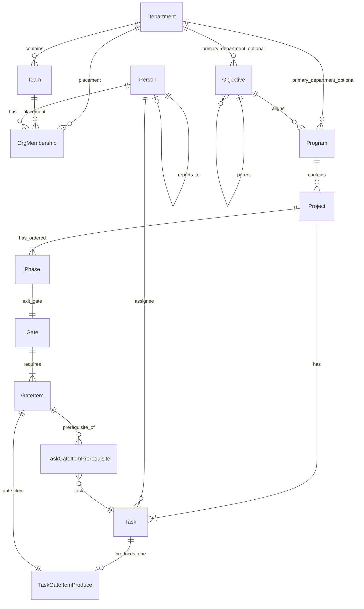

# 目标与执行及其组织支撑（需求）

- **文档类型**：产品与需求 **规范性** 指导（normative）
- **版本**：**v2.38.79**
- **状态**：**v2.38.79 M37 人员添加行置顶（§3.3.10）** · **v2.38.78 Panel 空态 · 同步推进事项 UI（§4.9.10 · 现网）** · **v2.38.77 GET graph 阶段转段读路径自愈（§4.7 · 链《实现》v1.39.95）** · **v2.38.76 M42 Person 身份硬切挂链（§2.3 · 规划）** · **v2.38.75 材料行「材料 / 更换」同行（§13.6.5.1）** · **v2.38.74 材料选择器展示 title（§13.6.5.1）** · **v2.38.73 项目管理 BP（§3.3.5 · M41 现网）** · **v2.38.71 项目进展成果列对齐证据层（§4.9.7 · 现网）** · **v2.38.70 组织详情默认 PBC Tab（§13.10.3 · 现网）** · **v2.38.69 证据层 UI（§13.6.5.1 · 现网）** · **v2.38.68 证据层实现细则（现网）** · **v2.38.67 GateItem 证据层（现网）** · **v2.38.66 阶段完成只通知** · **v2.38.65～v2.38.40** 等历史里程碑状态串仍有效
- **适用对象**：产品、设计、研发（概念与 UI 真源）

**上位规范**（冲突时服从）：[用户需求.md](../../platform_docs/用户需求.md) · [技术设计.md](../../platform_docs/技术设计.md)

**姊妹文档（实现真源）**：[目标与执行及其组织支撑(实现与测试).md](./目标与执行及其组织支撑(实现与测试).md)（**v1.39.95** · …）

**Hermes 集成**：[Hermes与组织及目标执行的集成.md](../../platform_docs/integration/hermes-goal_execution/Hermes与组织及目标执行的集成.md)（**v1.7.6** · 组织 invariant · PA 读集对齐 Web JWT）

**关联实施**：[skstudio-壳层与导航UI迭代.md](../../skstudio/docs/skstudio-壳层与导航UI迭代.md)（五模块壳层 · **组织**顶栏 · **v2.12.51**）· [skstudio-建群审批-需求与设计.md](../../skstudio/docs/skstudio-建群审批-需求与设计.md)（**评审员** 名单 · §2.6）· [组织知识库-项目Note权限迭代.md](../../knowledge_base/docs/组织知识库-项目Note权限迭代.md)（**K27** 项目文档可见性 · 规划）· [项目三分文档协作(需求).md](./项目三分文档协作(需求).md)（**v0.2.10** · F1–F14 · F11 对齐证据层）· [目标与执行-同年多顶层战略目标迭代.md](./目标与执行-同年多顶层战略目标迭代.md)（**M38** · **v0.1.5** · **现网**）· [目标与执行-年组管理面与顶层owner迭代.md](./目标与执行-年组管理面与顶层owner迭代.md)（**M39** · **v0.1.3** · **现网**）· [目标与执行-左树年组时间窗口过滤迭代.md](./目标与执行-左树年组时间窗口过滤迭代.md)（**M40** · **v0.2.0** · **现网**）· [目标与执行-项目管理BP迭代.md](./目标与执行-项目管理BP迭代.md)（**M41** · **v0.2.0** · **现网**）· [目标与执行-Person身份硬切迭代.md](./目标与执行-Person身份硬切迭代.md)（**M42** · **v1.0.0** · **现网** · Person≡id 硬闸零过渡）· [目标与执行-左树专项相关项目数角标.md](./目标与执行-左树专项相关项目数角标.md)（左树专项 `名称(可见, 参与)` ·「所参与」过滤 · **v0.3.1** · **现网**）· [目标与执行-鉴权与API拓扑重构共识.md](./目标与执行-鉴权与API拓扑重构共识.md)（**GE-AUTHZ-API** · **v0.1.15** · **M8–M11 现网** · 传输/谓词/API 拓扑真源）· [组织PBC共识.md](../../pbc/docs/组织PBC共识.md)（**ORG-PBC** · **v0.2.12**）· [组织PBC-UI线框.md](../../pbc/docs/组织PBC-UI线框.md)（**v0.5.4**）· [组织PBC-实现与测试.md](../../pbc/docs/组织PBC-实现与测试.md)（**v0.2.9**）· [standards/](./standards/)（三分文档写法模板）

**状态图例**（全文表格）：**现网** = 已落地可调用；**规划** = 共识待实现。

---

## 文档定位

本文是 **项目治理域** 的 **需求与概念真源**：两子系统边界、核心 ER、派生规则、状态机、**产品 UI 决策（§13）**、反模式（附录 A）。**DDL、REST、域事件、迁移脚本、测试矩阵** 见 [实现与测试文档](./目标与执行及其组织支撑(实现与测试).md)；不得在 ER 定稿前并行发明第二套实体模型。

| 章 | 内容 |
| --- | --- |
| [§1 背景与三维](#1-背景与三维) | 系统定位、目标 / 人员 / 执行 |
| [§2 两子系统](#2-两子系统) | 边界、Person ≡ User、**评审员**、字段命名 |
| [§3 核心概念模型（ER）](#3-核心概念模型er) | 实体、关系、字段 |
| [§4 派生规则与状态机](#4-派生规则与状态机) | Ownership、门条件、Phase/Gate/Task |
| [§4.9 项目推进与 PRA Action](#49-项目推进与-pra-action规划--v23851) | 推进契约 + Panel UI（含判定/返回补充 · **规划**） |
| [§5 门控项状态机](#5-门控项状态机) | 三种形态、提交/签收 |
| [§6 偏差处理](#6-偏差处理) | 延期派生 badge · PM 两阶段偏差 · remediation · `deviated`（P3） |
| [§7 审计](#7-审计) | 横切留痕（概念） |
| [§8 模板层](#8-模板层) | 定义 vs 实例 · **后续**（非 P1–P2 主路径） |
| [§9 与 skstudio 关系](#9-与-skstudio-关系) | 独立 `goal_execution` · BFF · 壳层、执行力模块、知识库 |
| [§10 实施顺序](#10-实施顺序) | 分阶段交付（产品视角） |
| [§11 实现与测试](#11-实现与测试) | 指向姊妹文档 |
| [§12 端到端业务示例](#12-端到端业务示例) | 两阶段 · 三任务闭环 |
| [§13 产品需求与 UI 决策](#13-产品需求与-ui-决策) | **执行力** Tab、Canvas、目标链、组织 UI |
| [附录 A 反模式](#附录-a-反模式) | 禁止做法 |
| [附录 B 默认目标链（产品规则）](#附录-b-默认目标链产品规则) | 命名与不可删约束 |
| [读者指南](#读者指南) | 按角色 / Milestone 阅读索引 · 现网 vs 规划 |
| [§14 修订记录](#14-修订记录) | 文档变更 |

---

<a id="读者指南"></a>

## 读者指南（Normative · 导航）

**不必通读全文**。按角色与阶段择章；**现网** 以 P1 已交付为准；**规划** 条目须见文内「P2/P3/规划」标记。

| 读者 | 现网（维护 / 联调） | P2 战略 owner（规划） | 偏差 / M22（现网） |
| --- | --- | --- | --- |
| **产品 / 设计** | §1–§3 · §13 · 附录 B | §3.3.5 · §3.4.5 · §13.8 | §6 · §13.6.3 |
| **前端** | §13 · §3.4.5.1 · 《实现》§4.0 双 base | §13.5.1 governor 左树 · §3.4.5.0 | Canvas §13.6 · **M26** GI icon + chip picker |
| **goal_execution 后端** | 《实现》§2–§4 · §3 编排 · §6 金样例 | §3.3.5 · 《实现》§4.2.0.1–§4.2.0.3 · GE-T90 | §6 · 《实现》§4.3.4 Deviation |
| **skstudio BFF** | 《实现》§4.0 · §4.2.3 M19 | ge 结构写 · `is_goal_subtree_governor`（域判定在 GE） | 评审员 `X-Actor-Is-Reviewer` |
| **测试** | [测试验证.md](../../platform_docs/测试验证.md) §15 · GE-T01～T15 | **GE-T11** · **GE-T90** | GE-T69～T89 |
| **Hermes / PA** | [Hermes集成 §12.16 `goal`](../../platform_docs/integration/hermes-goal_execution/Hermes与组织及目标执行的集成.md#1216-goal-toolsetp2-共识--v150) | **M24** PA 读集对齐 JWT（PM∪steward∪participant）· GO-04 修订 | inform / deviation |
| **M23 B′（现网 ☑）** | §4.6 · §4.7 · 附录 A **GE-28** | — | 《实现》§10.18 · GE-T96～T100 · GO-10 |
| **M24（现网）** | §3.3.5 · §3.4.5 · §13.8 | steward 全权子树 · `can_govern_project` 含 governor · PA scope · 项目设置只读 IA | 《实现》§10.19 · GE-T101～T103 · **GO-03/04/12** |
| **M26（现网）** | §13.2.3 · §13.6.3 · §13.6.6 | 废止壳层圆点 · 三 chip + QueuePicker · GI 主 icon + ⋯ | 《实现》§10.20 · GE-T104～T108 · **SHELL-E7** |
| **M26+（现网）** | §13.2 · §13.5.1 | 左树 `active` 项目标题内嵌待办 n · 壳层圆点仍废止 | 《实现》§10.21 · **GE-T109** · **SHELL-E7b** |
| **M27（现网）** | §13.5.2 · §13.6.2.2 | 窄屏 **项目内栈式 Canvas**（阶段→门控项/任务→GI 关系）· 宽屏不变 | 《实现》§10.22 · **GE-T110～T113** · **SHELL-E8** |
| **M28（现网）** | §3.2 组织宪章 Note · §13.10.2 | 部门/组各一 KB Note · 懒创建 · excerpt · trash slug 去重 | 《实现》§4.1.4 · §10.25 · **GE-T131～T136** · **ORG-E5** |
| **M29（现网）** | §3.3.6–§3.3.8 · [§3.3.8.1](#3381-默认链与年度目标-normative-m29) · [§3.3.8.2](#3382-考核单元与读时刷新-normative-m29) · 附录 B | 战略时间窗口 · 主责部门 · 年度新树 · 读时 lifecycle | 《实现》§2.2 · §4.2.0.4 · §7.5 · §10.26 · **GE-T137～T145** |
| **M29-UI（现网）** | [§3.3.6 UI](#336-ui-战略周期选择-normative-m29-ui) | Sub **季/月/年** · Program **季/月下拉** · 起止日期系统计算只读 | 《实现》§10.30–§10.31 · **M29-UI-T01～T05** |
| **M30（现网）** | §3.3.9 · §13.5.3 | 负责/参与定义 · 目标侧 **人员** Tab · `people-summary` API | 《实现》§4.2.4 · §10.27 · **GE-T146～T150** |
| **M31（现网）** | §3.3.9 · §13.10.4–§13.10.5 | 组织/人员 **目标与执行** Tab · `goal-portfolio` · 删部门迁移 | 《实现》§4.1.5 · §10.28 · **GE-T151～T157** · **ORG-E8/E9** |
| **M32（现网）** | §13.5.1 · §3.4.5.2 | 目标链 **兄弟排序** · 结构/项目 Tab ↑↓ · **专项移动**（同树 sibling sub）· 左树只读同步 | 《实现》§4.2.0.5 · §4.2.0.5a · §7.7 · §10.32 · **GE-T162～T168** · **M32-UI-T01～T07** · OpenAPI **1.21.0** |
| **M33（现网）** | §13.5.1 | 左树 **标题截断** · name ellipsis · suffix 不截 · title hover | 《实现》§4.2.0.6 · §10.33 · **M33-UI-T01～T04** |
| **M34（现网）** | §13.5.1 | 左树 pane **可拖分栏** · 默认 280px · localStorage | 《实现》§4.2.0.7 · §10.34 · **M34-UI-T01～T03** · **M34-E2E-1** |
| **M35（现网）** | §13.6.2 | 宽屏 Canvas SVG 连线 **layout 变化后 remeasure** | 《实现》§4.2.0.8 · §10.35 · **M35-UI-T01～T02** · **M35-E2E-1** |
| **v2.28（现网）** | §4.8.1–§4.8.5 · §13.6.5 | 阶段缺省/有效窗口 · graph API · 段间不交叉 · Deviation 延展 Phase | 《实现》§4.3.2 · §4.8 · §10.29 · **GE-T158** · OpenAPI **1.20.0** |
| **M36（现网）** | [§13.6.0](#1360-项目详情双模式执行--定义-normative--m36--规划) | 执行\|定义 · Ready=阶段 start · B3 · 治理者=PM · `?tab` / 深链 / 窄屏 · 左树 n 仅 Ready · 人员进设置 | 《实现》§4.2.0.9 · §4.3.3.1 · §10.36 · **GE-T169～T176** · **M36-UI/E2E** |
| **v2.38.71（现网）** | [§4.9.7](#49-项目推进与-pra-action规划--v23851) 项目进展成果列 | 已提交才显材料；Note 标题可点；summary 次行；status/metric 附属；树+by-id；禁 uuid | PRA **v0.2.68** · 线框 outcome-material |
| **v2.38.70（现网）** | [§13.10.3](#13103-部门组详情-tab) | 组织树节点详情默认 **PBC** 为首 Tab | 壳层 **v2.12.60** · FE `meOrgNodeDetailTabs` |
| **v2.38.69（现网）** | [§13.6.5.1](#13651-门控项弹窗-iam19--normative--view-first--m36-修订) · §13.6.8 | 证据层 UI：材料一等字段 · 选择器 P0 · 打开本项 vs 工具栏根 · 错误文案 | 《实现》§10.14a · **GE-T208～T211** |
| **v2.38.68（现网）** | §3.3.4 · §3.4.1 | 证据层实现细则：submit **无**缺 ref 兜底 · `#` 拒 · trash/unavailable · binding 缺失独立码 · sign 存在性 · 偏差同契 · 发版一次到位 | 《实现》§4.3 · §10.14a · **GE-T200～T207** |
| **v2.38.67（现网）** | §3.3.4 · §3.4.1 · §5.1 | 材料=全部 form 证据层 · submit 强制 `content_ref`∈项目 Note 子树（含 dir）· 存量 migration 缺省根 · GE→KB 归属校验 | 《实现》§4.3 · §10.14a · **GE-T49** 扩 · **GE-T200～T207** |
| **v2.38.66（现网）** | [§4.9](#49-项目推进与-pra-action规划--v23851) | 阶段完成 → `notify_phase_complete`（只 inform）；废 `review_phase` HITL · 链 PRA v0.2.47 | 现网（AA） |
| **v2.38.65（现网）** | [§4.9](#49-项目推进与-pra-action规划--v23851) · **§4.9.8** | **Retire 依赖矩阵三列表弹窗**；协同 = Canvas 拖线 + 创建任务可选 GI；就绪集仍按 produce/prereq | 现网（FE） · 对齐 PRA v0.2.51 |
| **v2.38.64～v2.38.51（历史 changelog）** | [§4.9](#49-项目推进与-pra-action规划--v23851) | 下列标「规划 / 实现未齐 / 切换日前」的行均为 **历史条目**；**现行真源**见上文 **§4.9 现网** 与 PRA **v0.2.51** | 勿作验收 |
| **v2.38.64（规划）** | [§4.9](#49-项目推进与-pra-action规划--v23851) · **§4.9.8** · §13.6.5 | 创建任务表单可选 **产出/依赖门控项** | 现网（FE）；切换日前 Panel 等仍见 §4.9 |
| **v2.38.63（规划）** | [§4.9](#49-项目推进与-pra-action规划--v23851) · **§4.9.8** | 矩阵只编排 Task↔门控项；临时交换写项目 Note；弹窗 **+任务/+门控项** + GI 下拉 | 矩阵 UI 部分现网；切换日前 Panel 等仍见 §4.9 |
| **v2.38.62（规划）** | [§4.9](#49-项目推进与-pra-action规划--v23851) · **§4.9.8** | §4.9.8 UI 对齐线框（起点行、外部交付、芯片点选、Retire N×N） | 实现未齐；切换日前现网仍 Gate-primary |
| **v2.38.61（规划）** | [§4.9](#49-项目推进与-pra-action规划--v23851) · **§4.9.8** | 依赖矩阵主编辑 = **三列表**（Task · 前置依赖文档 · 交付文档）；空前置=起点 · 链 PRA v0.2.43 | 实现未齐；切换日前现网仍 Gate-primary |
| **v2.38.60（规划）** | [§4.9](#49-项目推进与-pra-action规划--v23851) · **§4.9.8** | 阶段依赖矩阵：任务区 icon 简图 + 点区开弹窗；真源仍 produce/prereq；就绪集驱动 deliver · 链 PRA v0.2.42 | 实现未齐；切换日前现网仍 Gate-primary |
| **v2.38.59（规划）** | [§4.9](#49-项目推进与-pra-action规划--v23851) | M6 DoD 落 PRA-实现；壳层/AA SDA 指针 · 链 PRA v0.2.41 | 实现未齐；切换日前现网仍 Gate-primary |
| **v2.38.58（规划）** | [§4.9](#49-项目推进与-pra-action规划--v23851) | Panel App 壳：左树+右 SDA 流定稿 · 链 PRA v0.2.40 | 实现未齐；切换日前现网仍 Gate-primary |
| **v2.38.57（规划）** | [§4.9](#49-项目推进与-pra-action规划--v23851) | 进展：卡上可链项目 Note；**不**摘摘要 · 链 PRA v0.2.39 | 实现未齐；切换日前现网仍 Gate-primary |
| **v2.38.56（规划）** | [§4.9](#49-项目推进与-pra-action规划--v23851) | 进展从简：日报只写项目 Note · 链 PRA v0.2.38 | 实现未齐；切换日前现网仍 Gate-primary |
| **v2.38.55（规划）** | [§4.9](#49-项目推进与-pra-action规划--v23851) | 进展=团队知情 status update；日报可选且入项目 Note；旧 remediate 一刀切废名 · 链 PRA v0.2.37 | 实现未齐；切换日前现网仍 Gate-primary |
| **v2.38.54（规划）** | [§4.9](#49-项目推进与-pra-action规划--v23851) | 流上优先；弹窗必有流上入口；长跑进展 · 链 PRA v0.2.36 | 实现未齐；切换日前现网仍 Gate-primary |
| **v2.38.53（规划）** | [§4.9](#49-项目推进与-pra-action规划--v23851) | Panel = 进化 SDA 单栏流 + 按需弹窗；按意图 UI · 链 PRA v0.2.35 | 实现未齐；切换日前现网仍 Gate-primary |
| **v2.38.52（规划）** | [§4.9](#49-项目推进与-pra-action规划--v23851) | 链 PRA v0.2.34 整改意图拆分 | 实现未齐；切换日前现网仍 Gate-primary |
| **v2.38.51（规划）** | [§4.9](#49-项目推进与-pra-action规划--v23851) | Panel 补充判定/返回/左栏与 SDA · 链 PRA v0.2.33 | 实现未齐；切换日前现网仍 Gate-primary |
| **M37（现网）** | [§3.3.10](#3310-项目人员名单normative--m37--现网) | 项目级人员名单 · 系统共享角色（**仅评审员可建选项**）· assignee 自动入名单 · 名单∈participant 读 · 角色≠权限 · **PM 角色只读镜像** · **主责三角色单例** | 《实现》§4.2.5 · **§4.2.5.1** · **§4.2.0.10** · §10.37 · **GE-T177～T190** · **M37-UI-T05** · OpenAPI **1.23.2** |
| **M38（现网）** | [§3.3.8.1](#3381-默认链与年度目标-normative-m29) | **必须**同年多 **company 顶层** · 全状态≤10 · UI 年组/选根/创建聚焦 · 根 reorder 结构 Tab | [M38 迭代](./目标与执行-同年多顶层战略目标迭代.md) **v0.1.5** · 《实现》**§10.38** |
| **M39（现网）** | [§3.3.8.1](#3381-默认链与年度目标-normative-m29) | 年组管理面 · 顶层 owner · 根 ↑↓ 单入口 | [M39 迭代](./目标与执行-年组管理面与顶层owner迭代.md) **v0.1.3** · 《实现》**§10.39** |
| **M40（现网）** | [§3.3.8.1](#3381-默认链与年度目标-normative-m29) | 左树年组 全年/Q1–Q4（本季度=标注）· resolved 优先 · C11/C12 | [M40](./目标与执行-左树年组时间窗口过滤迭代.md) **v0.2.0** |
| **M41（现网）** | [§3.3.5](#335-目标链负责人owner--normative--p2--v217-子树全权) | 项目管理 BP · governor∪PMBP · 问责仍 owner · GA staffed | [M41](./目标与执行-项目管理BP迭代.md) **v0.2.0** · 《实现》**§10.48** |

**冲突处理**：业务语义 **本文** > 《实现与测试》DDL/API 细节 > OpenAPI（以《实现》§8.1 / §4.9 登记版本为准）。**M38 现网**细则见 [M38 迭代文档](./目标与执行-同年多顶层战略目标迭代.md) **v0.1.5**；语义已回写本节。

**独立阅读块**：§6 偏差处理 + M22/M26 Canvas 守卫（GE-21～25 · **GE-30**）为 **执行子域** 规格，P2 战略读者 **不必** 通读。

---

<a id="1-背景与三维"></a>

## 1. 背景与三维

### 1.1 背景

本系统用于管理公司各类项目的 **全流程治理**。三个核心维度，缺一不可：

| 维度 | 管什么 | 核心问题 |
| --- | --- | --- |
| **目标** | 做什么、为什么做 | 大目标拆对了吗？谁负责？ |
| **人员** | 谁来做、归谁管 | 人在哪个部门？能力到哪一级？ |
| **执行** | 做完了没有、能不能往下走 | 上一阶段完成了吗？能进下一阶段吗？ |

**Normative**：**目标定方向，人员定归属，执行定节奏。**

完整链条：

```text
公司大目标 → 子目标 → 项目群 → 项目 → 阶段 → 门 → 门控项 ←→ 任务
```

### 1.2 用语：执行 vs 门控

| 层级 | 用语 | 说明 |
| --- | --- | --- |
| **维度** | **执行** | 战略 / 产品语言（第三维） |
| **机制** | 门、门控项、提交、签收 | 执行维内的 **门控机制** |
| ~~维度~~ | ~~门控~~ | 已废弃为维度名；机制层仍用「门控项」 |

### 1.3 一句话总纲

> 阶段由门定界。人通过 **任务** 参与执行。**现网（B′）**：提交跟着任务产出走，签收跟着任务前置走；门开则阶段转化。**规划（v2.38.65 · §4.9）**：推进意图 + **produce/prereq 就绪集**（Canvas 拖线 / 创建任务声明 GI；临时交换在项目 Note）+ **Project Panel**。审计贯穿始终。

---

<a id="2-两子系统"></a>

## 2. 两子系统

### 2.1 划分

| 子系统 | 对应维度 | 职责 |
| --- | --- | --- |
| **目标与执行** | 目标 + 执行 | 战略拆解链、项目、阶段、门、门控项、任务、偏差 |
| **组织管理**（组织支撑） | 人员 | 在 skstudio User 之上附加部门、组、汇报、专业级别 |

目标线与执行线在 **概念上分维**，在 **建设上合一**——从「为什么做」到「签收了没有」不可切分，故同属 **目标与执行** 子系统。

### 2.2 边界（Normative）

| 子系统 | 持有 | 不持有 |
| --- | --- | --- |
| **组织管理** | 组织树、User 的组织扩展字段、专业级别 | 项目、任务、门控项、任务级交方/收方 |
| **目标与执行** | 目标链、项目、执行链、任务–门控项关联、`Project.pm_user_id` | 组织树（只读引用 `users.id`） |

**Note**：`Project.pm_user_id` 是 **项目级** PM 引用，不是组织汇报关系；任务级提交/签收 **不得** 手工挂人，须走 §4.1 派生。

### 2.3 Person ≡ skstudio User（Normative）

**Person 不是独立人员库**；与现网 **`users` 表 1:1**：

```text
Person.id  ==  users.id
```

| 层 | 内容 |
| --- | --- |
| **skstudio User（现网）** | 账号、登录、消息成员等 · 见《技术设计.md》`users` |
| **组织管理（扩展）** | 在同一 User 上：`user_org_memberships`（**多行**挂靠）+ `user_org_profiles`（标量：汇报、熟练度 · §3.2） |

**Normative**：

- **无** 第二套人员主数据、无外部 HR 同步源（v1）。
- 目标与执行中所有 `*_id → Person` 均写 **`users.id`**。
- P0 组织管理 = **User 组织化**，不是新建 Person 服务。
- **独立进程（v2.1.0）**：`users` 主数据 **仍** 在 skstudio 主库；`goal_execution` **不** 复制 User 表；所有 `*_user_id` 为 **逻辑引用**（JWT/API 校验 · **无** 跨库物理 FK · 《实现与测试》§2）。
- **M42（现网）**：业务 Person 列落库 **仅** `str(users.id)`（`^\d+$`）；BFF+GE **硬闸**；**零过渡 / 无双读** — 真源 [Person 身份硬切迭代](./目标与执行-Person身份硬切迭代.md) **v1.0.0**。

### 2.4 跨系统引用

**唯一跨系统引用**：`users.id`（文档中可记作 `Person.id`；历史别名 `person_id` **仅** 指 `users.id`）。

同一个人、两个维度，示例：

```text
组织管理：张三（users.id）· 研发部 · 前端组 · P7 · 汇报给 TL 李四
目标与执行：张三 · 项目 A · 执行任务 T → 提交/签收相应门控项
```

### 2.5 子系统依赖

```text
组织管理（User 组织化）──users.id──→ 目标与执行
```

组织管理与目标链 **无 org↔objective 硬 cascade**；交汇方式为：

1. **`users.id`** — owner / PM / assignee / **项目名单成员**（权限与参与 · §3.3.9 · §3.3.10）
2. **`primary_department_id`** — Sub-Objective / Program 的 **主责部门** 软关联（报表 · §3.3.7）
3. **读模型** — `people-summary` / `goal-portfolio`（§3.3.9 · **M30/M31**）· **项目名单**（§3.3.10 · **M37**）

### 2.6 评审员（组织管理员 · Normative）

**组织管理员** = **评审员**；与建群 / 分类 / Agent Lab 审批 **共用同一名单**，不另设角色。

| 项 | 说明 |
| --- | --- |
| **环境变量** | `SKSTUDIO_GROUP_CREATION_REVIEWERS`（`username` 列表 · 见《建群审批》§3.1）· **仅 skstudio** |
| **API 判定** | **`GET /me` → `is_group_creation_reviewer`**（UI 显隐）· skstudio 写入 `X-Actor-Is-Reviewer`（及按需组织事实头 · 共识 §3.2）· **域鉴权在 GE**（见 [鉴权与API拓扑重构共识](./目标与执行-鉴权与API拓扑重构共识.md) **v0.1.10**；《实现》§4.0） |
| **职责（本域）** | 组织树 CRUD · `user_org_profiles` 写入 · **读全部项目** · **项目执行治理与 PM 等价**（改图/改 assignee/代提交签收 · §3.4.5 · §13.8）· **结构治理 break-glass** · 浏览器经 skstudio `/api/v1/ge/*`；**域判定在 GE**（`X-Actor-Is-Reviewer`） |
| **UI 入口** | **组织** 顶栏模块 › `/org/*`（§13.4）· 写经 BFF；legacy `/me/org` redirect |

**Normative**：`goal_execution` **不读** reviewer env · **不** 从用户 JWT 解析评审员；仅在 **service 通道** 采纳 skstudio 声明的 `X-Actor-Is-Reviewer`（见共识文）。

**Normative**：文档中的「组织管理员」「平台管理员（组织域）」均指 **评审员**；**不** 在 `user_org_profiles` 再挂 admin 标志。

### 2.7 字段命名（Normative）

凡引用 **Person（≡ `users.id`）** 的外键列与 API 字段，**统一** 后缀 `_user_id`：

| 统一名 | ~~废弃~~ |
| --- | --- |
| `pm_user_id` | ~~`pm_id`~~ |
| `assignee_user_id` | ~~`assignee_id`~~ |
| `created_by_user_id` | — |
| `owner_user_id` | ~~`owner_id`~~（Objective / Program 文档语义） |
| `manager_user_id` | — |
| `lead_user_id` | 组负责人（`org_teams` · 《实现与测试》§2.1） |
| `primary_department_id` | 主责部门（Sub-Objective / Program · §3.3.7 · **M29**） |

**Normative**：DDL（《实现与测试》§2）、OpenAPI、前端类型 **须** 使用上表左列；概念章（§3.2）与 DDL 不一致时 **以《实现与测试》§2 + 本节为准**。

---

<a id="3-核心概念模型er"></a>

## 3. 核心概念模型（ER）

### 3.1 总览



**Note**：`TaskGateItemProduce` 与 `GateItem` 为 **1:1**（§3.4）；`TaskGateItemPrerequisite` 允许多任务共享同一前置门控项。

### 3.2 组织管理 · 实体

| 实体 | 说明 | 关键字段（物理列名 · §2.7） |
| --- | --- | --- |
| **Department** | 部门（可嵌套 · **编制与治理节点**） | `id`, `name`, `parent_id?`, `manager_user_id` → Person（**NOT NULL · 见下**）· `department_note_id?` → 知识库 Note（§3.2 · **M28**） |
| **Team** | 组（**部门内执行单元** · 不可嵌套） | `id`, `department_id`, `name`, `lead_user_id` → Person（**NOT NULL · 见下**）· `team_note_id?` → 知识库 Note（§3.2 · **M28**） |

**负责人必填（Normative · ORG-PBC / 组织治理 · 2026-08-04）**

| 规则 | 约定 |
|------|------|
| 部门 | `manager_user_id` **创建时必填**；PATCH **禁止**清空（`400 manager_required`） |
| 组 | `lead_user_id` **创建时必填**；PATCH **禁止**清空（`400 lead_required`） |
| 存量 | 上线前须回填空负责人；未回填节点 **禁止** 进入 PBC 对照（无上沿） |
| 为何 | PBC 层次对照上沿=节点负责人；空经理会逼出代理/假上沿等复杂度；与「任命即挂靠」一致 |

实现：skstudio `org_local.create/patch_department|team`（现网写路径）。
| **OrgMembership** | 一处组织挂靠（**多行** / user） | `id`, `user_id`, `department_id`, `team_id?` · 表 `user_org_memberships` |
| **Person** | ≡ `users` + 组织标量扩展 | `id`, `primary_membership_id?` → OrgMembership, `manager_user_id?`, `proficiency_level` · 表 `user_org_profiles` |

**汇报关系（Normative · v2.23 · v2.36 用语收紧）**：

- **主汇报链** = 沿 **主归属**（`primary_membership_id` 所指 membership）向上推导：**唯一**。
- **主归属部门** = 主归属 membership 的 `department_id`（编制与汇报语境的部门锚）。**禁止** 另设与主归属脱节的「主管部门」字段；口语「主管部门」**≡** 主归属部门。
- 推导规则（Phase 2 实现 · 方向已定）：组内 membership → 上级 **通常** 为 `Team.lead_user_id`；直属 membership → **通常** 为 `Department.manager_user_id`；再沿组织树 / `Person.manager_user_id` 向上 walk。
- `Person.manager_user_id`：**可选手工 override**（虚线汇报 · Phase 2）；未填时走主归属推导。
- **废止** v2.22 之前「Phase 2 再议多归属」的模糊表述；v2.23 **以主归属为锚**。

**ProficiencyLevel**：枚举 `junior` → `mid` → `senior` → `expert` → `chief`；挂在 `Person.proficiency_level`。

<a id="部门与组-normative-v236"></a>

#### 部门与组（Normative · v2.36）

**产品决策（Accepted · v2.36）**：**组 ≠ 子部门**。部门是可嵌套的 **治理 / 编制** 节点；组是某部门下的 **执行编制格子**（小队），**不** 占独立编制轴、**不** 作为目标主责部门、**不可** 再挂子组/子部门。

| 维度 | 部门 / 子部门 | 组 |
| --- | --- | --- |
| 结构 | 可 `parent_id` 嵌套；可含下属组 | **必须** 属且仅属一部门；**禁止** 组下再挂组/部门 |
| 编制 | **编制只看部门**（见下） | **不** 产生编制维度 |
| 目标主责 | 可挂 `primary_department_id` 等 | **不可** 作主责部门 |
| 管职 | `manager_user_id`（可一人多部门） | `lead_user_id`（可一人多组；**组间无主次**） |
| 成员 | 直属（`team_id` 空）+ 各组员 | 仅组员（`team_id` 精确） |

<a id="编制-normative-v236"></a>

#### 编制（Normative · v2.36）

**产品决策（Accepted · v2.36）**：**人的编制不看小组，只看部门。**

| 规则 | 说明 |
| --- | --- |
| **编制轴** | 仅 `department_id`；组名单 / 组长 **不** 改变占编口径 |
| **同部门多组** | 一人在同部门多个组 → 该部门编制仍按 **该人计 1**（去重） |
| **兼多部门** | 可在多个部门各有挂靠；**主编制 / 主汇报** 认 **主归属部门** |
| **指标 / GA / UI** | 编制人数、超编缺编等 **禁止** 按组人数简单相加冒充部门编制 |

<a id="成员归属-normative-v222"></a>

#### 成员归属（Normative · v2.22 · **v2.36 修订**）

**产品决策（Accepted · v2.22；v2.36 修订）**：一人 **可** 同时归属 **多个部门**、**多个组**（含 **同部门多组**）；一人 **可** 兼任 **多个部门** 的 `manager_user_id`、**多个组** 的 `lead_user_id`。治理角色与挂靠 **解耦**，但 **任命即挂靠**（见任命节）。

| 规则 | 说明 |
| --- | --- |
| **多部门挂靠** | 同一 `user_id` 可有多条 membership（如董事会直属 + 研发直属） |
| **同部门多组** | 同一 `department_id` 下可有多条 **不同** `team_id` 的组挂靠；可与该部门直属（`team_id` 空）**并存** |
| ~~同部门互斥~~ | **废止（v2.36）** · 原「直属或至多一个组」 |
| **跨部门** | 可同时：A 部门直属 + B 部门多组 + C 部门直属 |
| **属于某部门** | ∃ membership 且 `department_id = D`（直属或 D 下任一组均算） |
| **未分配** | 无任何 membership 且未离职 |
| **`org_path` 展示** | BFF 聚合 **全部** 挂靠路径，以 **`；`** 连接（如 `董事会；研发 › 平台组；研发 › 算法组`） |
| **组织树节点人数** | 按该节点对应 membership **行** 计数（一人可在多组各计一次）；**部门编制汇总** 须按 `user_id` **去重**（§编制） |

**UI · 添加 / 移出**：「添加到部门/组」= **新增** membership；从某节点「移出」= **删除该节点对应 membership 行**，**不** 清空其它挂靠。

<a id="主归属-normative-v223"></a>

#### 主归属与主汇报链（Normative · v2.23 · v2.36 用语）

**产品决策（Accepted · v2.23）**：在允许多处挂靠的前提下，每人 **须** 有 **至多一个** **主归属**（`primary_membership_id` → 某条 `OrgMembership`），据此形成 **唯一主汇报链** 与 **唯一主归属部门**。

| 规则 | 说明 |
| --- | --- |
| **主归属对象** | **一条 membership**（含「部门直属」或「部门 › 组」），**非** 裸 `department_id` · **非** 独立「主挂组」职级 |
| **主归属部门** | 该条的 `department_id`；全员（含经理）**至多一个** |
| **组无主次** | 同部门多组挂靠 / 多组 lead **不** 再标「主挂组 / 主管组」；主次只存在于 **部门级主归属** |
| **仅 1 条 membership** | **自动** 为主；无需 radio |
| **≥ 2 条 membership** | **须** 指定主归属；未指定 **禁止** 完成相关写操作（见 §13.10.1） |
| **任命即挂靠** | 追加 membership **不自动改主**；若导致 ≥2 条且尚无主 → **须** 当场选主 |
| **人员列表 `org_path`** | 仍展示 **全部** 路径（`；`）；主归属在详情 / 选择面板 **标注「主」** |
| **Canvas 团队 icon（M14）** | 派生自 **主归属** 对应路径（非 Task 字段） |
| **inform 汇报链** | `inform_reporting_chain` / PA 汇报链 walk **以主归属推导链** 为真源（**Phase 2 切换算法** · v2.23 先交付主归属字段与 UI）；`manager_user_id` 为 override |

<a id="主归属-invariant-v223"></a>

#### 主归属 invariant 与存量（Normative · v2.23）

**产品决策（Accepted）**：主归属是 **数据 invariant** + **写门禁**；读路径 **不** 因缺主而失败。

| 状态 | 读（列表 / 详情 / 组织树 / 选人） | 写 |
| --- | --- | --- |
| **0 条 membership** | 正常 · `is_unassigned=true` | 正常（添加首条 → 自动主） |
| **1 条 · 有主** | 正常 | 正常 |
| **1 条 · 无主** | 正常 · **实现须自愈**：视为该条即主并回写 `primary_membership_id` | 正常 |
| **≥2 条 · 有主** | 正常 · `org_path` 全路径 · 主路径可 badge | 正常 |
| **≥2 条 · 无主** | 正常 · BFF `needs_primary_selection=true` · Canvas M14 **不显示** · 汇报链 **暂** 走现网 `manager_user_id` walk（Phase 2 改主归属推导） | **门禁**（见下表） |

**写门禁（Normative · ≥2 条且无 `primary_membership_id`）**：

| 写路径 | 行为 |
| --- | --- |
| `POST …/memberships`（仅追加） | **409** · `primary_membership_required` · **除非** 同请求体含合法 `primary_membership_id`（指向将存在的行） |
| `POST/PATCH` 设经理/组长（GE 原子追加 membership） | GE **允许** 追加 · skstudio **须** 在提交前经 UI 收集主归属（§13.10.1）· **禁止** 仅调 GE 而绕过 BFF 门禁 |
| `PATCH …/profile` · `primary_membership_id` | **允许**：评审员；或部门子树管家且所选主行 `department_id` ∈ 管辖子树（**Web** · 添加后选主） |
| `DELETE …/memberships/{id}` | 允许 · 删后若剩 **1** 条 → **自动** 升格为主；若仍 **≥2** 且无主 → 回到门禁态 |
| 目标/项目/任务 assignee 等 **非组织** 写 | **不** 阻塞（组织未完备仍可选人 · §3.2 P1） |

**017 迁移回填（Normative）**：

1. 自 `user_org_profiles.department_id`/`team_id` **INSERT** 对应 membership 行（无则跳过）。
2. 若 resulting count **= 1** → 设 `primary_membership_id`。
3. 若 **≥2** 且旧 profile 有 dept/team → 主 = **匹配旧 profile 的那一行**；其余保留。
4. 若 **≥2** 仍无法唯一判定 → **留空** · `needs_primary_selection` · 由评审员在人员详情补选（**不** 按 `created_at` 猜测）。

**批量添加成员（§13.10.1 扩展）**：一次添加 N 人时，**按人** 判断：仅对「操作后将 ≥2 条且无主 / 尚无主且已 ≥2」的用户展开主归属面板；**须** 全部满足后方可一次提交。

<a id="任命与成员归属-normative-v21-v222"></a>

#### 任命与成员归属（Normative · v2.21 → v2.22 · **v2.36 修订**）

**产品决策（Accepted）**：部门负责人 / 组长 **须** 在所管范围内 **至少** 有一处成员挂靠（与 v2.21 一致）。**管理某部门 ⇒ 归属该部门**；**lead 某组 ⇒ 须已属于该组所在部门**（任命事务可原子追加组挂靠以满足）。

| 触发 | 对 `OrgMembership` 的副作用（v2.36） |
| --- | --- |
| 设 `Department.manager_user_id` 为非空 | **追加** 该部门直属 membership（已存在则 **no-op**）· **不删除** 其它部门 membership · **不自动改** 主归属 |
| 设 `Team.lead_user_id` 为非空 | **前置**：任命对象 **已属于** 该组 `department_id`（∃ 该部门挂靠），**或** 本事务先追加本组 membership 使其属于该部门。**追加** 该组 membership（已存在则 **no-op**）· **不** 删除同部门其它组挂靠 · **不** 覆盖直属 · **不改** 主归属 |
| 清空 `manager_user_id` / `lead_user_id` | **禁止**（`400 manager_required` / `lead_required`）· **不** 再提供「无负责人」节点 |
| ~~跨部门覆盖~~（v2.21） | **废止** · v2.22 改为 **仅追加** |
| ~~同部门直属↔组替换~~（v2.22） | **废止（v2.36）** · 直属与多组可并存 |

**部门经理（Normative · v2.36）**：

| 规则 | 说明 |
| --- | --- |
| **可管多部门** | 一人可任多个 `Department.manager_user_id` |
| **主归属唯一** | 仍只有一个主归属部门；所管部门 **不必** 等于主归属部门 |
| **任命即归属** | 见上表 |

**组长（Normative · v2.36）**：

| 规则 | 说明 |
| --- | --- |
| **部门内执行单元** | 仅 **已属该部门** 者可加入 / lead 该部门下的组 |
| **可 lead 多组** | 同一人可任多组 `lead_user_id`（限已属部门之下的组） |
| **组间无主次** | **不** 设「主管小组 / 主挂组」第二字段；多 lead 权限同等 |
| **缺省目标** | 多 lead 时 `inform_team` 等 **须** 显式 `team_id`（不可唯一解析 → **409** `ambiguous_target`） |

**Normative**：副作用在 **goal_execution** `POST/PATCH /org/departments` 与 `POST/PATCH /org/teams` 写路径 **原子** 完成。**不** 在设经理/组长时自动改 `primary_membership_id`（见 §13.10.1）。

**派生 · Canvas 团队 icon（M14 · v2.23）**：取 **主归属** membership 的 `org_path`；无主归属时不显示（与「可空」一致）。

<a id="组织宪章-note-normative-m28"></a>

#### 组织宪章 Note（Normative · M28 · **现网**）

**产品决策（Accepted · M28）**：部门与组的 **职责 / 协作说明** 以 **知识库 Note 为唯一真源**；goal_execution **不** 持久化 `description` 等正文字段。

| 决策 | 说明 |
| --- | --- |
| **真源** | **仅** 知识库 Note · GE 仅存 **绑定 id** |
| **范围** | **部门** + **组** 各 **一** Note · **个人 Note 本期不做** |
| **GE 字段** | `org_departments.department_note_id` · `org_teams.team_note_id`（均可空 · 逻辑 FK → note uuid） |
| **KB 主题 slug** | 固定 **`org-charter`** · path/API/代码常量（同 M19 `project-management`） |
| **KB 主题 title** | 固定展示名 **「组织宪章」** · 系统 ensure（同 M19「项目管理」模式） |
| **Note 标题** | 默认 **`{节点名} 宪章`** · **仅在本主题内** title 唯一 |
| **KB path** | `org-charter/departments/{slug}` · `org-charter/teams/{slug}` · 末段 `{slug}` 由 Note 标题生成（中文 → 拼音）· **活区 + 回收站** 去重 · 冲突时 slug **追加 `-2`、`-3`…**（同 §3.3.4） |
| **创建时机** | **懒创建**：评审员在组织详情点 **「+ 创建部门/组宪章」**（**非** 建部门/组时自动建） |
| **改名** | `PATCH` 部门/组 **改 `name`** → **不同步** Note `title` / path（宪章标题独立 · **Accepted**） |
| **预览** | 组织详情从 Note 拉 **excerpt** · **≤500 字** · 去 Markdown · 空正文显示空态文案 |
| **打开** | 跳转知识库深链 `/knowledge/…` · 模式同 **打开项目文档**（§3.3.4 · §13.6.8）· **禁止** 在组织页内嵌 KB 编辑器 |
| **删除 · 前提** | 删部门须 **无子部门、无组**（现网 `department_has_children` / `department_has_teams`）· **无** 级联删组 Note |
| **删除 · Note** | 删部门/组时 **同步软删** 本节点绑定 Note 至回收站（path = slug 镜像 · 《组织知识库》§12.5）· 若 `_trash` 内已有 **同 slug path** → **先** 将该 **回收站内** 存量 note 的 slug **前缀 `_`**（仍冲突则 `_2`… 直至 trash 内 path 唯一）· **再** soft-delete 活区 note · **不改** 活区 note 的 slug/title |
| **ACL · Phase 1** | **评审员** 全权 · **部门经理** / **组长** 对 **各自** 节点 Note **可读可写** · **登录用户全员可读** · **后置任命**：设 `manager_user_id` / `lead_user_id` 时若已绑宪章 → BFF **追加** Note ACL（清空负责人 **不** revoke） |
| **ACL · Phase 2（可选 · 暂缓）** | 宪章 Note 与 membership **批量**挂钩 · **非 M28 阻塞** · **K22 明确 out of scope**（宪章现网 `authenticated` read 已覆盖部门成员 · 见 [《组织知识库》§6.5.7](../../knowledge_base/docs/组织知识库.md#657-组织-acl-与-jwt-k22--normative)） |
| **ACL · 通用 KB（K22）** | 主题/note ACL 主体 **`user` + `org`**（部门/组）· **废止** IM 群 / builtin 受众 · Agent 仅登录用户权限 · 规格见 [《组织知识库》§8.5](../../knowledge_base/docs/组织知识库.md#85-k22-组织-acl-验收normative--657--6510) |

**Normative · 与项目 Note 对照**：

| 维度 | **项目 Note（M19 · 现网）** | **组织宪章 Note（M28 · 现网）** |
| --- | --- | --- |
| 绑定字段 | `ge_projects.project_note_id` | `department_note_id` / `team_note_id` |
| 主题 slug | `project-management` | **`org-charter`** |
| 主题 title | 「项目管理」 | **「组织宪章」** |
| 创建 | 建项目 **同事务** | **懒创建**（评审员显式触发） |
| 改名 | **同步** Note title | **不同步** Note title / path |
| 正文用途 | 门控 material 协作真源 | 组织职责 / 协作说明（**只读引用** · 不进执行流） |
| Note ACL | PM read/create/update | 经理/组长 read+update · 全员 read · 评审员全权 |

**Normative**：`GET /org/departments`（含 teams）**须** 返回 `department_note_id` / `team_note_id`；excerpt **由 skstudio BFF 聚合**（KB read + 截断）· **不** 经 goal_execution 缓存正文。`GET …/charter-excerpt` 无绑定时 **200** · `{ bound: false, excerpt: null }`（**非** 404）。

### 3.3 目标与执行 · 目标链

| 实体 | 说明 | 关键字段 / 关系 |
| --- | --- | --- |
| **Objective** | 大目标 / 子目标 | `level`: `company` / `sub`；`parent_id?`；`owner_user_id` → Person（**创建时 NOT NULL** · §3.3.5）；`pmbp_user_id?` → Person（**可选** · §3.3.5 · M41）；`is_default` bool（**legacy · v2.34 起恒 false · 勿新建** · 附录 B）；**M29**：`period_granularity` · `period_start` / `period_end` · `lifecycle_status` · `primary_department_id?` → Department（§3.3.6–§3.3.8） |
| **Program** | 项目群（专项） | `objective_id` → Objective（**NOT NULL**）；`owner_user_id` → Person（**创建时 NOT NULL** · §3.3.5）；`pmbp_user_id?` → Person（**可选** · §3.3.5 · M41）；`is_default` bool（**legacy**）；**M29**：`period_granularity` · `period_start` / `period_end` · `lifecycle_status` · `primary_department_id` → Department（**必填** · §3.3.7） |
| **Project** | 项目（**枢纽**） | `program_id` → Program（**必填** · v2.34）；`pm_user_id` → Person；`created_by_user_id` → Person；`status`（§3.3.1）；`project_note_id` → 知识库 Note（§3.3.4 · **M19**）；**主责部门读时派生** = 所属 Program.`primary_department_id`（§3.3.7）；**人员名单** → §3.3.10（**M37**） |

```text
Objective(company · is_default=false)*  ← 顶层战略目标（同年可多条 · 评审员 POST /years · M38）
  └── Objective(sub)*
        └── Program*
              └── Project*
```

**Normative · 方案 A（Accepted）**：总目标下 **仅** 挂子目标；**禁止** 在 `company` 节点下直接挂 Program。

#### ~~默认总目标与默认 Program~~（已移除 · v2.34）

**v2.34 起**：默认链 b1/b3/b2 **已删除**；见 [附录 B](#附录-b-默认目标链已移除--v234)。下列规则 **仅作历史归档**：

| 规则 | 说明 |
| --- | --- |
| ~~默认总目标~~ | ~~系统有且仅有一个 `is_default=true` company~~ |
| ~~默认 Program~~ | ~~`POST /projects` 可省略 `program_id`~~ |
| **新建 Project** | **`program_id` 必填** · 须 active Program · **is_goal_subtree_governor** 或评审员 |
| **禁止游离** | 禁止 `objective_id IS NULL` 的 Program；禁止 Project 脱离 Objective 链（**GE-12**） |

**PM 形态**（`Project.pm_user_id` 语义）：

| 形态 | 适用 |
| --- | --- |
| 专职 PM | 大项目、多阶段、跨部门 |
| Team Lead 兼 | 项目在单组内闭环 |
| 部门经理兼 | 项目跨多 Team |

#### 3.3.1 Project.status

| 值 | 含义 | 转移 |
| --- | --- | --- |
| **draft** | 已创建，阶段/任务可编辑，**未**进入执行 | 创建时默认 |
| **active** | 执行中；恰一 Phase 为 `active` | PM **`activate`**（《实现与测试》§4.2） |
| **completed** | 全部业务完成 | **结束** 系统阶段 `Gate.is_open` 后系统自动（§4.5） |
| **archived** | 只读归档 | PM 手动（**规划**） |

**Normative**：仅 `active` 项目允许 Task 启动、GateItem 提交/签收（`draft` 仅配置；`completed` / `archived` 只读）。

#### 3.3.2 项目创建者与删除（Normative）

| 字段 / 规则 | 说明 |
| --- | --- |
| **`created_by_user_id`** | `POST /ge/projects` 的 **JWT 当前用户**（可与 `pm_user_id` 不同 · §3.3.3） |
| **删除权限** | **`pm_user_id` 或 `is_goal_subtree_governor` 或评审员**（§3.3.5 · §2.6）· UI **二次确认** |
| **删除前提（PM）** | **`pm_user_id`（非 subtree owner）** 须 **`project_is_empty`**（下表） |
| **删除前提（负责人/评审员）** | **`is_goal_subtree_governor` 或评审员** 可 **强制软删**（**跳过** `project_is_empty`）· UI **须** 明确警告（含进行中/含任务） |
| **删除语义** | **软删**（《实现与测试》§2 `deleted_at`）· 对外不可再访问 · 列表过滤 · **AuditEvent 保留** · 关联 **Project Note** 经 BFF 同步删除 |

**`project_is_empty`**（**PM 删除**时须全部为真；**负责人/评审员 force delete** 时不校验）：

```text
Project.status == draft
∧ ∀ Phase : status == pending
∧ ∀ Task : （`deviated` 为 false）∧ effective_status 派生为 **waiting**（§4.6.2）· **无** `started_at` / `done_at`
∧ ∀ GateItem : status == draft
    ∧ submitted_by IS NULL ∧ signed_by IS NULL ∧ rejected_by IS NULL
```

**Normative**：

- Phase / Gate / Task / GateItem **行可存在**（创建时的图结构保留）；「空」指 **未进入任何执行/提交/签收**（门 `is_open` 恒为 false）。
- **PM** 不满足 `project_is_empty` → **409** `project_not_empty`。
- **`is_goal_subtree_governor` / 评审员** 不满足 `project_is_empty` 时 **仍允许** `DELETE`（`can_force_delete_project` · 《实现》§4.3 · **v2.35**）。
- 非 PM / 非 `is_goal_subtree_governor` / 非评审员 → **403** `not_project_governor`。
- `DELETE` 设置 `deleted_at`（软删）；`GET /ge/projects` 与详情 **须** 过滤 `deleted_at IS NULL`；已软删项目 **GET → 404** `project_not_found`（与不存在同语义 · GE-T08）；子图行 **保留** 供审计关联。

#### 3.3.3 创建向导规则（P1c · Normative · Accepted v2.0.1）

| 规则 | 说明 |
| --- | --- |
| **创建者 ≠ PM** | **允许** · `created_by_user_id` 为 JWT 当前用户 · `pm_user_id` 由向导指定 |
| **assignee 组织** | assignee **不要求** 已有 `user_org_profiles`（§13.5.1 · 团队 icon 可空） |
| **评审员代建** | 评审员 **可** `POST /ge/projects` · `created_by_user_id` = 评审员本人 · 删空项目 **与 PM / is_goal_subtree_governor 同权** |
| **draft 读权** | **废止（GE-VIS-1）** · `created_by_user_id` **仅审计**；读权 = PM ∨ participant ∨ `is_goal_subtree_governor` ∨ 评审员 · 真源 [个人左树投影迭代.md](./目标与执行-个人左树投影迭代.md) |
| **activate** | **仅** `pm_user_id` · 创建者若非 PM **不可** activate |

#### 3.3.4 项目文档（Project Note · M19 · Normative）

**总纲**：

> **协作真源在项目 Note；流程真源在 Canvas 门控项。** 参与者在 Note 中阅读、讨论、开会；**提交 / 签收** 是对「Note 已能支撑该项门控条件」的 **正式确认**，不替代沟通，也不在弹窗中承载正文。

**两层模型**：

| 层 | 真源 | 用户主要在哪 |
| --- | --- | --- |
| **协作** | 知识库 **项目 Note**（§下） | 知识库「项目管理」主题 · 项目文档 |
| **流程** | `goal_execution` Canvas + GateItem 状态机 | 执行力 Canvas · **薄** 门控项弹窗 |

**内置主题「项目管理」**（[组织知识库.md](../../knowledge_base/docs/组织知识库.md) 同域）：

| 规则 | 说明 |
| --- | --- |
| **主题** | 固定名 **「项目管理」** · 目标与执行域内置库 |
| **ensure** | **系统** 在首次需要时创建主题（**非** PM 手工建主题） |
| **Note 数量** | **一项目一根 Note** · `Project.project_note_id` → 根 `kb:{note_uuid}`；根下可有任意子节点（三分页、成员自建页等） |
| **Note 标题** | **= `Project.name`** · **仅在本主题内** title 唯一 |
| **Note slug** | 由标题生成（中文 → 拼音，如「测试」→ `ce-shi`）· 分配 path 时 **活区 + 回收站** 去重，避免软删冲突 |
| **创建者** | frontmatter `owner` = **`pm_user_id`** · KB **由评审员代建** Note · 权限 **不** 依赖长期 ACL 行（见下） |
| **可见性 / 权限（K27 · 现网）** | 根 Note + 子树 **策略锁死**：仅 **项目成员（根可读可写·可建子页·不可删根）** / **PM** / **subtree governor** / **评审员（全项目 governor 级）**；**禁** `authenticated` 全员读与 topic 回落；**禁** 改 ACL / public share。真源：[组织知识库-项目Note权限迭代.md](../../knowledge_base/docs/组织知识库-项目Note权限迭代.md) **v1.0.9**。**废止**「主题 `authenticated:read` → 登录可读全部项目文档」 |

**创建事务（Normative）**：

`POST /ge/projects`（含 draft）与 **创建项目 Note** **同事务语义**（skstudio BFF `create_project_with_note` · **现网**）：

1. 系统 ensure 主题「项目管理」
2. 在该主题下创建 **根** Note（`title = name` · 现网常为 `kind=dir` 容器）· 主题内重名 → **409** `note_title_conflict` · **不得** 创建项目
3. **（现网 · 三分）** 同事务种子三工作子页 · 见 [项目三分文档协作(需求).md](./项目三分文档协作(需求).md)
4. 仅 Note（及种子）成功 → 写入 `project_note_id` 并落库项目图 · KB `project-bindings` 绑定根 path
5. 任一步失败 → **整体失败** · 已建 Note **补偿删除**（编排见《实现与测试》§4.2.3）

**GA 建项（v29.00.07 · 规划）**：`governance_goal_mutate` / `project-create-plan` commit 的 create 步 **与上表同编排**（`create_project_with_note`）；执行图仍可为「方案」空壳。**不含**三分种子（非通用建项）。见 [release-v29.00.07.md](../../platform_docs/migration/release-v29.00.07.md)。

**改名事务（Normative）**：

`PATCH /ge/projects/{id}` 改 `name` 时 **同步** 改绑定的项目 Note `title`（仍须主题内唯一）· Note 改名失败 → **项目改名失败**（**409** `note_title_conflict`）· 同事务语义与补偿策略同创建。

**删除项目**：软删项目时 **同步软删** 绑定 Note 至知识库回收站（v20.2.5+）· Audit 保留 `project_note_id` 关联。

**与门控项提交/签收（Normative · v2.38.67 · 证据层）**：

> **材料是所有 `form` 的证据层**；`form` 只区分结构化判定形状。协作真源在项目 Note 子树；流程真源在 GateItem。

| 层 | 规则 |
| --- | --- |
| **公共证据** | 三类 submit **均须显式** `content_ref` + `summary`（**禁止**服务端在 submit 时缺省填根） |
| **`content_ref`** | `kb:{note_uuid}` · 须落在本项目根 Note **子树内任意节点**（含根 · **含 `kind=dir`** · kbase 节点皆为独立文档）· **禁止** `#anchor`（本轮 · 带锚点 → `invalid_content_ref`） |
| **定义态** | `content_ref` **可选**；有根时可预填根 · UI 明示「材料：…（可更换）」 |
| **提交态** | **强制显式** `content_ref`；缺省 → **400**；无根 Note → **409** `project_note_required` |
| **归属校验** | **GE 经 KB service API** 断言 Note∈本项目子树（复用 `project_binding`+path）· 权威 **仅 GE** · KB 不可用 **不降级**（短超时 · 至多一重试 → **503**） |
| **改绑** | 仅 `draft` / `rejected`；`pending_sign` / `signed` **硬拒**（无治理特批） |
| **删/移/回收站** | KB **不**维护「被哪些 GI 依赖」；不级联改 GI · submit/**sign** 失败 → `content_ref_note_unavailable` |
| **binding 缺失** | 有 `project_note_id` 但 KB 无 project binding → **独立错误、不放行**（勿伪装 `project_note_required`） |
| **缺省 / 存量** | **仅 migration** 将缺 `content_ref` 的 metric/status 回填根；已有合法 ref **不覆盖** · **submit 路径不兜底** |
| **系统 GI** | `项目启动` / `结项复盘` **不豁免** · migration/定义预填根 |
| **偏差重提** | 与普通 submit **同一证据契约** |
| **UX** | 打开 **本项材料 Note**；选择器可不挡硬契约发版 |
| **legacy** | 新 submit **只**接受子树内 `kb:`；已 `signed` 的 `https`/`att` **只读保留**；未签收非法 ref migration → 根 |
| **发版** | **一次性到位**：KB API → migration → GE 强硬校验 → FE（同窗或严格顺序；无旧 FE 兼容窗） |

| form | Note 中（建议承载） | GateItem（流程层 · 判定） |
| --- | --- | --- |
| **material** | 正文章节 + attachments | 仅证据：`content_ref` + `summary` |
| **metric** | 口径、数据来源、过程记录 | 证据 + `target_value`/`operator` + 提交 `actual_value` |
| **status** | 检查标准、会议纪要、部署记录 | 证据 + `target_state`/`target_value` + 提交 `actual_value` |

**Normative**：签收人 **以阅读 `content_ref` 指向的 Note（及会议）为主要审阅路径** · 弹窗 **不** 替代材料审阅（**GE-17**）。

##### 三分工作文档（Normative · v2.38.17 · **现网**）

> **完整条款与冻结清单 F1–F14**见 [项目三分文档协作(需求).md](./项目三分文档协作(需求).md)。本节为 GE 锚点摘要。

| 规则 | 说明 |
| --- | --- |
| **结构** | 根下 **需求 / 实现 / 测试**（`doc_kind` 必填）；建项 **同事务种子**；存量幂等补齐 |
| **当前 one reality** | 工作三页；`releases/` 只读快照（仅 **项目经理** 可删） |
| **写权** | 仅对口单例：`product_manager` / `technical_designer` / `test_designer`；**含项目经理在内**其余角色三分页只读 |
| **应急** | 项目经理 **改任** 单例角色（保单例）；**禁止** 项目经理直接写三分页 |
| **根 Note** | 写权 **不** 因本需求变更（与三分页解耦） |
| **空槽 / 兼任** | 空则无人可写；**不支持** 一人兼两单例 |
| **协作** | PA = 当前用户身份；横切读评；项目经理/governor **联合评审不改正文**；意见 inform → 对口 PA；不依赖 Master |
| **门控（v2.38.67）** | `content_ref` 可指根 **或** 子树内任意节点（含三分页）；**废止**「P0 仅指根」 |
| **与 K27** | 三分页叠加规则见 K27 **§8.4.1** |

#### 3.3.5 目标链负责人（Owner · Normative · P2 · v2.17 子树全权）

**产品决策（Accepted · v2.17）**：Objective / Program **须** 有明确负责人；**谁负责某节点，谁即以该节点为根，对其整棵子树拥有读、搜、结构管理与执行治理的全部权限**（与 Web JWT / BFF 验权一致）。**不再** 拆分「结构 owner 只读 graph / 执行归 PM」两层模型（v2.12 **废止** · 见 **GE-26 废止**）。

| 层级 | 负责字段 | 子树范围 | 全权含义（Normative） |
| --- | --- | --- | --- |
| **总目标 / 子目标** | `owner_user_id` | 其下所有子目标、项目群、项目 | 目标链 CRUD · 项目创建/迁移/删空 · **Canvas 执行治理**（改图 / activate / submit-sign / 偏差） |
| **项目群** | `owner_user_id` | 其下所有项目 | 项目群 CRUD · 下属项目结构 + **执行治理** |
| **项目** | **`pm_user_id`** | 该项目本身 | 与上相同 · **项目级负责者 = PM** |

**用户话术（Normative）**：对用户只说 **「负责」** 与 **「参与（做任务）」** · **不** 暴露 `is_goal_subtree_governor` / steward 等实现词。

**`owner_user_id` 必填规则**：

| 实体 | 规则 |
| --- | --- |
| **非默认** Objective / Program | 创建时 **`owner_user_id` NOT NULL** · UI **须** 选人（`ExecutionUserSelect` · §13.5.1） |
| **默认** 总目标 / 子目标 / Program（附录 B） | 种子可为 `NULL` 或首任平台管理员；产品 **应** 提示评审员补齐负责人 |

> **实现名（v2.38.34 · 现网）**：一律 **`is_goal_subtree_governor`**（旧名已硬删）。传输与合成谓词真源：[鉴权与API拓扑重构共识](./目标与执行-鉴权与API拓扑重构共识.md) **v0.1.10**。域判定在 GE；组织事实头见共识 **§3.2**（`X-Actor-Org-Portfolio-Department-Ids` / `…-Team-Ids` / `X-Target-Org-*`）；**不**再假设「均经 BFF 先验即放行」。

**子树 owner 链（`is_goal_subtree_governor` · 仅 Objective/Program owner 上溯）**：

```text
is_goal_subtree_governor(user, objective_id) =   // 新名；旧名 is_subtree_governor
  ∃ Objective O 或 Program P
    O 为 objective_id 自身或其祖先（沿 parent_id 上溯至 company）
    ∨ P.objective_id 为 objective_id 或其祖先子目标
    ∧ (O.owner_user_id = user ∨ P.owner_user_id = user)

is_goal_subtree_governor(user, program_id) =
  program.owner_user_id = user
  ∨ is_goal_subtree_governor(user, program.objective_id)

is_goal_subtree_governor(user, project_id) =
  is_goal_subtree_governor(user, project.program_id)
  ※ 不含 project.pm_user_id；PM 见下
```

**项目管理 BP（`pmbp_user_id` · Normative · M41 · 现网）** — 细则 [M41 迭代](./目标与执行-项目管理BP迭代.md) **v0.2.0**：

| 项 | 规则 |
| --- | --- |
| **字段** | Objective / Program 可选 **`pmbp_user_id`**（可空）；**项目层无** |
| **用户话术** | UI **「项目管理 BP」**；**不**写「PMBP」缩写 · **不**与项目 PM 混称 |
| **能力** | 并入 **`is_goal_subtree_governor`**（读 · 结构 · 执行治理 · **activate 仍仅 PM**） |
| **问责** | **仅** `owner_user_id` =「负责」· PMBP **不是** PRA/GA 默认拍板 · **不能** PATCH `owner_user_id` |
| **继承** | 节点空 → **沿祖先**取最近非空 **effective**；**不落库**复制到子节点 |
| **任命** | 写 BP = direct owner ∨ 祖先 owner ∨ 评审员；PMBP **不能**仅因 BP 身份改 owner |
| **UI** | 基本设置 **负责人正下方** 可选 BP（testid `execution-objective-pmbp-select` / `execution-program-pmbp-select`）；摘要 `负责人：A · 项目管理 BP：B`（B 可为 inherited · hint「沿自 {ancestor}」）；新建子目标/专项 `execution-*-create-pmbp-select` 默认空 |

**`is_goal_subtree_governor` 修订（M41）** — owner 链 **∪** 沿路径 **effective PMBP** 匹配（实现与 owner 同构上溯 · 见 [鉴权共识](./目标与执行-鉴权与API拓扑重构共识.md) **v0.1.15**）。

**`is_goal_direct_owner`（问责 · M41）** — **仅**该节点 `owner_user_id = user`（**不含** PMBP · **不含**祖先 owner）。用于：人员「负责」· portfolio accountable · GA `owned` · PRA 拍板链 · owner 转交门禁。

**能力三档（M41）**：

| 档 | PMBP |
| --- | --- |
| 办事（建项 · 改图 · submit-sign · 结构 PATCH 非 owner 字段） | ✓ · 审计记实际操作者 |
| 可见/会签（升 GA 抄送 · inform） | ✓ · **非**默认审批槽 |
| 问责槽（`review_project` · 战略评定生效 · 转交 owner） | ✗ |

**项目负责者与全权（产品语义 · v2.17）** — **统一用下列合并谓词**，**禁止** 把 `pm_user_id` 或 `is_reviewer` 塞进 `is_goal_subtree_governor()` 实现：

```text
is_project_pm(user, project) =
  project.pm_user_id = user

can_read_project(user, project) =
  is_project_pm(user, project)
  ∨ is_participant(user, project)
  ∨ is_goal_subtree_governor(user, project.id)
  ∨ 评审员 service（BFF）
  // GE-VIS-1: created_by 仅审计，不授予读

can_govern_project(user, project) =          // 结构 + 执行（activate 除外见 §3.3.3）
  is_project_pm(user, project)
  ∨ is_goal_subtree_governor(user, project.id)
  ∨ 评审员 service（BFF）
```

**Normative · 子树全权（v2.17 · 不混淆）**：

| 能力 | **`is_project_pm`** | **`is_goal_subtree_governor`**（owner 链） | **assignee** | **评审员（Is-Reviewer）** |
| --- | --- | --- | --- | --- |
| 读 list / detail / graph / 搜索 | ✓ 本项目 | ✓ **子树内全部** 项目 | ✓ 参与者项目 | ✓ 全部 |
| 目标链 CRUD | — | ✓ 负责子树 | ✗ | ✓ break-glass |
| 项目结构（建/改 name·pm·program / 删空） | ✓ | ✓ 子树内 | ✗ | ✓ |
| 执行治理（Canvas · 工作流 · 偏差） | ✓ | ✓ **子树内**（v2.17） | 仅自己的 Task · 派生 submit/sign | ✓ |
| **activate**（draft → active） | ✓ **仅 PM** | ✗ | ✗ | ✓ |

**Normative · 项目设置可见性**：凡 **`can_read_project`** 为真者，UI **须** **只读展示** 项目名、PM、所属项目群、状态、创建者（display_name）· **写** 仅 **`can_govern_project`** 与评审员。

**Normative · steward 代操作（P2 · 规划）**：ancestor owner 经 `can_govern_project` 代 submit-sign / 改 graph 时 · **须** AuditEvent · `actor_user_id` = 实际操作者 · **建议**（P2+）通知项目 `pm_user_id` · UI **可选** 标注「负责人代管」· **v1 不阻塞 M24**。

**Normative · 创建默认值**：新建非默认子目标 / 项目群时，UI **默认** `owner_user_id` = 父节点 owner（可改）；新建项目时 **不** 默认 owner = PM（PM 由 `pm_user_id` 指定 · §3.3.3）。

**Normative · 删除约束**（与 §3.3.2 对齐 · **v2.35**）：

- Objective / Program：**有** 子节点时 **禁止** DELETE（**409** `has_children`）
- **Project · PM**：须 **`project_is_empty`**
- **Project · `is_goal_subtree_governor` / 评审员**：可 **force delete**（跳过 empty）· UI 二次确认 · BFF 同步删 Project Note

**Normative · owner 托管（P2）**：

| 场景 | 规则 |
| --- | --- |
| **`owner_user_id` 指向已软删 User** | **不** 自动产生 `is_goal_subtree_governor`；**回退** 评审员 break-glass（§2.6） |
| **非默认节点 owner 空缺** | **禁止** 新建（**GE-27**）· 存量默认链 **应** 由评审员 PATCH 补齐 owner |
| **owner 转交** | **`is_goal_direct_owner` 或评审员** 可 PATCH `owner_user_id` · **须** AuditEvent · UI 二次确认 · PMBP **不可** |
| **离职批量** | 与 skstudio `users.deleted_at` 联动 **规划**（P2+）；v1 **不** 自动 cascade 改 owner |

**Normative · 审计（P2）**：

- **结构写**（Objective·Program·Project 结构字段 · `program_id` 迁移）→ **须** AuditEvent（§7）。
- **steward 代执行**（activate / submit-sign / 偏差 / 改 graph）→ **须** AuditEvent · `actor_user_id` = 实际操作者。
- steward **只读** browse → **不强制** 逐次 AuditEvent · **禁止** 批量导出（§3.4.5）。

**Normative · draft 创建者与 steward 读权交集（GE-VIS-1）**：

- 读集 = **参与者 ∪ `is_goal_subtree_governor` ∪ 评审员**（并集 · 非互斥）· **`created_by_user_id` 仅审计，不授予读**。
- 仅 draft 创建者（无 PM / roster / assignee / governor / 评审员）**不可读**。
- steward 对 **draft** 项目：**可读** · **可** 结构写与执行写（与 active 相同 · v2.17）· **`activate` 仍仅** `is_project_pm`（§3.3.3 · 不变）。

<a id="336-战略时间窗口-normative-m29"></a>

#### 3.3.6 战略时间窗口（Normative · M29）

**产品决策（Accepted · v2.25）**：Objective / Program **须** 有结构化时间窗口；执行层 Phase / GateItem 排期 **不变**（§3.4）。

| 层级 | `period_granularity` | 缺省窗口 | 可改粒度 |
| --- | --- | --- | --- |
| **Company Objective（总目标）** | `year`（固定） | **当年** 1/1–12/31 | **不可** 改为月/季 |
| **Sub-Objective（子目标）** | `quarter` / `month` / `year` | **当季度**（日历季首–季末） | 月 **或** 季 **或** 年 |
| **Program（专项）** | `quarter` / `month` | **继承** 所属 Sub-Objective 窗口 | 月 **或** 季 · 可 override · **不可** year |

**Normative · 边界对齐**：

- Sub / Program 的 `period_start` / `period_end` **须** 为 **月首–月末**、**季首–季末** 或（**仅 Sub-Objective**）**整年 1/1–12/31**（`YYYY-MM-DD` · 无 TZ）。
- Sub / Program 窗口 **须完全落在** 其祖先 **Company Objective** 年度窗口内；越界 → **400** `period_out_of_parent_bounds`。
- **禁止** 战略层「任意延期改 `period_end`」跨期延续（§3.3.8）。

**与执行层关系**：

| 层 | 时间真源 | 说明 |
| --- | --- | --- |
| 战略（Objective / Program） | `period_*` | 考核周期 · 左树展示 |
| 执行（Phase / GateItem） | `planned_start/end` · `planned_due` | 项目内排期 · **不变** |
| Project | **无** 战略时间列 | 可选展示所属 Program 窗口 |

<a id="336-ui-战略周期选择-normative-m29-ui"></a>

**UI · 战略周期选择（Normative · M29-UI）**

| 场景 | 交互 |
| --- | --- |
| **Sub-Objective / Program** · `period_granularity = quarter` | **须** 使用 **季度下拉**；**禁止** 手填 `period_start` / `period_end` |
| **Sub-Objective / Program** · `period_granularity = month` | **须** 使用 **月份下拉**；**禁止** 手填 `period_start` / `period_end` |
| **Sub-Objective** · `period_granularity = year` | **须** 使用 **年度下拉**（选项 = 祖先 Company 年度窗口内完整日历年）；**禁止** 手填 `period_start` / `period_end` |
| **Program** | **不可** 选 `year`（粒度下拉仅季/月） |
| 选项范围 | 祖先 **Company Objective** 年度窗口内的 **全部日历季度 / 月份** |
| 季度文案 | `YYYY Qn（本季度 · m/d–m/d）`；非当前季度无「本季度」前缀 |
| 月度文案 | `YYYY年M月（本月 · m/d–m/d）`；非当前月无「本月」前缀 |
| 只读展示 | 下拉下方展示 `mm/dd - mm/dd`（与标题栏一致） |
| 编辑保留 | 已保存但已过去的季/月 **仍保留** 在下拉中 |
| 新建默认 | 季度 → **当前日历季度**（GE `default_sub_period`）；月度 → **当前日历月** |
| Company `year` | 公司目标固定 **year** · 年度下拉只读展示规划年度 |

<a id="337-主责部门-normative-m29"></a>

#### 3.3.7 主责部门（Normative · M29）

**产品决策（Accepted · v2.25）**：Sub-Objective / Program **须** 有 **主责部门**；与 `owner_user_id` **独立**（组织问责 vs 个人问责）。

| 节点 | `primary_department_id` | 说明 |
| --- | --- | --- |
| **Company Objective** | **可空** | 全公司级目标 |
| **Sub-Objective（非默认）** | **NOT NULL** | 创建向导 **必填** |
| **Program（非默认）** | **NOT NULL** | 默认 **继承** Sub-Objective · 可 override |
| **默认链节点**（附录 B） | **可空** | 待评审员补齐 |
| **Project** | **不存列** | 读时 **派生** = `Program.primary_department_id` |

**Normative**：

- **仅 Department** · **不** 挂 Team · v1 **不做** contributing departments 多对多。
- 改 `primary_department_id` 权限 = 改 `owner_user_id`（`is_goal_subtree_governor` + 评审员）· **须** AuditEvent。
- **删部门**：若存在指向该部门的 `primary_department_id` → **409** `department_has_primary_objectives` · **须** 先 **强制迁移** 至目标部门（§13.10.4 · 《实现》§4.1.5）。

**存量回填（019 migration · Normative）**：

1. 非默认 Program / Sub：缺省 = `owner_user_id` **直接管理的部门**（`org_departments.manager_user_id`）。
2. 若 owner **非** 任何部门 manager → 取 owner **`primary_membership_id` 对应 `department_id`**。
3. 若 owner 管理 **多个** 部门且与主归属不一致 → 写入 **猜测值** + 标记 **`primary_department_needs_confirmation`**（评审员待确认清单）。
4. 无法判定 → **待补齐** · **不** 静默绑定。

<a id="338-战略周期终态与年度更替-normative-m29"></a>

#### 3.3.8 战略周期终态与年度更替（Normative · M29）

**产品决策（Accepted · v2.25）**：**不支持** 未完成目标跨期延期；**新年度 = 新业务目标树**；旧年度 **只读归档**。**v2.34 起**：默认链（b1/b2/b3）**已移除**；见 [附录 B](#附录-b-默认目标链已移除--v234)。

<a id="3381-默认链与年度目标-normative-m29"></a>

##### 3.3.8.1 正式年度树（v2.34 · 取代默认链 · **M38 现网** · **M39 现网**）

| 概念 | 规则 |
| --- | --- |
| **顶层战略目标** | 评审员经 `POST /ge/objectives/years` 为某 **`planning_year`（INT · 日历年）** 新建 `level=company` · **`is_default=false`** 的 **顶层** 战略目标及其 Sub / Program 子树；**同一年可有多条**（每条一棵独立树根）。**M38 交付必须是多 company 顶层**，**禁止**仅用多 sub 冒充完成 |
| **产品心智** | **年** = 规划 period；**年内多个顶层目标** = 多个 company 根；子目标/专项用 **季/月**（及现网粒度）挂在各自顶层下 |
| **`POST /ge/projects`** | **`program_id` 必填** · 须为 active Program · 调用方须 subtree governor |
| **同一年度 · 数量上限（M38）** | 同 `planning_year` 下正式 company 根 **≤ 10**，计数 **含全部** `lifecycle_status`（含 `active` / `pending_assessment` / 考核终态 / `archived`） |
| **命名（M38）** | 创建 **`name` 必填**；同 `planning_year` 下正式 company 根 **不允许重名**（含全部状态 · 细则见 [M38 迭代](./目标与执行-同年多顶层战略目标迭代.md) **v0.1.5**） |
| **owner（M39 · 现网）** | **UI** 创建须选人（`ExecutionUserSelect` · 默认当前用户）；**API** `owner_user_id` 可选，缺省/空白 → **fallback = actor**；已传入则 **禁止** 覆盖为 actor。**废止** M38「强制 owner=actor 且无选人」。细则 [M39](./目标与执行-年组管理面与顶层owner迭代.md) **v0.1.3** |
| **复制（M38）** | 可选复制 **某一源顶层目标**（`copy_from_objective_id`）；`copy_from_year` **废弃 → 400** |
| **默认公司战略根（M38）** | 执行力/深链 **不设**「默认战略根」；未指定且当年多根时 **须** 显式选择。**≠** GA DQ「缺省根」（本迭代不改） |
| **`planning_year`（API）** | **仅响应** · `level=company` · `is_default=false` · **派生** = `YEAR(period_start)` · **无** DB 列 · **不可写**（OpenAPI `readOnly`） |
| **挂靠** | Program / Project **不得** 跨两个 company 根；考核仍 **各自**（§3.3.8.2） |

**左树（Normative · M29 · M38 · M39 · **M40 现网**）**：

- **按年成组**：**可折叠**虚拟年组；组头 **仅显示年份**（不显示条数）；组内列出该年各顶层（展示 **`name`** + lifecycle 后缀）；testid `execution-tree-year-group-{year}`。
- **默认展示**：当前 **`lifecycle_status=active`** 的顶层（≈ 当年与已规划未来年度）；**可含同年多根**。
- **标题行「全部」**：checkbox 默认关；勾选后同组 **另外** 展示该年非 active（含已归档）。
- **点年组头（M39）**：导航 **`/execution/years/{YYYY}`** · 右侧年组管理面（列表 · owner · ↑↓ 仅 active · 新建 · 空态）；与左树「全部」同步；行点击进详情 · **无** 行内编辑。兼容 `?year=`。见 [M39](./目标与执行-年组管理面与顶层owner迭代.md) **v0.1.3**。
- **新建年度战略**（评审员）：
  - 左上「+ 新建年度战略」**保留** → 弹窗：名称 + **负责人下拉（默认当前用户）** + 可选复制源（**任意年**顶层）；
  - 年组管理面 **另有** 新建入口（年锁定 · 同上字段）；
  - 创建成功后选中新根并展开年组、进入详情。
- **根 reorder（M39 修订）**：**仅** 年组管理面 · **仅 active** ↑↓；非 active 不参与排序；根详情 **结构 Tab 不再** 提供同年间根 ↑↓；左树 **只读** · **禁止** 树内 ↑↓/拖拽。
- **多根未指定**：浏览可展开并 **选中年组** → 管理面；动作硬性需要单一根 → **选根列表**（见 [M38](./目标与执行-同年多顶层战略目标迭代.md) §3.3.3 · [M39](./目标与执行-年组管理面与顶层owner迭代.md) §3.1）。
- **时间窗口过滤（M40 · 现网 · [v0.2.0](./目标与执行-左树年组时间窗口过滤迭代.md)）**：年组头旁 **全年 · Q1–Q4**（当前季加注「本季度」）· 相交（`resolved_*`??`period_*`）· 空根隐藏 · LS `all`/`YYYY-Qn` · 滤掉选中→年组面+inline 提示 · 深链按 start 落季 · **P0 无** URL · **禁止** 季树层/全局 filter。  
  - **废止**：M29「不做 **时间** 筛选」OUT（**按部门筛选仍 OUT**）。
<a id="3382-考核单元与读时刷新-normative-m29"></a>

##### 3.3.8.2 考核单元与读时刷新（无定时任务）

**产品决策（Accepted · v2.25.1）**：

| 决策 | 说明 |
| --- | --- |
| **考核粒度** | **每个 Sub-Objective、每个 Program 各自** 持有 `period_*` 与 `lifecycle_status` · **各自** 进入待评定与终态（**非** 随父节点批量） |
| **Company 年度战略总目标** | `is_default=false` 的年度总目标 **亦各自** 考核（自有 `period_end`） |
| **触发方式** | **无 cron / 无后台定时任务** · 在 **用户读路径** 访问时 **惰性刷新**（同 [§4.6.2 `effective_status`](#462-effective_status读时派生-normative) 派生模式） |
| **读时刷新范围** | `GET /ge/objectives` · `GET /ge/programs` · `GET /ge/programs/{id}` · 详情 / portfolio / `people-summary` 等 **触及该节点** 的路径 |

**读时状态迁移（Normative）**：

```text
若 lifecycle_status == active 且 today > period_end
  → pending_assessment（锁写 · 写 AuditEvent）

若 lifecycle_status == pending_assessment
  且 today > period_end + 30 日历日
  且尚无评定
  → not_met → archived（写 AuditEvent）
```

**Normative**：

- 刷新在 **同一读请求事务** 内完成（或读前短事务）· **幂等**。
- **不** 因父节点过期而级联改子节点；子节点 **仅** 按 **自身** `period_end` 迁移。
- **默认链节点**（`is_default=true`）**跳过** 上述迁移。

**`lifecycle_status`（战略层 · 非默认 Objective / Program · 及年度业务总目标）**：

| 值 | 含义 |
| --- | --- |
| `active` | 周期内 · 可编辑（受 steward 权限约束） |
| `pending_assessment` | `period_end` 已过 · **锁编辑** · 待评定 |
| `met` | 达标（考核终态） |
| `partial_met` | 部分完成（考核终态） |
| `not_met` | 未达标（考核终态） |
| `archived` | 已归档只读（终态评定后或读时自动 `not_met` 后进入） |

**期末评定流程（Normative）**：

1. 读时刷新将节点置为 **`pending_assessment`** 后 · **锁** 该节点结构/时间/主责写（**不** 锁子树除非子节点自身也到期）。
2. **评审员** 对该 **节点** 调用评定 API（Sub / Program / 年度总目标 **各评各的**）· owner **可** 提交建议 · **不** 单独生效 · **须** AuditEvent · 可选备注。
3. 评定为 `met` / `partial_met` / `not_met` → **`archived`**（只读）。
4. 读时刷新：超 **30 天** 未评定 → 自动 **`not_met`** → **`archived`** · AuditEvent。

**归档节点下的 Project（Normative）**：

- 战略节点 `archived` 后 · 其下 Project **只读**（与 `completed` 项目同类处理 · **不可** 新 activate / 结构写）· **不** 自动改 Project.status。

**Normative · 与执行层「过期」区分**：

- **执行层 overdue** = GateItem 过 `planned_due`（现网 · §6）· **不变**。
- **战略层** = 周期截止 → **考核终态** · **非** 改 deadline 式延期。

<a id="339-负责参与与人事视图-normative-m30-m31"></a>

#### 3.3.9 负责、参与与人事视图（Normative · M30/M31）

**产品决策（Accepted · v2.25）**：在目标链与组织树两侧提供 **人事结合只读视图**（读模型 · **不** 新增 ER 关系表）。

**负责（accountable）** — **仅** direct owner / PM（**不含** PMBP · M41）：

| 节点 | 条件 |
| --- | --- |
| Objective / Sub-Objective | `owner_user_id` = 该用户 |
| Program | `owner_user_id` = 该用户 |
| Project | `pm_user_id` = 该用户 |

**项目管理 BP（M41 · 现网）**：**不**进入上表 · **不**进入「负责」筛选 · GA 用 **`staffed`** 与 **`owned`** 分开展示（见 [M41](./目标与执行-项目管理BP迭代.md) · [business-os](../../platform_docs/business-os共识.md) **v1.3.103**）。

**参与（contributing）**：

| 规则 | 说明 |
| --- | --- |
| **项目层** | 用户为某 Project 下 Task 的 `assignee_user_id` 且 **非** 该项目 `pm_user_id` |
| **向上 rollup** | 参与 Project ⇒ **同时视为参与** 其 Program · Sub-Objective · Company Objective |
| **不算参与** | 仅 `created_by_user_id` · 仅 ancestor steward（非 owner/PM/assignee） |

**Steward**：**不单列**「治理」栏；仅当其同时为 owner / PM 时进入 **负责**。

**目标侧视图（M30 · `people-summary`）**：

- 挂在 Objective / Sub / Program / Project 详情 **「人员」Tab**（§13.5.3）。
- 两栏：**负责** | **参与**（参与按人聚合 · 展示任务数与归属链）。
- **含** `draft` 项目 · **默认隐藏** `completed` / `archived` · 可切换「含已结束」。

**组织侧视图（M31 · `goal-portfolio`）**：

| 节点 | **主责** | **参与** |
| --- | --- | --- |
| **Department** | `primary_department_id` = 本部门的 Sub / Program | 本部门 **组织子树**（直属 + 子部门）内用户的负责 + 参与 |
| **Team** | **无**（不存 FK） | 组员作为 owner / PM / assignee 的 rollup |
| **Person** | 个人全部 **负责** 项 | 个人全部 **参与** 项 |

**可见性（Normative）**：

| 读者 | 范围 |
| --- | --- |
| **部门经理** | 管理所管部门 **子树** portfolio |
| **普通用户** | **仅自己** 的 portfolio |
| **评审员** | **全量** |

**Normative**：portfolio **不依赖** assignee 必有 membership；`org_path` 可为空。

<a id="3310-项目人员名单normative--m37--现网"></a>

#### 3.3.10 项目人员名单（Normative · M37 · **现网**）

**产品决策（Accepted · v2.38）**：每个项目维护 **粗粒度人员名单**（谁在项目里 · 各任一角色标签）。**先** 做项目级；任务级 `assignee` 办事能力 **仍** 按 §4.1 / 现网；阶段 / 门控项 **不** 直接挂人。

##### 实体与角色

| 概念 | 说明 |
| --- | --- |
| **ProjectMember** | `(project_id, user_id)` **唯一** · 一人一行 · 一个 **主角色**（指向角色选项） |
| **ProjectRoleOption** | **全系统共享** 角色选项库（非项目私有）· 下拉选用 |
| **新建角色选项** | **仅评审员**（§2.6）可写入系统库 · UI：人员名单角色下拉末项 **「+ 新建角色」**（内联）· 项目治理者 **只用** 下拉、**不可** 新建 · **无** 删除/停用 UI（本版） |
| **种子角色** | 固定 5 个：**「项目经理」**（`project_manager`）· **「产品经理」**（`product_manager`）· **「技术设计师」**（`technical_designer`）· **「测试设计师」**（`test_designer`）· **「团队成员」**（`member` · 任务自动入名单默认角色）；生产收口时非种子角色名单行改挂「团队成员」后删除多余选项（migration **025**） |

##### 主责角色单例（Normative · v2.38.8–v2.38.12 · **现网**）

> **产品意图**：除项目经理外，产品 / 技术设计 / 测试设计各是项目级 **唯一主责**；「团队成员」可多人。约束落在名单角色标签上，**不** 新增类似 `pm_user_id` 的项目字段。

| 规则 | 说明 |
| --- | --- |
| **单例集合** | 同一项目内，下列 slug **各最多 1 人**：`product_manager` · `technical_designer` · `test_designer` |
| **非单例** | `member`（团队成员）**不限**人数；评审员新建的自定义角色选项 **不限**（本版不强制单例） |
| **项目经理仍特殊** | `project_manager` 继续由 `pm_user_id` 唯一镜像 · **不** 走本表「换人降级」规则（换 PM = 删旧整行，见下表） |
| **谁可指派 / 更换** | 仅 **`can_govern_project`**（与名单写权同）· 含项目经理在设置 › 人员下拉改角色 |
| **换人语义（Accepted）** | 将用户 B 设为某一单例角色时，若已有用户 A 持有该角色：**同请求事务内** 先将 A 的角色改为 **「团队成员」**，再将 B 设为该单例角色 · A **保留**名单行（**不** 删除）· **不** 返回 409「已被占用」 |
| **跨单例迁转（Accepted · v2.38.9）** | 用户 A 当前为单例角色 R1，被改为另一单例角色 R2：① 若 R2 已有持有者 B → B 降为「团队成员」；② A 设为 R2；③ R1 槽位空出。一次请求只改 **一名** 用户的角色（**不** 支持「A↔B 对调」原子交换） |
| **空槽** | 单例角色可无人担任（零人或恰一人） |
| **幂等** | 对已是该单例角色的同一用户再次指派同一角色 → 成功、无副作用 |
| **释放** | 将单例持有者改角色为「团队成员」或其它非冲突角色 / 移出名单 → 该单例槽位空出 |
| **并发后不变式** | 任意时刻查询：每个单例 slug 在一项目内持有者 **≤1**（允许短暂重试；最终一致由实现 + DB 护栏保证，见《实现》） |
| **验收（可判定）** | ① 前置 A=`product_manager`、B=`member` → 将 B 改为 `product_manager` → B=`product_manager` · A=`member` · 名单仍含 A、B。② 前置 A=`product_manager`、B=`technical_designer` → 将 A 改为 `technical_designer` → A=`technical_designer` · B=`member` · 无任何人持有 `product_manager`。③ 同时存在两名 `product_manager` **不可接受**（自动化与手工均视为失败） |

##### 与 PM / 办事 / 权限（Normative）

| 规则 | 说明 |
| --- | --- |
| **PM 真源** | 仍为 `Project.pm_user_id` · **不** 用名单角色推断治理权 |
| **「项目经理」角色保留** | slug `project_manager` **仅** 由建项 / 换 PM 钩子写入名单镜像 · **禁止** 在可写角色下拉中出现 · **禁止** `POST/PATCH …/members` 手动指派或改写为该角色（**409** `role_reserved_for_pm`） |
| **PM 行只读** | 当前 `pm_user_id` 的名单行角色 **只读展示** · **禁止** PATCH 改其角色（**409** `cannot_change_pm_role`）· **禁止** DELETE（**409** `cannot_remove_pm`）；换人须走项目设置「项目经理」字段 |
| **建项** | 创建成功后 **自动** 将 `pm_user_id` 写入名单 · 角色 = 「项目经理」 |
| **改 PM** | 名单 **删除旧 PM 的整行**（一人一行 · **不** 保留其他角色）· **加入新 PM 行**（角色「项目经理」）；旧人若仍须以名单身份留在项目 → 须 **另行** 加回；若旧人仍为任务 `assignee` → **仍可读**（participant 含 assignee） |
| **任务 assignee** | 指派 / 变更 `assignee_user_id` 时 **自动 upsert** 进名单：若尚无该人行 → 角色默认 **「团队成员」**；若已有行 → **不改** 其现有角色 |
| **名单写权** | 仅 **`can_govern_project`**（PM ∪ 子树 owner ∪ 评审员代理） |
| **名单 → 读权** | 名单成员 ∈ **`participant`** → **`can_read_project`**（与 PM / assignee 并存 · 去重） |
| **名单 ≠ 办事** | **不** 因进名单自动获得提交 / 签收 / 改图 / 知识库主题写；办事仍跟 **任务 assignee + 门控连线** |
| **角色 ≠ 通用 ACL** | 角色是协作身份 **标签** · **禁止** 映射为提交/签收/改图等办事权限引擎 |
| **例外 · 三分文档写权（v2.38.16 · 规划）** | 同左映射；项目经理无正文写权、可改任；见协作需求 **v0.2.4** §5 · K27 §8.4.1 |
| **阶段 / 门控项** | **不** 挂人 |

##### UI（Normative）

| 入口 | 行为 |
| --- | --- |
| **项目设置 › 人员** | **默认主区 = 可写名单**（增删改人 · 下拉选角色 **不含「项目经理」**）；**添加行在表头/名单上方**；当前 PM 行角色 **只读**；提示「项目经理由上方项目经理字段决定」；M30 `people-summary`（PM + assignee **派生**）为 **次要/可折叠** 补充 · **禁止** 并排两套同等权重花名册 |
| **单例换人** | 仍用同一角色下拉；将第二人设为产品经理 / 技术设计师 / 测试设计师时 **无需** 先手动改掉旧人 · 旧人展示变为「团队成员」；**不** 另开顶栏字段（对比项目经理字段） |
| **降级提示（建议 · 非验收必过）** | 若本次保存触发了他人降级为「团队成员」，可用轻量文案提示（如「已将某某调整为团队成员」）；**缺省不提示不判失败** · **禁止** 二次确认弹窗挡保存 |
| **目标 / 项目群人员 Tab** | M30 `people-summary` **不变**（负责 / 参与派生）；名单 **不** 替代该 rollup（名单纯成员未当 assignee 时 **可不** 进「参与」栏） |

##### 非目标（本里程碑）

- 任务颗粒度「项目角色 → 默认 assignee」自动填充（**后续**）
- 一人多角色行、阶段负责人、门控项交收方手工挂人
- 为产品经理 / 技术设计师 / 测试设计师增设类似 `pm_user_id` 的项目级独立字段（**本版否**）
- 自定义角色选项的单例约束（**本版否**）

### 3.4 目标与执行 · 执行链

| 实体 | 说明 | 关键字段 / 关系 |
| --- | --- | --- |
| **Phase** | 阶段（有序、串行 · **时间链**） | `project_id`, `sequence`, `name`, `status`, `is_system?`, `planned_start?`, `planned_end?` |
| **Gate** | 阶段出口门（= 下阶段入口门） | `phase_id` 1:1；`is_open` 派生（§4.2） |
| **GateItem** | 门控项 | `phase_id`（Canvas 泳道行）· `planned_due` · 见 §3.4.1 |
| **Task** | 任务 | `project_id`, `phase_id`, `assignee_user_id`, `title`, `status` · **无** 计划时间字段 |

#### 3.4.1 GateItem 字段

**公共字段**（所有 `form`）：

| 字段 | 说明 |
| --- | --- |
| `id`, `phase_id`, `name` | Canvas 泳道行、展示名 |
| `planned_due` | 计划截止（`YYYY-MM-DD`）· 创建/编辑 **必填** · 须落在所属 Phase 计划窗口内（§4.8） |
| `form` | `material` / `metric` / `status` |
| `status` | 见 §5.2 |
| `submitted_by`, `submitted_at` | 提交时写入（= 产出任务 assignee） |
| `signed_by`, `signed_at` | 或签成功者 |
| `rejected_by`, `rejected_at`, `reject_reason` | 驳回时 **必填** reason |

**形态扩展**（`payload` JSON 或等价列）：

| form | 扩展内容 | 提交时填写 | 签收时核对 |
| --- | --- | --- | --- |
| **公共证据（所有 form）** | `content_ref` → 项目 Note 子树内节点（§3.3.4）· `summary` 短声明 | **必填** | 打开材料 Note 审阅 |
| **material** | 无额外判定字段（材料即交付） | 证据层 | 人审阅 **Note** 后签收/驳回 |
| **metric** | `target_value`, `operator`（定义时） | 证据 + `actual_value` | **人** 比对（**禁止**自动过闸） |
| **status** | `target_state`（描述）· `target_value`（`true`/`false`） | 证据 + `actual_value` | **人** 对照目标签收/驳回 |

**Normative · 证据层 submit（v2.38.67/68 · 取代「仅 material 钉根」）**（与《实现与测试》§4.3 · §10.14a 对齐）：

- `summary` **必填**（非空字符串 · 短声明）
- `content_ref` **必填且须由请求显式提供** · 须为 **`kb:{note_uuid}`** · 且 Note ∈ 本项目根子树（含根 · 含 dir · 含三分页与其它子页）
- **禁止** submit 时服务端因「有根」而缺省填 `content_ref`（**v2.38.68 · 一次性到位**）
- **禁止** `#anchor`（带片段 → **400** `invalid_content_ref`）；段落锚点 **规划**
- **禁止** 新 submit 以 `https?://…` / `att:{uuid}` 为主路径（已 `signed` 历史可只读保留）
- 项目无 `project_note_id` → **409** `project_note_required`
- 格式非法（含 `#`）→ **400** `invalid_content_ref`
- 合法 uuid 但不在本项目子树 → **400** `note_not_in_project`
- 已删/回收站/不可读/移出 → **400** `content_ref_note_unavailable`（**submit 与 sign**）
- 有 `project_note_id` 但 KB 无 binding → **独立错误**（如 `project_binding_missing`）· **不放行**
- KB 归属校验不可用 → **503** `note_validation_unavailable`（短超时 · 至多一重试 · **禁止**降级 · **禁止**缓存「上次合法」）
- 归属校验责任：**GE 调 KB service API**（权威仅 GE；BFF 不作第二安全边界）
- 定义态：`content_ref` 可选；有根时可预填 `kb:{project_note_id}`；UI「可更换」
- 改绑：仅 `draft`/`rejected`；`pending_sign`/`signed` **硬拒**（无特批）
- 偏差 `active` 重提：**同一**证据契约
- 存量：**仅 migration** 回填缺 ref → 根；**非** submit 兜底

**Normative · v1 签收主体**：`material` / `metric` / `status` **统一** 走 **人工提交 + 人工签收**；**暂不考虑** 系统或智能体自动签收（**规划** 预留扩展点，v1 禁止）。

#### 3.4.2 关联表（核心）

| 关联 | 语义 | Cardinality | 约束 |
| --- | --- | --- | --- |
| **TaskGateItemProduce** | 任务 **产出** 门控项 | Task 1 ── * GateItem | **GateItem 有且仅有一条 Produce 边**（1:1）· **可跨泳道** |
| **TaskGateItemPrerequisite** | 门控项是任务 **前置** | GateItem 1 ── * Task | 每 GateItem **≥1** 条（§3.4.4）· **可跨泳道** |
| **GateGateItemInclude** | 门 **包含** 门控项（开门条件 · **派生**） | Gate 1 ── * GateItem（同阶段） | **禁止** 跨阶段 · **禁止** 手工增删 · 由 `gate_items` 自动 sync |

**Normative**：

- 每个 **GateItem** 由 **恰好一个** Task 产出；禁止多个 Task 共同 Produce 同一 GateItem。
- 一个 Task **可** Produce **多个** GateItem（1:N）。
- 门控项 **不直接挂** 交方/收方；提交/签收人 **仅** 由 Task + 关联表派生（§4.1）。
- 每个 GateItem **至少一条** Prerequisite 边（§3.4.4）；前置 Task **可位于后续阶段**。

**Gate 与 Phase**：每阶段 **一扇出口门**（1:1）。门 **包含** 本阶段 **全部** 门控项（`GateGateItemInclude` 表自动 sync · **只读**）；Canvas **不** 以连线表达包含（§13.6）。同一 Project **至多一个** `Phase.status = active`（§4.5）。

**Normative · 系统阶段（Canvas v2）**：

| 阶段 | `sequence` | 规则 |
| --- | --- | --- |
| **开始** | `0` | `is_system = true` · **不可删/不可改名** · 可设 **项目计划起点**（§4.8） · PM activate 后 **首个** `active` |
| **业务阶段** | `1…n` | 用户定义 |
| **结束** | `n+1` | `is_system = true` · **不可删/不可改名** · 可设 **项目计划终点**（§4.8） · 其 Gate 开 → `Project.completed` |

#### 3.4.3 系统内置任务（Normative · M20）

每个 **Project** 创建时 **自动 seed** 下列 **系统内置** Task / GateItem（`is_system = true`）：

| 阶段 | Task | GateItem | form | 默认 assignee |
| --- | --- | --- | --- | --- |
| **开始** | `启动项目` | `项目启动` | `status` | `pm_user_id` |
| **结束** | `结项复盘` | `结项复盘` | `status` | `pm_user_id` |
| **结束** | `确认结项` | —（仅签收路由 · 不 produce） | — | `pm_user_id`（随项目 PM 同步） |

| 规则 | 说明 |
| --- | --- |
| **自动 seed** | `POST /ge/projects` 事务内插入；各 GateItem **纳入** 同阶段 Gate Include |
| **名称/结构** | 系统 Task/GateItem **不可删/不可改名/不可移相**；produce 边 **不可断** |
| **计划截止** | 系统 GateItem（`项目启动` / `结项复盘`）**可改** `planned_due`（须落在所属阶段有效窗口内 · §4.8）；名称/form 仍不可改 |
| **assignee** | PM **可改** 产出 Task `assignee_user_id` · **`确认结项` assignee 不可手改**（须跟 `pm_user_id`） |
| **签收路由 · 启动** | **不** seed；PM 在 Canvas 将业务 Task 的 prerequisite 连至 `项目启动` |
| **签收路由 · 结项** | **自动** seed：`确认结项` → prerequisite → `结项复盘` · PM **无须** Canvas 手配 |
| **Canvas · 结项签收** | `确认结项` Task 及其至 `结项复盘` 的 prerequisite 连线 **不在** Canvas 展示（graph 仍保留 · 签收人派生不变） |
| **orphan 例外** | 仅 **`项目启动`** 在 PM 未配签收路由前 **允许** 无 Prerequisite（§3.4.4）；**提交** 仍 `no_eligible_signers` · **`结项复盘`** 创建即有签收路由 |
| **开始 Gate** | seed 后 Include 非空 → **须** 签收 `项目启动` 后开门，首个业务阶段方可 `active` |
| **结束 Gate** | **须** 签收 `结项复盘` 后 `Project.completed` |

**Note**：存量项目 backfill / migration **012** **幂等**补全 `确认结项` 与 protected 边；阶段内可有其它业务 Task/GateItem（如 charter），**不得**缺少 `启动项目`/`项目启动` 与 `结项复盘`。若开始阶段已 `completed`，补种时内置启动门控 **自动** `signed`、任务 `done`，避免 Gate 回退。

#### 3.4.4 签收完备性（Normative · 方案 A）

每个 **GateItem** 在项目图创建时 **必须有 ≥1 条** `TaskGateItemPrerequisite` 边，使 `eligible_signers` 非空。

| 规则 | 说明 |
| --- | --- |
| **最少一条前置边** | 无 Prerequisite 的 GateItem **禁止** 落库 · 创建/导入时 **400** `gate_item_orphan_signer` · **例外**：`is_system = true` 且为 **`项目启动`** 且 PM 尚未配签收路由（§3.4.3） |
| **前置 Task 可跨阶段** | 消费 Task 的 `phase.sequence` **可大于** 产出 Task 所在阶段（常见：下一阶段 Task 签收上一阶段产出） |
| **签收不要求消费 Task 已启动** | 消费 Task 的 `effective_status` 可为 **waiting** / **actionable** 亦可成为 `eligible_signer`；**仅要求** `assignee_user_id` 已设定 |
| **禁止自环** | 同一 Task **不可** 既 Produce 某 GateItem 又 Prerequisite 同一 GateItem（**GE-11**） |

**Note**：仅用于「关门、不阻塞任何 Task 启动」的 GateItem，仍须挂 **至少一条** Prerequisite（例如下一阶段某 Task 仅作签收路由，可不 Produce 门控项）。

#### 3.4.5 访问与治理范围（P1 读 · P2 · v2.17）

**不** 仅靠 PM∪assignee 派生访问；**M37** 起另有 **项目人员名单** 显式成员（§3.3.10）并入 `participant`。访问权 = 名单成员 ∪ PM ∪ assignee ∪ draft 创建者 ∪ **`is_goal_subtree_governor` owner 链** ∪ **`can_read_project` / `can_govern_project` 合并谓词**（§3.3.5）。

##### 3.4.5.0 权限总览（Normative · v2.17）

**实现映射（Normative · 勿混）**：

| 产品说法 | 判定函数 | 模块 |
| --- | --- | --- |
| 可读项目 | **`can_read_project`** | `ge_access.py` |
| 可治理项目（结构 + 执行，activate 除外） | **`can_govern_project`** | `ge_access.py` |
| owner 链（不含 PM · M41 含 PMBP） | **`is_goal_subtree_governor`** | `ge_goal_subtree_governor.py`（compat：`ge_subtree_governor.py`） |
| direct owner（问责 · M41） | **`is_goal_direct_owner`** | `ge_goal_subtree_governor.py` |

| 角色 | 读 | 结构写 | 执行写 | activate |
| --- | --- | --- | --- | --- |
| **其他用户** | ✗ | ✗ | ✗ | ✗ |
| **名单纯成员**（在名单 · 非 PM · 非本项目办事角色） | ✓ 本项目 | ✗ | ✗ | ✗ |
| **assignee** | ✓ 参与者项目 | ✗ | 自己的 Task · submit/sign | ✗ |
| **draft 创建者** | ✓ **draft** 仅 | ✗ | ✗ | ✗ |
| **`is_goal_subtree_governor`（owner ∪ PMBP 链）** | ✓ 负责子树全量 | ✓ 目标链 + 项目结构 | ✓ 子树内 Canvas/工作流/偏差 | ✗ |
| **`pm_user_id`** | ✓ 本项目 | ✓ 本项目结构 | ✓ 本项目全执行 | ✓ |
| **评审员（Is-Reviewer）** | ✓ 全部 | ✓ | ✓ + break-glass | ✓ |

**Normative · 子树全权（产品）**：对用户表述为「负责 = 子树全权」；**实现上** PM 与 ancestor owner **分别**判定后由 **`can_govern_project = pm ∨ is_goal_subtree_governor`** 合并（v2.17 · **GE-26 废止** · **GE-29**）。

**Normative · `POST /ge/projects` 门禁**：

| 目标 Program | 门禁 |
| --- | --- |
| **任意 active Program** | **`is_goal_subtree_governor`(program) 或评审员** · **`program_id` 必填**（v2.34） |

##### 3.4.5.1 项目读与执行写（P1 · v2.17）

**JWT / BFF 验权真源**：下表为 **角色视图**；API **须** 调用 §3.3.5 的 **`can_read_project` / `can_govern_project`**，**禁止** 散落重复逻辑。

| 角色 | 读 | 写（执行 + 结构） |
| --- | --- | --- |
| **`pm_user_id`** | ✓ | **`can_govern_project`** · 含 activate |
| **assignee** | ✓ | 仅派生 submit/sign · **无** graph/结构写 |
| **draft 创建者** | ✓ draft | ✗（除非兼 PM/steward/评审员） |
| **`is_goal_subtree_governor`** | ✓ 子树全量 | **`can_govern_project`** · **不含** activate |
| **评审员** | ✓ 全部（BFF） | 与 PM 等价 + break-glass |
| **其他用户** | ✗ | ✗ |

**Normative · 项目 JWT 读扩展（P2）**：

- **`can_read_project`**（§3.3.5）= participant ∪ `is_goal_subtree_governor` ∪ `is_project_pm` ∪ 评审员（**GE-VIS-1：无 draft 创建者**）。
- 非评审员 `GET /ge/projects` 返回 **`can_read_project`** 为真的项目集合。
- **Program 详情 `projects[]`**：对 **`is_goal_subtree_governor`(program)** → **须** 全量项目摘要（GE-T90）；否则 participant ∪ governor 覆盖集；program ∉ 个人投影 → **404**。
- 评审员全量 **经 BFF**（§4.0）。

**Normative · PA `goal` toolset 读集（§12.16 · I10 · 对齐 Web）**：

- **项目可见** ≡ Web **`can_read_project`**（**含** 评审员全量 · **不含** draft 创建者 · GE-VIS-1）。
- PA **`pa_goal_scope`** **须** 与上式等价（**GO-03/04/12/21+**）；**禁止** 二次砍掉评审员。
- **PA 写**：**仍禁止** · 写引导 **我 › 执行力** Tab / GA mutate。

**Normative · PA 名单身份面（I14 · **G-M7 现网** · 边角冻结）**：

- 列表/详情暴露 **`roster_role`**（**键必在**；无名单行 = JSON `null`）∥ **`my_roles`**；progress **整键不出现** `roster_role`。
- 画像：**主句**四类名单角色（+member）；`steward` **副句**；`null` → 监管主句。
- 写权分流默认靠 `roster_role` + kbase；**禁止** `product_manager`→`pm`；不上三分角色项目列（协作 **F14** · Hermes **v1.9.47**）。

**Normative · 目标链读扩展（P2 · JWT）**：

- `is_goal_subtree_governor` 对某 Objective / Program：`GET /ge/programs/{id}.projects[]` **须** 返回该 Program 下 **全量** 项目摘要（**不受** participant 过滤）· 左树 **须** 挂全子树项目名（§13.5.1）。
- `GET /ge/objectives` · `GET /ge/programs`：对 **非** `is_goal_subtree_governor` 用户，`programs[]` **仍仅** Program **元数据**；**不得** 嵌套他人未覆盖之 **项目名** 或全量 `projects[]`。
- 项目叶子数据 **仅** 来自 `GET /ge/projects`（列表过滤）或 `GET /ge/programs/{id}.projects[]`（§上 · GE-T15 / **GE-T90**）；评审员全量 **经 BFF**（§4.0）。

##### 3.4.5.2 目标链结构写（P2 · BFF）

| 操作 | 门禁（BFF 验 `is_goal_subtree_governor` 或评审员） |
| --- | --- |
| POST 子目标 | 父 Objective 的 **`is_goal_subtree_governor`** · `owner_user_id` **必填** |
| PATCH / DELETE 子目标 | 该 Objective 的 **`is_goal_subtree_governor`** · 有子节点 **409** |
| POST 项目群 | 所属子目标 **`is_goal_subtree_governor`** · `owner_user_id` **必填** |
| PATCH / DELETE 项目群 | 该 Program 的 **`is_goal_subtree_governor`** · 有 Project **409** |
| POST 项目 | 目标 Program **`is_goal_subtree_governor`** · **`program_id` 必填** · `pm_user_id` **必填** |
| PATCH 项目 `name` / `pm_user_id` / `program_id` | **`can_govern_project`** · 迁移 `program_id` 须对源/目标 Program 均为 governor |
| DELETE 项目 · **PM** | **`can_govern_project`** · **`project_is_empty`** |
| DELETE 项目 · **is_goal_subtree_governor / 评审员** | **`can_govern_project`** · **force delete**（跳过 empty · §3.3.2） |
| POST …/objectives\|programs\|projects/{id}/**reorder** | 父 scope **`is_goal_subtree_governor`** 或评审员 · body `{direction: up\|down}` · 默认/归档战略节点 **403** |

**Normative · 结构写审计**：Objective / Program / Project 的 **结构** CREATE / UPDATE / DELETE / `program_id` 迁移 **须** AuditEvent（§7）。

**Normative · 评审员读范围与隐私**：

- 评审员读 **全部** 项目与 **任意** `user_org_profiles`（《实现与测试》§4.1）系 **组织管理员职责**，与建群审批「待我审批」同级（§2.6）；**项目治理写与 PM 等价**（经 BFF · §13.8）；**不** 赋予批量导出能力。
- 评审员 Canvas **可** 查看 GateItem `payload` 并 **可代** submit/sign（审计记 actor · **无** start/done · M23）；**禁止** P1 提供项目/门控项 **批量导出**、附件打包下载或等价全量 dump API（须修订本文方可增）。
- 组织 **写** 操作与项目 **DELETE** 须留 **AuditEvent**（§7）；产品层须与 [用户需求.md](../../platform_docs/用户需求.md) 身份/权限基调一致（登录用户仅访问职责范围内数据）。
- 非评审员 **不可** 枚举未参与项目或他人组织档案（403 / 空列表 · §12）。

#### 3.4.6 规划扩展实体

| 实体 | 说明 | 阶段 |
| --- | --- | --- |
| **Deviation** | 门控项偏差记录：原因、补救措施、补救截止、延期修订历史、关联 remediation Task · **快照**（cancel 回滚） | **P3 · M22** · §6 |

**Deviation** 字段（概念 · P3 DDL 见《实现与测试》）：

| 字段 | 说明 |
| --- | --- |
| `id`, `gate_item_id`, `project_id` | 关联 |
| `status` | `open`（结构已换绑 · 待 PM 填表激活）/ `active`（补救执行中）/ `closed`（门控项已签收结案）/ `cancelled`（废止 · 少数路径） |
| `kind` | `overdue`（自「延期」badge 经 PM 确认）/ `scope`（原标准不可达 · **不必** 逾期） |
| `reason`, `remediation_plan` | **阶段 B** PM 保存时 **必填** |
| `remediation_due` | 补救截止（`YYYY-MM-DD`）· **阶段 B** 设定 · 可经 **延期修订** 更新 |
| `remediation_task_id` | **阶段 A** 创建的 **补救 Task** |
| `superseded_task_id` | 被替换的 **原产出 Task**（进入 `deviated`） |
| `gate_item_status_at_open` | 阶段 A **前** GateItem.status 快照（cancel 回滚用） |
| `superseded_task_status_at_open` | 阶段 A **前** 原产出 Task.status 快照（cancel 回滚用） |
| `revision` | 延期修订次数（从 `0` 起 · 每次 `remediation_due` 延后 **+1**） |
| `opened_at`, `activated_at`, `closed_at` | 时间戳 |
| `opened_by_user_id` | 执行 **阶段 A**「偏差处理」的 PM / 评审员 |

**Normative**：同一 `gate_item_id` 在 `status ∈ {open, active}` 时 **至多一条** Deviation（**GE-21**）。

### 3.5 实体归属速查

| 实体 | 子系统 |
| --- | --- |
| Department, Team, Person（≡ users 组织扩展） | 组织管理 |
| Objective, Program, Project, Phase, Gate, GateItem, Task, TaskGateItemProduce, TaskGateItemPrerequisite | 目标与执行 |
| AuditEvent | 平台横切 |
| Deviation | 目标与执行（**规划**） |

---

<a id="4-派生规则与状态机"></a>

## 4. 派生规则与状态机

派生规则与 ER **同级 normative**；不得手工覆盖（管理员例外 **规划** 且须审计）。

### 4.1 Ownership

| 规则 | 派生 |
| --- | --- |
| **提交跟着任务产出走** | 提交者 = **唯一** Produce 边对应 `Task.assignee` |
| **签收跟着任务前置走**（**现网 B′**） | `eligible_signers` = ∪ `TaskGateItemPrerequisite.task.assignee`（去重） |
| **或签**（**现网 B′**） | `eligible_signers` 任一人签收 → `GateItem.status = signed` |
| **驳回** | 仅 `eligible_signers` 可驳回；须填 `reject_reason`；通知产出任务 assignee |
| **驳回后重提** | 仅产出 Task 的 assignee 可再次提交 |
| **治理者代操作** | **`pm_user_id` 或评审员** 可代 submit/sign/reject（审计 `actor_user_id` 记实际操作者）· **废弃** 代 `start`/`done`（M23 · §4.6.4） |

**规划（v2.38.49 · §4.9）**：门控是否通过以 **`review_gate`**（PM，Mute 免疫）为准，并与 GE sign/reject 对齐；驳回 → **整改**（非轻量重提）。「签收跟着任务前置走 / 或签」主叙事 **Retire**（切换日一刀切）。Prerequisite 仍可解锁依赖。

#### 4.1.1 签收人派生（与 §3.4.4 联动）

```text
eligible_signers(gi) =
  { t.assignee_user_id
    | t assignee IS NOT NULL
    ∧ ∃ TaskGateItemPrerequisite(t, gi) }
```

**Normative**：

- 创建项目、`activate` 前校验：∀ GateItem · `|Prerequisite| ≥ 1` 且 ∀ 消费 Task · `assignee_user_id IS NOT NULL`。
- 前置 Task 与产出 Task **可不在同一 Phase**；签收 **不** 要求消费 Task 的 Phase 已 `active`。
- `eligible_signers` 为空时 **禁止** 进入 `pending_sign`（提交前预检 · **400** `no_eligible_signers`）。

### 4.2 门条件（布尔聚合）

```text
GateItem.is_signed =
  status == signed
  （§6 · P3：补救 submit/sign 闭环后 `signed` · `deviation` 态 **不算** 已签）

Gate.is_open =
  |phase.gate_items| >= 1
  ∧ ∀ gi ∈ phase.gate_items : gi.is_signed == true

（**Normative · v2.9**）业务阶段 Gate **须** ≥1 个门控项；**开始** 系统 Gate **无门控项时** 视为 **已开**（直通）；**有门控项时**（M20 seed 后）按 AND 聚合开门；**禁止** 手工置位（GE-05）· **禁止** 手工编辑 Include（GE-14）。
```

```text
门 = (门控项 A 已签收) ∧ (门控项 B 已签收) ∧ …
```

门引用 **仅** `is_signed` 布尔；门控项内部走完整状态机（§5）。

### 4.3 任务启动条件（派生，非持久化主真源）

```text
Task.can_progress =   # 内部布尔 · **非** 废弃的 start API
  assignee_user_id IS NOT NULL
  ∧ ∀ gi ∈ Task.prerequisites : gi.is_signed
  ∧ Task.phase.status == active
```

| 层级 | 触发 | 效果 |
| --- | --- | --- |
| **任务级** | 前置 GateItem `is_signed` | 满足 `can_progress` 的前置条件之一 |
| **阶段级** | 本阶段 `Gate.is_open` | 下一阶段 `Phase` → `active`（§4.5） |

**跨阶段前置**：允许 Task（阶段 N）以 GateItem（阶段 N-1 的门）为前置；阶段 N-1 门未开时，阶段 N 为 `pending`，其 Task 的 **`effective_status` 派生为 waiting**（§4.6.2）。

### 4.4 驱动链（B′ · Normative）

```text
① assignee 被分配到 Task（结构：produces / prerequisites）
        ↓
② 前置 GateItem 满足 can_progress → Task effective_status: waiting → actionable（对 assignee / 治理者）
        ↓
③ assignee 在 GateItem 上 submit（**非** Task start）
        ↓
④ pending_sign → eligible_signer sign / reject
        ↓
⑤ 产出 Gate signed → 产出 Task → effective_status: complete
   签收路由 prereq Gate signed → 签收 Task → effective_status: complete
        ↓
⑥ 阶段内 ∀ GateItem signed → Gate.is_open → Phase 转化（§4.5）
        ↓
⑦ 结束 Gate 开 → Project → completed
```

**Normative（现网 B′）**：

1. 人 **只操作 GateItem**（提交 / 签收 / 驳回 / 偏差处理）；**禁止** 将 Task `start`/`done` 作为主路径（§4.6.4）。
2. Task **不直接定门**；门只认 `GateItem.status == signed`（§4.2）。
3. 每个 GateItem **仅一个** 产出 Task；一个 Task **可产出多个** GateItem。
4. 一个 GateItem **可被多个** Task 作为前置（或签签收）。

**规划（v2.38.49 · §4.9）**：执行主叙事 = **deliver_* / review_*** + **Project Panel**；上表 2–3 与「禁止 start/done」**Retain**；「只操作 GateItem / 执行 Tab 队列」叙事 **Replace**（一刀切弃旧）。

### 4.5 Phase / Gate 状态机（Normative）

**Phase.status**：`pending` | `active` | `completed`

**串行约束**：同一 `Project` 同时 **至多一个** `Phase.status = active`。

| 事件 | 转移 |
| --- | --- |
| **Project 激活**（PM 确认） | **开始**（`sequence = 0`）Phase：`pending → active` |
| **Gate.is_open** 变为 true | 本 Phase：`active → completed` |
| 同上 | 若存在 `sequence + 1` 的 Phase：该 Phase `pending → active` |
| **结束** Gate 开 | End `completed` · Project → `completed`（§3.3.1） |
| **Gate.is_open 后** | 写入审计 `gate_open`、`phase_transition` |

**Gate.is_open**：**派生字段**，不手工置位；仅由 §4.2 计算（Include 边 + `is_signed`）。

**Normative · 阶段时间链**：阶段按 `sequence` **单向**推进；**无** 门→门连线（GE-16）。Canvas 仅三种可编辑连线（§13.6.2）。

### 4.6 Task 与门控派生（B′ · Normative · Accepted v2.16）

**产品决策（Accepted · v2.16 · M23）**：**GateItem 为唯一 persisted 业务状态机**（§5）；Task **不持久化** `blocked` / `ready` / `running` / `done` 作为业务进度；对外统一 **读时派生** `effective_status`；**仅** `deviated` 与结构字段持久化。

#### 4.6.1 设计原则

| 原则 | 说明 |
| --- | --- |
| **Gate-primary**（**现网**；规划见 §4.9 Retire/Retain） | 提交 / 签收 / 驳回 / 偏差均在 GateItem 上完成 |
| **Task-minimal**（**现网**） | Task = assignee + 图结构（`produces` / `prerequisites`）+ 例外态 |
| **单一用户语义** | Web · API · PA **须** 同算法输出 `effective_status`（**禁止** 再维护 Canvas 专用「展示态」与 API raw `status` 双轨） |
| **废弃 start/done** | `POST /ge/tasks/{id}/start` · `…/done` **已移除主路径**（M23 · 410）；审计 action `task_start` / `task_done` **不再新增** |

**规划叠层（v2.38.49）**：用 **deliver_* / review_* + Project Panel** 替换「仅门控队列 / 阶段·项目静默完成」；细则 §4.9。

<a id="462-effective_status读时派生-normative"></a>

#### 4.6.2 `effective_status`（读时派生 · Normative）

**取值**：`waiting` | `actionable` | `complete` | `deviated`

| 值 | 用户可见标签（建议） | 含义 |
| --- | --- | --- |
| **waiting** | 等待 | 前置未满足，或项目非 `active`，或 **当前 actor 暂不可推进** |
| **actionable** | 可处理 | **当前 actor** 可推进（提交 / 重提 / 签收 / 代操作 · §4.1） |
| **complete** | 已完成 | 该 Task 在流程上已闭环（见派生规则 · **与 actor 无关**） |
| **deviated** | 已偏差 | 持久化 `deviated`（§6）· 只读终态 · **与 actor 无关** |

**Normative · 视角（actor · M23）**：

- `effective_status` **须** 相对 **当前 JWT 主体（`actor_user_id`）** 派生；**禁止** 返回与 `GET /ge/me/queues` 不一致的「全局 Task 进度」。
- **Graph** · **WriteOperationResponse.`affected_tasks[]`** · **PA `goal_*`** **须** 调用 **同一** 函数：`derive_effective_status(task, graph, actor_user_id)`（《实现与测试》§4.3.2）。
- **产出型 Task · `actionable`**：`can_progress` ∧ 产出 GI ∈ `{draft, rejected}`（或 active remediation 路径）∧ **（actor = assignee ∨ actor 为项目治理者 · §4.1 代操作）**。
- **签收路由 Task · `actionable`**：∃ prereq GI = `pending_sign` ∧ **（actor ∈ eligible_signers(gi) ∨ actor 为项目治理者）**。
- **其他 actor** 读他人 Task：在 `complete` / `deviated` / 结构性 `waiting` 之外，**不得** 将他人待办显示为 `actionable`（PM 看 assignee 待提交 Task → `waiting`；assignee 看他人待签收 Task → `waiting`）。

**派生布尔 `can_progress`**（不单独持久化 · **非** 废弃的 `POST …/start`）：

```text
can_progress(task) =
  project.status == active
  ∧ task 非 deviated
  ∧ ∀ prereq gi（Task 级 + 阶段级前置）: gi.is_signed
```

**产出型 Task**（`produces` 非空 · 在 `can_progress` 判定之后）：

```text
若 task.deviated                              → deviated
若 ∀ produce gi : gi.status == signed         → complete
若 can_progress ∧ ∃ produce gi : gi ∈ {draft, rejected}
  ∧ (actor == assignee ∨ actor 为治理者)      → actionable（待提交/重提）
若 can_progress ∧ ∃ produce gi : deviation(active) remediation 路径
  ∧ (actor == remediation.assignee ∨ actor 为治理者)
                                              → actionable
否则                                          → waiting
```

**签收路由 Task**（`produces` 为空且 `prerequisites` 非空 · §4.6.3）：

```text
若 ∀ prereq gi : gi.status == signed          → complete
若 ∃ prereq gi : gi == pending_sign
  ∧ (actor ∈ eligible_signers(gi) ∨ actor 为治理者)
                                              → actionable（亦进 sign 队列）
否则                                          → waiting
```

**金样例 · 产出 submit 后 dedup（Normative · GE-T98）**：

| 时刻 | 产出 GI | assignee 的 `effective_status` | `queues.submit` | `queues.actionable_tasks` |
| --- | --- | --- | --- | --- |
| submit 前 | `draft` | `actionable` | **含** 该 GI | **不含**（已被 submit 队列覆盖） |
| submit 后 | `pending_sign` | **`waiting`** | **不含** | **不含** |
| sign 后 | `signed` | `complete` | — | — |

> assignee 在 submit 后 **无** 下一步直至 reject；待签收由 **`sign` 队列** 服务 eligible_signer，**不** 重复进 `actionable_tasks`。

**Normative · Gate 事件对 effective_status 的反映**（无 Task 独立写转移）：

| Gate / 项目事件 | 产出型 Task | 签收路由 Task |
| --- | --- | --- |
| 项目 `activate` | waiting → actionable（若 can_progress · 且 actor 可推进） | 同左 |
| 前置 Gate `signed` | waiting → actionable / complete | waiting → actionable / complete |
| assignee `submit` 产出 Gate | → **`waiting`**（GI `pending_sign` · 见上表） | — |
| 产出 Gate `signed` | → **complete** | — |
| prereq Gate `pending_sign` | — | → **actionable**（对 eligible signer / 治理者） |
| prereq Gate `signed` | — | → **complete** |
| Gate `rejected` | → **actionable**（对 assignee / 治理者 · 重提） | — |
| 偏差阶段 A | 原产出 → **deviated**；remediation → waiting/actionable | 不变 |
| 结束 Gate 开 → Project `completed` | 仍可为 complete；项目只读 | 同左 |

#### 4.6.3 签收路由 Task（Normative）

**定义**：`produces` 为空、仅 `prerequisites` 非空的 Task（如 §14 的 Task C · **确认结项**）。

| 规则 | 说明 |
| --- | --- |
| **职责** | assignee 通过 GateItem 的 `sign` / `reject` 参与验收 |
| **effective_status** | prereq Gate 全 signed → **complete**；**不** 阻塞 Project `completed` |
| **待办** | 签收队列仍按 GateItem `pending_sign` + `eligible_signers`（§5 · 《实现与测试》§4.4） |
| **Canvas** | **确认结项** 等系统签收路由 **可不展示**（§14 · M20）；graph 仍含节点 |

#### 4.6.4 持久化字段与废弃项（M23）

| 字段 / API | M23 处置 |
| --- | --- |
| `ge_tasks.status` 列 | **停止写入** `blocked/ready/running/done`；**保留** `deviated`；读路径 **须** 附带 `effective_status` |
| `started_at` / `done_at` | **废弃**（或只读历史 · 不再更新） |
| `POST …/tasks/{id}/start` · `…/done` | **Deprecated** → 移除 |
| `recompute_task_status` | **替换为** `attach_effective_status(graph)`（读时派生 · graph 响应必含） |
| `queues.ready_tasks` | **重定义为** `actionable_tasks`（`effective_status == actionable` 且未被 submit/sign 队列覆盖）· **`ready_tasks` 为过渡别名** |

#### 4.6.5 改 assignee 与进行中的签收（Normative）

PM `PATCH` Task `assignee_user_id` 后 **`eligible_signers` 立即按 §4.1.1 重算**。GateItem 处于 `pending_sign` 时，签收/驳回 **仍** 以 **请求时刻** 的实时派生集合为准（**不** 持久化快照 · 与 GE-09 一致）。

**Normative · `deviated`**（持久化例外 · 与 §6 一致）：

- **仅** 曾持有 Produce 边的 Task 可进入 `deviated`；签收路由 Task **不适用**。
- `deviated` **不参与** `can_progress`；**禁止** 再 submit / 偏差激活。
- 补救 Task 签收结案后，原 Task **保持** `deviated`（历史留痕）。

### 4.7 写操作编排（Normative）

任一写操作完成后，服务端 **须** 按序执行（失败则整体回滚 **步骤 1–6**）：

```text
【同一数据库事务 · 步骤 1–6】
1. 校验 actor 权限（§4.1 / 《实现与测试》§4.3）
2. 更新 GateItem / Task（仅结构字段或 deviated）/ Phase 主字段
3. 写入 AuditEvent
4. recompute_gate_open(phase_id)        — 按 §4.2
5. 若 Gate 由 false→true：apply_phase_transition(project_id)  — §4.5
6. 组装写操作响应：gate_item · gate · phase · project · affected_tasks[]
   — affected_tasks[] **须** 含最新 effective_status（读时派生）

【事务 COMMIT 之后 · 步骤 7 · P1】
7. 同步扇出域事件 / WS（《实现与测试》§5 · **无 outbox**）
   — 客户端断线靠 §5.4 补偿重拉 queues / notifications
```

**Normative**：

- `eligible_signers` **不持久化**；API 响应 **实时派生**（可短 TTL 缓存，真源仍是关联表 + assignee）。
- `Gate.is_open` **不落库**（《实现与测试》§2 · `ge_gates` 无 `is_open` 列）；API 响应 **实时派生**。
- `effective_status` **不落库**；`GET …/graph` 与写操作响应 **须** 按 §4.6.2 计算。
- 禁止 API 跳过步骤 4–5 直接改 Phase.status。
- **读路径补救（不替代写路径）**：《实现与测试》§4.3.2 · §10.50 — `GET …/graph` 可对 active 项目幂等自愈阶段转段/结项漂移；**不** 写 `planned_*`（§4.8.3 仍禁止 GET 静默 PATCH 计划窗）。

### 4.8 计划时间（Phase · GateItem · Normative）

**Normative · 真源**：计划时间 **仅** 持久化在 **Phase** 与 **GateItem**；**Task 不得** 持久化 `planned_*` 字段。

| 实体 | 字段 | 规则 |
| --- | --- | --- |
| **Phase** | `planned_start`, `planned_end` | **Canvas 添加/编辑业务阶段**时 **必填** · `YYYY-MM-DD` · `start ≤ end` · **开始/结束** 系统阶段窗口仍 **可选**（可设 **项目计划边界**）· **`create_project` 批量创建** 路径仍允许业务阶段无窗口 |
| **GateItem** | `planned_due` | 创建/编辑 **必填** · 若 Phase 有窗口则 `start ≤ due ≤ end`（闭区间） |
| **Task** | — | UI **只读派生** 自 Produce / Prerequisite 关联 GateItem 的 `planned_due` |

**项目边界（Normative）**：当 **开始** 与 **结束** 均设完整计划窗口时，以 `开始.planned_start` ～ `结束.planned_end` 为项目 envelope；**业务阶段** 窗口须落在此范围内（系统阶段名称仍不可改）。

**Deviation（§6 · P3）**：激活 / 延期修订设定 `remediation_due` 时同步 `GateItem.planned_due`；若超出所属 Phase `planned_end`，**同事务** 将 Phase `planned_end` 延展至该日（§6.5 · §6.7）；延展后 **仍须** 满足专项外边界与段间不交叉（§4.8.4）。

**Canvas（§13.6）**：阶段卡片展示计划窗口；门控项展示截止；任务展示派生截止（灰色 · 不可编辑）。

**延期 badge（§6.2 · P3 · 纯派生）**：`GateItem.is_overdue` **不落库** · graph/API **实时计算**（可与短 TTL 缓存一致 · 真源仍是 `planned_due` + `status` + Deviation 存续）。

<a id="481-战略窗口与项目排期"></a>

#### 4.8.1 战略窗口与项目排期（Normative）

| 层 | 时间真源 | 与阶段排期关系 |
| --- | --- | --- |
| **专项（Program）** | `period_start` / `period_end`（§3.3.6） | 项目 **不存** 战略时间列；阶段缺省与校验的 **外边界** |
| **项目（Project）** | — | 执行排期真源在 Phase / GateItem |
| **开始 / 结束** 系统阶段 | `planned_start` / `planned_end`（可选） | 二者均填完整时构成 **项目 envelope**（§4.8 项目边界） |
| **业务阶段** | `planned_start` / `planned_end`（Canvas 必填） | 须落在专项窗口内；envelope 已设时亦须落在 envelope 内 |

**Normative**：专项 `period_*` 由所属目标链继承或显式设置；Canvas 读图时 **须** 能解析所属专项窗口（`program_id` → Program 元数据或 graph 附带 `program_period`）。

<a id="482-阶段缺省计划窗口"></a>

#### 4.8.2 阶段缺省计划窗口（Normative · Accepted）

**适用**：Canvas **新建业务阶段** 表单预填；**开始 / 结束** 系统阶段计划窗口编辑（§4.8.5 · **仅日期** · 不可改名/删）。

**一周**：缺省 **+1 周** = 起始日 **+7 个自然日**（`YYYY-MM-DD` 日历加算）。

**上一阶段结束日 fallback**（当 `planned_end` 为空、读有效窗口时）：  
`上一阶段.planned_end` → `上一阶段.planned_start` → **开始** 有效 `planned_end` → 专项 `period_start`。

| 阶段类型 | 缺省 `planned_start` | 缺省 `planned_end` |
| --- | --- | --- |
| **开始**（`sequence=0` · 系统） | 专项 `period_start` | `planned_start` **+1 周** |
| **业务阶段**（`sequence=1…n`） | 上一阶段有效 `planned_end` **+1 日** | 专项 `period_end` |
| **结束**（系统 · 末位） | 上一阶段有效 `planned_end` **+1 日** | `planned_start` **+1 周** |

**Normative · 仅建议、不静默落库**：缺省值用于 **表单预填** 与 **读时有效窗口**（§4.8.3）；**禁止** 在 `GET …/graph` 或打开页面时 **自动 PATCH** 写库。用户 **保存** 后方持久化。

**Normative · 部分已填**：存量或编辑时 **只补空字段**，**不覆盖** 已有 `planned_start` / `planned_end`。

<a id="483-读时有效窗口"></a>

#### 4.8.3 读时有效窗口（Normative · Accepted）

**问题**：`create_project` 批量路径与历史数据允许 Phase 窗口为空；Canvas 不应展示「无时间」的断链。

**规则**：`GET …/projects/{id}/graph`（及写操作返回的 graph）中，每个 Phase **须** 附带只读 **`effective_planned_start`** / **`effective_planned_end`**：当库内 `planned_*` 为空时按 §4.8.2 算法派生；当库内 **已填** 时 **effective = planned**（同值 · 便于客户端统一读 effective）。

**Normative · 真源与展示**：库内 `planned_*` 仍为持久化真源；`effective_*` **不落库** · **禁止** 客户端重复实现推导（§4.8.5 T4）。UI **须** 区分「已保存」与「建议缺省」（`planned_*` 为空且 effective 来自推导时 · 如弱提示或 `planned_window_is_derived: true`）。

**Graph 上下文**：响应 **须** 附带所属专项 `program_period`（`period_start` / `period_end` / `period_granularity`）供展示与客户端校验提示；专项缺窗口时 effective 推导 **失败** · 对应 Phase effective 字段为 `null`（与 T2 禁止保存一致）。

**门控项**：校验 `planned_due ∈ [phase window]` 时 **一律** 用 **effective** 窗口（服务端 gate-item 校验与 graph 构建同算法）。

**专项变更**：专项 `period_*` 变更后，未保存的有效窗口 **可随之变化**；已持久化 Phase 窗口 **不变** 直至用户再次编辑保存。

<a id="484-保存校验"></a>

#### 4.8.4 保存校验（Normative · Accepted）

保存 Phase 计划窗口（`POST …/phases` · `PATCH …/phases/{id}` · 系统阶段设窗）时，服务端 **须** 校验（客户端 **应** 同步拦截）：

1. **段内**：`planned_start` 与 `planned_end` **均必填**（业务阶段；系统阶段成对出现）· `start ≤ end`。
2. **段间（时间链 · 不交叉）**：按 `sequence` 排序后，对 **相邻** 且 **均已填完整窗口** 的两阶段 `A` → `B`：  
   **`B.planned_start > A.planned_end`**（严格在后 · **禁止** 日期区间交叉 · **不允许** 同日贴边）。  
   校验须使用 **将写入库** 的值；邻段一端为空时，该邻接对 **可用** 有效窗口参与校验（§4.8.3）。
3. **专项外边界**：各 Phase 窗口须落在所属专项 `period_start`～`period_end` 内。**专项缺 `period_*` 时禁止保存阶段计划窗口** · **须** 先在专项详情补全战略时间（§4.8.5 T2）。
4. **项目 envelope**：当 **开始** 与 **结束** 均设完整窗口时，业务阶段窗口须落在 `开始.planned_start`～`结束.planned_end` 内（延续 §4.8 项目边界）。

**错误码（规划）**：段间违反 → `400` **`phase_schedule_overlap`**（或同等语义码）；专项越界 → 沿用 / 扩展 `phase_schedule_outside_program`；envelope 越界 → 沿用 `phase_schedule_outside_project`。

**与缺省规则一致**：业务 / **结束** 缺省起点为 `上一阶段有效 planned_end + 1 日`，以满足 `B.planned_start > A.planned_end`（§4.8.2）。

<a id="485-已确认"></a>

#### 4.8.5 已确认决策（Accepted · v2.28.0）

| # | 议题 | 决策 |
| --- | --- | --- |
| T1 | **结束** 缺省终点 | **A**：`planned_start + 1 周`（短结项窗 · 不默认拉满专项末日） |
| T2 | **专项无 `period_*`** | **强制**先补专项战略时间；缺窗口时 **禁止** 保存项目内阶段计划 |
| T3 | **系统阶段 UI** | **开放** 开始/结束 **仅计划窗口** 编辑（仍不可改名/删） |
| T4 | **有效窗口落点** | **`GET …/graph` 服务端派生** · 每 Phase 只读 `effective_planned_*` · 附 `program_period` · 客户端 **禁止** 重复算法 |
| T5 | **阶段重排** | `PATCH …/move` 后 **不** 单独弹窗；**任意** Phase 保存时 **重验全链** · 失败则提示改日期 |
| T6 | **Deviation 延展 Phase** | 见 §6.5 / §6.7：`remediation_due` 超出 Phase `planned_end` 时 **延展** Phase 结束日 |

---

<a id="49-项目推进与-pra-action规划--v23851"></a>

### 4.9 项目推进与 PRA Action（现网 · v2.38.65）

**切换日验收真源（DoD）**：[PRA-实现与测试.md](./PRA-实现与测试.md)「M6 完成定义」；工程切片见《实现与测试》**§1.7**；壳层 IA 指针见 [skstudio-壳层与导航UI迭代.md](../../skstudio/docs/skstudio-壳层与导航UI迭代.md) §4.2。

**状态**：**现网（M6）** — Project Panel + produce/prereq 就绪集 + 推进 Action；与 [PRA产品设计.md](./PRA产品设计.md) **v0.2.50** §4.9 对齐。  
实现指针：[目标与执行及其组织支撑(实现与测试).md](./目标与执行及其组织支撑(实现与测试).md) **§1.7**。  
**废止**：旧三 Tab 主路径 / 或签 / 静默结段结项；笼统 intent **`remediate`**（仅 `remediate_stage` / `remediate_envelope`）。  
**后置**：升 GA、`deliver_artifact` 开票、Mute 代行 HITL 等 — 见 PRA **§5.5**。

#### 4.9.1 一句话

> **GE 管图与条件（含 produce/prereq 就绪集）；PRA 按就绪集用 `deliver_*` / `review_*` 推动项目跑完。** 交付只提交并 inform；评审在 `review_*`。Mute 只代行可代行 HITL；**`review_gate` / `review_project` 硬 HITL。** 主表面 **Project Panel**。任一 `review_*` **驳回 → 整改**；逾期/整改启动后 **取消原推进票，以补救为准。**

#### 4.9.2 分层

| 面 | 谁 | 做什么 |
| --- | --- | --- |
| **管理面** | PM、专项 owner、PRA、GE | 评审、阶段/结项、整改决策；GE 真源 |
| **执行面** | 人、专家 Agent | `deliver_*` 交产出 |
| **协同骨架** | produce / prereq（§4.9.8） | Task ↔ 门控项；空前置=起点；**可计算**就绪集 |
| **文档** | 项目根 Note | 临时交换与材料正文；**不是**状态机；**不**作边端点 |

#### 4.9.3 建模要点（现网契约）

| 项 | 约定 |
| --- | --- |
| **基数** | **1 GE Task ↔ 1 条** `deliver_*`（不在 Task 内嵌子 Action） |
| **多步** | 多条 Task/Action + **produce/prereq**（阶段内协同）+ 文档衔接 |
| **实体** | 与现网 PRA **同一套** Action（绑定 Task / GI / Phase / Project / Note） |
| **deliver 同构** | `deliver_gate` 与 `deliver_artifact` 同类；前者 **1:1 锚定 GI** |
| **产出形态** | 跟 GI form（material/metric/status）；协作可用文档 |
| **UI 维护** | Task/Action 由界面创建维护；不 hard-code「一 Produce 自动一条」为唯一来源 |
| **阶段协同** | §4.9.8；真源 `TaskGateItemProduce` / `TaskGateItemPrerequisite`；**禁止**第二套边表、N×N 方阵与依赖矩阵弹窗 |
| **模板** | 后置 |

#### 4.9.4 意图 · HITL · 创建时机（现网契约）

| 意图 | 对象 | 执行 | HITL | Mute | 创建/激活时机 |
| --- | --- | --- | --- | --- | --- |
| **deliver_artifact** | 一般任务 | 人\|Agent **提交** | **无**；inform PM+项目团队 | — | 任务入 **就绪集**之后（前置文档具备或前置为空 · §4.9.8） |
| **deliver_gate** | 任务绑 GI | 同上 | **无**；inform | — | 同上 |
| **review_gate** | 门控项 | PM 评审 | **硬** | **免疫** | 该 GI **首次提交后** |
| **notify_phase_complete** | 阶段（非系统且有 GI） | PM | **无**；只 inform | — | 本阶段全部 GI **已签**（GE 可已结段；**不再**开 `review_phase` 通过/驳回） |
| **review_project** | 项目结项 | **专项 owner**（无专项→阶梯上收） | **硬** | **免疫** | GE **结项条件就绪后** |

**Mute：** 真 → PRA 代该槽位人类批并 inform；假 → 必须人批。硬 HITL 免疫。可代行槽含开票前批等（**不含** deliver / 阶段完成通知——二者无 HITL）。

**判据：** `deliver_*` 提交成功即交付侧完成（并 inform）；门控通过以 `review_gate` 为准并对齐 GE sign/reject；阶段全签后 **只通知** PM（`notify_phase_complete`，票即时 done）；`review_project` **通过后** 才写 GE 项目 `completed`。GE 在末次 GI sign 时仍可即时写阶段完成（与通知叠层，**不再**要求人批阶段）。

#### 4.9.5 主链与双真源纪律

```text
deliver_*（提交+inform）→ review_gate（PM，硬）
  → notify_phase_complete（PM，只通知）· GE 可已结段 / 下阶段 active
  → …（各阶段）…
  → 结项条件就绪 → review_project（专项 owner，硬）→ 写 GE：Project.completed
```

| | 职责 |
| --- | --- |
| **GE** | 条件是否就绪；末次 GI sign 可即时结段 |
| **PRA** | 门控/结项批不批；阶段完成 inform；履历与催办 |
| **写项目结项** | **仅** `review_project` **通过后** 写 GE；**禁止**静默结项 |

#### 4.9.6 驳回与整改（现网契约）

| 规则 | 约定 |
| --- | --- |
| **`review_gate` 驳回** | 走整改处置；**cancel 仅该 `gate_id`** 未终态 deliver/review，再 rescan |
| **`review_project` 驳回** | 走整改处置；**cancel 整项目** 未终态推进票 |
| **逾期整改 / 补救启动** | **按门控/阶段取消**原 `deliver_*` 及未完成关联 `review_*`；后续 **只以补救任务侧** 为准 |
| **不并行** | 同范围不长期并存健康推进票与整改票 |

#### 4.9.7 UI：Project Panel（现网 · 一刀切 · v2.38.59）

**一句话：** 执行力壳 **左目标树保留**；点项目后右区 = **进化 SDA 单栏事件流**（Panel）；**流上优先**；装不下才弹窗（必有卡上入口）；进展从简可链 Note；定义顶栏链出。**无** Panel 内左右分栏办事面；**无** Panel 内「回树」。

##### 壳与导航

| 项 | 约定 |
| --- | --- |
| **App 壳** | 宽屏：**左树 \| 右项目区**（沿用执行力布局 §13.5）；窄屏树/详情切换同现网 |
| **入口** | 左树点项目 → **右区**直接为 Panel（吸收原执行\|SDA；定义另链出） |
| **顶栏（右区）** | 项目名 · 状态/PM · **定义** · 设置（含 Mute）；**不**放「回树」（回树靠点左树其它节点） |
| **主区（右区）** | **单栏**事件流（复用现 SDA 卡：进程/类型徽章、标题、步骤、`ctas[]`、轻量进展） |
| **筛选** | 「待我处理」等（判定见下） |
| **迁移** | 切换日一刀切；旧 `?tab=execute\|define\|sda` **replace** 到 Panel（`sda`/`execute`→流；`define`→Canvas；可带 `event=`/`action=`） |
| **线框** | App 壳：[project-panel-app-shell.canvas.tsx](file:///Users/skbx090/.cursor/projects/Users-skbx090-projects-skstudio/canvases/project-panel-app-shell.canvas.tsx)；按意图：[project-panel-wireframe.canvas.tsx](file:///Users/skbx090/.cursor/projects/Users-skbx090-projects-skstudio/canvases/project-panel-wireframe.canvas.tsx) |

##### 「待我处理」判定（规划契约）

相对 **当前 actor**（含治理者代办视角）：

| 计入「待我处理」 | 说明 |
| --- | --- |
| **待我交** | `deliver_*` 且 actor = 执行者（或治理者代办）且状态为可提交/驳回后可重提 |
| **待我审** | `review_*` 且 actor = 该槽位人类审批人（PM / 专项 owner 等）且待批；**硬 HITL 在 Mute 下仍计入** |
| **治理待我办** | 定义核销、整改 PM 核、提醒确认等现网 SDA 对 actor 可点的 primary CTA |

**不计入：** 仅别人可办的进行中项；已完成；已被整改取消的原推进票。

##### 进入落点（三档）

| 条件 | 落点 |
| --- | --- |
| 有 **待我处理** | Panel 流，**滚到并高亮**一条（待审优先于待交）；**默认不**自动弹窗（流上能办则留流上） |
| 无待我处理，但有 **进行中** Action | Panel 流，高亮一条进行中（**不**进定义）；可见进展摘要 |
| **无**进行中/待办 Action | **自动进「定义」Canvas** |
| **深链**带具体 Action/event | **覆盖**默认：高亮该卡；仅当深链显式要求办事面且流上装不下时才开弹窗 |

##### 流上优先 · 弹窗 · 链出（Normative）

| 规则 | 约定 |
| --- | --- |
| **流上优先** | 能在卡片 CTA / 内联控件完成的，**禁止**强制进弹窗 |
| **弹窗例外** | 仅当需要多字段表单、大段只读材料、或明显装不下的选择器时 |
| **弹窗入口** | **必须**来自该卡上明确 CTA（或辅 CTA）；禁止点空白开窗；禁止「只有深链、卡上无入口」 |
| **关窗** | 回到同一卡；卡上须仍能读出关键状态与进展 |
| **链出** | 定义 Canvas、去补救（钟一点定时间）、包络改窗口；**不**在弹窗内嵌画布 |
| **禁止** | 把弹窗做成第二套全页 App；左右分栏工作面 |

##### 长跑 · 进展（Normative · for team information）

**定位：** 过程 **status update**，供团队知情。**不是**状态机、**不是**审批、**不是**最终产出提交，**不**驱动 GE sign/完成。

| 项 | 约定 |
| --- | --- |
| **卡上** | 从简：轻量状态（如进行中/失败）；**可**挂到项目 Note 的链接；**不**在卡上做摘要摘录 |
| **Agent** | 运行状态可投影到卡上（短）；详细日志不必堆在流上 |
| **人** | **不强制日报**；是否写由团队自己的方式方法决定 |
| **若写日报** | **只写项目 Note**；卡上**可以**放链过去（轻）；**禁止**卡上再摘一段摘要正文 |
| **与 review** | `review_*` 以产出为准；**不**用进展代替签收 |

##### 项目进展表 · 成果列（Normative · v2.38.71 · 现网 · 对齐证据层）

筛选条下「项目进展」三列表（阶段 / 任务 / 成果）的 **成果** 列须与 §3.3.4 / §3.4.1 证据层一致（人读 Note，不读存储键）。产品摘要见 [PRA产品设计 §4.9.4](./PRA产品设计.md)。

| 项 | 约定 |
| --- | --- |
| **材料何时显** | 仅 GateItem **已提交**（`pending_sign` \| `signed` \| `rejected` \| `deviation`）且有 `content_ref`；未提交 **不**画材料行 |
| **material** | 材料一等：Note **标题可点**（打开本项材料同路径） |
| **status / metric** | 判定文案（状态/指标值）**主读**；材料行 **附属** |
| **summary** | **永远次行**；不得与材料标题混为一行或互相顶替 |
| **禁止** | 成果列展示 `kb:{uuid}` 或裸 uuid |
| **标题解析** | 项目 Note 树批量优先；树缺失 → `GET /api/v1/kbase/notes/by-id/{uuid}` 兜底；同 id 去重；403 不泄 title |
| **线框** | `project-progress-outcome-material-wireframe.canvas.tsx` |
| **布局** | 阶段列用 HTML **`rowSpan`** 合并同阶段多任务行；**禁止** `display:flex` 直接作用于进展表 `<td>`（任务列 flex 仅在内层 `.execution-project-progress-task-inner`）；阶段列 **`vertical-align: middle`**；空阶段（0 任务）不产出行 |

##### 按意图 UI（现网 · 推进 + 治理；`deliver_artifact` 后置）

| 意图 | 流上（优先） | 弹窗（仅装不下 + 卡上入口） | 链出 | 进展（知情） |
| --- | --- | --- | --- | --- |
| `deliver_artifact` | 执行者·状态；能简交则流上交 | 多附件/复杂产出时「提交产出」 | — | 轻量状态；日报→Note，卡上可链、不摘 |
| `deliver_gate` | 同上 + GI 锚 | 按 GI form 的提交面 | 可选 focus-gate | 同上 |
| `review_gate` | 摘要；材料少时可流上过/驳 | 材料多时「去评审」 | — | —（审侧） |
| `notify_phase_complete` | （无 CTA；已完成提醒） | — | — | — |
| `review_project` | 可流上过/驳 | 需结项摘要面板时 | — | — |
| `fix_definition` | 已补齐请核销 | — | 去补全定义→Canvas | — |
| `remediate_stage` | 批准/PM 过驳/提交报告（现网 CTA） | 待确认改派·改要求（若控件多） | 去补救→钟一点定时间；报告 Note | 轻量状态；Note 可链不摘 |
| `remediate_envelope` | 已改期请核销 | — | 去调整窗口 | — |
| `notify_owner_worsening` | 确认已知晓 | — | — | — |
| `praise_owner` | （无 CTA） | — | — | — |
| `escalate_ga` | — | 「去拍板」→三选一（后置） | — | — |
| `amend_action` | 原票步骤「要求已更新」 | — | — | — |

##### 定义 / 结构 · 往返

| 项 | 约定 |
| --- | --- |
| **入口** | 顶栏 **「定义」** → **链出**现有 Canvas（**不**内嵌） |
| **自动进定义** | 仅当项目上 **无**进行中/待办 Action（见三档落点） |
| **返回 Panel** | Canvas **须**「回项目」→ Panel 流；返回后 **重算**落点 |
| **深链进定义** | 结构类深链可直达 Canvas；办事深链落 Panel 卡（流上优先） |

硬 HITL（`review_gate` / `review_project`）在 Mute 下仍「待人批」，不可 PRA 静默勾掉。

#### 4.9.8 阶段协同与 produce / prereq（现网契约 · v2.38.65）

**问题：** 一阶段多任务如何协同；无此定义则 Panel/SDA 只有离散票、项目跑不起来。

**一句话：** 协同真源 = **produce / prereq**（Task ↔ **GI id**）。人在定义 Canvas **拖线**开边，或在 **创建任务**时可选声明产出/依赖 GI。**不提供**依赖矩阵三列表弹窗（已 Retire）。

**分层（Normative · 与 §3.3.4 对齐）**

| 层 | 用途 | 是否作边端点 |
| --- | --- | --- |
| **项目根 Note** | 协作正文、临时交换、材料正文容器（一项目一份） | **否** |
| **门控项（GI）** | 可签收的交付锚；material 等 form **不**另建「每 GI 一份 Note」 | **是** |
| **produce / prereq** | Task ↔ **GI id** | **是**（图边真源） |

临时交换写在项目 Note；**只有**成为下游硬前提时才建/挂 GI 并 produce，再被前置引用。

| 纪律 | 约定 |
| --- | --- |
| **引用** | 前置只能引用 **已有 GI**；**禁止**手填幽灵名；**禁止**把项目 Note 当边端点 |
| **映射** | Produce → `gate_item_id`；Prerequisite → `gate_item_id`；空前置 → 无阶段内硬前置（起点） |
| **禁止** | 另存独立矩阵边表；**N×N 任务方阵**；**依赖矩阵三列表弹窗** |
| **汇合** | 多前置 = AND |
| **UI 开边** | Canvas 拖线；创建任务可选产出/依赖 GI（同纪律） |
| **约束** | 沿用现网环检测 / 未来阶段边禁令 |

##### 与 Panel / PRA

| 项 | 约定 |
| --- | --- |
| **就绪集** | 前置 **GI** 均已具备（或前置为空）且可执行 → 开/推 `deliver_*`；未就绪不刷存在感票；卡上可标「等文档 · …」 |
| **Panel** | **消费**就绪信息；定义链出 Canvas（**无**「查看矩阵」CTA） |
| **过程说明** | 项目 Note 承载临时交换与材料正文，**不**替代 produce/prereq 边 |

#### 4.9.9 Retire / Retain / Replace

| | 内容 |
| --- | --- |
| **Retire** | Task start/done；执行\|定义\|SDA 三 Tab 主路径；门控 TODO 唯一叙事；阶段/项目静默完成；前置或签；双轨兼容；独立概览；**左右分栏 Panel**；Panel 内回树；强制弹窗办事；Canvas 任务区 **依赖轮廓简图**；**依赖矩阵三列表弹窗**；**N×N 方阵作主编辑** |
| **Retain** | GI/Produce/Prerequisite 图与 Task 结构；定义 Canvas（链出）任务卡片清单 + 拖线；创建任务可选 GI；治理票；Action 实体一体；**SDA 卡/CTA/深链投影** |
| **Replace** | 推进 = §4.9.4 + **§4.9.7 Panel** + **§4.9.8 produce/prereq 就绪集**；评审 = `review_*` |

定义不齐仍 `fix_definition`。细节见 PRA §4.9。

#### 4.9.10 Panel 空态 · 同步推进事项（**现网 · v2.38.78**）

**问题**：进展表显示上游阶段任务已完成，但 **SDA 列表为空**（典型：GE `sign_gate_item` 后 §4.7 转段未落库 · 门已开 · 阶段仍 `active` → PRA Sense 只扫 `active` 阶段 · 无合法 `deliver_gate`）。**读路径** GET graph 幂等自愈（§4.7 · 《实现》§10.50）可被动修复；治理者还须 **显式同步** 作 UI 兜底。

**状态**：UI + BFF + GE **现网**（[迭代](./目标与执行-Panel空态同步推进事项迭代.md)）。评价见 [Panel 空态同步推进事项评价](./目标与执行-Panel空态同步推进事项评价.md) **v0.2.0**。

##### 位置与布局（Normative）

| 项 | 约定 |
| --- | --- |
| **组件** | `SdaEventStream` 空态分支（**非** SDA 卡 · **不占** `concern_key`） |
| **位置** | **紧挨**「项目进展」三列表下方（`execution-sda-between-filters` 之后）；与现网 `execution-detail-meta` 同位置感 |
| **禁止** | 独立顶栏条；flex 把文案推到底部留白区；右侧「消息」栏冒充 SDA 区 |
| **显隐** | `sda/events` **空列表** · 非 loading/error · **非** define 视图；**有** SDA 事件时 **不**显示本块（**非**列表 footer） |

##### 文案（Normative · 定稿）

| 角色 | 文案 |
| --- | --- |
| **治理者**（`can_govern_project`） | `暂无推进事项，让项目管理智能体` + 内联按钮 **`主动同步推进事项`** |
| **参与者** | `暂无推进事项，项目经理可以让项目管理智能体主动同步推进事项`（纯文字，**无**按钮） |

**testid**：`execution-sda-empty`（空态容器）· `execution-sda-sync-execution-state`（同步按钮，仅治理者）。

**线框**：[sda-sync-execution-state-wireframe.canvas.tsx](file:///Users/skbx090/.cursor/projects/Users-skbx090-projects-skstudio/canvases/sda-sync-execution-state-wireframe.canvas.tsx)

##### 同步行为（Normative）

| 项 | 约定 |
| --- | --- |
| **API** | `POST /api/v1/ge/projects/{id}/recompute-phases`（BFF 编排：`POST …/sync-execution-state`） |
| **逻辑** | 与 `GET …/graph` 读路径 heal **共用**同一 heal 函数（`recompute_stuck_phases_if_needed` + 既有结项/系统 Task reconcile） |
| **鉴权** | 治理者 **200**；非治理者 **403** |
| **成功后** | **同步**触发 AA `revalidate_project`（或等价项目 rescan）→ 刷新 SDA 列表 |
| **审计** | `AuditEvent`：`recompute_phases`（含 actor · project_id · healed 摘要） |
| **边界** | **不**替代写路径 §4.7（sign/submit 仍须同事务 recompute）；**不**写 `planned_*` |

---

<a id="5-门控项状态机"></a>

## 5. 门控项状态机

### 5.1 三种形态（form）

| form | 提交内容 | 签收时人做什么 |
| --- | --- | --- |
| **material** | **证据**（`content_ref`→Note + `summary`） | 审阅材料 Note，通过或驳回 |
| **metric** | **证据** + 实际值（相对目标） | 打开材料并 **人工** 核对指标，通过或驳回 |
| **status** | **证据** + 实际状态（相对目标） | 打开材料并 **人工** 对照目标，通过或驳回 |

**Normative · 证据层（v2.38.67）**：三种形态 **共用** `content_ref`+`summary` 证据契约（§3.3.4 · §3.4.1）；`form` **只**区分有无结构化判定及字段形状。材料 **不是** 嵌套的第二种门控实体。

选型：

| 问自己 | 则用 |
| --- | --- |
| 只需审阅文档类交付、无数值/布尔判定？ | material |
| 验收标准是数值指标？ | metric |
| 验收标准是某状态/环境到位？ | status |

**Normative · v1**：三种形态 **共用** 同一提交/签收状态机（§5.2）；**禁止** 指标自动比对通过后跳过人工签收。

### 5.2 状态（status）

```text
draft → submitted → pending_sign → signed
                              ↘ rejected → submitted（产出 assignee 修正重提）
                              ↘ deviation（§6 · P3：暂挂开门）
                                    → submitted → pending_sign → signed（补救 Task 产出 · 人工签收）
```

| 转移 | 执行者 |
| --- | --- |
| `draft → submitted` | 产出 Task 的 assignee |
| `submitted → pending_sign` | 系统（提交后自动） |
| `pending_sign → signed` | `eligible_signers` 任一人 |
| `pending_sign → rejected` | `eligible_signers` 任一人 + `reject_reason` |
| `rejected → submitted` | 产出 Task 的 assignee |
| `* → deviation`（未 `signed`） | **阶段 A**：`pm_user_id` 或评审员点「偏差处理」（§6.4）· **`scope`** 亦可对未逾期 GI 发起 |
| `deviation → submitted` | **补救 Task** assignee（Produce 边已换绑） |
| `deviation` 态 **签收** | 同 `pending_sign → signed`（补救交付后） |

### 5.3 两个动作

| 动作 | 执行者 | 说明 |
| --- | --- | --- |
| **提交** | 产出 Task assignee | 三种 form 均须人提交 |
| **签收** | eligible_signers 或签 | 三种 form 均须人签收（通过 / 驳回） |

---

<a id="6-偏差处理"></a>

## 6. 偏差处理

**规划 · P3** · DDL / REST 细节见《实现与测试》§10.17。**P1–P2 实现须 hardcode 无 Deviation 分支**（§4.2 门条件仅认 `status == signed`）。

**Normative · 无后台定时器**：**不** 使用 cron / in-process scheduler 自动开偏差；**打开项目** 时派生「延期」展示 · **PM/评审员** 手动两阶段确认后改图。

### 6.1 定位

当门控项 **无法在计划内按原标准闭环** 时，走偏差路径：**仍是同一个 GateItem**（不作废、不新建替代门控项），由 **补救 Task** 接手 Produce 边，原产出 Task 进入 **`deviated`** 终态。

### 6.2 延期 badge（纯派生 · 不改库）

打开 **active** 项目 Canvas 时，对每个 GateItem **实时派生**（**不落库** · 时区默认 **Asia/Shanghai** · 「今天」= 日历日 00:00 本地）：

```text
is_schedule_overdue =
  planned_due IS NOT NULL
  ∧ planned_due < today
  ∧ status ∉ {signed}

is_remediation_overdue =
  ∃ Deviation d WHERE d.gate_item_id = gi.id
    ∧ d.status ∈ {open, active}
    ∧ d.remediation_due IS NOT NULL
    ∧ d.remediation_due < today
    ∧ gi.status ∉ {signed}

is_overdue =                                    -- 圆章「延期」· 阶段 A 菜单
  is_schedule_overdue
  ∧ gi.status ∉ {deviation}
  ∧ ¬∃ open/active Deviation on gi

show_deviation_stamp =                          -- 圆章「偏差」
  gi.status = deviation
  ∨ task.status = deviated
```

| 展示 | 规则 |
| --- | --- |
| **圆章「延期」** | `is_overdue == true` · **全体**可见 · **与「偏差」圆章互斥**（`deviation` 态 GI 只显示「偏差」） |
| **圆章「偏差」** | GateItem `status=deviation` **或** 原产出 Task `deviated` · 见 §13.6.3 |
| **补救截止过期（meta）** | `is_remediation_overdue` · GI 卡片 **副文案/meta 标红** · **不** 改回「延期」圆章 · 触发 **延期修订** 菜单（§6.7） |
| **偏差处理入口** | PM/评审员 · 见 §13.6.3 菜单 · `scope` **不必** 先逾期 |

**Normative**：「延期」**仅** 视觉与菜单激活 · **不** 写库 · **不** 发个人助理 · **不** 改 Task/GateItem 状态。

### 6.3 两阶段 UX（Normative · v2.38.46 · 时间先行 + 钟一点定时间）

与 [PRA产品设计.md](./PRA产品设计.md) **§3.3.1（v0.2.28）** 对齐：SDA「写整改报告」要求 **补救任务已建**；故 **先定合理时间，再建补救任务**。原因/方案叙事归 **整改报告 Note**，**不**要求 Deviation 一等必填。

| 阶段 | 用户动作 | 库 / 图变化 | 通知 |
| --- | --- | --- | --- |
| **—** | 打开项目 | 逾期 GI 显示 **延期** badge / **钟** | — |
| **A** | PM/评审员对某 GI **开启偏差**（可隐式） | §6.4 · **仅** Deviation=`open` · **不**建补救 Task · **不**换绑 Produce | **不发** 个人助理 |
| **B** | **确认补救截止日**（+可选负责人）保存 | §6.5 · **此时**建补救 Task + Produce 换绑 · `active`；或 §6.7 `extend` 仅改 due | §6.8 **`activated`** / **`extended`** |

`overdue` 与 `scope` **共用** 阶段 A/B；`scope` **不必** 先出现延期 badge。

**Normative · Canvas 钟入口（v2.38.46）**：

- GI **小时钟**（`issue=delay` / 补救逾期）：**一次点击** → **同一弹窗**只填 `remediation_due`（+可选负责人）→ 校验 → **一口气**落到合理补救截止并建/保住补救任务。
- FE 编排（复用 open / activate / extend，**不**新建合成 HTTP）：无 Deviation → `open`+`activate(due)`；`open` → `activate(due)`；`active`（含补救逾期）→ `extend({ remediation_due })`，**不要求** `extend_reason`。
- **禁止**钟路径弹出「延期说明 / extend_reason」窗；原因/方案仍归整改 Note。
- 钟灭条件：`is_remediation_overdue === false`（`remediation_due >= 今天`）。阶段旁钟仅表示阶段窗逾期（只读、无点击）；`activate`/`extend` 的 `_sync_remediation_schedule` 延展 Phase 后应一并灭阶段钟（若窗已盖住今天）。

### 6.4 阶段 A：打开偏差（`open`）

**执行者**：`pm_user_id` 或评审员 · **per GateItem**（非一键全开）。

**同一事务**内：

```text
1. 创建 Deviation（status = open, kind = overdue | scope）· remediation_task_id = NULL
2. GateItem → status = deviation（门条件暂挂 · **延期** badge 消失 · 显示 **偏差中**）
3. 写入 AuditEvent（deviation_open）· 扇出 ge.deviation.opened（Canvas 刷新 · **无** 个人助理）
4. **不** 创建 remediation Task · **不** 改 Produce · **不** 将原 Task 置 deviated
```

**Normative**：

- GateItem **ID 不变**；Include / prerequisite / Produce **暂不变**（阶段 B 再换绑）。
- 若已有 `open`/`active` Deviation → **409**（**GE-21**）。
- 系统内置 Task/GateItem：**范围偏差**（`kind=scope`）及未逾期开单 **禁止** → **403** `system_node_not_deviatable`（**GE-24**）；**已逾期**且 `kind=overdue` **允许**。
- Deviation `open` 且尚无补救 Task：**禁止** GI/原产出 submit（**409** `deviation_not_activated`）。

**Normative · `scope` 确认（未逾期）**：

| 步骤 | 规则 |
| --- | --- |
| 1 | PM 点 **开启偏差** 且 `is_overdue=false` → 确认 Modal（`execution-deviation-scope-confirm`） |
| 2 | 文案：「门控项尚未逾期 · 将以 **范围偏差** 打开 · 仍须确认补救时间」 |
| 3 | 确认后 `POST …/open` **须** 显式 `{ "kind": "scope" }` · 取消则不请求 |

### 6.5 阶段 B：确认时间并激活（`open → active` · 建补救任务）

**执行者**：`pm_user_id` 或评审员。

**入口（锚定 GI · v2.38.46）**：

| 入口 | UI |
| --- | --- |
| GI **小时钟** / 队列「确认补救时间」 | **同一**「确认补救时间」弹窗（§6.3 钟入口）· 编排 open+activate 或 activate |
| GI **处理偏差** icon（菜单） | 同上弹窗 · Footer「关闭 + 保存」 |

**禁止**钟/确认时间路径再开「延期修订（填说明）」第二窗。

**保存时必填 / 可选**：

| 字段 | 说明 |
| --- | --- |
| `remediation_due` | **必填** · 补救完成日 → 同步 `GateItem.planned_due`；若超出 Phase 结束日则 **同事务** 延展 Phase（§4.8.5 T6） |
| `assignee_user_id` | **可选** · 补救 Task 负责人（默认原产出 Task assignee） |
| `reason` / `remediation_plan` | **非必填**（可空）。叙事由 PRA **整改报告 Note** 承载（PRA §3.3.1） |

**同一事务**内（在写入 due 之后）：

```text
1. 创建 remediation Task（同 phase · 标题 **`补救·{gate_item.name}`** · 挂 deviation_id）
2. Produce：原 Task → GateItem  **转移** 至 remediation（GE-02）
3. 原产出 Task → status = deviated
4. Deviation.status → active · remediation_task_id 赋值 · 扇出 ge.deviation.activated
```

**Normative · Phase 窗口随补救截止延展（T6）**：同前（`remediation_due` → GI due → 必要时 `Phase.planned_end`）· 段间冲突 → **409**。

**Normative · 阶段 A/B 之间（Deviation `open` · 尚无补救 Task）**：

| 操作 | API | UI |
| --- | --- | --- |
| 原产出 / GI **`submit`** | **409** `deviation_not_activated` | 提示「待 PM 确认补救时间」 |
| PM **`activate`**（确认时间） | 正常 · 缺 due → **400** `deviation_activate_incomplete` | — |

**Normative**：阶段 B **之后** 才存在补救 Task；GE-25（禁止手改 Produce）自建任务起生效。
### 6.6 补救执行与签收

补救 Task 走 **正常** §4.4 驱动链：

```text
remediation Task（effective_status actionable）
  → assignee submit GateItem（按 remediation_plan）
  → deviation → submitted → pending_sign
  → eligible_signers sign
  → signed · Deviation closed · 门可继续聚合
```

**Normative**：补救期 **仍须** 人工 submit + 人工 sign（**GE-03**）；原产出 Task 的 **历史 submit** 保留审计，**不再** 参与开门。

### 6.7 补救期再延迟（延期修订 / 改期）

**禁止** 对同一 `open`/`active` Deviation **spawn 第二条** Deviation（日历滑档 **不** 自动开新偏差）。

| 场景 | 动作 |
| --- | --- |
| `remediation_due` 过期且 GateItem 仍未 `signed` | GI **meta 标红**（`is_remediation_overdue`）· 圆章 **仍** 为「偏差」· **钟或菜单「确认补救时间」**（同 Deviation · `PATCH action=extend`）：更新 due · **`extend_reason` 非必填**（空则审计可记 `time_first`）· `revision += 1` · 同步 `GateItem.planned_due` · **若超出 Phase 结束日则延展 Phase**（同 §6.5）· `ge.deviation.extended` |
| `revision ≥ 2`（**延期修订后**） | `ge.deviation.extended` 载荷中 `revision ≥ 2` 时 · 个人助理 **额外** 抄送汇报链（`revision=1` **不** 抄送） |
| `revision ≥ 3` | 菜单路径仍可要求更新 `remediation_plan`；**Canvas 钟路径本轮不挡**（时间先行优先） |
| 补救方案 **彻底失败** | PM **`⋯` → 废止偏差** · 见 **§6.9** |

**Normative · `extend_reason`（v2.38.46）**：Canvas **钟 / 确认补救时间**路径 **不**强制填写；缺 due → **400** `deviation_activate_incomplete`。

### 6.9 废止偏差（`cancel` · Normative）

**执行者**：PM/评审员 · `PATCH …/deviations/{id}` · `action=cancel` · **`cancel_reason` 必填**。

**同一事务**内回滚（**禁止** spawn 新 Deviation · **须** 用快照还原）：

| 对象 | cancel 后状态 |
| --- | --- |
| **Deviation** | `cancelled` · 写 `cancelled_at` |
| **GateItem** | `status` → **`gate_item_status_at_open`** 快照（常见 `draft` / `rejected`）· 离开 `deviation` |
| **原产出 Task** | `deviated` → **`superseded_task_status_at_open`** 快照 · **恢复** Produce → GateItem |
| **补救 Task** | **删除** Produce 边 · `deviation_id` 清空 · `effective_status` 回 **waiting** · 保留行与标题（审计）· Canvas **无** produce 箭头 |
| **AuditEvent** | `deviation_cancel` · payload 含快照与 `cancel_reason` |

**Normative**：

- **不** 删除 Deviation / remediation Task 行（审计追溯）。
- 原 Task 若快照为 `done` 且 GI 回 `draft`/`rejected` · 产出方 **须** 按既有驳回/重提规则重新闭环（与 §6.6 历史 submit 审计并存）。
- cancel 后 **可** 再次阶段 A（新 Deviation 行 · 新 remediation Task · 新 id）。

### 6.8 通知（域事件 · 个人助理 · 阶段 B 起）

GE **只定义域事件**；经 skstudio / Hermes **个人助理** 投递（**规划** · P3）：

| 事件 | 时机 | 收件人 |
| --- | --- | --- |
| `ge.deviation.opened` | 阶段 A 完成 | **仅** Canvas/项目内刷新 · **不** 经个人助理 |
| `ge.deviation.activated` | 阶段 B 保存成功 | **remediation assignee** · assignee **汇报链**（知晓原因/补救/新截止） |
| `ge.deviation.extended` | 延期修订 · `revision` 递增 | remediation assignee · **`revision ≥ 2` 时** 汇报链（§6.7） |
| `ge.deviation.closed` | GateItem **signed** 且关联 Deviation 由 `active→closed` | remediation assignee · 汇报链（闭环知晓） |
| `ge.deviation.cancelled` | §6.9 cancel 成功 | **仅** Canvas 刷新 · **不** 个人助理 |

**Normative**：汇报链 = **主归属** 推导链 **向上**（§3.2 · v2.23）· 可选 `user_org_profiles.manager_user_id` override · **不** 用 `Project.pm_user_id` 作组织汇报真源。实体字段见 §3.4.6 · UI 见 §13.6.3–§13.6.6 · 主归属 UI 见 §13.10.1。

#### 6.8.1 用户主动告知（inform toolset · 规划）

Personal Assistant 经 Hermes **toolset `inform`** 向同事/组/部门/汇报链投递 **告知消息**（写入各收件人「我的助手」thread）。规格见 [Hermes与组织及目标执行的集成.md](../../platform_docs/integration/hermes-goal_execution/Hermes与组织及目标执行的集成.md)。

| 维度 | 系统偏差（上表 · **现网**） | 用户 inform（**规划**） |
| --- | --- | --- |
| 触发 | GE 域事件 commit 后 | 用户对话 PA · Agent 调 `inform_*` |
| skstudio 路由 | `POST /internal/ge/deviation-notify` | `POST /internal/pa/inform` |
| 收件人 | remediation assignee · 汇报链 | user / team / department / reporting_chain |
| 壳层圆点 / inbox | **不** 影响 | **不** 影响 |
| Agent 约束 | — | **禁止** 用 inform 模拟 `ge.deviation.*` |

正文末尾由服务端追加 `-- 来自{display_name}`；v1 **仅** 结构化应用日志、**暂不限流**、**不 dedupe**（重复发送为独立消息）。部门告知 **仅直属成员**（不含子部门）；单次 **≤ 200** 人。规格真源 [Hermes与组织及目标执行的集成.md](../../platform_docs/integration/hermes-goal_execution/Hermes与组织及目标执行的集成.md) **v1.0.2**。

---

<a id="7-审计"></a>

## 7. 审计

**AuditEvent**（平台横切）：

| 字段 | 说明 |
| --- | --- |
| `actor_user_id` | → `users.id`（§2.7 · 物理列见 《实现与测试》§2 `ge_audit_events`） |
| `entity_type`, `entity_id` | 操作对象 |
| `action` | `submit`, `sign`, `reject`, `task_deviated`, `deviation_open`, `deviation_activate`, `deviation_extend`, `deviation_close`, `gate_open`, `phase_transition`, … · **`task_start` / `task_done` 仅历史审计**（M23 起不再写入） |
| `created_at`, `payload` | 时间戳、不可篡改上下文 |

**Normative**：§4.5 / §4.6 / §5.2 所列转移 **必须** 留痕。

---

<a id="8-模板层"></a>

## 8. 模板层

实例（§3）与模板分离；**不改变** §4 派生语义。

```text
ProjectTemplate
  └── PhaseTemplate
        └── GateTemplate → GateItemTemplate*
        └── TaskTemplate
              ├── produce → GateItemTemplate   （1:1）
              └── prerequisite → GateItemTemplate*
```

**Normative**：每个 `GateItemTemplate` **对应唯一** `TaskTemplate` Produce 边；实例化时生成 §3.4.2 约束。

**Normative · P1 vs 后续**：

| 阶段 | 交付 | 说明 |
| --- | --- | --- |
| **P1c** | **创建向导** | UI 收集阶段 / 任务 / 边 → 单次 `POST /ge/projects`（《实现与测试》§4.2.2）；**不** 持久化 `ProjectTemplate` 表 |
| **后续** | 模板库（**非主路径**） | `ProjectTemplate` 持久化 + 从模板实例化 · **不在 P1–P2 排期** · 须另修订 DDL 与 §12 |

P1 文档中的「模板」一词 **仅** 指导向内的 JSON 示例或向导步骤，**不等于** §8 持久化模板实体。

---

<a id="9-与-skstudio-关系"></a>

## 9. 与 skstudio 关系

<a id="90-独立服务架构"></a>

### 9.0 独立服务架构（Normative · v2.1.3）

> **项目治理 = 独立 repo/进程 `goal_execution`（ge API + 自有 DB + 写操作编排）+ skstudio B/S UI 壳（执行力 Tab · org 权威）；浏览器 ge **仅**经 skstudio `/api/v1/ge/*`（service+Actor；**禁止** JWT 直连 GE；**已废** `/ge-api`）；org 结构经 skstudio `/api/v1/org/*`；实时通知经 skstudio `/ws` 扇出（GE commit 后回调 · **不** 另开用户 WS）。真源：[鉴权共识](./目标与执行-鉴权与API拓扑重构共识.md) **v0.1.10**。**

**与 [组织知识库.md](../../knowledge_base/docs/组织知识库.md) §0.1 同构**：

| 维度 | Agent Lab | knowledge_base | goal_execution |
| --- | --- | --- | --- |
| **Repo** | skstudio + Hermes integration | 独立 | **独立** |
| **进程** | Hermes integration | **:8091** | **:8092** |
| **skstudio 角色** | 元数据 + UI | 仅 UI + BFF | **仅 UI + BFF + WS 扇出入口** |
| **评审员 env** | skstudio | **仅 skstudio** | **仅 skstudio** |

**实现仓库**（规划）：[`goal_execution`](https://github.com/pumpkinale999/goal_execution) — 组织管理 + 目标与执行 **同仓同进程**（概念上仍分 §2 两子系统）。

**Normative**：

- **禁止** 在 skstudio `backend/` 内实现 `org_*` / `ge_*` 域逻辑（附录 A **GE-13**）。
- OpenAPI 真源：[`ge-v1.yaml`](../openapi/ge-v1.yaml)（与 `goal_execution` routes **同 PR** 对齐；repo 创建后 yaml **迁入** goal_execution，skstudio 保留镜像链指）。
- 集成拓扑、鉴权、BFF 路由、WS 回调见 [实现与测试 · §1.3–§1.5](./目标与执行及其组织支撑(实现与测试).md#13-集成拓扑normative)。

| 能力 | 归属 | 状态 |
| --- | --- | --- |
| 独立服务 `goal_execution` | org + ge API · 自有 DB · Alembic | **规划** |
| org 结构写 | skstudio BFF `/api/v1/org/*` → service token | **规划** |
| 评审员治理读（全项目 / 他人 profile） | skstudio BFF `/api/v1/ge/*` · `/api/v1/org/users/*/profile` | **规划** |
| ge 参与者执行链 | 浏览器 JWT → skstudio `/api/v1/ge/*` → service+Actor → GE | **现网** |
| org 公开读 · 本人 profile | 浏览器 JWT → skstudio `/api/v1/org/*`（org 权威在 skstudio） | **现网** |
| WS 三帧（待签收 / 阶段进展） | skstudio `/ws` · GE commit 后 internal 回调 | **规划** |
| User 组织化 | 组织管理 · `user_org_profiles` | **规划** · UI 在 **执行力**（§13.4）· 写 API **评审员**（§2.6） |
| 目标链、项目、阶段、门控、任务 | 目标与执行 | **规划** · UI 在 **执行力**（§13） |
| 默认总目标 + 默认 Program | 目标与执行 · 系统种子（附录 B） | **规划** |
| 待签收 / 阶段进展通知 | **执行力** Tab · 壳层（§13.2 · 《实现与测试》§5） | **规划** |
| 建群 / Lab 等审批 | **工具** Tab · [skstudio-壳层与导航UI迭代.md](../../skstudio/docs/skstudio-壳层与导航UI迭代.md) | 现网 / 迭代中 |
| Hermes / 智能体管理 | **工具 › 管理中心** | 现网 |
| material / metric / status 材料 | **项目 Note 子树**（§3.3.4）· `content_ref` = `kb:{note_id}`∈子树 | **v2.38.67（现网）** · M19 根绑定仍现网 |
| 项目文档主题「项目管理」 | 系统 ensure · 一项目一 Note · 创建/改名事务 | **现网** |

项目治理 **不** 并入 Agent Lab 或知识库。**不** 将组织管理 UI 放入 Hermes/智能体管理中心。

### 9.1 现网标记维护（Normative）

§9 表格使用 **状态图例**（文首）：能力 **首次** 在目标环境可调用后，须在同一版本修订中把对应行改为 **现网**，并在 **§14** 修订记录注明（例如「`GET /org/departments` 现网」）。**禁止** 代码已合并而文档仍标 **规划**。

---

<a id="10-实施顺序"></a>

## 10. 实施顺序

| 阶段 | 交付 | 状态 |
| --- | --- | --- |
| **P0** | **`goal_execution` repo 脚手架** + User 组织化 + skstudio **org/ge BFF**（评审员门禁） | **规划** |
| **P0b** | 默认总目标 + 默认 Program 种子（附录 B）+ Project 默认挂载 | **规划** |
| **P1** | 目标与执行 MVP：§3–§5 + **§13 UI（P1a–c）** · [实现与测试](./目标与执行及其组织支撑(实现与测试).md) · **GE-T01–T15** | **规划** |
| **P2** | 非默认 Objective / Program **写 API** + 战略视图左树（《实现与测试》§4.2.0.1） | **规划** |
| **M29** | 战略时间 · 主责部门 · 年度更替 · 周期终态（§3.3.6–§3.3.8） | **现网** |
| **M30** | 负责/参与 · 目标侧人员 Tab · `people-summary`（§3.3.9） | **现网** |
| **M31** | 组织侧目标与执行 Tab · `goal-portfolio` · 删部门迁移（§3.3.9 · §13.10.4） | **现网** |
| **M37** | 项目人员名单 · 系统角色选项 · 名单∈participant（§3.3.10）· 主责三角色单例 | **现网** |
| **P3** | `metric` / `status` 门控形态 UI · Deviation（§6） | **规划** |

P1 依赖 **默认目标链**（附录 B）；门控主循环可在默认 Program 下独立验证。**UI** 按 §13.9 分期。

**Normative · P1 不可裁**：**P1c**（创建向导 · `POST` 整图 · §3.3.3）为 **硬依赖**——因 P1 `draft` **不可 PATCH 图**（《实现与测试》§4.2）；无 P1c 则业务用户无法自助建项目。

**Normative · P1 DoD**：见 [实现与测试 · §10](./目标与执行及其组织支撑(实现与测试).md#10-p1-完成定义dod)。**工程排期 / Epic 切分**：见 [实现与测试 · §1.6 Milestone](./目标与执行及其组织支撑(实现与测试).md#16-工程-milestone)（M1～M7 = P1 完成）。

---

<a id="11-实现与测试"></a>

## 11. 实现与测试

**Normative**：物理表、REST API、域事件、WebSocket 帧、迁移/bootstrap、错误码、测试 ID 与 **P1 DoD** 以姊妹文档为唯一实现真源：

**[目标与执行及其组织支撑(实现与测试).md](./目标与执行及其组织支撑(实现与测试).md)**

| 需求章节 | 实现文档章节 |
| --- | --- |
| §9.0 独立架构 · BFF 信任模型 | §1.4–§1.5 · §4.0 · §5.4 |
| §3.3 创建者 / draft 读删 | §4.2.1 · §2 `deleted_at` |
| §4 派生规则 · §4.7 编排 | §3 写操作编排 · §5 WS 补偿 |
| §3 ER · §7 审计 | §2 DDL · §2.3 审计表 |
| §10 P0–P2 | §1 实施顺序 · §1.6 Milestone · §7 Bootstrap |
| §6 偏差 · §12.4 示例 | §6 端到端验收场景（P3）· `ge_deviations` DDL |
| §13 UI · §13.2 角标 | §4.4 待办 · §5 事件/WS |
| §13.6 Canvas / graph | §4.7 graph Schema · `docs/openapi/ge-v1.yaml` |
| §3.3.4 项目 Note | §4.2.3 BFF 编排 · §2 `project_note_id` |
| §3.2 组织宪章 Note · §13.10.2 | §4.1.4 BFF 编排 · §2 `department_note_id`/`team_note_id` · §10.25 DoD |
| §3.3.6–§3.3.8 战略时间/主责/终态 · M29 | §2.2 DDL · §4.2.0.2 · §7.5 migration 020 · §10.26 DoD |
| §3.3.9 人事视图 · §13.5.3 · §13.10.4–§13.10.5 · M30/M31 | §4.2.4 · §4.1.5 · §10.27–§10.28 DoD |
| §3.3.10 项目人员名单 · M37 | §4.2.5 · **§4.2.0.10** · §10.37 DoD（现网） |
| §13.6.5.1 门控项弹窗 IA | 前端 M19 · §10.14 DoD |
| §13.6 写操作刷新 | §4.3.1 响应 Schema |
| 附录 B 产品规则 | §7 Bootstrap 常量 |
| GE-T01～T15 | §9 测试追溯 · §10 DoD |

---

<a id="12-端到端业务示例"></a>

## 12. 端到端业务示例

**最小闭环**：1 Project · 2 Phase · 3 Task · 2 GateItem（含跨阶段前置与签收路由）。

### 12.1 结构

```text
Project「上线 MVP」· active
  Phase 1「方案」 sequence=1
    Gate G1
      GateItem X（material · 诊断报告）
    Task A（张三）─produce─→ X

  Phase 2「开发」 sequence=2
    Gate G2
      GateItem Y（material · 接口规格）
    Task B（李四）─produce─→ Y
         └─prerequisite─→ X        ← 跨阶段：Phase2 Task 依赖 Phase1 产出
    Task C（王五）─prerequisite─→ Y   ← 仅签收路由（不 produce）
```

**签收派生**：

| GateItem | eligible_signers | 依据 |
| --- | --- | --- |
| X | {李四} | B（Phase 2）prerequisite X |
| Y | {王五} | C prerequisite Y |

**Normative**：§4.5 / §4.6 / §5.2 所列转移 **必须** 留痕。

### 12.2 时间线（B′ · 无 Task start/done）

| 步 | 动作 | 结果 |
| --- | --- | --- |
| 1 | PM `activate` 项目 | Phase1 `active`；A **actionable**（无前置） |
| 2 | 张三 `submit` X | X `pending_sign` · A 仍 **actionable** · 李四可签（B 已分配 · Phase2 仍 pending） |
| 3 | 李四 `sign` X | X `signed` · A → **complete** · G1 开 |
| 4 | G1 开 | Phase1 `completed` · Phase2 `active` · B **actionable** |
| 5 | 李四 `submit` Y | Y `pending_sign` · 王五可签 |
| 6 | 王五 `sign` Y | Y `signed` · G2 开 · Project `completed` · Task C → **complete**（§4.6.3 · 签收路由） |

**Note**：步 4 若 G1 另有其他 GateItem 未签，G1 不开，Phase2 仍 `pending`——体现 **累加** 语义。

### 12.3 与派生规则对表

| 讨论共识 | 本例 |
| --- | --- |
| 提交跟着产出 | 张三 submit X · 李四 submit Y |
| 签收跟着前置 | 李四 sign X（B 前置）· 王五 sign Y（C 前置） |
| 前置 Task 可跨阶段 | B/C 在 Phase2 · 签收 Phase1 的 X |
| 方案 A 完备性 | Y 由 C 提供签收路由 · 非 orphan |
| 签收路由 Task | C 仅 sign Y · **effective_status** 随 Y 签收 → complete |
| 或签 | 若多 Task prerequisite 同一 GateItem · 任 assignee 签 |
| 门开 → 阶段转化 | G1 开 → Phase2 active |

### 12.4 偏差示例（PM 两阶段 · P3）

在 §12.1 结构上，假设 **GateItem X** 的 `planned_due` 已过且仍为 `draft`：

```text
Phase 1「方案」
  GateItem X（诊断报告）
  Task A（张三）─produce─→ X          ← 阶段 A 之前
  Task B（李四）─prerequisite─→ X
```

| 步 | 动作 | 结果 |
| --- | --- | --- |
| D0 | 任何人打开项目 Canvas | X 显示 **延期** badge（派生 · 不改库） |
| D1 | PM 对 X 点 **偏差处理**（阶段 A） | Deviation `open` · X → `deviation`（**偏差中**）· A → **`deviated`**（断 Produce · **偏差** badge）· 新建 **Task A′** ─produce─→ X · **无** 个人助理 |
| D2 | PM 点 A′ · 填原因/补救/新截止 · 保存（阶段 B） | Deviation `active` · X.`planned_due` 更新 · **个人助理** → 张三与汇报链 |
| D3 | 张三 `submit` X（按补救方案） | X：`deviation → pending_sign` |
| D4 | 李四 `sign` X | X `signed` · Deviation `closed` · G1 可开 · **A 保持 `deviated`** · A′ → `done` |

**再延迟**：D2 补救截止再次过期 → GI 可再显示 **延期** 派生 · PM **延期修订** 同一条 Deviation（`revision=1`）· **不** 新建 Deviation #2。

**scope**：未逾期但标准不可达时，PM 可 **跳过 D0 延期展示** 直接 D1（`kind=scope`）。

---

<a id="13-产品需求与-ui-决策"></a>

## 13. 产品需求与 UI 决策

本章为 **项目治理域 UI** 的 normative 真源（Accepted · v1.4）。后端行为须与本章及《实现与测试》一致；壳层路由与提醒见 [skstudio-壳层与导航UI迭代.md](../../skstudio/docs/skstudio-壳层与导航UI迭代.md) **§2 · §4.2 · §5.5**（**v2.9.6** · 与本文同步）。

### 13.1 模块定位：执行力 Tab

| 项 | 决策 |
| --- | --- |
| **模块名** | **执行力** |
| **Tab 顺序** | 第 **2** 个模块 Tab，紧接 **消息** 之后：`消息` / `执行力` / `知识库` / `工具` / `我` |
| **路由锚点** | `/execution/*` |
| **职责** | 战略落地的一体化工作区：**组织支撑** + **目标链** + **项目执行**（含 Canvas） |
| **与 Agent Lab / 知识库** | **不合并**；项目治理主界面 **仅** 在执行力模块（§9） |

### 13.2 与工具模块的边界（Normative）

**产品决策（Accepted · GE REST-only · M26 修订）**：

- **`GET /ge/me/queues`** 仍为 **项目内待办** 与 Canvas 高亮的 **API 真源**（§13.6.6）。
- **壳层「执行力」Tab 不再显示圆点角标**（M26 · 废止 v2.11 四队列 OR 圆点）：多项目 PM / steward / assignee 队列 **长期难清零**，圆点退化为「你在执行力模块里」，**无有效信号**；待办引导改由 **左树项目标题内嵌计数（M26+）** · **进入项目后顶栏 chip** · **Canvas 节点** 承担。
- **左树 `active` 项目标题内嵌待办总数**（M26+ · **现网**）：目标链/项目群节点 **不** 汇总数字；**仅** 项目叶子在 `status = active` 时显示 `{name}（进行中，{n}）`（n>0）或 `{name}（进行中）`（n=0）· n = `submit + sign + deviation_actions` 按 `project_id` 过滤之和（§13.5.1）· **非** 独立圆点 badge · **非** 壳层 Tab OR 角标。
- **模块首页 / 目标链 / 项目群节点无待办计数**（不变）：用户 **进入项目 Canvas** 后仍见分项 chip（§13.6.6）。
- **无** inbox 表 · **无** WS Banner · **无** `execution-notifications` API。与 **工具** Tab 审批角标 **不存在冲突**。

| 待办来源 | 壳层 Tab 角标（M26 · 已废止） | 左树项目叶子（M26+） | 项目 Canvas 顶栏 chip | 工具 Tab |
| --- | --- | --- | --- | --- |
| 待签收（`queues.sign`） | — | ✓ 计入 **n**（`active` 项目标题） | ✓ **待我签收** | — |
| 待提交（`queues.submit`） | — | ✓ 计入 **n** | ✓ **待我提交** | — |
| 偏差待办（`queues.deviation_actions`） | — | ✓ 计入 **n** | ✓ **待我处理偏差** | — |
| `actionable_tasks` | — | — | **不** 单独 chip（M23 · Canvas `effective_status` + 橙框） | — |
| 我的申请 / 待我审批 | — | — | — | ✓（现网 §5.4） |
| Hermes / 智能体管理 | — | — | — | ✓（管理中心） |

#### 13.2.1 域事件归属（与 《实现与测试》§5 对齐）

| 事件 | 壳层 / 工作台 |
| --- | --- |
| `ge.gate_item.submitted` | 派生 `queues.sign` · **无** WS |
| `ge.gate.opened` · `ge.phase.activated` | 派生 `queues`（若适用）· Canvas 刷新 · **无** inbox |
| `ge.gate_item.signed` | Canvas 刷新 |
| `ge.gate_item.rejected` · `ge.task.actionable` | Canvas 内高亮（M23 · 替代 `ge.task.ready`） |
| `ge.deviation.opened` | **P3** · 仅 Canvas 刷新 · **不** 个人助理 |
| `ge.deviation.activated` · `ge.deviation.extended` · `ge.deviation.closed` | **P3** · 个人助理 thread（§6.8）· **不** 经壳层 inbox |

#### 13.2.2 深链（Normative）

| 场景 | 深链 |
| --- | --- |
| 待签收 GateItem | `/execution/gate-items/{id}` |
| 门已打开 / 阶段已开启 | `/execution/projects/{id}` |
| 待提交 / 偏差 | `/execution/gate-items/{id}` · `/execution/projects/{id}` |

**Normative · 门控项深链**：`/execution/gate-items/{id}` 解析后进入项目；**M36 前** 进 Canvas（若 `pending_sign` 且 ∈ `eligible_signers` → `panel=workflow` · GE-T68 / SHELL-E6；否则 `panel=view`）。**M36**：落 **`?tab=execute`** · Ready 开办事弹窗 · 未 Ready 仅灰行定位（§13.6.0）。

- **禁止** 使用「Inbox」作为用户可见文案（与壳层工具模块一致）

#### 13.2.3 壳层角标（M26 · 废止圆点 · Normative）

**M26 产品决策（Accepted）**：**移除** 执行力 Tab **`app-module-badge-execution` 圆点** · **不** 再调用 `hasExecutionPendingWork` 驱动壳层角标。

**保留**（不变）：

- **真源**：`GET /ge/me/queues`（《实现与测试》§4.4 · §5.2）· `useGeQueues` · 30s poll · focus refetch — 供 **项目顶栏 chip** 与 Canvas 高亮。
- **消息 / 工具 Tab**：仍用现有 **数字** 角标。

**历史（v2.11～v2.17 · 已废止）**：

```text
// 已不再用于壳层 Tab
executionHasPendingWork(queues) =
  queues.submit OR sign OR actionable_tasks OR deviation_actions
```

**反模式（GE-30 · M26）**：为「提醒用户进执行力」而 **恢复** 壳层圆点或 OR 进 `actionable_tasks` 做全局角标 — 须用 **项目内 chip** 与 **GI 主操作 icon** 引导。

### 13.3 默认总目标与目标链（Normative · 不妥协）

**产品决策（Accepted）**：必须提供 **默认总目标**（附录 B.1），使 Project **始终** 挂在目标拆解之下，回答 **为什么做**。**禁止** v1 采用「无 Objective、仅默认 Program」的妥协方案（**GE-12**）。

| 规则 | UI 含义 |
| --- | --- |
| 左树 **自 P0b 起** 展示完整目标链 | 默认总目标 → 默认子目标 → 默认项目群 → 项目 |
| 新建项目 | 默认挂默认 Program（= 默认子目标链）；P2 可选其他 Program / 子目标 |
| 无「游离项目」 | 列表与树中 **不得** 出现无法上溯 Objective 的项目 |

P2 增删非默认 Objective / Program **不** 改变默认链；未拆细战略仍先挂默认总目标。

### 13.4 组织管理 UI 归属（Normative）

**产品决策（Accepted · 2026-06；DSM-M2 修订 2026-08）**：组织管理（人员列表 + 组织树 + 企微同步 + PBC）放在顶栏 **组织** 模块（`/org/*`）；Desktop 双栏结构页；面包屑 `组织 / …`。Legacy `/me/org/*` → `/org/*`。

| 能力 | UI 位置 | 权限 |
| --- | --- | --- |
| 人员列表 | **组织 › 人员** | **全员可读** |
| 组织树浏览 | **组织 › 结构** | **全员只读** |
| **PA `org` toolset（只读 · 现网）** | **个人助理对话** · Hermes | **管理所管子树 + 自我上下文** · **严于** Web；§12 |
| **PA `goal` toolset（只读 · ≡ Web 读）** | **个人助理对话** · Hermes | **≡ `can_read_project`**（含评审员全量 · draft 创建者）· 目标子树 **至项目群** · **无** PA 写 · §12.16 · I10 |
| 企微同步 | **组织 › 结构** chrome「同步企微」→ `/org/structure/wecom-sync` | **评审员** §2.6 · `require_org_reviewer` |
| 新建根部门 | 结构 chrome「+ 新建」 | **评审员** · 名称 + 经理必选 |
| 新建子部门 / 新建组 | 结构 Tab | **评审员** 或 **部门子树管家 / HRBP** · 名称 + 负责人/组长必选（`ExecutionUserSelect`） |
| 组织写（部门/组/删除编制） | **组织 › 结构** 右详情 | **评审员** 全树 · **部门子树管家 / HRBP** 管辖子树 · **BFF** `/api/v1/org/*` |
| 任命 HRBP | 部门概览 `hrbp_user_id` | **仅评审员**（C28） |
| 挂人 / 移出 / 添加后选主归属 | **组织 › 结构** 成员 Tab | **评审员** 全树 · **部门子树管家 / HRBP** 管辖子树内（**仅 Web** · 组 lead 不放行） |
| 评审员读他人 profile / 全项目 | BFF | `/api/v1/org/users/{id}` · `/api/v1/ge/projects*` |
| Hermes / 智能体 / Lab 发布 | **工具 › 管理中心**（不变） | — |

**Normative**：**不** 在 Hermes/智能体管理中心重复组织 CRUD UI。执行力左树「组织」Tab（§13.5）为 **可选只读快捷浏览**（M14）；**写操作与同步仅在顶栏「组织」模块**（`/org/*`）。

**Normative · Web vs PA（组织读）**：本表「组织树浏览 / 人员列表」的 **全员只读** **仅指 skstudio Web 壳层**。**Personal Assistant** 经 Hermes **`org` toolset** 的组织读 **不得** 复刻全公司 browse；**须** 采用管理所管子树 + 自我上下文，并在超范围时引导用户至 **组织** 模块。产品真源：[Hermes与组织及目标执行的集成.md](../../platform_docs/integration/hermes-goal_execution/Hermes与组织及目标执行的集成.md) §12.2 · I9。

**Normative · Web vs PA（目标执行读 · P2 · v2.17）**：Web JWT / BFF 读 = **参与者 ∪ `is_goal_subtree_governor` ∪ draft 创建者** · 评审员 **BFF 全量**（§3.4.5）。PA **`goal` toolset** 项目读 **对齐 JWT 读集**（**含** steward · **不含** 仅 draft 创建者 · **不含** 评审员升权）· 目标子树 **不含 Project 层列表** · PA **仍只读**（**I10** · §12.16.0）· 写操作引导 **我 › 执行力** Tab。

### 13.10 组织 UI（Normative · Desktop + Mobile P1）

<a id="1310-me-组织-ui"></a>

路由与 testid 见 [`skstudio-组织与企微同步.md`](../../skstudio/docs/skstudio-组织与企微同步.md) §UI。壳层 IA 见 [`skstudio-壳层与导航UI迭代.md`](../../skstudio/docs/skstudio-壳层与导航UI迭代.md) §2.1 / §4.5。

| 路径 | 说明 |
| --- | --- |
| `/org` | 组织模块首页 → redirect `/org/structure` |
| `/org/people` | 人员列表 |
| `/org/people/:userId` | 人员详情 |
| `/org/structure` | 组织树 index（窄屏 tree-only） |
| `/org/structure/department/:deptId` | 部门详情 |
| `/org/structure/team/:teamId` | 组详情 |
| `/org/structure/unassigned` | 未分配人员 |
| `/org/structure/wecom-sync` | 企微同步（评审员） |
| `/me/org/*` | **Legacy** → `/org/*`（replace） |

**Normative · 窄屏（`useMediaCompact` · 对齐 §13.5.2）**：

| 条件 | 视图 | class / testid |
| --- | --- | --- |
| `/org/structure`（无子路径） | **tree-only** | `me-org-structure-layout--narrow tree-only` · `me-org-structure-tree` |
| 组织子路由（department / team / unassigned / wecom-sync） | **detail-open** | `me-org-structure-layout--narrow detail-open` · `me-org-structure-detail` |
| 宽屏 | 双栏（树 + 详情） | `me-org-structure-layout--wide` |

**Normative · 双视口独立卷滚与左树顶导航（v2.36.5 · 现网）**：

| 视口 | 容器（testid / class） | 滚动纪律 |
| --- | --- | --- |
| **组织树视口** | `me-org-structure-tree` | 顶栏 `me-org-structure-chrome` 固定；树列表本栏独立滚 |
| **选中节点内容视口** | `me-org-structure-detail` | **仅** 本栏卷滚；详情 Tab 变长只在本栏卷滚 |

- **宽屏**：真左右布局——**无** AppHost 通栏 head；`←` + 面包屑与「同步企微 / + 新建」（评审员）在左树顶；右栏从节点标题起笔。
- **顶栏长路径**：**单行截断**（`nowrap` + ellipsis）；右侧动作不缩；`title` 悬停看全路径；**禁止**折行抬高顶栏。
- **窄屏**：`tree-only` 顶栏同行导航+|同步|+|新建|（可截断）；`detail-open` 顶栏仅返回导航（**无** 新建/同步）。
- **禁止**：整页单滚动条带着树+详情一起滚；禁止通栏头横跨树+详情。
- 实现：`AppHostLayout`（无 head）+ `body--flush` · [`MeOrgStructureChrome`](../skstudio/frontend/src/me/org/MeOrgStructureChrome.tsx) · [`MeOrgStructureLayout`](../skstudio/frontend/src/me/org/MeOrgStructureLayout.tsx) · [`styles.css`](../skstudio/frontend/src/styles.css)；壳层摘要见 [`skstudio-壳层与导航UI迭代.md`](../../skstudio/docs/skstudio-壳层与导航UI迭代.md) §4.5。

- 窄屏 `←`：**组织详情** → `/org/structure`；**组织树** → `/org`（或模块 lastPath）；**人员详情** → `/org/people`
- 组织树 **手风琴**：仅展开当前选中路径祖先（`ExecutionTreeNode.defaultExpanded`）
- 宽屏 index 无子路径时 **replace** 到首个 root 部门子路由
- Legacy `?focus=userId` **replace** 到对应 dept/team/unassigned 子路由

<a id="13101-主归属选择-ui"></a>

#### 13.10.1 主归属选择 UI（Normative · v2.23 · 组织 › 结构）

**产品决策（Accepted）**：在 **组织 › 结构** 右详情（部门 / 组节点）执行 **保存负责人**、**添加成员**（含批量）时，若目标用户 **已有或将拥有 ≥2 条** membership，**须** 展示 **主归属选择区** 并完成选择后方可提交。写门禁与迁移策略见 [§3.2 主归属 invariant](./目标与执行及其组织支撑(需求).md#主归属-invariant-v223)。

**skstudio 落地（2026-08-26 · v29.00.34 现网）**：`org_memberships.py` 同构 GE · POST 409 · UI 双闸 · 个人台 banner；规格 [skstudio-主归属Invariant落地迭代.md](../../skstudio/docs/skstudio-主归属Invariant落地迭代.md) **ORG-PRIMARY-INV v0.1.4**（**不** reopen 本节产品决策）。

| 触发 | 行为 |
| --- | --- |
| **保存部门负责人** | 追加本部门直属 membership（若尚无）→ 若该用户 membership **≥2** → 展开选择区 |
| **保存组长** | 校验已属该组所在部门（或本保存追加本组挂靠）→ 追加本组 membership（**不** 互斥覆盖同部门其它挂靠）→ 同上 |
| **添加成员到部门/组** | 追加对应 membership → 同上 |
| **仅 1 条 membership** | **不展示** radio；该条 **即主** |
| **已有主归属且本次仅多挂非主部门** | **展示** 全部挂靠列表；**默认保留** 原主（radio 已选）；允许改选 **非强制改** |
| **尚无主且 ≥2 条** | **必须** 选一项 radio 才能保存 |
| **批量添加 N 人** | **按人** 展开面板；**全部** 须满足 invariant 后 **一次** 提交 |

**选择区 IA（Normative）**：

```text
┌─ 组织挂靠（N 处）────────────────────────┐
│ ○  董事会（直属）                         │
│ ●  研发 › 平台组          ← 主归属        │
│ ○  健康城市事业部（直属）                 │
│ 说明：主归属用于汇报关系与执行视图展示。     │
│       其它挂靠仍保留。                     │
└──────────────────────────────────────────┘
```

| 要素 | 规范 |
| --- | --- |
| 控件 | **Radio**（单选）· 每条 membership 一项 |
| 标签 | 与人员 `org_path` 单条格式一致（`部门 › 组` 或部门名） |
| 主标记 | 选中项旁 **「主归属」**；列表 / 详情中对主路径可加 **「主」** 前缀或 badge |
| 文案 | 标题 **「主归属」**（**非**「主汇报链」— 链为后端推导结果） |
| testid（建议） | `me-org-primary-membership-panel` · `me-org-primary-membership-{membershipId}` |

**人员详情页（`/org/people/:userId`）**：评审员 **须** 可查看全部 membership 并 **随时** 改选主归属（同 radio 语义），不限于「添加/保存负责人」流程。

**API（现网 · 与《实现》§4.1.3 一致）**：`PATCH /org/users/{id}/profile` 接受 `primary_membership_id`；**须** 校验该 id 属于该用户当前 membership 行。

**实现锚点（现网）**：`frontend/src/me/org/MeOrgPrimaryMembershipPanel.tsx` · `MeOrgNodeDetail.tsx` · `MeOrgPersonDetailPage.tsx` · `frontend/src/org/api.ts` · `skstudio/backend/app/services/org_users_service.py`

<a id="13102-组织宪章-ui"></a>

#### 13.10.2 组织宪章 UI（Normative · M28 · **现网**）

**产品决策（Accepted）**：在 **组织 › 结构 › 部门/组详情**（`MeOrgNodeDetail`）展示宪章区块；语义与字段见 [§3.2 组织宪章 Note](./目标与执行及其组织支撑(需求).md#组织宪章-note-normative-m28)。

**布局（Normative）**：

| 要素 | 规范 |
| --- | --- |
| **位置** | **概览 Tab 内**（见 [§13.10.3](#13103-部门组详情-tab)）：**保存表单（名称 / 负责人）之后** · **成员列表之前**（成员已移至「成员」Tab，概览内顺序不变） |
| **标题** | 部门节点 **「部门宪章」** · 组节点 **「组宪章」** |
| **右上操作** | 已绑定 Note 时 **「打开部门/组宪章 ›」**（链接样式 · 新开或同页跳转 `/knowledge/…`） |
| **有 excerpt** | 灰底卡片展示截断正文（≤500 字 · 去 Markdown） |
| **空态 · 未绑定** | 说明文案 + 评审员可见 **「+ 创建部门/组宪章」** |
| **空态 · 已绑定无正文** | 仍显示 **打开…** · excerpt 区显示「尚未编写内容」类提示 |
| **加载** | excerpt 请求中显示 skeleton / 「加载中…」 |
| **权限 · 读** | **登录用户** 可读 excerpt · 可打开 KB 深链 |
| **权限 · 写** | **部门经理** / **组长** 可在 KB 编辑 **各自** 节点宪章 · **评审员** 全权 |
| **权限 · 创建** | **仅评审员** 见 **「+ 创建…宪章」**（懒创建绑定） |
| **不做** | **不** 内嵌 Markdown 编辑器 · **不** 在组织页 PATCH Note 正文 · **不** 因改部门/组名而改 Note 标题 |

**线框（交互稿）**：Cursor Canvas `me-org-charter-wireframes.canvas.tsx`（Desktop + Mobile · 四态：none / empty-bound / excerpt / loading）。

**testid（Normative）**：

| testid | 说明 |
| --- | --- |
| `me-org-charter-department` / `me-org-charter-team` | 宪章面板容器 |
| `me-org-charter-open-department` / `me-org-charter-open-team` | 打开宪章链接 |
| `me-org-charter-create-department` / `me-org-charter-create-team` | 懒创建（评审员） |
| `me-org-charter-excerpt-department` / `me-org-charter-excerpt-team` | excerpt 正文区 |

**实现锚点（现网）**：`frontend/src/me/org/MeOrgCharterPanel.tsx` · `frontend/src/org/api.ts` · `MeOrgNodeDetail.tsx` · BFF `ge_org_charter.py`（`GE_ORG_CHARTER_TOPIC_SLUG` / `TITLE` · 模式参照 `ge_project_note.py` · §4.1.4）· 深链 `/knowledge/org-charter/…`。

<a id="13103-部门组详情-tab"></a>

#### 13.10.3 部门/组详情 Tab（Normative · **现网**）

**产品决策（Accepted）**：`MeOrgNodeDetail`（部门 / 组节点）采用 **Tab 分区**，减轻单页纵向堆叠；**主归属 radio 面板**仍为 **全页 modal**，**不** 纳入 Tab。

**Tab 定义**（展示顺序 · PBC 优先）：

| Tab id | 标签 | 部门 | 组 | 可见性 |
| --- | --- | --- | --- | --- |
| `pbc` | PBC | ☑ | ☑ | 全员 |
| `overview` | 概览 | ☑ | ☑ | 全员 |
| `members` | 成员 | ☑ | ☑ | 全员 |
| `structure` | 结构 | ☑ | — | 评审员或部门子树管家 |

**各 Tab 内容（Normative）**：

| Tab | 部门 | 组 |
| --- | --- | --- |
| **概览** | 名称 / 负责人表单（评审员或部门子树管家）→ [§13.10.2 宪章面板](#13102-组织宪章-ui) | 组名 / 组长表单（评审员或部门子树管家）→ 组宪章 → **删除组**（同写权 · 底部） |
| **成员** | 成员列表 · 添加/移出（评审员或部门子树管家 · 管辖子树）· 添加后选主归属 | 同左 |
| **结构** | 子部门列表 · 新建子部门（**名称 + 负责人必选**）· 下属组列表 · 新建组（**名称 + 组长必选**）· **移动到** · **删除部门**（评审员或部门子树管家） | — |
| **目标与执行** | [§13.10.4](#13104-组织侧目标与执行-portfolio-normative-m31) portfolio 面板 | 同左 |

**交互（Normative）**：

| 规则 | 说明 |
| --- | --- |
| **默认 Tab** | 进入部门 / 组详情 → **PBC** |
| **切换左树节点** | **重置** 为 PBC（**不** 记忆 Tab） |
| **URL** | `?tab=overview` / `members` / `structure` / `pbc`（query 形如 `?tab=members`）；**PBC 时省略** query（无 `?tab=`） |
| **非法 Tab** | 未知 id、组访问 `structure`、非写权访问 `structure` → **回落 PBC** |
| **窄屏** | Tab 条 **横向滚动**（`overflow-x: auto`） |
| **不做** | 宪章 **不** 单独成 Tab · **不** 内嵌 KB 编辑器 |

**testid（Normative）**：

| testid | 说明 |
| --- | --- |
| `me-org-detail-tabs` | Tab 条容器 |
| `me-org-detail-tab-pbc` / `-overview` / `-members` / `-structure` | Tab 按钮 |
| `me-org-detail-panel-pbc` / `-overview` / `-members` / `-structure` | Tab 面板 |

**实现锚点（现网）**：`frontend/src/me/org/meOrgNodeDetailTabs.ts` · `MeOrgNodeDetailTabBar.tsx` · `MeOrgNodeDetail.tsx` · `frontend/src/me/org/meOrgNodeDetailTabs.test.ts`

<a id="13104-组织侧目标与执行-portfolio-normative-m31"></a>

#### 13.10.4 组织侧「目标与执行」Tab — 部门 / 组（Normative · M31 · **规划**）

**产品决策（Accepted · v2.25）**：在 **组织 › 结构 › 部门 / 组** 详情增加 **目标与执行** Tab（人员详情见 §13.10.5）。

**可见性（部门 / 组）**：

| 读者 | 范围 |
| --- | --- |
| **评审员** | 全量 |
| **部门经理** | 管理所管 **子树** |
| **普通用户** | **403** 或引导至本人 portfolio |

**内容（Normative）**：

```text
┌─ 主责 ─────────────────────────────────────┐
│ 子目标：… · 专项：…  （primary_department 命中）│
└────────────────────────────────────────────┘
┌─ 参与 ─────────────────────────────────────┐
│ 按人 / 按节点折叠 · 负责 vs 参与 分栏         │
│ 默认隐藏 archived 战略节点与 completed 项目    │
│ 可切换「含已结束/已归档」                      │
└────────────────────────────────────────────┘
```

**删部门强制迁移（Normative）**：

- 结构 Tab「删除部门」前 **须** 检查 `primary_department_id` 引用。
- 若有引用 → 展示 **迁移向导**：选择目标部门 · 批量 PATCH · 完成后方可 DELETE。
- **409** `department_has_primary_objectives` 若未迁移直接删。

**testid（建议）**：`me-org-detail-tab-goals` · `me-org-goal-portfolio` · `me-org-goal-portfolio-primary` · `me-org-goal-portfolio-participation`

**实现锚点（规划）**：`MeOrgGoalPortfolioPanel.tsx` · BFF `GET /api/v1/org/departments/{id}/goal-portfolio` · `…/teams/{id}/goal-portfolio`

**与管域分布热力图（M-HT）**：本 Tab **保留**（组织→goal portfolio）；跨域矩阵在执行力年度根「分布」Tab（[壳层 §4.2.6](../../skstudio/docs/skstudio-壳层与导航UI迭代.md#426-管域分布热力图执行力--normative--m-ht)）· M-HT-4 可提供「在管域分布中查看」深链 · **禁止** 用热图替换。

<a id="13105-人员详情目标与执行-tab-normative-m31"></a>

#### 13.10.5 人员详情「目标与执行」Tab（Normative · M31 · **规划**）

**产品决策（Accepted · v2.25.1）**：`/org/people/:userId` 增加 **`goals` Tab** · 数据来自 `GET …/users/{id}/goal-portfolio`（§3.3.9）。

| 要素 | 规范 |
| --- | --- |
| **可见性** | 本人 · 评审员 · 部门经理（**子树** 内下属） |
| **内容** | **负责** 与 **参与** 两栏 · 含 rollup 到的 Objective / Program / Project / Task |
| **过滤** | 默认隐藏 archived 战略节点与 completed/archived 项目 · 可切换 |
| **URL** | `/org/people/:userId?tab=goals`（**仅** goals Tab 时带 query；默认省略） |
| **testid** | `me-org-person-tab-goals` · `me-org-person-goal-portfolio` |

**实现锚点（规划）**：`MeOrgPersonDetailPage.tsx` · `MeOrgPersonGoalPortfolioPanel.tsx` · BFF `GET /api/v1/org/users/{id}/goal-portfolio`（§4.1.5）

### 13.5 布局：左树 + 右详情（Normative）

#### 13.5.1 左树：Tab 切换「组织 | 目标与项目」（Normative）

左列 **同一面板** 内用 **Tab** 切换两棵互斥树（**非** 并排双树 · **非** 单树混挂）：

| Tab | 树内容 | 右详情 |
| --- | --- | --- |
| **组织** | 部门* → 组 → 人员 | 部门 / 组 / 人员档案（proficiency · 汇报线） |
| **目标与项目** | 总目标 → 子目标* → 项目群 → 项目 | 目标 / 项目群摘要；**项目** → Canvas（§13.6） |

**Normative · Tab 行为**：

- 同一时刻 **仅一棵** 树可见；切换 Tab **保留** 各 Tab 独立选中节点（session 或 URL query · 如 `?tree=org|goals`）。
- 默认进入执行力模块：**目标与项目** Tab（P1 须见 **active 年度战略子树** · §13.3 · §3.3.8.1）。
- **M29**：左树 **默认** 展示 **active 年度战略子树**（§3.3.8.1）· 已归档年度 **默认折叠**。
- **testid**：`execution-tree-tab-org` · `execution-tree-tab-goals` · `execution-tree-panel` · `execution-tree-show-archived`（标题行「全部」· **现网**）。

**Normative · 目标链兄弟排序（M32 · 现网）**：

| 层级 | 读序 | 手工 reorder |
| --- | --- | --- |
| 年度 Company 根（顶层） | `planning_year` **降序** · 同年内 `sort_order ASC, name ASC`（**M38**）· **左树可折叠按年成组**（组头仅年份） | **是（M38 IN）** · **仅详情结构 Tab** ↑↓ · 左树只读 |
| Company 下子目标 | `sort_order ASC, name ASC` | **是** · 父详情 **结构** Tab ↑↓ |
| Sub 下专项 | 同上 | **是** · 父详情 **结构** Tab ↑↓ |
| Program 下项目 | 同上 | **是** · 父详情 **项目** Tab ↑↓ |
| legacy `is_default` 节点 | 固定 | **否** · reorder **403**（v2.34 起勿新建） |

- 左树 **只读展示** reorder 结果；**禁止** 树内拖拽。
- 新建节点 append 到同级末尾（`max(sort_order)+10`）；`POST /ge/objectives/years` 复制结构 **保留** 源 `sort_order`。
- **testid**：`execution-reorder-child-up/down-{id}` · `execution-reorder-program-up/down-{id}` · `execution-reorder-project-up/down-{id}` · `execution-reorder-program-move-{id}`

**Normative · 专项改挂父级（结构 Tab · 现网 · v2.38.43）**：

| 项 | 规则 |
| --- | --- |
| **入口** | **子目标** 详情 › **结构** Tab › **下属项目群** 行内 **「移动」**（`canEditStrategic` · 与 ↑↓ 同权） |
| **目标集** | **仅** 同一 **company 根** 下、除当前父级外的 **sibling `sub`**；选项按 `sort_order ASC, name ASC` |
| **写 API** | `PATCH /ge/programs/{id}` · body `{ objective_id }`（既有迁移能力 · **不** 新开端点） |
| **跟随** | 专项下项目 **一并** 跟随父级变更（左树刷新后可见） |
| **禁用** | 同树无其他 sub → 按钮 disabled（title 提示）；战略锁定 / 无治理写权 → **不** 展示移动 |
| **OUT** | 子目标改挂 · 项目在本 Tab 改挂 · 左树拖拽改挂 · **跨** company / 跨年 |

- **弹窗 testid**：`execution-program-move-modal` · `execution-program-move-current` · `execution-program-move-target` · `execution-program-move-confirm`

**Normative · 左树标题截断（M33 · 现网）**：

- 左列 **默认 280px**（宽屏 · M34 可拖调整 · 见下）；**名称** 区 `text-overflow: ellipsis`；**后缀** 区（lifecycle `[待评定]` / 项目 `（进行中，n）` / `· 主责部门` / `[已归档]`）**不截断**（`flex-shrink: 0`）。
- 组件：`ExecutionTreeNodeLabel` · `renderObjectiveTreeLabel` / `renderProgramTreeLabel` / `renderProjectTreeLabel`。
- hover **`title`** = `format*TreeLabel` 完整字符串。
- **testid**：`execution-tree-node-label-name` · `execution-tree-node-label-suffix`

**Normative · 左树 pane 宽度（M34 · 现网）**：

- 宽屏（`execution-layout--wide`）左列与右详情之间 **可拖分隔线**（`execution-tree-pane-resize-handle`）；**默认 280px** · 范围 **220–480px**（且不超过容器宽 50%）。
- **双击分隔线** 恢复默认 280px。
- 宽度持久化 **`localStorage`** 键 `execution-goals-tree-pane-width`（logout **不清除** · 见壳层 doc §2.5.5）。
- **窄屏栈式布局不适用**（无 handle · 树 pane 100% 宽）。
- **testid**：`execution-tree-pane-resize-handle`

**Normative · 左树层级间距抛光（v2.35 · 现网）**：

- CSS 变量（`.execution-goals-tree`）：宽屏 nest `margin-left: 8px` · `padding-left: 5px` · toggle **16px** · 行内 `gap: 0` · 按钮水平 `padding: 4px`；窄屏 nest **4px/3px** · toggle **12px** · 按钮 **2px**。
- **+/−** 与节点文字 **紧挨**（无额外 spacer gap）；层级缩进约为 M34 前 **一半**。
- 实现：`skstudio/frontend/src/execution/execution.css` · 链壳层 doc **v2.11**。

<a id="1353-目标详情人员-tab-normative-m30"></a>

#### 13.5.3 目标链详情「人员」Tab（Normative · M30 · **规划**）

**产品决策（Accepted · v2.25）**：在 **执行力** 模块右详情（Objective / Sub / Program / Project）增加 **人员** Tab，数据来自 `people-summary`（§3.3.9）。

| 节点 | Tab | 内容 |
| --- | --- | --- |
| 总目标 / 子目标 / 专项 / 项目 | **人员** | **负责** 栏（owner / PM）· **参与** 栏（assignee rollup） |

**展示（Normative）**：

- 左树 / 概览 Tab **须** 展示战略时间（`period_start–end` · 粒度标签）与 **主责部门名**（有则显示）。
- 创建 / 编辑非默认 Sub / Program：**时间 + owner + 主责部门** 并列必填（§3.3.6–§3.3.7）。
- 期末 `pending_assessment`：详情 **Banner**「待评定」· 评审员入口 **评定终态**（§3.3.8）。

**testid（建议）**：`execution-detail-tab-people` · `execution-people-accountable` · `execution-people-contributing`

**与管域分布热力图（M-HT · 规划）**：**「人员」Tab 保留** — 节点级负责/参与 roster；**跨域分布矩阵** 仅在 **公司年度根** Tab **「分布」**（[壳层 §4.2.6](../../skstudio/docs/skstudio-壳层与导航UI迭代.md#426-管域分布热力图执行力--normative--m-ht) · [GA §6.6](./Governance-Assistant产品设计.md#66-跨域分布热力图m-ht--p1--normative)）· **禁止** 用热图替换本 Tab。

**实现锚点（规划）**：`ExecutionPeoplePanel.tsx` · `GET /ge/objectives/{id}/people-summary` 等

**Normative · 评审员 vs 普通用户**：

| Tab | 普通用户 | 评审员 |
| --- | --- | --- |
| **组织** | 只读浏览 | 节点详情内 **编辑**（**BFF** 写）· 读他人档案 **BFF** |
| **目标与项目** | 仅 **参与者** 或 **`is_goal_subtree_governor`** 项目可写（结构 / 执行分面 · §3.4.5） | **BFF** 可读 **全部** 项目 · Canvas **只读**（§13.8） |

**Normative · 左树数据真源（P1 读 · P2 owner 子树 · 与 §3.4.5 · 《实现与测试》§4.0 对齐）**：

| 数据 | 普通用户 | **`is_goal_subtree_governor`** | 评审员 |
| --- | --- | --- | --- |
| 组织树 | skstudio `GET /api/v1/org/departments` | 同左 | 同左 |
| 目标链（objectives / programs 元数据） | skstudio `GET /api/v1/ge/objectives` · `/ge/programs`（GE 过滤） | 同左 | 同左（GE 全量） |
| Program 下 `projects[]` | 同 URL · **参与者 ∪ draft 创建者**（GE） | 同 URL · **全量子树**（GE） | 同 URL · **全量**（GE · `Is-Reviewer`） |
| 项目详情 / graph | 同 URL · participant 过滤（GE） | 同 URL · **子树内全量读**（GE） | 同 URL · 全量（GE） |

**Normative · 前端单轨**（GE-AUTHZ M9）：执行力模块 **仅** skstudio 基址（`/api/v1/ge/*` · `/api/v1/org/*`）。评审员与参与者 **同 URL**；可见差在 GE 响应（`X-Actor-Is-Reviewer` / governor）。**禁止** `geReadVariant` / jwt\|bff 分叉；**禁止**浏览器 JWT 直连 GE。

**Normative · 左树装配（P1 · P2 扩展 · 推荐算法）**：

```text
1. GET /api/v1/ge/objectives · /ge/programs → 目标链骨架
2. 项目叶子：GET /api/v1/ge/projects（按 program_id 挂入；过滤差在 GE）
3. 同一 Tab **禁止** 再分叉第二套读路径 merge
4. P2：目标/项目群详情页 **须** 展示 owner · 提供「选为负责人」· governor 见结构 CRUD 入口
```

**Normative · 项目叶子标题**（M26+ · `ExecutionGoalsTree` · 全角括号）：

| 项目 `status` | 标题格式 | n 口径 |
| --- | --- | --- |
| `draft` | `{name}（草稿）` | — |
| `completed` | `{name}（已完成）` | — |
| `active` · n>0 | `{name}（进行中，{n}）` | `submit + sign + deviation_actions` · 按 `project_id` |
| `active` · n=0 | `{name}（进行中）` | 同上 · 不显示 `,0` |

- **数据**：`GET /ge/me/queues` · 与 §13.6.6 chip **同源** · 刷新策略与 `useGeQueues` 一致（30s + focus）· queues 未就绪时 n 视为 0
- **禁止**：独立圆点 badge · 目标/项目群节点汇总 · 壳层 Tab OR 角标（§13.2.3）

**Normative · assignee 选人**（创建向导 / PM 改 assignee · P1c）：

- **M13（P0 · 现网）**：Canvas **添加/编辑任务** 弹窗内 `ExecutionUserSelect`（用户搜索 + 下拉）；create 默认当前用户并提示确认；view 必显 **负责人** meta 行
- **M14（P1 · 规划）**：打开 **组织** Tab → 点选人员节点 → 「选为负责人」；或用户搜索框 + 展示 **主归属** `org_path`（多挂靠时列表仍可为全路径 `；` · **不** 裸 UUID）；无 membership 时 **仍可选** 为 assignee（§3.3.3）

**Normative · 用户目录与选人控件**（`ExecutionUserSelect` · 群邀请通信录 · 组织加人 · v20.2.1）：

| 场景 | API | 排序 | 含当前用户 |
| --- | --- | --- | --- |
| **单选**（创建项目 PM、**目标链 owner**、项目设置、任务负责人、组织部门负责人/组长） | `GET /api/v1/users/directory?include_self=1` | 后端 **pypinyin** 对 `display_name ?? username` 统一拼音序 | **是**（`include_self=1`） |
| **群邀请多选** | `GET /api/v1/users/directory`（默认） | 同上 | **否**（排除当前用户） |
| **组织加人多选** | `GET /api/v1/org/users` | 同上 | 含全部 active 用户 |

- **无条数上限**；前端 **不得** 再对目录结果 `localeCompare` 重排或 `me` 置顶
- **单选回显**：选中后保留 `selectionSnapshot`，过滤/清空搜索后输入框仍显示已选 label
- **多选**：勾选状态跨搜索保留；群邀请确认按钮显示 **「确定 (已选 N)」**

- P1 左树 **必须** 含默认总目标与默认项目群（§13.3）
- 人员节点 **≡** `users.id`（§2.3）；Canvas 上团队 icon **派生** 自用户 **主归属** membership（**M14** · v2.23），**非** Task 独立字段

#### 13.5.2 宽屏 / 窄屏

| 断点 | 布局 |
| --- | --- |
| **宽屏** | 模块 nav / 左树 / 右详情（含 Canvas） |
| **窄屏** | 栈导航：树 → 项目 Canvas **全屏** → **项目内栈**（M27 · §13.6.2.2）；`←` 分层返回（对齐壳层 §3.4） |

**Normative · 窄屏判定**（`useMediaCompact` · `isExecutionDetailOpen`）：

| 条件 | 视图 | class / testid |
| --- | --- | --- |
| `/execution`（无子路径） | **tree-only**：全屏左树 | `execution-layout--narrow tree-only` · 仅 `execution-left-tree` |
| `/execution/projects/{id}` · `/execution/objectives/{id}` · `/execution/programs/{id}` · `/execution/projects/new` · `/execution/gate-items/{id}` · `/execution/tasks/{id}` | **detail-open**：全屏 Outlet（隐藏左树） | `execution-layout--narrow detail-open` · 仅 `execution-main` |
| 宽屏 | 双栏（左树 + 右详情） | `execution-layout--wide` |

- **模块级 `←`**（Canvas 页头 · L1 阶段列表）：`navigate(/execution)`（回 tree-only 首页）
- **项目内栈 `←`**（M27 · L2/L3）：L3→L2→L1；**L1 不**再叠一层返回项目树（与模块级 `←` 合并）
- 弹窗仍 **SkOverlay / Bottom Sheet**（与宽屏同构 · GE-T23）

### 13.6 项目执行 Canvas

项目详情 **最复杂**；用 **图** 表达 §3.4 执行链，**弹窗** 承载细节与写操作。

**产品分面（M36 · 规划）**：打开项目后主 Tab 为 **执行 | 定义**（见 [§13.6.0](#1360-项目详情双模式执行--定义-normative--m36--规划)）。**定义** Tab 承载本节 Canvas；**执行** Tab 承载本人 TODO 列表。落地前现网仍为「概览≈Canvas + 顶栏 chip」（§13.6.6）。

<a id="1360-项目详情双模式执行--定义-normative--m36--规划"></a>

#### 13.6.0 项目详情双模式（执行 | 定义）（Normative · M36 · **现网**）

**产品决策（Accepted · 2026-07-23）**：搭结构与办事 **分开**；**默认执行**；**不做** 按角色/空项目自动切模式。

##### 总则

| 项 | 决策 |
| --- | --- |
| **标题栏** | **不改**（返回 · 项目名 · 周期/状态/PM 等保持现网） |
| **主 Tab** | **执行 \| 定义**（取代现网项目详情「概览 \| 人员」主 Tab 组合） |
| **默认** | 打开项目 → **一律「执行」** |
| **切换** | 仅用户显式点 Tab；**禁止** 自动切换 |
| **人员** | 项目详情 **取消**「人员」主 Tab；摘要进 **项目设置**（见下「路由」）；目标/项目群人员 Tab 不变 |
| **API** | 待办以 `GET /ge/me/queues` **为基**；**扩** `ready` / `block_reason` / `phase_*`（见《实现》§4.3.3.1）· **不** 另开「灰项派生」前端旁路 · 角色判定仍按 §5 / §6；结构写仍 `can_govern_project` |

##### 执行 Tab（默认 · 办事）

**规划叠层（v2.38.65 · §4.9）**：落地后项目右区主表面为 **Project Panel**（§4.9.7：进化 SDA 单栏流）；定义 Canvas **任务区** = 任务卡片 + 拖线；**无**依赖矩阵弹窗；本表执行\|定义\|SDA 三 Tab 主路径在切换日 **废弃**（一刀切，无双轨）；定义改为顶栏链出 Canvas；**左目标树保留**（执行力壳不变）。

| 项 | 决策 |
| --- | --- |
| **列表宇宙** | **B**：当前用户相关的 **提交 / 签收 / 处理偏差** 均进列表（含未到点项） |
| **谁的事** | 产出 assignee → 提交；`eligible_signers` → 签收；偏差处置人 → 处理偏差（规则对齐 §5 / §6 / 现网 queues 角色判定） |
| **治理者 = PM** | `can_govern_project`（PM ∪ 目标子树 owner ∪ 评审员代理）在执行 Tab **与 PM 同权**：列表可见性与可点动作含 **代提交 / 代签 / 偏差处置**（与现网代操作一致） |
| **入列前提（B3）** | **结构不齐的事不进列表**（缺产出连线 / 无签收人 / 材料未绑文档等 → 在 **定义** 修结构；执行列表 **不** 用灰行表达结构债） |
| **Ready** | **仅时间**：所属阶段 **effective `planned_start`**（§4.8 · graph）的日历日 ≤ **今天**（时区 **Asia/Shanghai**，与延期派生一致）→ Ready → **可点** → 弹窗执行 |
| **未 Ready** | 阶段 start **晚于今天** → **灰显** · 原因文案固定为 **「未到开始时间」** · **整卡不可点** · **禁止** 开弹窗 |
| **无 planned_start** | 该阶段无有效 start → **视为 Ready**（不另造规则） |
| **与 M26 chip** | 落地后 **废止** 定义/Canvas 顶栏三 chip + `ExecutionQueuePicker` 主入口（§13.6.6 标历史）；左树 `{n}`（M26+）**保留** |
| **左树 n** | **仅计 Ready**（`ready=true` 的 submit+sign+deviation 之和）· **未到点不计入** · n=0 不显示数字（与 M26+ 一致） |
| **代办标注** | 治理者因代操作入列的项：列表 **可** 显示次要「代办」角标（API `as_governor`）· **不** 另开队列 |
| **排序** | 同过滤下：**Ready 在前** · 未 Ready 在后；组内按 `phase_effective_planned_start` 升序（空 start 视为最早）· 同日按门控项名 |
| **空态** | **仅当** 本项目三队列过滤后 **长度为 0** →「当前没有需要你处理的事项」；**仅有灰行 ≠ 空态**（仍渲染列表） |

##### 路由 · 深链 · 窄屏（P1 · Normative）

| 项 | 决策 |
| --- | --- |
| **URL Tab** | `/execution/projects/{id}?tab=execute\|define` · **缺省 / 非法 → `execute`** |
| **旧 Tab 映射** | `overview` → `define` · `people` → `execute`（人员主 Tab **废止** · 见下）并 **可** 去掉 query |
| **人员** | 项目详情 **取消**「人员」主 Tab；**M37** 起：项目设置 Overlay **「人员」= 可写名单**（§3.3.10）+ 可选只读 `people-summary` 派生补充 · M30 目标/项目群 **人员** Tab **不变** |
| **深链 GateItem** | `/execution/gate-items/{id}` → 解析项目后落 **`?tab=execute`** · 若该项对本用户 **Ready** 则开对应弹窗（submit/sign/deviation）；**未 Ready** 仅定位列表灰行 **不开** 弹窗；非本用户相关 → `tab=define` 只读高亮节点（可选） |
| **深链 Task** | `/execution/tasks/{id}` → **`?tab=define`**（结构上下文 · 与现网 View 一致） |
| **窄屏** | **执行** = 统一 TODO 列表；**定义** = 现网 **M27 栈式 Canvas**（§13.6.2.2）· **不** 在执行列表再做 L1～L3 钻取 |
| **空态（执行）** | 同「执行 Tab · 空态」· 若 `graph_editable` 可次要链「去定义」 |
| **列表行** | **阶段 · 门控项 · 动作 · 原因** 同列展示 · **不** 再分「全部/提交/签收/偏差」过滤 Tab；原因如：未到开始时间 / 待提交产出 / 已有提交待签收 / 已逾期待开启偏差 等 |

##### 定义 Tab（搭结构 · 清爽 Canvas）

| 项 | 决策 |
| --- | --- |
| **主体** | 宽屏 Canvas / 窄屏 M27 栈（§13.6.2–§13.6.2.2） |
| **节点点击** | 阶段 / 门控项 / 任务 **单击节点** → 弹窗：`graph_editable` 且可编辑 → **编辑**；否则 → **查看** |
| **门控项卡面** | **单行**：`名字 · 类型型 · 截止`（材料型/指标型/状态型 · 有日 `截止 M/D` · **未设 `-`**）· **无** 状态圆章 / 待签点 / 操作区 |
| **任务卡面** | **单行**：`名字 · owner` · **无** 状态圆章 / 操作区 |
| **去掉（定义面）** | 节点 **主操作 icon**（提交/签收/处理偏差）· **`⋯` 溢出菜单** · 待办 chip · QueuePicker |
| **办事入口** | **仅** 执行 Tab 列表（含开启/延期/废止偏差）· 定义 **不** 再双入口 |
| **删除** | 仅在 **编辑弹窗** 页脚（可删规则不变） |
| **可编辑** | 仅 **`graph_editable`**（PM ∪ 项目所属目标子树 owner ∪ 评审员代理） |
| **其他人** | **只读**看结构（无添加按钮 · 不可改连线 · 点击仍开查看弹窗） |
| **壳层清爽** | 一行：**[添加任务] [添加门控项] [添加阶段]**（仅可编辑）+ **[项目设置]**（最右） |
| **项目文档** | 项目详情 **执行\|定义 Tab 行右侧**：**项目知识库** → 深链打开绑定 Note（§13.6.8）· 执行/定义均可见 |
| **窄屏** | L2 门控项行仍进 L3；L3 摘要行点击开弹窗；Task 行直接开弹窗 · **无** trailing |

##### 线框（规范摘要）

```text
┌ 标题栏（现网 · 不改） ─────────────────────────────────────┐
├ (●) 执行   ( ) 定义                    项目知识库 ─────────┤
│                                                            │
│ 执行：提交/签收/偏差 · 仅时间 Ready · 未到点灰「未到开始时间」 │
│ 定义：清爽一行操作 + 现有 Canvas + 短图例 + 项目设置         │
└────────────────────────────────────────────────────────────┘
```

**落地前**：现网行为以 §13.6.2–§13.6.8（含 M26 chip）为准；实现排期见《实现》§1.6 **M36**。

#### 13.6.1 语义（Canvas v2 · 两种可编辑连线）

```text
Task ──produce──→ GateItem ──prerequisite──→ Task
（阶段门 = 本阶段全部门控项 · 由泳道布局表达 · AND 开门）
```

| 连线 | 含义 | 动作上下文 |
| --- | --- | --- |
| **Task → GateItem** | **Produce**（1:1 每 GateItem 恰一条） | **提交** · 产出 assignee · **可跨泳道** |
| **GateItem → Task** | **Prerequisite**（≥1） | **签收 / 驳回** · eligible_signer · **可跨泳道** |

**Normative**：**无** gate_includes 连线 · **无** 门→门连线；阶段顺序由 `sequence` 时间链决定（§4.5）。

#### 13.6.2 泳道布局（Canvas v2）

**统一表格式泳道**（无独立 lane header）· 每 Phase 一行 · 三列：

```text
| 阶段 · 门 | 门控项 | 任务 |
| [开始 卡片] | …      | …    |  ← 系统内置 · sequence=0 · 卡片内含门状态摘要
| [开发 卡片] | …      | …    |
| [结束 卡片] | …      | …    |  ← 系统内置 · 末位
```

- **阶段列**：**单一阶段卡片**（阶段名 · 元信息 · 出口门开闭 · 已签 x/y）；**无** 独立门框；只读 **↓** 示意时间顺序（**非**可编辑连线）
- **跨泳道**：三种连线均可跨泳道绘制
- **锚点 · 位置**：门控项右贴卡片边线中心 · 任务仅左侧
- **锚点 · 视觉**：全部锚点统一 **灰圆 + 矩阵虚线边框**（与列分隔线同风格）；**语义靠连线**线型/颜色（实线产出 · 虚线签收 · 见 Canvas legend）
- **SVG 连线 remeasure（M35 · 现网）**：宽屏 Grid reflow（窗口 resize · `@media (min-width: 1440px)` 列模板 · 左树 pane 宽度变化）后，SVG overlay **须** 与端口锚点重新对齐 · 实现：`useCanvasNodeRegistry` 多帧 rAF + debounce remeasure

#### 13.6.2.1 窄屏 Canvas · 阶段折叠列表（Normative · M20 · **M27 前历史**）

**宽屏** §13.6.2 三列泳道不变。**窄屏 M27 实施前** 为 **阶段折叠长列表**（`ProjectCanvasCompact` · `execution-canvas-board-compact`）；**M27 实施后** 以 **§13.6.2.2 栈式浏览** 取代本节交互（保留本节作 M20 历史与 GE-T67 对照）。

| 宽屏 | 窄屏（M20 · M27 前） |
| --- | --- |
| 三列 grid + SVG 连线 | 按阶段纵向折叠块 |
| 拖锚点建线 / retarget | **禁止**（PM 改结构仍经弹窗 / 添加按钮） |
| 跨泳道贝塞尔线 | 卡片内 **文字链**（产出 → 门控项 / 等待 ← 门控项签收） |

- 阶段头：名称 · 门状态 · 已签 x/y · 计划窗口 · 点击阶段名 → **GraphGateModal**
- 默认展开：含 **actionable / highlight** 节点的阶段；否则 **active** 阶段；已完成默认折叠
- 门控项 / 任务卡片：**M26** · 主体 **不** 开 View · GateItem **主操作 icon + ⋯** · Task **`⋯`（含查看）**

#### 13.6.2.2 窄屏 Canvas · 项目内栈式浏览（Normative · M27 · **现网**）

**产品决策（Accepted · M27）**：窄屏 **不再** 使用 M20 一屏折叠长列表；改为 **项目内四层 drill-down**，与 §13.5.2 壳层栈导航一致；**宽屏三列 Canvas 不变** · **无后端变更**。

**四层导航（Normative）**：

| 层 | 视图 | 行点击 | 右侧操作（M26 不变） |
| --- | --- | --- | --- |
| **L1 阶段列表** | 仅阶段行：名称 · 状态 · 门摘要（已签 x/y 或 门开/关）；**active** 可带计划窗口 | 进入 **L2** | 阶段名仍可开 **GraphGateModal**（与 M20 一致） |
| **L2 阶段详情** | **门控项** section + **任务** section（分块标题 · 可滚动） | GI 整行 → **L3** · Task 整行 → **Task View 弹窗** | GI：**主 icon + ⋯** · Task：**⋯** |
| **L3 门控项详情** | GI **只读摘要**（名称 · 状态 · 圆章）+ **产出任务** / **签收依赖任务** section | Task 整行 → **Task View 弹窗** | **无** trailing（GI 写操作 **仅** L2） |
| **L4 任务** | `GraphTaskModal` **`mode=view`**（Bottom Sheet · GE-T23） | — | **⋯** 编辑等低频项 |

**栈页头（Normative）**：

| 层 | 内层 `←` 旁主标题 |
| --- | --- |
| **L1** | 项目名（与 chip 顶栏一体 · 模块级 `←` → `/execution`） |
| **L2** | 阶段名 |
| **L3** | 门控项名（单行 truncate） |

**L1 默认 scroll（Normative · 对齐 M20 展开优先级）**：

- 进入项目窄屏栈时 **停留在 L1** · **不** 因默认规则自动进入 L2/L3
- **须** `scrollIntoView` 至：**含 `--actionable` / `--highlight` 节点所在阶段** → 否则 **active 阶段** → 否则 **首阶段**

**Section 与空态**：

- L2 / L3 **须** 用 `<section>` 分块标题（如「门控项」「任务」「产出任务」「签收依赖任务」）
- 某 section **无条目** 时 **仍显示标题** + 文案「无」（**不** 隐藏整块 section）
- L3 跨阶段任务 **须** 显示 **所属阶段** 副标题

**点击与误触（Normative · 延续 M26）**：

- **L2 GI 行**：整行 = 进入 L3；**主 icon / `⋯`** `stopPropagation` · **不** 触发层级导航
- **L3 GI 摘要**：**只读** · 整行 **不** 触发导航 · **无** trailing
- **Task 行**（L2/L3）：整行 = 打开 View 弹窗；**`⋯`** 仍供编辑等
- **禁止** 恢复整卡点击开 GI View 作为默认（查看仍在 **`⋯` → 查看** · **仅** L2）

**返回（Normative）**：

- L3 `←` → L2 · L2 `←` → L1 · L1 页头 `←` → `/execution`（项目树）
- **禁止** L3/L2 直接 `navigate(/execution)` 跳过中间层

**深链 / chip / 队列落层（Normative）**：

| 入口 | 目标栈 | 附加行为 |
| --- | --- | --- |
| chip / **ExecutionQueuePicker** · **GateItem** 队列项 | **L2**（含该 GI 的阶段） | `scrollIntoView` + `--highlight` GI 行 · **不** 自动进 L3 |
| chip / picker · **Task** 队列项 | **L2** + **L4** | 打开 **Task View** · highlight Task 行 |
| `/execution/gate-items/{id}` | **L3** | GI 只读摘要 · 父阶段隐含于 L2 |
| `/execution/tasks/{id}` | **L2** + **L4** | 打开 View · highlight Task |
| 上表任一路径 + `?panel=` | 同上 | 弹窗 panel 与宽屏 / M12 深链一致 |

- `--actionable` / `--highlight` 样式 **沿用** M26 · 与 L2/L3 列表行兼容

**URL 栈同步（Normative）**：

- L2：**须** URL 含 `?phase={phase_id}`
- L3：**须** 含 `?phase={phase_id}&gate_item={gate_item_id}`
- L1：**清除** `phase` / `gate_item`（保留与弹窗同步的 `panel` 等 query）
- 刷新 / 分享 **须** 恢复同层栈 · **不** 改变 REST 真源
- `ProjectCanvasPage` 窄屏分支 **须** 读 query 初始化栈（与上表一致）

**列表行与 §13.6.3（Normative）**：

- L2/L3 用 **列表行**（规划容器 `.execution-canvas-stack-row`）· **不** 强制套 M20 `.execution-canvas-compact-card-head`
- **须** 复用 §13.6.3 **DOM 顺序** 与 **GateItem/Task 右侧操作区**（`GateItemCanvasTrailing` · `TaskCanvasTrailing`）
- L3 GI **只读摘要** **不** 套用 trailing 区（见上表 L3）

**组件退役（Normative）**：

- M27 落地后窄屏 **不再** 渲染 `ProjectCanvasCompact` · 宽屏仍 `ProjectCanvas`
- 源码可保留至 **GE-T67** 断言迁移 / 删除 PR

**结构编辑（不变）**：

- 窄屏 **仍禁止** 拖锚点建线 / retarget（M20）
- PM **添加任务 / 门控项 / 阶段** 仍走顶栏 edit bar + 弹窗

**实现组件（现网）**：`ProjectCanvasMobileStack` · `canvasStackUrl` · `useMediaCompact` 分支 · 复用 `Graph*Modal` · `GateItemCanvasTrailing` · `TaskCanvasTrailing`

**测试（现网）**：**GE-T110～T113** · **SHELL-E8** · M20 **GE-T67** / **SHELL-E5** **M27 后废止**（由 SHELL-E8 取代）

#### 13.6.3 节点表现

**卡片标题栏（Normative · M26 · 防回归）**

GateItem / Task Canvas 卡片写操作入口 **收入** 标题栏 **右侧操作区** · **不改变** 标题与状态的 flex 关系。

**M26 修订（Accepted）**：GateItem **高频主操作** 改回 **直出 icon**；**低频** 收入 **`⋯` 溢出菜单** · **取代** M22「全部进 ⋯」。

**窄屏栈列表行（M27 · Normative）**：L2/L3 **列表行**（§13.6.2.2 · `.execution-canvas-stack-row`）**复用** 本节 **DOM 顺序** 与 **GateItem/Task 右侧操作区** · 容器 class **可** 与 M20 compact card 不同 · L3 GI **只读摘要** **不** 渲染 trailing（写操作 **仅** L2）

**容器**：M20 折叠卡片用 `.execution-canvas-compact-card-head`（`display: flex` · `flex-wrap: wrap` · `align-items: center` · `gap: 6px` · 与现网一致）；M27 栈列表行 **语义对齐**、容器 class **可** 不同。

**DOM 顺序（从左到右 · normative）**：

| 序 | 元素 | GateItem | Task | 说明 |
| --- | --- | --- | --- | --- |
| 1 | **待签收点** | `pending_sign` 时 | — | `.execution-canvas-gate-item-sign-badge` · **标题最左** · **与圆章无关** |
| 2 | **标题** | ✓ | ✓ | `.execution-canvas-compact-card-title` · **`flex: 1`** · `min-width: 0` · 链接按钮 |
| 3 | **状态文案** | ✓ | ✓ | `.execution-canvas-compact-card-status` / gate-item status · 紧跟标题后 |
| 4 | **右侧操作区** | ✓ | ✓ | `execution-graph-node-trailing` |

**GateItem 右侧操作区（M26 · normative）**：

```text
[execution-stamp-badge?] · [提交 icon?] · [签收 icon?] · [处理偏差 icon?] · [⋯ 溢出菜单]
```

| 直出 icon | 何时渲染 | 行为 |
| --- | --- | --- |
| **提交** | 当前用户可 submit · GI `draft` / `rejected` / active 偏差重提 | GI 弹窗 `panel=workflow` · submit |
| **签收** | 当前用户可 sign · `pending_sign` | GI 弹窗 `panel=workflow` · sign/reject |
| **处理偏差** | **已有** open/active Deviation · 当前用户可治理 | open → activate 表单；active 且补救逾期 → extend · **锚定 GI** |

- **不可用时**：icon **disabled + tooltip**（blockReason）· **不** 用 hidden 替代 disabled（用户可理解权限边界）。
- **与状态无关时**：**不渲染**该 icon（例：draft 下 **不** 渲染签收 icon）。

**GateItem `⋯` 溢出菜单（低频 · M26）**：

| 菜单项 | 条件 | 行为 |
| --- | --- | --- |
| 编辑 | PM/评审员/steward · `graph_editable` · GI `draft` | `panel=edit` |
| **开启偏差** | PM/评审员/steward · GI 未 signed/deviation · 无 open/active Deviation · `is_overdue` 或 scope | §6.4 scope 确认 · `POST …/open` |
| **延期修订** | 可治理 · Deviation `active` · `is_remediation_overdue` | `PATCH …/extend` |
| **废止偏差** | 可治理 · Deviation `open` / `active` · 非系统 GI | 确认 Modal · `cancel` |
| 删除 | 可治理 · 可删规则满足 | 确认 Modal |

**Normative**：**提交 / 签收 / 处理偏差（已出偏差）** **不得** 仅出现在 `⋯` 内 · 须为直出 icon。

**Task 右侧操作区（M26 · normative）**：

```text
[execution-stamp-badge?] · [⋯ 菜单]
```

| 菜单项 | 条件 | 行为 |
| --- | --- | --- |
| 编辑 | PM/评审员/steward · 非 `deviated` · 非系统 | Task 弹窗 `panel=edit` · `deviated` → **disabled** |

**Normative · Task 无「处理偏差」**：偏差治理 **统一在 GateItem**（§6 · §13.6.6）· **禁止** 在补救 Task 的 `⋯` 上提供 activate 入口（M22 废止）。

**`deviated` Task**：圆章 **「延期」** + **`⋯`**（编辑 **disabled**）· View **换绑** 行。

**M19 → M22 → M26 对照**：

| 能力 | M19 | M22 | **M26** |
| --- | --- | --- | --- |
| GateItem 主操作 | 编/交/签/删 四 icon | 全进 ⋯ | **交/签/处理偏差 icon + ⋯ 低频** |
| Task 偏差 activate | — | 补救 Task ⋯ | **废止** · 仅 GI |
| 待签收点 | 标题左 amber 点 | 不变 | **不变** |

**圆章 stamp（Normative · M22 · 偏差/延期专用）**

延期与偏差 **不用** 胶囊 Pill · 用 **盖章式圆章**：正圆 · 双圈描边 · 圈内 **二字** 居中。

| 圆章文案 | 挂在哪 | 何时 |
| --- | --- | --- |
| **延期** | GateItem **标题栏右侧操作区** / View 状态区 | `is_overdue` 派生（§6.2） |
| **偏差** | GateItem **标题栏右侧操作区** | `status = deviation`（替代「延期」圆章） |
| **延期** | 原产出 Task **标题栏右侧操作区**（`deviated`） | 阶段 A 后 · 卡片琥珀描边（§4.6）· **无** produce 线 |
| **补救** | remediation Task **标题栏右侧操作区** | `is_remediation` · 标题含「补救·」 |

| 属性 | 规则 |
| --- | --- |
| **尺寸** | 直径 **28–32px**（窄屏可 26px） |
| **字形** | **固定二字** · 不换行 |
| **颜色** | **延期** / **偏差** / **补救** **同色**：**红色** 圈内文字 + **红色** 双圈描边（`--danger` / 语义红 · **不** 分琥珀/主色） |
| **样式** | `execution-stamp-badge` · `--overdue` / `--deviation` / `--remediation`（**仅** testid/语义 · **视觉同色**）· testid：`execution-graph-gi-overdue` · `execution-stamp-overdue-*`（deviated Task）· `execution-stamp-remediation-*` |
| **位置** | 仅 **§13.6.3 右侧操作区** 内 · 圆章 → 主操作 icon → `⋯` · **不** 另占标题左/卡片角 |

**反模式（禁止 · M26 回归即 bug）**：

- 圆章放在 **标题左侧**、**卡片角**、或 **替代** 待签收琥珀点
- 提交/签收/处理偏差（已出偏差）**仅** 出现在 `⋯` 内
- 偏差 activate / 队列导航 **默认跳转补救 Task** 而非 **锚定 GI**
- 在 View 弹窗顶栏 **复活** 四图标或重复一排写操作按钮（§13.6.5.1）

**Normative · Task 始终有 `⋯`**：每个 Task 卡片 **须** 渲染 `⋯`（至少含编辑项 · disabled 仍可见）。

**Normative · GateItem `⋯`**：仅当溢出菜单 **至少一项** 可显时渲染 `⋯`（主操作 icon 与 `⋯` 可并存）。

**卡片状态文案 vs 圆章（Normative · 勿混）**：

| 位置 | 内容 | 示例 |
| --- | --- | --- |
| **圆章** | 仅二字 **延期** / **偏差** | 圆章「偏差」 |
| **状态行** | `gateItemStatusLabel(status)` | `偏差中` · `草稿` · `待签收` |
| **meta 行** | 截止 / 补救至 / revision | `截止 6/20 · 补救至 7/05` |

| 节点 | 要求 |
| --- | --- |
| **Task** | **`effective_status`** 标签（§4.6.2 · 与 Gate 一致）；**assignee**（M13）；**`deviated`**：卡片琥珀描边 + 圆章 **延期** · 只读 · 无 produce 线 · View **换绑** 行；**补救 Task**：圆章 **补救** + produce 箭头 |
| **GateItem** | 状态色；`pending_sign` 高亮 · 圆章见上 · `deviation` 时副文案：补救截止 / `revision` |
| **Gate** | 门摘要 **内嵌阶段卡片** |

#### 13.6.4 Task 三类视觉（§4.6.3 · B′）

| 类型 | Canvas | 弹窗 / 菜单操作 |
| --- | --- | --- |
| **产出 Task**（有 `produces`） | 出箭头 → GateItem · 状态 = **`effective_status` 标签** | GateItem 上 **submit**（Workflow 面板）· **无** start/done |
| **补救 Task**（§6 · remediation） | 出箭头 → GateItem · 标题含「补救」或可辨标识 | assignee **submit** · PM **activate** 经 **GI「处理偏差」icon**（§6.5 · **非** Task 菜单） |
| **签收路由 Task**（仅 `prerequisites`） | 入箭头 ← GateItem · **无** 出箭头（系统任务如 **确认结项** 可隐藏） | GateItem 上 **sign** / **reject** · **无** start/done |
| **waiting** | 灰态 + 等待说明 | 只读 |
| **deviated**（§6） | 圆章 **延期** · **无** produce 箭头 · View **换绑** 行 | **只读** · `⋯` 编辑 disabled |

#### 13.6.5 交互：点击 → 弹窗

| 点击对象 | 弹窗内容 |
| --- | --- |
| **阶段卡片**（含 Start/End） | **GraphGateModal**（点击已有阶段）/ **GraphPhaseModal**（新建）：门状态 · **本阶段门控项**（只读）· 业务阶段 **重命名/删除** · **开始/结束** 系统阶段 **可编辑计划日期**（不可改名/删）· 展示 **有效窗口**（`effective_*`）与「建议缺省」弱提示 |
| Task | **GraphTaskModal**（view/edit 同模板）：任务名字 · owner · 派生截止等 form 字段；**create** 另含可选 **产出/依赖门控项**（GI 下拉）；底部 **注释** 集中说明（系统内置启动/复盘：负责人固定 PM 不可改等）· **deviated** 含 **换绑** 行 · **不含** 偏差表单 · 补救 open 态见注释「到执行 Tab 处理」 |
| GateItem **主体** | **GraphGateItemModal** · `panel=view` · Footer **仅关闭** |
| GateItem / Task **`⋯` 菜单** | 见 §13.6.3 菜单表 · 切 `panel=edit` / `workflow` 或删除确认 · **不** 在 View 顶栏堆按钮 |
| produce / prerequisite **连线** | **CanvasEdgeModal**：**浏览**（边类型、端点、产出 assignee、可签收人）· **PM/评审员**（`graph_editable`）可改目标 / 删线 **除** remediation Produce 在 Deviation `open`/`active`（**GE-25** · 只读提示 · 仅 **废止偏差** 可恢复）· **无** submit/sign 按钮 |
| **拖锚点** | 建线 / **拖已有线端点改挂**（retarget）· 仅 `graph_editable` |
| 箭头（可选） | Tooltip：Include / 提交人 / 可签收人 |

**审计（§7）**：Task / GateItem 弹窗内 **Tab「操作记录」** · 不占用 Canvas 主区域。

**M11 已交付**：Phase / Gate / Task / GateItem 四类节点弹窗 · 改 phase · Gate includes · 连线摘要 · PM/评审员图治理。

**M12 交付**：SkOverlay + Bottom Sheet · 三层按钮语义 · 删除确认 Modal · 审计 Tab · reject · 深链 URL 同步 · inline 详情表单 token 对齐。

**M13 交付（Task assignee P0）**：view/create 弹窗 assignee meta + 确认 hint · create 须显式 `assignee_user_id`（服务端 **不** fallback PM）· Canvas 未知 assignee warning · **GE-T31**

**M15–M17 交付（门控项形态 + 连线分工）**：GI 弹窗 = 工作流 + 三类表单 · 点线 = 连线弹窗浏览/PM 编辑 · 拖锚点 = 结构 · **GE-T32–T38**

**M18 交付（工作流 UX 闭环）**：Canvas pan/highlight/actionable · Task↔GI 导航 · metric/status 签收对比 · 驳回原因 · workflow 错误反馈 · **GE-T39–T45** · ~~SHELL-E1 圆点~~（**M26 废止** · §13.2.3）

**Canvas 创建全字段必填（Normative · GE-T66）**：Canvas 弹窗 **添加阶段 / 门控项 / 任务** 时各字段 **全部必填**（阶段含计划窗口 · 门控项含名称/阶段/截止/定义 · 任务含标题/负责人/阶段）；与 `add_phase` / `add_gate_item` / `add_task` 服务端校验对齐。

#### 13.6.5.1 门控项弹窗 IA（M19 · Normative · View-first · **M36 修订** · **v2.38.69 证据层 UI**）

**原则**：定义 Tab = 结构 form；执行 Tab = 办事（提交/签收）；弹窗 **不** 内嵌长文编辑器；**材料**为一等字段（§3.3.4 / §3.4.1），与形态判定并列。

**入口**：

- **定义 Tab** 点击门控项 → `panel=view|edit`（结构 form · 与任务弹窗同构）
- **执行 Tab** Ready 行 → `panel=workflow`（提交/签收）

**两个文档入口（Normative · 须拆开）**：

| 入口 | 文案 | 深链目标 | testid（建议） |
| --- | --- | --- | --- |
| Canvas / 项目详情 **工具栏·项目知识库** | **打开项目文档** | 项目 **根** Note | `execution-open-project-note` |
| 门控弹窗内 | **打开材料** | 本项 `content_ref` | `execution-open-gate-item-material` |

**禁止** 弹窗内继续用「打开项目文档」指代本项材料（易与根入口混淆）。

**定义 · view/edit/create（统一模板）**：

- **字段**：名称 · 形态 · 计划截止 · 阶段 · 形态细节（指标目标/比较、状态条件等）· **材料**（三类共用）
- **材料行（Normative）**：
  - 展示 Note **标题**（主）· 缺标题时短 id 兜底
  - CTA：**打开材料**（点标题）；可编辑态 **「更换」** 紧跟 label「材料」同一行（小间距；打开选择器；文案无省略号）
  - 创建/有根时 **预填根** · 文案 **「…（可更换）」** · 须把 `content_ref=kb:{project_note_id}` 写入将保存的定义/payload（**可见**预填 · 禁止「界面未指定、库内已有根」双真相）
  - 可更换：`create` / `draft`（未进入 pending）编辑 · 系统 GI **可换材料**（名称/形态仍锁）
  - **不可**更换：`pending_sign` / `signed`（只读打开）
- **无**：状态徽章、「你要做」、执行结果、卡片图标指引（定义模板）
- **注释**（底部集中）：系统内置锁名/形态可改截止 · 签收路由未配 · 阶段窗口 · 删阻 · 「提交/签收请到执行 Tab」
- **系统 GI**（项目启动 / 结项复盘）：名称与形态锁 · **可改** `planned_due` · 材料默认根（优先 **seed/migration 写入** `content_ref` · UI 只展示）

**Edit**：结构/定义编辑 · 保存后关闭 · **不** 改 GateItem 状态 · 保存时可写 `content_ref`

**材料选择器（P0 · Normative）**：

- 弹窗内小树 · **仅本项目** Note 子树（含根 · 含 `dir` · 含三分页与其它子页）
- **节点与根均展示 Note title**；path **仅**用于树导航 / 深链（**禁止** path 末段 / slug 当标签）
- **禁止** 手填 uuid 作主路径；**禁止** 跳转知识库再返回作为唯一选页方式（「打开材料」仅用于编辑正文）
- 窄屏：同结构 Bottom Sheet
- 搜索标题等增强 **可后置**，不挡 P0

**Workflow**（执行 Tab）：

| 状态 × 角色 | 内容 |
| --- | --- |
| draft · 产出方 | **定义**（含材料只读打开）+ **提交**（类型字段 + **材料**打开/更换 + **此次提交说明**）· footer **提交** |
| pending_sign · 签收方 | **定义** + **执行结果**只读（均含 **打开材料** · **无**更换）· footer **签收 / 驳回** |
| rejected · 产出方 | **驳回摘要** + **定义 + 提交**（材料 **可更换**） |
| signed | 工作流入口隐藏 · View 可看材料只读 |
| deviation active · 产出方 | 同 draft 提交（证据契约相同） |

**Normative · 提交材料**：

- 请求体三类均须带**显式** `content_ref`（来自本项已选材料；**禁止**前端在缺省时静默改用根冒充——若定义已预填根则 payload 已有，算显式）
- 提交区 **允许更换** 材料（仅 draft/rejected/偏差重提）
- 无材料 / 无根：提交不可用或本地错误「请先指定本项材料」

**Normative · 签收材料**：打开 `content_ref`；材料不可用 → 行内/Toast 提示 · **禁止**静默改开根 · 引导驳回或恢复 Note

**Normative · Workflow footer**：`draft` / `rejected` **仅**「提交」；`pending_sign` **仅**「签收 / 驳回」——**互斥**，不得同屏并存。

**Normative · Workflow 反馈**：submit / sign / reject 在 **API 往返结束**后 **关闭弹窗** · Canvas 顶栏下展示 **ephemeral** 成功/错误提示（本地表单校验失败 **不关** 弹窗）。

**错误文案（Normative · 须映射）**：

| 条件 / `detail` | 用户可见方向 |
| --- | --- |
| 缺 `content_ref` | 请先指定本项材料 |
| `project_note_required` | 项目尚未绑定协作文档… |
| `project_binding_missing` | 项目文档绑定异常，请联系管理员 |
| `note_not_in_project` | 所选材料不属于本项目 |
| `content_ref_note_unavailable` | 材料页不可用（可能已删），请更换或恢复后重试 |
| `content_ref_immutable` | 待签收/已签收不可更换材料，请驳回后重提 |
| `note_validation_unavailable` | 暂时无法校验材料，请稍后重试 |
| `invalid_content_ref` | 材料引用无效 |

**审计 Tab**：全量事件流（提交、签收、驳回、编辑…）· 与工作流驳回摘要分工：工作流 = 办事上下文 · 审计 = 追溯

**旁观者**（无 submit/sign/edit 权）：仅 View + 审计 + **打开材料**（ACL 允许时）

**M19 交付（历史）**：项目 Note 绑定（§3.3.4）· View 只读 IA · material 提交绑定 Note · **GE-T46–T49** · **GE-T64**

**v2.38.69 交付（现网）**：三类材料行 · 选择器 P0 · 打开本项 vs 工具栏根 · 错误映射 · **GE-T208～T211** · 线框见下

**Normative · Task 创建 assignee**：`POST …/phases/{phase_id}/tasks` 请求体 **`assignee_user_id` 必填** · 缺/空 → `400 invalid_assignee`

**Normative · 写操作响应**：submit / sign / reject 后 **一次刷新** API 返回的 `gate_item` · `affected_tasks[]` · `gate.is_open` · `phase.status`（《实现与测试》**§4.3.1**）。

##### 证据层 UI 线框（Normative 结构 · v2.38.69）

> 结构真源；视觉服从现网弹窗皮肤。实现须覆盖下列表面。

**W1 · 定义 create/edit**

```text
┌─ 添加/编辑门控项 ───────────────────────── ✕ ─┐
│ 名称 · 形态 · 截止 · 阶段 ·（形态细节）         │
│ 材料  更换                                     │
│ 〈根或已选标题〉                               │
│                         [取消] [保存]           │
└─────────────────────────────────────────────────┘
```

**W2 · 材料选择器**

```text
┌─ 选择本项材料 ──────────────────────────── ✕ ─┐
│ ▼ 项目根                                        │
│   ○ 根   ● 子页…                                │
│                         [取消] [确定]           │
└─────────────────────────────────────────────────┘
```

**W3 · Workflow 提交**

```text
┌─ 提交 ──────────────────────────────────── ✕ ─┐
│ ▌定义（含材料·打开）                            │
│ ▌提交  实际值/状态 · 材料[打开][更换] · 说明    │
│                         [关闭] [提交]           │
└─────────────────────────────────────────────────┘
```

**W4 · Workflow 签收**

```text
┌─ 签收 ──────────────────────────────────── ✕ ─┐
│ ▌定义 · 材料[打开材料]（无更换）                │
│ ▌执行结果 · 材料[打开材料]                      │
│ （不可用时行内警告 · 不改开根）                 │
│                   [驳回…] [签收]                │
└─────────────────────────────────────────────────┘
```

**W5 · View 只读**：材料行 + `[打开材料]` · 无更换。

**W6 · 入口拆分**：工具栏「打开项目文档」=根 · 弹窗「打开材料」=`content_ref`。

#### 13.6.6 项目顶栏（项目内待办 · M26 · Normative · **M36 前现网**）

**产品决策（Accepted · M26）**：待办引导 **仅在项目 Canvas 内** · **三 chip** · **两步交互**（列表 → 操作弹窗）· **废止**「可开始」chip 与壳层 Tab 圆点（§13.2.3）。

> **M36（现网）**：待办主入口为项目详情 **「执行」Tab** 列表（[§13.6.0](#1360-项目详情双模式执行--定义-normative--m36--规划)）；本节三 chip + `ExecutionQueuePicker` **废止为历史**。

```text
待我提交 (n) · 待我签收 (m) · 待我处理偏差 (d)     ← 仅 n/m/d > 0 时渲染对应 chip
```

**数据**：`GET /ge/me/queues` · 前端 **按 `project_id` 过滤** 当前项目 · **`actionable_tasks` 不** 做 chip（M23 · Canvas 已展示 `effective_status`）。

| Chip | 队列 | 列表项摘要（第一步） | 第二步（操作弹窗） |
| --- | --- | --- | --- |
| **待我提交** | `submit[]` | 门控项名 · 阶段 · 状态提示（草稿/已驳回/偏差重提） | GI **`panel=workflow`** · submit |
| **待我签收** | `sign[]` | 门控项名 · 阶段 · 提交人（若有） | GI **`panel=workflow`** · sign/reject |
| **待我处理偏差** | `deviation_actions[]` | 门控项名 · 阶段 · 动作标签（激活/延期修订/开启偏差） | **锚定 GI** · activate / extend / open（§6.4） |

**两步交互（Normative）**：

1. 点击 chip → **`ExecutionQueuePicker`**（[`SkOverlay`](../../frontend/src/shell/components/SkOverlay.tsx) · 宽屏 Modal · 窄屏 Bottom Sheet · 壳层 §4.3）列出当前项目内该队列 **全部** 条目（说明行 · 可滚动）。
2. 用户选中一条 → 打开 **第二步** 操作 UI（上表）· **与** 深链 `/execution/gate-items/{id}?panel=workflow` **同路由/同弹窗** · 可选 **scrollIntoView + `--highlight`** 对应 **GateItem**（非补救 Task · **GE-30**）。
3. **仅 1 条**时：**须** 可跳过第一步列表 · 直接进入第二步（少一次点击）。

**Canvas 高亮**：

- 当前用户待办 **GateItem** 加 **`--actionable`** 橙框（submit/sign/deviation 队列 · **不含** 单独 actionable_tasks chip）。
- **`--highlight`** 蓝框：picker 选中或深链 pulse · 与橙框区分。

**窄屏**：`execution-canvas-toolbar` **sticky** 贴顶（SHELL-E5 / M20 · chip 仍适用）· **M27** 栈页 L1～L3 共用项目顶栏（chip + `←`）

**左树汇总（M26+ · 脚注）**：§13.5.1 项目叶子 `{n}` 与上表三 chip 分队列数字 **同源**（同一 `GET /ge/me/queues` · 同一 `project_id` 过滤）；左树为 **选项目前** 的汇总信号 · chip 为 **进入项目后** 的分项引导。

#### 13.6.7 draft 项目

- P1：`draft` **不可 PATCH 图**（《实现与测试》§4.2）· 配错且 `project_is_empty` → **PM** DELETE 重建 · **subtree owner / 评审员** 可 **force delete**（v2.35）
- Canvas：`draft` 可 **只读预览** + PM **activate** checklist；创建向导 / 模板 → `POST` 整图（§13.9 **P1c · 硬依赖**）· **M19** 创建须同步项目 Note（§3.3.4）

#### 13.6.8 项目文档入口（M19 · **v2.38.69 修订**）

| 入口 | 行为 |
| --- | --- |
| 项目 Canvas **工具栏** / **M36 项目知识库** | **打开项目文档** · 深链 **根** `project_note_id` · 无绑定 Note 时显示「项目尚未绑定协作文档」或创建引导 |
| 门控项弹窗（定义 / 工作流 / View） | **打开材料** · 深链本项 `content_ref`（§13.6.5.1）· **鼓励** 提交/签收前先阅材料 |
| 知识库 | 主题 **「项目管理」** · 根标题 = 项目名 · 子树内任意节点可作材料 |

**Normative**：工具栏根入口与弹窗材料入口 **文案与 testid 分离**（§13.6.5.1 表）。

### 13.7 路由（Normative）

| 路径 | 用途 |
| --- | --- |
| `/execution` | 模块首页（默认展开左树） |
| `/execution/org/...` | 组织节点深链（可选） |
| `/execution/objectives/...` | 目标 / 项目群节点 |
| `/execution/projects/{id}` | 项目 Canvas · 工具栏 **打开项目文档** |
| `/execution/gate-items/{id}` | 门控项弹窗（可从 Banner / 队列 deep link 打开） |
| `/execution/tasks/{id}` | 任务弹窗 |

URL **须** 可刷新 / 分享（登录后 · 壳层 §1.3）。

### 13.8 权限在 UI 上的表达（v2.17）

| 角色 | 目标链（结构） | Canvas（执行） | 项目设置 |
| --- | --- | --- | --- |
| **`is_goal_subtree_governor`（steward）** | 负责子树 **读全量** · **新建/编辑/删除** 子目标与项目群 · **创建/迁移/删空** 项目 · 详情 **须** 显 owner | **全治理**（改图 / submit-sign / 偏差 · v2.17）· **activate** 仍 **仅** `pm_user_id` | **可读** 全字段 · **可写** 结构字段 · **可删空** |
| assignee | 同普通参与者读 | 按 §4.3 显示 **自己的** Task 写操作 | **只读** 展示 PM · 名称 · 项目群 · 状态 |
| PM | 同参与者读 | **全治理** | **可读可写** |
| 评审员 | **BFF** 维护任意目标链 · break-glass | **与 PM 相同** · 可删空（**二次确认**）· **无** 批量导出 | **可读可写** |
| 创建者 | `draft` 读权 | **无**（除非兼 PM/steward/assignee） | **只读**（draft） |

**Normative · 项目设置只读 IA（v2.17）**：凡 **可读** 项目者 **须** 看到 PM（display_name）、项目名、所属项目群、状态、创建者；**不可写** 时禁用表单并提示「仅负责人可修改」· **禁止** 空白占位。

### 13.9 UI 实施分期

| 阶段 | 交付 |
| --- | --- |
| **P0** | 左树 Tab（组织 / 目标与项目）+ 右详情；评审员组织编辑 |
| **P1a** | 目标链树 + 项目列表；Canvas **只读泳道** + GateItem 弹窗；~~Tab 角标~~ → **M26** 项目 chip + picker |
| **P1b** | Task 弹窗（`effective_status` 展示 · 签收路由差异）；审计 Tab；跨泳道连线 |
| **P1c** | **硬依赖** · **创建向导**（`POST` 整图 · §3.3.3）· draft activate · empty soft DELETE |
| **P2** | §3.3.5 owner 子树治理 · 《实现与测试》§4.2.0.1 结构写 API · BFF `is_goal_subtree_governor` 验权 · 左树战略编辑 + owner 选人 |
| **P3** | Deviation（§6）· 自动指标比对签收（GE-03） |
| **M19** | **项目 Note**（§3.3.4）· 创建/改名事务 · 门控项 **薄弹窗**（§13.6.5.1）· material→Note · **GE-T46–T49** |

**Normative · M18**：`metric` / `status` GateItem 表单与 payload 校验前移至 **M17**（替代原 P3 单行）；**M15** material GI 弹窗真实提交；**M16** 连线全员浏览 + PM 编辑/拖 retarget。

**Normative · M19 + v2.38.67/68/69**：项目根 Note（§3.3.4）· 门控 **证据层 + UI**（§13.6.5.1）· 三类显式 `content_ref` · 选择器 P0 · **GE-T46–T50** · **GE-T64/T65** · **GE-T200～T211** · **不** 内嵌 KB 编辑器 · **不** 强制一门控项一 Note。

**Normative · P1c 范围**：向导 UI → 校验 《实现与测试》§4.2.2 → `POST /ge/projects`；**不含** `ProjectTemplate` CRUD（§8 · P2+）。

**Normative**：**不可** 跳过 P1c 交付 P1「可自助建项目」；P1b 与 P1c **可并行** 但 P1 DoD **须含** P1c（[实现与测试 · §10](./目标与执行及其组织支撑(实现与测试).md#10-p1-完成定义dod)）。

<a id="13-11-与壳层文档的同步项"></a>

### 13.11 与壳层文档的同步项

**状态（v2.18.1 · M26 共识）**：下列壳层条目 **已** 写入《skstudio-壳层与导航UI迭代.md》**v2.9.6**；UI 以 **本文 §13** 为真源、以 [实现与测试](./目标与执行及其组织支撑(实现与测试).md) **v1.21.1** 为 API/BFF/事件真源 · OpenAPI **1.15.0** · [Hermes goal §12.16](../../platform_docs/integration/hermes-goal_execution/Hermes与组织及目标执行的集成.md#1216-goal-toolsetp2-共识--v150) **v1.7.4**。

- 五模块 IA 与 Tab 顺序（§13.1）
- **M26**：**废止** 壳层 `executionHasPendingWork` 圆点 · 项目内 **三 chip + ExecutionQueuePicker**（§13.6.6）
- GateItem **主操作 icon + ⋯**（§13.6.3 · M26）
- `/execution/*` 路由与 `ExecutionModule` 壳层组件
- 左树 Tab：`execution-tree-tab-org` / `execution-tree-tab-goals`（§13.5.1）
- 审批 WS 仍归 **工具** Tab（`GlobalApprovalBanner`）；治理 **无** 壳层 Banner
- 字段命名与本文 §2.7 一致（`*_user_id`）

---

<a id="附录-a-反模式"></a>

## 附录 A 反模式

| ID | 禁止 | 原因 |
| --- | --- | --- |
| **GE-01** | 在 GateItem 上手工指定 submitter / signer，绕过 Task 关联 | 破坏 §4.1 ownership 真源 |
| **GE-02** | 多个 Task Produce 同一 GateItem | 违反 1:1 Produce 约束 |
| **GE-03** | 指标/状态自动签收，跳过 eligible_signer | v1 要求人工核对 |
| **GE-04** | 产出 GateItem 仍 `draft`/`rejected` 时对外宣称 Task **complete**（须 `effective_status == complete` 仅当产出 Gate 全 `signed`） | 破坏 Gate-primary 驱动链（M23 · §4.6.2） |
| **GE-05** | 手工置 `Gate.is_open` 或跳过 GateItem 签收开门 | 门只认 `is_signed` 聚合 |
| **GE-06** | 并行多个 `Phase.active` | 违反串行阶段约束 |
| **GE-07** | 独立 Person 表与 users 双写 | Person ≡ User（§2.3） |
| **GE-08** | 写 GateItem 后不跑 §4.7 编排（Phase/Gate/Project 重算） | 阶段与门状态漂移 · Task 由读时 `effective_status` 派生（M23 · **无** `recompute_task_status`） |
| **GE-09** | 持久化 `eligible_signers` 为可编辑列 | 破坏派生真源 |
| **GE-10** | GateItem 无 Prerequisite 边 | `eligible_signers` 为空 · §3.4.4 |
| **GE-11** | 同一 Task 对同一 GateItem 既 produce 又 prerequisite | 自环 · 逻辑死锁 |
| **GE-12** | Program / Project 脱离 Objective 目标链（含 `objective_id` 为空的非默认 Program） | 丧失「为什么做」· §3.3 · v1.4 不妥协 |
| **GE-13** | 在 skstudio `backend/` 内实现 `org_*` / `ge_*` 域逻辑或 migration | 须独立 `goal_execution` 进程（§9.0 · 同构 knowledge_base） |
| **GE-14** | 手工增删 `GateGateItemInclude` 或 Canvas 拖拽 include | 破坏 §4.2 派生 sync · `gate_includes_automatic` |
| **GE-15** | 业务阶段无门控项 | 开门条件未定义 · `gate_has_no_items` |
| **GE-16** | 门→门连线或阶段分支图 | 阶段为时间单向链（§4.5） |
| **GE-17** | 在门控项弹窗内承载长材料正文，替代项目 Note 审阅 | 协作真源在 §3.3.4 · 弹窗仅流程与轻量字段 |
| **GE-18** | 无 `project_note_id` 创建项目或 material 提交 | M19 创建/提交事务前提（§3.3.4） |
| **GE-20** | 删除 **开始** / **结束** 系统阶段 | 生命周期不完整 |
| **GE-19** | 删除/改名/断链 **系统内置** Task 或 GateItem | 破坏 M20 生命周期骨架（§3.4.3） |
| **GE-21** | 同一 GateItem 在 `open`/`active` Deviation 存续期间 spawn **第二条** Deviation | 补救再延迟须 **延期修订**（§6.7） |
| **GE-24** | 对 **系统内置** GateItem/Task 发起 **范围**偏差，或未逾期开单；**例外**：已逾期 + `kind=overdue` 允许（补救任务） | **403** `system_node_not_deviatable`（例外外） |
| **GE-22** | `deviated` Task **保留** Produce 边 | 破坏 1:1 Produce 换绑（§6.4） |
| **GE-25** | Deviation `open`/`active` 期间 **手删/改挂** remediation Produce | 须 **废止偏差** 恢复结构 · API **409** `deviation_produce_immutable` |
| **GE-23** | 用 cron / scheduler **自动** 开偏差 | §6 **仅** PM/评审员手动阶段 A · 逾期 **仅** 派生 badge |
| **GE-26** | ~~因 Objective / Program **`owner_user_id`** 自动赋予 Canvas 执行写~~ | **废止（v2.17 · M24）** · 改由 **子树全权 steward** · §3.3.5 |
| **GE-27** | 非默认 Objective / Program 创建时 **`owner_user_id` 为空** | 问责链断裂 · §3.3.5 · **400** `owner_required` |
| **GE-28** | 读/写路径以 legacy `ge_tasks.status`（`blocked`/`ready`/`running`/`done`）或 `POST …/start` · `…/done` 作为进度真源；Canvas 单独维护与 API 不一致的「展示态」 | M23 B′ 双轨 · 须统一 `effective_status`（§4.6.1–§4.6.2） |
| **GE-29** | 在同一负责子树内 **拆分**「结构 owner 只读执行 / 执行仅 PM」双轨 | 与 v2.17 **子树全权** 冲突 · **须** 统一 steward 全权 |
| **GE-30** | 偏差 chip / 队列 / activate **默认跳转补救 Task** · 或 **恢复** 壳层四队列 OR 圆点作全局提醒 | 偏差锚定 GI · M26 · §13.6.3/§13.6.6 |
| **GE-31** | 在 GE 存 `description` / 组织页内嵌 KB 编辑器 · 或 PATCH 部门/组名时 **同步** 改宪章 Note title | M28 宪章真源在 KB · §3.2 · §13.10.2 |
| **GE-32** | 战略层 **`period_end` 任意延期** 或跨年度沿用同一 Objective 行改窗口 | §3.3.8 · 新年度须新树 · 考核终态 |
| **GE-33** | 在 Project 上持久化 `primary_department_id` 或与 Program 主责不一致的 FK | §3.3.7 · Project **派生** |
| **GE-34** | 删部门时不迁移 `primary_department_id` 引用 | §3.3.7 · **409** + 迁移向导 |
| **GE-35** | 将 steward / `created_by` 计入 **参与** 栏 | §3.3.9 · 仅 assignee（非 PM） |
| **GE-36** | 为 org↔objective 建 1:1 cascade 或 contributing departments 多对多（M29 范围外） | §3.3.7 · v1 单主责 |
| **GE-37** | 用 **cron/定时任务** 刷新战略 `lifecycle_status` | §3.3.8.2 · **须** 读时惰性刷新 |
| **GE-38** | 按年 **复制** 默认链（b1/b2/b3）或改 `is_default` 唯一性 | §3.3.8.1 · 默认链 **全局** |
| **GE-39** | 父节点过期 **级联** 锁死子 Sub/Program | §3.3.8.2 · **各自** 考核 |
| **GE-40** | 将 **组** 当子部门（嵌套组 / 组级编制轴 / 组作目标主责）· 或按组人数相加冒充部门编制 · 或另造「主管小组」职级与 `lead_user_id` 双真源 | §3.2 v2.36 · 编制只看部门 · 组=执行单元 |
| **GE-41** | 恢复「同部门直属与组互斥」或禁止同部门多组挂靠 / 多组 lead | §3.2 v2.36 · 实际兼岗需求 |

---

<a id="附录-b-默认目标链产品规则"></a>

## 附录 B 默认目标链（已移除 · v2.34）

**状态（Accepted · v2.34.0 · 2026-07-09）**：全局默认目标链 **b1（默认总目标）→ b3（未分类战略线）→ b2（未分类项目群）** 已从产品与 GE 实现中 **完全移除**。`POST /ge/projects` **须** 显式传 `program_id`；Bootstrap 不再创建默认链；migration **`023_remove_default_chain`** 删除存量 b1/b3/b2（删除 b2 前须无 active 项目）。

**历史 UUID（仅 migration / 审计）**：

| 节点 | UUID |
| --- | --- |
| b1 默认总目标 | `00000000-0000-4000-8000-0000000000b1` |
| b2 默认 Program | `00000000-0000-4000-8000-0000000000b2` |
| b3 默认子目标 | `00000000-0000-4000-8000-0000000000b3` |

**替代模型**：评审员经 `POST /ge/objectives/years` 创建 **正式年度战略树**；新建 Project **必须** 挂在明确 Program 下，且调用方须为 subtree governor（《需求》§3.4 · 《实现》§7 · OpenAPI `CreateProjectRequest.program_id` required）。

**Legacy 字段**：`is_default` 列保留于 schema，**新环境不得** 再创建 `is_default=true` 节点；GA / stewardship 仍可对 API 返回的 legacy 标志做防御性过滤。

---

<details>
<summary>附录 B 历史规则（v2.33 及以前 · 只读归档）</summary>

**技术种子与固定 UUID** 见 [实现与测试 · §7](./目标与执行及其组织支撑(实现与测试).md#7-bootstrap-与迁移)（**b1/b2/b3** 三节点 · migration **002 + 004**）。

| 实体 | 产品名（可本地化） | 规则 |
| --- | --- | --- |
| **默认总目标** | `默认总目标` | **全局** 有且仅有一个 `company` + `is_default=true`（**b1**）· **禁止删除** · **须** 有当年 `period_*` · **不参与** 考核终态（§3.3.8.1） |
| **默认子目标** | `未分类战略线` | **全局** 有且仅有一个 `sub` + `is_default=true`（**b3**）· `parent_id` = **b1** · **禁止删除** |
| **默认 Program** | `未分类项目群` | **全局** 有且仅有一个 `is_default=true`（**b2**）· `objective_id` = **b3** · **禁止删除** |
| **年度战略总目标** | （业务命名 · 如「2026…」） | **（历史 · 已由 M38 取代）** 每年至多一条 `company` · `is_default=false` · `lifecycle_status=active` · **各自** 考核（§3.3.8.2）。**现行** 见 §3.3.8.1 / [M38](./目标与执行-同年多顶层战略目标迭代.md) |

**Normative（已废止）**：

- 新建 Project 可省略项目群 → 等价挂在默认子目标链下（**GE-12**）。
- 总目标详情页：**仅** 改名 + 新建子目标；**不得** 在总目标下新建项目群。
- P2 可增非默认 Objective / Program；**不得**取消默认链。

</details>

---

<a id="14-修订记录"></a>

## 14. 修订记录

| 日期 | 版本 | 变更 |
| --- | --- | --- |
| 2026-09-03 | **v2.38.79** | **§3.3.10**：项目设置 › 人员 · **添加行在名单上方** · 链《实现》**v1.40.06** · **M37-UI-T06** |
| 2026-08-26 | **v2.38.78** | **§4.9.10 Panel 空态 · 同步推进事项**：位置/文案/testid · POST recompute-phases · 链《实现》**§10.51** · 线框 · [评价](./目标与执行-Panel空态同步推进事项评价.md) |
| 2026-08-26 | **v2.38.77** | **§4.7 读路径补救**：GET graph 幂等自愈阶段/结项漂移（不替代写路径 · 不写 planned_*）· 链《实现》**v1.39.95** · **GE-T212～T214** |
| 2026-08-21 | **v2.38.76** | **§2.3 M42 挂链**：Person≡id 硬闸零过渡 · 链 [M42](./目标与执行-Person身份硬切迭代.md) **v0.2.0** · 《实现》**§10.49** |
| 2026-08-21 | **v2.38.75** | **§13.6.5.1 材料行布局**：label「材料」与 CTA「更换」同行右侧；标题下一行；文案去省略号；W1 线框；链 [材料选择器 title 迭代](./目标与执行-GateItem材料选择器title展示迭代.md) |
| 2026-08-21 | **v2.38.74** | **§13.6.5.1 材料选择器**：节点与根展示 Note title；path 仅导航；链 [材料选择器 title 迭代](./目标与执行-GateItem材料选择器title展示迭代.md) · 《实现》**GE-T208** |
| 2026-08-18 | **v2.38.73** | **§3.3.5 M41 现网**：testid 定稿 · 链 [M41](./目标与执行-项目管理BP迭代.md) **v0.2.0** · 《实现》**§10.48** |
| 2026-08-18 | **v2.38.72** | **§3.3.5 项目管理 BP（M41 · 规划）**：`pmbp_user_id` · governor∪PMBP · `is_goal_direct_owner` · 三档能力 · UI 负责人下 BP · §3.3.9 accountable 排除 · §3.4.5 矩阵注 · 链 [M41](./目标与执行-项目管理BP迭代.md) **v0.1.0** · 鉴权 **v0.1.15** · 《实现》**§10.48** |
| 2026-08-14 | **v2.38.71** | **§4.9.7 项目进展成果列（现网）**：已提交才显材料；Note 标题可点；summary 永远次行；status/metric 判定主读+材料附属；树批量（`getTree`）+ by-id 兜底；禁 `kb:uuid`；链 PRA **v0.2.68** · FE M1–M3 |
| 2026-08-14 | **v2.38.70** | **§13.10.3 组织树节点详情**：Tab 顺序 **PBC → 概览 → 成员 →（结构）** · 默认 / 切节点 / 非法回落均为 **PBC**（无 `?tab=`）；人员详情默认同理；testid `-pbc`；链壳层组织详情 Tab |
| 2026-08-14 | **v2.38.69** | **证据层 UI**：§13.6.5.1 / §13.6.8 · 材料一等字段 · 选择器 P0 · 打开本项 vs 工具栏根 · 错误文案 · 线框 W1–W6 · 链《实现》**v1.39.86** · **GE-T208～T211** |
| 2026-08-14 | **v2.38.68** | **证据层实现细则**：submit **无**缺 ref 服务端兜底（一次性到位）· `#` 拒 · trash/sign 存在性 · binding 缺失独立码 · 偏差同契 · 权威仅 GE · 链《实现》**v1.39.85** · **GE-T200～T207** |
| 2026-08-14 | **v2.38.67** | **GateItem 证据层**：材料=全部 form 公共契约 · submit 强制 `content_ref`∈项目 Note 子树（含 dir）· 定义可选/提交强制 · GE→KB 归属校验不降级 · 存量 migration 缺省根 · 废止「仅 material 钉根 / F11 P0 仅根」· 链《实现》**v1.39.84** · 三分需求 **v0.2.10** |
| 2026-08-10 | **v2.38.66** | **阶段完成只通知**：`notify_phase_complete` 取代 `review_phase` HITL；链 PRA **v0.2.47** · AA SDA.md |
| 2026-08-08 | **v2.38.44** | **GE-24 修订**：逾期系统 GI/产出任务可人手 `kind=overdue` 开偏差 → 非系统补救任务；scope 仍禁；链 PRA **v0.2.21** · 《实现》**v1.39.62** |
| 2026-08-07 | **v2.38.43** | **结构 Tab 专项移动**：子目标下属项目群行内「移动」→ 同 company 下 sibling sub；`PATCH program.objective_id`；testid `execution-reorder-program-move-*` / `execution-program-move-*`；链《实现》**v1.39.59 / §4.2.0.5a** · **M32-UI-T05～T07** |
| 2026-08-07 | **v2.38.42** | **C20/A21 UI**：结构 Tab 新建子部门/组 **名称 + 负责人/组长必选**（对齐 API `manager_user_id_required` / `lead_user_id_required`）；链 PBC 共识 **v0.2.12** · 壳层 **v2.12.51** |
| 2026-08-05 | **v2.38.41** | **DSM 组织/PBC 文档对齐**：§13.4/§13.10 路由 `/org/*`（legacy `/me/org`）；企微 chrome + 根部门经理必选；HRBP C28；链壳层 **v2.12.49** · PBC 共识 **v0.2.8** |
| 2026-08-03 | **v2.38.40** | **M40 现网 v0.2.0**：年组 period filter FE · [M40](./目标与执行-左树年组时间窗口过滤迭代.md) · 《实现》**v1.39.56 / §10.41** |
| 2026-08-03 | **v2.38.39** | **M40 v0.1.2**：resolved 优先 · C11 年组导航+inline · C12 start 落季 · 补测 GWT · [M40](./目标与执行-左树年组时间窗口过滤迭代.md) |
| 2026-08-03 | **v2.38.38** | **M40 v0.1.1**：下拉=全年+Q1–4（本季度为标注）· 默认/选中冲突/深链 · P0 无 URL · M40-0 字段前提 · [M40](./目标与执行-左树年组时间窗口过滤迭代.md) |
| 2026-08-03 | **v2.38.37** | **M40 共识冻结**：左树 **年组级时间窗口 filter**（本季/Qn · 相交 · localStorage）· **废止** M29「不做时间筛选」OUT（部门筛选仍 OUT）· **不加** 季树层 · [M40](./目标与执行-左树年组时间窗口过滤迭代.md) **v0.1.0** |
| 2026-08-02 | **v2.38.36** | **GE-AUTHZ M12 CLEAN**：对齐共识 **v0.1.11**（无 mint/预检壳）· 《实现》**v1.39.51** |
| 2026-08-02 | **v2.38.35** | **GE-AUTHZ 文档收口**：§9.0 / 左树装配去 `/ge-api`·双 base；单轨 `/api/v1/ge` · 《实现》**v1.39.50** |
| 2026-08-02 | **v2.38.34** | **GE-AUTHZ M8–M11 现网**：对齐共识 **v0.1.10** · 《实现》**v1.39.49** |
| 2026-08-02 | **v2.38.33** | **GE-AUTHZ 文档续迭代**：共识 **v0.1.9** 组织事实头钉死 · 《实现》**v1.39.48** |
| 2026-08-02 | **v2.38.32** | **GE-AUTHZ 续作边角**：对齐共识 **v0.1.8**（portfolio GE 鉴权 · 组织头 · 单轨读 · 硬删兼容 · M8–M11）· 《实现》**v1.39.47** |
| 2026-08-02 | **v2.38.31** | **GE-AUTHZ 收口 M7**：§3.3.5 谓词名 **`is_goal_subtree_governor`**（旧名说明修正）· OpenAPI **1.26.0** · 共识 **v0.1.7** · 《实现》**v1.39.46** |
| 2026-08-02 | **v2.38.30** | **GE-AUTHZ-API 现网**：对齐共识 **v0.1.6**（M1–M4 + 收口 M5/M6）· 《实现》**v1.39.45** |
| 2026-08-02 | **v2.38.29** | **鉴权共识 DOC-SYNC**：外链对齐共识 **v0.1.4**（M1–M4 DoD/触点/GE-AUTHZ-T*）· 《实现》**v1.39.44** |
| 2026-08-02 | **v2.38.28** | **鉴权与 API 拓扑重构共识（规划）**：链 [共识](./目标与执行-鉴权与API拓扑重构共识.md) · `is_goal_subtree_governor` · 单一 `/api/v1/ge` · `X-Actor-Is-Reviewer` · 废 service 上帝 / `/ge-api` · 《实现》**v1.39.43** |
| 2026-07-26 | **v2.38.27** | **M39 现网**：年组管理面 · UI owner · API omit→actor · GA 透传 · OpenAPI **1.25.0** · 真源 [M39](./目标与执行-年组管理面与顶层owner迭代.md) **v0.1.3** · 《实现》**v1.39.35 / §10.39** |
| 2026-07-26 | **v2.38.26** | **M39 实现/测试钉死**：主路由 `/execution/years/:year` · 触点清单 · GWT/OOS · 真源 [M39](./目标与执行-年组管理面与顶层owner迭代.md) **v0.1.2** · 《实现》**v1.39.34 / §10.39** |
| 2026-07-26 | **v2.38.25** | **M39 边角 Accepted**：空态 · 非 active 不参与 ↑↓ · 复制任意年 · owner API fallback=actor · URL `year` 深链 · 行内编辑 OUT · 真源 [M39](./目标与执行-年组管理面与顶层owner迭代.md) **v0.1.1** |
| 2026-07-26 | **v2.38.24** | **M39 年组管理面与顶层 owner（规划）**：点年组→管理面 · reorder 单入口 · 双新建入口均含 owner 下拉 · `POST /years` 必填 owner · 真源 [M39](./目标与执行-年组管理面与顶层owner迭代.md) **v0.1.0** · 《实现》**§4.2.0.12 / §10.39** |
| 2026-07-26 | **v2.38.23** | **M38 同年多顶层战略目标（现网）**：对齐迭代 **v0.1.5** · 《实现》**v1.39.31 / §10.38** |
| 2026-07-26 | **v2.38.22** | **M38 同年多顶层战略目标（规划）**：多 company 顶层 · 全状态≤10 · UI：可折叠年组/组头仅年/结构 Tab↑↓/多根策略/创建聚焦 · 真源 [迭代](./目标与执行-同年多顶层战略目标迭代.md) **v0.1.4** · 《实现》**§4.2.0.11 / §10.38** |
| 2026-07-25 | **v2.38.21** | **I14 / G-M7 现网**：`roster_role` · 链 Hermes **v1.9.47** · 实现 **v1.39.22** · 协作 **v0.2.8** |
| 2026-07-25 | **v2.38.20** | **I14 GO-20 字段形状**：列表/详情键在=`null` · progress 整键不出现 · 链 Hermes **v1.9.44** · 实现 **v1.39.20** |
| 2026-07-25 | **v2.38.19** | **I14 边角冻结**：主句/副句 · null→监管 · progress 不带 · 写权默认 roster_role · 链 Hermes **v1.9.43** · 协作 **v0.2.7** · 实现 **v1.39.19** |
| 2026-07-25 | **v2.38.18** | **PA 名单身份面（规划）**：§3.4.5 `roster_role` ∥ `my_roles` · 链 Hermes **I14 / v1.9.42** · 协作需求 **F14 / v0.2.6** · 实现 **v1.39.18** |
| 2026-07-25 | **v2.38.17** | **三分协作 P0–P2 现网**：锚点对齐协作需求 **v0.2.5** · 实现 **v0.3.0** · K27 §8.4.1 |
| 2026-07-25 | **v2.38.16** | **三分协作 F13**：锚点补横切读评 / 项目经理·governor 联合评审不改正文 · 真源协作需求 **v0.2.4** |
| 2026-07-25 | **v2.38.15** | **三分协作文档对表**：关联/锚点对齐协作需求 **v0.2.3** · 实现 **v0.2.1** · K27 **v1.0.12** · PA **v0.5.4** |
| 2026-07-25 | **v2.38.14** | **三分文档协作 v0.2 冻结**：§3.3.4 锚点对齐 F1–F12（种子同事务、根解耦、改任应急、releases、空槽无破例等）· 真源协作需求 **v0.2** · K27 **§8.4.1** |
| 2026-07-25 | **v2.38.13** | **项目三分文档协作（规划）**：§3.3.4 增工作三文档 / one reality 写权 / PA·inform · §3.3.10「角色≠ACL」改为通用禁止 + **三分文档写权例外** · 真源 [项目三分文档协作(需求).md](./项目三分文档协作(需求).md) **v0.1** · 链 [standards/](./standards/) |
| 2026-07-25 | **v2.38.12** | **M37 主责角色单例现网**：UI **M37-UI-T05** + `singleton_role_conflict` 文案 · 条款标现网 · 链《实现》**v1.39.13** |
| 2026-07-25 | **v2.38.11** | **M37 主责角色单例 MS1**：GE migration **026** + demote API + **GE-T186～T190** 现网 · UI/文案随 MS2 · 链《实现》**v1.39.12** · OpenAPI **1.23.2** |
| 2026-07-25 | **v2.38.10** | **M37 主责角色单例实现切片（规划）**：行为不变 · 工程落点/验收钉死见《实现》**§4.2.5.1 / v1.39.11** · §10.37 |
| 2026-07-25 | **v2.38.9** | **M37 主责角色单例边角（规划）**：跨单例迁转 · 并发后不变式 · UI 降级提示为建议非门禁 · 链《实现》**v1.39.10** · **GE-T189～T190** |
| 2026-07-25 | **v2.38.8** | **M37 主责角色单例（规划）**：`product_manager` / `technical_designer` / `test_designer` 每项目最多 1 人 · 换人时旧人降为「团队成员」· 不新开项目字段 · 链《实现》**v1.39.9** · **GE-T186～T188** |
| 2026-07-25 | **v2.38.7** | **M37 角色种子收口**：固定 5 种子（项目经理 / 产品经理 / 技术设计师 / 测试设计师 / 团队成员）· 「成员」改名「团队成员」· 非种子改挂后删除 · 链《实现》**v1.39.8** · migration **025** |
| 2026-07-25 | **v2.38.6** | **K27 项目 Note 权限共识（规划）**：§3.3.4 可见性改绑成员/PM/governor/评审员 · 成员可写根不可删根 · 策略锁 · 禁 authenticated · 链 [组织知识库-项目Note权限迭代.md](../../knowledge_base/docs/组织知识库-项目Note权限迭代.md) **v1.0.2** |
| 2026-07-24 | **v2.38.5** | **M37 PM 名单角色只读**：「项目经理」不下拉 · PM 行只读 · API `role_reserved_for_pm` / `cannot_change_pm_role` · 链《实现》**v1.39.7** · OpenAPI **1.23.1** |
| 2026-07-23 | **v2.38.4** | **M37 评审员下拉内联「+ 新建角色」**（无删除/停用）· 细规《实现》**§4.2.0.10 / v1.39.6** |
| 2026-07-23 | **v2.38.3** | **M37 人员 UI 线框验收**：入口=项目设置 › 人员 · IA 钉死见《实现》**§4.2.0.10 / v1.39.5** |
| 2026-07-23 | **v2.38.2** | **M37 现网**：标记 §3.3.10 / M37 现网 · 细规见《实现》**v1.39.3**（落地 **v1.39.4**）· OpenAPI **1.23.0** |
| 2026-07-23 | **v2.38.1** | **M37 边角收口**：角色选项 **仅评审员可建** · 种子「成员」· assignee **自动 upsert** 名单 · 换 PM **删整行** · 权限表补名单纯成员 · 设置 UI 名单为主/派生次要 · 链《实现》**v1.39.1**（实现/测试细规见 **v1.39.3**） |
| 2026-07-23 | **v2.38.0** | **M37 项目人员名单共识（规划）**：§3.3.10 · 系统共享角色选项 · 建项写入 PM · 换 PM 移除旧/加新 · 名单∈participant 读 · 角色≠权限 · 链《实现》**v1.39.0** |
| 2026-07-23 | **v2.37.10** | **项目知识库**：从定义操作栏上移到 **执行\|定义 Tab 行右侧** · 两 Tab 均可见 · 链 §13.6.0 / §13.6.8 |
| 2026-07-23 | **v2.37.9** | **定义 Tab**：操作栏「项目知识库」链 · 未绑定确认创建并打开 · 链 §13.6.8 |
| 2026-07-23 | **v2.37.8** | **门控项弹窗**：定义侧 view/edit 统一 form+注释 · 去掉状态/你要做/执行结果 · 办事仅执行 Tab workflow · 链《实现》 |
| 2026-07-23 | **v2.37.7** | **任务详情**：view/edit 统一 form 模板 · 注释集中底部 · 系统启动/复盘任务 PM owner 锁定说明 · 编辑可改名字/owner/产出 |
| 2026-07-23 | **v2.37.6** | **定义 Canvas 收口**：节点单击 → edit\|view · 去掉主 icon/`⋯` · 办事/偏差仅执行 Tab · 链《实现》§10.36 |
| 2026-07-23 | **v2.37.5** | **M36 现网**：§13.6.0 执行\|定义 · 废止项目 chip 主路径 · 链《实现》**v1.38.0** · OpenAPI **1.22.0**；执行列表改为 **阶段·门控项·动作·原因** 统一行（去掉四过滤 Tab）；§3.4.3 明确系统 GateItem（`项目启动`/`结项复盘`）**可改** `planned_due` |
| 2026-07-23 | **v2.37.4** | **M36-A queues 契约现网**（`ready`/治理者入列）· UI 仍规划 · 链《实现》**v1.37.4** · OpenAPI **1.22.0** |
| 2026-07-23 | **v2.37.3** | **§13.6.0 可开工补钉**：左树 n **仅 Ready** · 人员进项目设置 · 代办角标 · 排序/空态 · 链《实现》**v1.37.3** · **GE-T176** |
| 2026-07-23 | **v2.37.2** | **§13.6.0 P1 收口**：`?tab=execute\|define` · 深链/窄屏/空态/过滤 · 废止项目人员主 Tab · 链《实现》**v1.37.2** §4.3.3/§10.36 · 《测试验证》M36 |
| 2026-07-23 | **v2.37.1** | **§13.6.0 执行列表钉死**：宇宙 B（提交/签收/偏差）· Ready=阶段 effective `planned_start`≤今天（A1）· 未 Ready 仅「未到开始时间」· 结构不齐不入列（B3）· 治理者=PM 同权 |
| 2026-07-23 | **v2.37.0** | **M36 项目详情双模式共识（规划）**：§13.6.0 **执行 \| 定义** · 默认执行 · TODO Ready/灰 · 定义=清爽 Canvas+项目设置 · 标题栏不改 · §13.6.6/§13.6.8 标 M36 前现网 · 链壳层 **v2.12.38** · 《实现》**v1.37.0** |
| 2026-07-09 | **v2.35.0** | **项目 force delete**：§3.3.2 PM 仍须 empty · subtree owner/评审员可删非空 · §3.4.5 权限表 · 左树间距/缩进抛光（链壳层 v2.11）· **GE-T08** 扩面 |
| 2026-07-09 | **v2.34.0** | **默认链移除**：附录 B 废止 · §3.3.8.1 正式年度树 · `program_id` 必填 · migration **023** · GA 删除 `default_chain_*` checks · **GE-T07** 重写 · **GE-T91** 废弃 |
| 2026-06-30 | **v2.32.0** | **M34 左树 pane 可拖分栏**：§13.5.1 默认 280px · localStorage · 双击恢复 · 链实现 §10.34 · **M34-UI-T01～T03** · **M34-E2E-1** |
| 2026-06-30 | **v2.31.0** | **M33 左树标题截断**：§13.5.1 name ellipsis · suffix 不截 · title hover · 链实现 §10.33 · **M33-UI-T01～T04** |
| 2026-06-30 | **v2.30.0** | **M32 目标链兄弟排序**：§13.5.1 · §3.4.5.2 · 结构/项目 Tab ↑↓ · 链实现 v1.32.0 · **GE-T162～T168** · OpenAPI **1.21.0** |
| 2026-06-30 | **v2.29.0** | **M29-UI 扩面**：§3.3.6 Sub-Objective 可选 **year** · 年度下拉 UI · Program **不可** year · 链实现 §10.31 · **GE-T159～T161** · **M29-UI-T05** |
| 2026-06-29 | **v2.28.0** | **§4.8.1–§4.8.5** 阶段缺省/有效窗口（**graph API**）/段间不交叉 · T1–T6 拍板 · Deviation 延展 Phase |
| 2026-07-21 | **v2.36.5** | **§13.10 顶栏改回单行截断**：`nowrap` + ellipsis · 新建不缩 · `title` 全路径；废止折行默认；链壳层 **v2.12.37** |
| 2026-07-21 | **v2.36.4** | **§13.10 顶栏长路径折行**：`flex-wrap` · 新建钉右上 · 单段 ellipsis 兜底；链壳层 **v2.12.36** |
| 2026-07-21 | **v2.36.3** | **§13.10 结构页左树顶导航现网**：取消通栏 head；导航与「+ 新建」同行；窄屏 detail 仅返回；链壳层 **v2.12.35** · [`skstudio-组织与企微同步.md`](../../skstudio/docs/skstudio-组织与企微同步.md) |
| 2026-07-21 | **v2.36.2** | **§13.10 双视口卷滚高度链现网**：`body--flush` + `.me-org-structure-host` · layout/tree/detail `min-height:0`；链壳层 **v2.12.34** · [`skstudio-组织与企微同步.md`](../../skstudio/docs/skstudio-组织与企微同步.md) |
| 2026-07-21 | **v2.36.1** | **§13.10 双视口独立卷滚**：组织树栏与选中节点详情栏各自 `overflow: auto`；宽屏互不带动、窄屏当前栏独立滚；链壳层 §4.5 · [`skstudio-组织与企微同步.md`](../../skstudio/docs/skstudio-组织与企微同步.md) |
| 2026-07-21 | **v2.36.0** | **组织归属/编制/组执行单元共识**：**现网** · 废止同部门互斥 · 同部门多组 · 编制只看部门 · 组≠子部门 · 多部门管理+唯一主归属部门 · 部门内可多组 lead（组间无主次）· 任命即归属 · **GE-40/41** · 链实现 v1.36.0 |
| 2026-06-29 | **v2.28.0-draft** | **§4.8.1–§4.8.5** 草案 |
| 2026-06-29 | **v2.27.2** | **左树标题行**：「含已归档」→ checkbox **「全部」** · 链壳层 v2.10.2 |
| 2026-06-29 | **v2.27.1** | **M29 左树抛光**：新建年度 **标题行链接 + 弹窗** · 链壳层 v2.10.1 · 实现 v1.30.1 |
| 2026-06-29 | **v2.27.0** | **M30/M31 现网**：people-summary · goal-portfolio · 删部门迁移 · 链实现 v1.30.0 · OpenAPI **1.19.0** |
| 2026-06-29 | **v2.26.0** | **M29 现网**：左树归档折叠 · `execution-tree-show-archived` · 战略详情表单 · assess/year UI · 链实现 v1.29.0 · migration **020** |
| 2026-06-29 | **v2.25.4** | 表格内枚举竖线改 `/`（§3.3/§13 等）· §3.3.8.1 `planning_year` OpenAPI readOnly · 链实现 v1.28.4 |
| 2026-06-29 | **v2.25.3** | **抛光**：§3.3.8.2 链 §4.6.2（显式锚点）· 对照表首列（宪章/M19/M26/架构）· 读者指南 M29 细化 · §13.10.5 URL/BFF · 链实现 v1.28.3 |
| 2026-06-29 | **v2.25.2** | **抛光**：§3.3.8.1 `planning_year` 派生 · `POST /years` 同步 b1 period · §13.10.3 Tab 表修复（去人员列 · 补 goals 行/testid）· 链实现 v1.28.2 |
| 2026-06-29 | **v2.25.1** | **M29 收口**：§3.3.8.1 默认链 **全局** b1/b2/b3 · §3.3.8.2 Sub/Program **各自** 考核 · **读时** lifecycle 刷新（无 cron）· §13.10.5 人员 goals Tab · 左树归档折叠 · 附录 B 修订 · **GE-37～39** · 衍生文档登记 · 链实现 v1.28.1 |
| 2026-06-29 | **v2.25.0** | **M29–M31 共识**：§2.5 组织–目标软关联 · §3.1 ER · §3.3.6 战略时间 · §3.3.7 主责部门 · §3.3.8 年度更替/终态 · §3.3.9 负责参与/portfolio · §13.5.3 / §13.10.4 UI · 附录 A **GE-32～36** · 附录 B 年度默认链 · 链实现 v1.28.0 |
| 2026-06-28 | **v2.24.5** | **组织详情 Tab**：§13.10.3 部门/组详情 Tab · §13.10.2 宪章位置改「概览 Tab 内」· testid · 链实现 v1.27.5 |
| 2026-06-28 | **v2.24.4** | **M28 现网**：§3.2 / §13.10.2 实现锚点 · GE-T131～T136 · ORG-E5 · 链实现 v1.27.4 · OpenAPI **1.17.3** |
| 2026-06-27 | **v2.24.3** | **M28 KB 主题定稿**：slug **`org-charter`** · title **「组织宪章」** · path `org-charter/departments/{slug}` · `org-charter/teams/{slug}` · 链实现 v1.27.3-draft · OpenAPI **1.17.3-draft** |
| 2026-06-27 | **v2.24.2** | **M28 收口**：软删 trash **slug** `_` 前缀 · 后置任命 ACL · Hermes PA 不读宪章 · OpenAPI **1.17.2-draft** |
| 2026-06-27 | **v2.24.1** | **M28 抛光**：改名不同步 Note · excerpt 200 · ACL · 可读 path+去重 · **GE-31** · OpenAPI **1.17.1-draft** |
| 2026-06-27 | **v2.24.0** | **M28 组织宪章 Note（规划）**：§3.2 `department_note_id`/`team_note_id` · 组织宪章 Note 小节 · §13.10.2 UI/testid · 读者指南 M28 · 链实现 v1.27.0-draft · OpenAPI **1.17.0-draft** |
| 2026-06-27 | **v2.23.2** | **v2.22/v2.23 现网**：§13.10.1 实现锚点 · membership + 主归属 UI/BFF 现网 · 链实现 v1.26.3 · OpenAPI **1.16.0 现网** |
| 2026-06-27 | **v2.23.1** | **主归属 invariant 抛光**：§3.2 存量/写门禁/017 回填 · §13.10.1 批量 · Phase 2 汇报链分界 · 链实现 v1.26.2 · OpenAPI **1.16.0-draft** |
| 2026-06-27 | **v2.23.0** | **主归属 + 组织 UI radio**：§3.2 `primary_membership_id` · 主汇报链 · §13.10.1 保存负责人/添加成员时选主 · Canvas 读主归属 · 链实现 v1.26.1（**规划**） |
| 2026-06-27 | **v2.22.0** | **一人多部门归属**：§3.2 引入 `OrgMembership` · 废止 v2.21 跨部门覆盖 · `org_path` 全路径 `；` 连接 · 链实现 v1.26.0（**规划**） |
| 2026-06-27 | **v2.21.0** | **组织任命即挂靠**：§3.2 新增 normative · 设部门经理/组长自动同步 `user_org_profiles` · 链实现 v1.25.0 |
| 2026-06-20 | v1.0.0～v1.4.4 | 见归档单体《目标与执行及其组织支撑.md》修订链（git 历史） |
| 2026-06-20 | **v2.0.0** | **文档拆分**：本文 = 需求/概念/UI（§13）；[实现与测试](./目标与执行及其组织支撑(实现与测试).md) = DDL/API/事件/测试/DoD；原 §11～§13 迁入姊妹文档 |
| 2026-06-20 | **v2.0.1** | 产品决策包：§3.3.3 draft 创建者读+软删 · §3.4.5 列表可见性 · §4.7 事务/WS 分界 · §8/§10/§13.9 路线图（P2 战略 · P3 metric/Deviation · 模板后续）· §13.2 WS 降级 · §11 映射 GE-T14 |
| 2026-06-20 | **v2.0.2** | 抛光：§10 GE-T14 · §3.3.2 软删 GET→404 · 与实现 v1.0.4 / OpenAPI 对齐（**文档收口** · 可开工） |
| 2026-06-21 | **v2.1.0** | **架构决策包**：§9.0 独立 `goal_execution` repo/进程（同构 knowledge_base）· org 结构写 BFF · ge JWT 直连 · WS 经 skstudio 回调 · §2.3 逻辑引用 · §10 P0 脚手架 · **GE-13** 反模式 |
| 2026-06-21 | **v2.1.1** | **BFF 信任模型**（对齐 knowledge_base v1.0.15）：评审员治理读/写 **均经 skstudio BFF** · GE **不** 读 reviewer env/JWT claim · §2.6 · §3.4.5 · §9.0 |
| 2026-06-21 | **v2.1.2** | **抛光**：§3.4.1 `content_ref` 格式 · §3.4.5 Program `projects[]` participant 过滤 · §13 壳层 v2.7.4 · §13.5.1 左树双 base / 评审员 BFF · 对齐实现 v1.1.2 |
| 2026-06-21 | **v2.1.3** | **P1 规格收口**：§3.4.5 目标链摘要隐私 · §13.5.1 左树装配算法 · 对齐实现 v1.1.3 · OpenAPI 1.0.5 · **冻结排期** |
| 2026-06-22 | **v2.2.0** | **Canvas v2（M10）**：§3.4 GateGateItemInclude · §4.2/§4.5 Start/End 系统阶段 · §13.6 三列泳道/三种连线/锚点 · **GE-14～GE-17** · 对齐实现 v1.2.0 |
| 2026-06-22 | **v2.2.1** | **Canvas 节点弹窗（M11）**：§13.6.5 增 Phase 弹窗 · 锚点修正（任务仅左）· Task/GateItem 编辑改 phase · Gate includes 列表 · 对齐实现 v1.2.1 · OpenAPI **1.2.0** |
| 2026-06-22 | **v2.2.2** | **Canvas 阶段卡片 UI**：§13.6.2 阶段列单一卡片（门摘要内嵌）· §13.6.3 Gate 不单独成框 · §13.6.5 阶段卡片 → Gate 弹窗 · 对齐实现 v1.3.1 |
| 2026-06-22 | **v2.2.3** | **Canvas 锚点统一**：§13.6.2 阶段列宽右 1/10 灰锚点 · 全锚点矩阵虚线边框 · 圆心连线 · 语义靠线型 · 对齐实现 v1.3.2 |
| 2026-06-22 | **v2.3.0** | **计划时间（Phase · GateItem）**：§3.4 / §4.8 · Task 不持久化排期 · Deviation 越界 P3 · 对齐实现 v1.4.0 |
| 2026-06-22 | **v2.3.1** | **Task assignee P0（M13）**：§13.5.1 / §13.6.3 / §13.6.5 · M14 组织 Tab 选人规划 · 对齐实现 v1.4.1 · OpenAPI **1.4.1** |
| 2026-06-26 | **v2.15.0** | **PA `goal` 共识迭代**：§3.4.5 PA 读集（PM∪参与者）· §13.4 I10 · 链 [Hermes v1.5.0](../../platform_docs/integration/hermes-goal_execution/Hermes与组织及目标执行的集成.md) §12.16 |
| 2026-06-26 | **v2.14.0** | OpenAPI **1.13.0** P2 结构路径 · [Hermes §12.16 `goal`](../../platform_docs/integration/hermes-goal_execution/Hermes与组织及目标执行的集成.md#1216-goal-toolsetp2-共识--v150) · §13.4 I10 Web/PA goal 分叉 · 对齐实现 v1.14.0 |
| 2026-06-26 | **v2.13.0** | **文档一致性迭代**：[读者指南](#读者指南) · §3.3.5 owner 托管/只读审计/draft 交集 · §3.4.5.0 权限总览 · §13.10 版本刷新 · 对齐实现 v1.13.0（默认子目标 b3 · §7） |
| 2026-06-27 | **v2.20.0** | **M27 现网**：§13.6.2.2 栈式 Canvas 落地 · §13.6.2.1 标 M27 前历史 · 链实现 v1.24.0 · 壳层 v2.10.0 |
| 2026-06-27 | **v2.19.1** | **M27 规格收口**：§13.6.2.2 深链落层表 · URL 栈同步 · L1 scroll · 栈页头 · L3 GI 只读无 trailing · §13.6.3 栈列表行 · 组件退役 · 链实现 v1.23.1 · 壳层 v2.9.10 |
| 2026-06-27 | **v2.19.0** | **M27 共识**：§13.5.2 项目内栈返回 · §13.6.2.2 窄屏四层 drill-down · §13.6.2.1 标 M27 前现网 · 链实现 v1.23.0 · 壳层 v2.9.9 |
| 2026-06-27 | **v2.18.3** | **M26+ 左树待办计数**：§13.2/§13.5.1/§13.6.6 项目叶子标题内嵌 n · 壳层圆点仍废止 · 链实现 v1.22.1 · 壳层 v2.9.8 |
| 2026-06-27 | **v2.18.2** | **M26 现网**：状态行 · 读者指南 M26 ☑ · 链实现 v1.22.0 · 壳层 v2.9.7 |
| 2026-06-27 | **v2.18.1** | **M26 文档扫尾**：§13.2 左树无 badge 预期 · §13.6.6 SkOverlay/深链/单条跳过 normative · §13.11（原 §13.10 重复编号）· 链实现 v1.21.1 · 壳层 v2.9.6 |
| 2026-06-27 | **v2.18.0** | **M26 执行力 UX 共识**：§13.2/§13.2.3 **废止壳层圆点** · §13.6.3 GI **主 icon + ⋯** · §13.6.6 **三 chip + ExecutionQueuePicker** · 废止「可开始」chip · **GE-30** · 链实现 v1.21.0 · 壳层 v2.9.5 |
| 2026-06-27 | **v2.17.3** | **M24 现网**：链实现 v1.20.3 · Hermes v1.7.3 · OpenAPI **1.15.0** · §10.19 DoD ☑ |
| 2026-06-27 | **v2.17.2** | **M24 抛光 II**：§3.4.5 实现映射表 · JWT/PA 统一引用 `can_read/govern_project` · GO-03/04 分工 · 链 v1.20.2 · Hermes v1.7.2 |
| 2026-06-27 | **v2.17.1** | **M24 抛光**：§3.3.5 拆分 `is_goal_subtree_governor` 与 `can_govern_project` / `can_read_project` · steward 代操作审计/通知规划 · 链实现 v1.20.1 · Hermes v1.7.1 |
| 2026-06-27 | **v2.17.0** | **M24 子树全权负责者（Accepted）**：§3.3.5 / §3.4.5 / §13.8 统一 steward 全权 · **废止** v2.12 两层治理 · **GE-26 废止** · **GE-29** · PA goal 读集对齐 Web JWT · 链 Hermes v1.7.0 · 实现 v1.20.0 |
| 2026-06-27 | **v2.16.3** | **M23 B′ 现网**：规格状态 · OpenAPI **1.14.0 现网** · 对齐实现 v1.19.0 · Hermes v1.6.2 |
| 2026-06-27 | **v2.16.2** | **M23 规格抛光**：§4.6.2 **actor 视角** · `can_progress` · submit 后金样例 · 事件矩阵修正 · 对齐实现 v1.18.2 |
| 2026-06-27 | **v2.16.1** | 读者指南 M23 行 · 附录 A **GE-04/GE-08/GE-28** · 对齐实现 v1.18.1 · OpenAPI **1.14.0** |
| 2026-06-27 | **v2.16.0** | **Task 派生态 B′（Accepted · M23）**：§4.4 驱动链 Gate-primary · §4.6 重写（`effective_status` · 废弃 start/done · 仅 `deviated` 持久化）· §4.7 编排 · §12.2 时间线 · §13.2/§13.6.4 队列与 Canvas · 对齐实现 v1.18.0 |
| 2026-06-26 | **v2.12.0** | **Owner 子树治理（Accepted）**：§3.3.5 owner 语义与 `is_goal_subtree_governor` · §3.4.5 拆结构/执行两面 · §13.5.1/§13.8 P2 UI · **GE-26/GE-27** · 对齐实现 v1.12.0 |
| 2026-06-26 | **v2.11.2** | §13.4 **Web vs PA org 读分叉** · PA `org` toolset 行 · 链集成文档 §12.2 / I9 |
| 2026-06-26 | **v2.11.1** | §6.8.1 **inform toolset**（用户告知 vs 系统 deviation-notify 边界）· 链 [Hermes与组织及目标执行的集成.md](../../platform_docs/integration/hermes-goal_execution/Hermes与组织及目标执行的集成.md) |
| 2026-06-26 | **v2.11.0** | **GE REST-only**：§13.2 执行力 Tab **圆点角标**（`queues` 四队列）· 删 inbox / WS Banner / `execution-notifications` · 保留 deviation → PA · 对齐实现 v1.11.0 · OpenAPI **1.12.0** |
| 2026-08-10 | **v2.38.65** | §4.9.8：**Retire 依赖矩阵 UI**；协同 = Canvas 拖线 + 创建任务可选 GI；链 PRA **v0.2.46** |
| 2026-08-10 | **v2.38.64** | §4.9.8 / §13.6.5：创建任务可选 **产出/依赖门控项**（与矩阵同纪律）；链 PRA **v0.2.45** |
| 2026-08-10 | **v2.38.63** | §4.9.8：**矩阵=Task↔门控项**；临时交换在项目 Note；弹窗 **+任务/+门控项** + GI 下拉；链 PRA **v0.2.44** |
| 2026-08-10 | **v2.38.62** | §4.9.8 **UI 对齐线框**：起点行、外部可用交付、+任务/芯片点选；§4.9.1–4.9.3/§4.9.9/§13 叠层措辞与三列表一致；链 PRA **v0.2.43** |
| 2026-08-10 | **v2.38.61** | **依赖矩阵三列表**：§4.9.8 主编辑 = Task · 前置依赖文档 · 交付文档（空前置=起点）；废 N×N 方阵作主面；链 PRA **v0.2.43** / 实现 **v1.39.73** |
| 2026-08-10 | **v2.38.60** | **阶段依赖矩阵**：§4.9.8（任务区 icon 简图 · 点区弹窗编矩阵 · 真源 produce/prereq · 就绪集驱动 deliver）；Retire 纯清单任务区；链 PRA **v0.2.42** / 实现 **v1.39.72** |
| 2026-08-10 | **v2.38.59** | **M6 DoD 指针**：§4.9 链 PRA-实现「M6 完成定义」· 壳层 §4.2 · AA `docs/SDA.md`；链 PRA **v0.2.41** / 实现 **v1.39.71** |
| 2026-08-10 | **v2.38.58** | **Panel App 壳定稿**：左树+右 SDA 流；§4.9.7/§13.6 叠层对齐；线框 app-shell；链 PRA **v0.2.40** |
| 2026-08-10 | **v2.38.57** | **进展**：卡上**可链**项目 Note；**不**摘摘要；链 PRA **v0.2.39** |
| 2026-08-10 | **v2.38.56** | **进展从简**：日报若有 **只**落项目 Note；链 PRA **v0.2.38** |
| 2026-08-10 | **v2.38.55** | **进展澄清**：团队 status update（非状态机）；日报不强制、有则写 **项目 Note**；旧 `remediate` **一刀切废名**（无长期双轨）；链 PRA **v0.2.37** |
| 2026-08-10 | **v2.38.54** | **流上优先 + 进展**：能流上则流上；弹窗必有卡上入口；长跑进展槽；链 PRA **v0.2.36** |
| 2026-08-10 | **v2.38.53** | **Panel IA 改向**：以 SDA 单栏事件流为主体 + 按需弹窗；废左右分栏与 Panel 回树；§4.9.7 按意图 UI 表；链 PRA **v0.2.35** |
| 2026-08-10 | **v2.38.52** | 链 PRA **v0.2.34**：废弃笼统 `remediate` → `remediate_stage` / `remediate_envelope`（门控延期属 stage，非 amend_action） |
| 2026-08-10 | **v2.38.51** | **Panel 补充**：待我处理判定；定义↔Panel 返回重算落点；左栏吞并 SDA；链实现 §1.7 · PRA v0.2.33 |
| 2026-08-10 | **v2.38.50** | **Project Panel UI（规划）**：§4.9.7 左列表右工作面；三档进入落点；无概览；定义顶栏链出 Canvas；深链/旧 tab replace；链 PRA v0.2.32 |
| 2026-08-10 | **v2.38.49** | **项目推进契约补全（规划）**：deliver 无 HITL；创建时机；驳回=整改；逾期取消原票；Panel 一刀切骨架；链 PRA v0.2.31 |
| 2026-08-10 | **v2.38.48** | **项目推进 Action 骨架（规划）**：五意图首版（**由 v2.38.49 补全**）；链 PRA v0.2.30 |
| 2026-08-09 | **v2.38.47** | **任务执行过程建模（规划）**：§4.9 首版 Task→Actions（**由 v2.38.48 收束**）；链 PRA v0.2.29 |
| 2026-08-09 | **v2.38.46** | **Canvas 钟一点定时间**：GI 钟→确认补救时间一口气 open+activate / extend(仅 due)；§6.7 `extend_reason` 非必填；链 PRA v0.2.28 |
| 2026-08-09 | **v2.38.45** | **§6 时间先行**：open 仅建 Deviation；activate=确认 `remediation_due` 后建补救 Task+换绑；reason/plan 非必填（叙事→整改 Note）；链 PRA v0.2.27 |
| 2026-06-25 | **v2.10.10** | **M22 结构守卫**：§6.4 **GE-25** produce 不可手改 · deviated/remediation 不可 patch/delete · §13.6.3 圆章 **延期/补救** · Task **始终** `⋯` · View/处理偏差 **双弹窗** · View **换绑** 行 · OpenAPI **1.11.2** · 对齐实现 v1.10.11 |
| 2026-06-25 | **v2.10.9** | **M22 全量实现**：D0–D4 金样例 · GE-T69–**T86** · 汇报链 PA · 对齐实现 v1.10.16 |
| 2026-06-25 | **v2.10.8** | **§6.9 cancel 状态机** · A/B 间 start/submit 硬规则 · scope 确认 · `ge.deviation.closed/cancelled` · GE-24 · 文案表 · OpenAPI **1.11.1** |
| 2026-06-25 | **v2.10.7** | **M22 实现收口**：§6.2 派生 · 菜单 · queues · API · GE-T69–T78 |
| 2026-06-25 | **v2.10.6** | **§13.6.3 卡片标题栏 normative**：DOM 顺序 · `execution-graph-node-trailing` · M19→M22 对照 · 反模式 |
| 2026-06-25 | **v2.10.5** | **M22 UI**：圆章 + `⋯` 占 **现网 icons 操作区**（标题 flex:1 · 状态 · 操作区 · 与 M19 关系不变） |
| 2026-06-25 | **v2.10.4** | **M22 UI**：圆章与 `⋯` **紧挨** 于标题栏最右（圆章左 · 菜单右） |
| 2026-06-25 | **v2.10.3** | **M22 UI 澄清**：圆章 + `⋯` 同在 **标题栏**（同 M19 icons 行）· 延期/偏差圆章 **统一红色** |
| 2026-06-25 | **v2.10.2** | **M22 UI**：§13.6.3 圆章 stamp（延期/偏差）· **⋯ 菜单** 取代四图标 · §13.6.5.1 View-first |
| 2026-06-25 | **v2.10.1** | **偏差 UX 简化**：§6 去掉定时器 · **延期** 纯派生 · PM 两阶段 · **GE-23** |
| 2026-06-25 | **v2.10.0** | **偏差处理定稿（P3）**：§3.4.6 Deviation 实体 · §4.6 `deviated`（`done` 变种）· §5.2/§6 全流程 · Produce 换绑 · 延期修订 · §13.6 视觉 badge · **GE-21/GE-22** |
| 2026-06-23 | **v2.9.6** | **Canvas 创建全字段必填**：§4.8 业务阶段 Canvas 添加/编辑须 `planned_start`+`planned_end` · §13.6.5 弹窗 normative · **`create_project` 批量路径仍可选** · **GE-T66** · 对齐实现 v1.10.6 |
| 2026-06-23 | **v2.9.5** | **M19 Workflow 提交 IA**：§3.3.4 / §3.4.1 三类 submit 统一 `summary` · 废弃 status `evidence` · §13.6.5.1 Workflow 定义+提交两块 · **GE-T65** · 对齐实现 v1.10.5 |
| 2026-06-23 | **v2.9.4** | **M19 View 三块分区**：§13.6.5.1 状态/定义/执行结果 normative · material Note 双入口 · **GE-T64** 场景更新 · 对齐实现 v1.10.4 |
| 2026-06-23 | **v2.9.3** | **M19 View IA（icons-first）**：§13.6.5 / §13.6.5.1 重写 · 操作入口 = Canvas 四图标 · View = 只读摘要 + 文档 CTA · 删除 SkOverlay 顶栏多按钮 normative · **GE-T64** · 对齐实现 v1.10.3 |
| 2026-06-23 | **v2.9.2** | **M20 结项签收路由自动 seed**：§3.4.3 增 `确认结项` · 结项 PM 签收无须 Canvas 手配 · orphan 例外收窄至 `项目启动` · **GE-T63** · 对齐实现 v1.10.2 |
| 2026-06-23 | **v2.9.1** | **M18 工作流弹窗 UX 补全**：Workflow footer 按状态互斥 · API 成功/失败关弹窗 + Canvas 提示 · **GE-T62** · 对齐实现 v1.10.1 |
| 2026-06-23 | **v2.9.0** | **门控项语义迭代**：阶段门 = 本阶段全部门控项（AND）· Include 自动 sync · Canvas 仅 produce/prerequisite · GraphGateModal 只读门控项 · **GE-T16** 更新 · 对齐实现 v1.10.0 · OpenAPI **1.10.0** |
| 2026-06-23 | **v2.8.0** | **M21 权限简化**：PM=评审员 全治理 · assignee 仅执行 · 删项目改 PM/评审员 · 治理者代 submit/sign · **GE-T58–T61** · 对齐实现 v1.9.0 · OpenAPI **1.9.0** |
| 2026-06-23 | **v2.7.2** | **M20 系统内置任务**：§3.4.3 启动/结项 seed · §3.4.4 orphan 例外 · §4.2 开始有 Include 时不再直通 · **GE-19** · 对齐实现 v1.8.0 · OpenAPI **1.8.0** |
| 2026-06-23 | **v2.6.1** | **项目文档工具栏入口 + 存量 backfill**：§13.6.8 Canvas 工具栏 · 无 Note 兜底文案 · 对齐实现 v1.7.1 · **GE-T50** |
| 2026-06-22 | **v2.6.0** | **M19 项目文档与门控项弹窗 IA**：§3.3.4 项目 Note · 创建/改名事务 · §3.4.1 material 绑定 Note · §13.6.5.1 薄弹窗 · §13.6.8 · **GE-17/GE-18** · 对齐实现 v1.7.0 · OpenAPI **1.7.0** |
| 2026-06-22 | **v2.5.0** | **M18 工作流 UX 闭环**：§13.2.2 Banner 三态 · §13.6.6 pan/highlight/actionable · AppShell WS · 签收对比 · 驳回可读 · GE-T39–T45 · 对齐实现 v1.6.0 · OpenAPI **1.6.0** |
| 2026-06-22 | **v2.4.0** | **M15–M17 门控项三类形态 + 连线分工**：§3.4.1 / §5.1 / §13.6.5 / §13.9 · GI 弹窗工作流 · 点线浏览/PM 编辑 · 拖 retarget · GE-T32–T38 · 对齐实现 v1.5.0 · OpenAPI **1.5.0** |

**Normative · 规格状态**：**v2.17.3** + [实现与测试 v1.20.3](./目标与执行及其组织支撑(实现与测试).md) + [`ge-v1.yaml`](../openapi/ge-v1.yaml) **1.15.0** 构成规格真源（**M24 现网**）。
